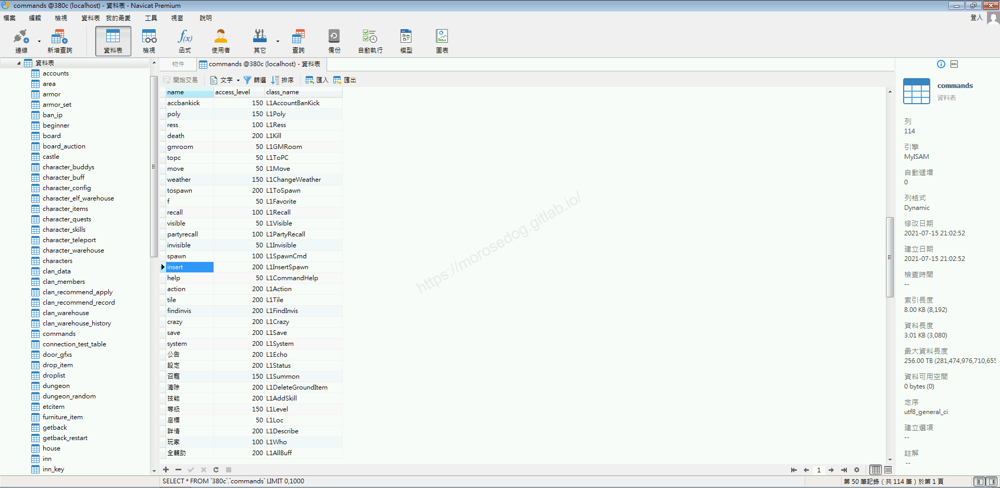
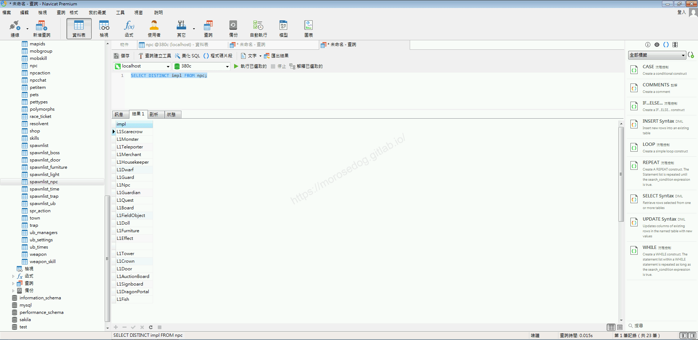
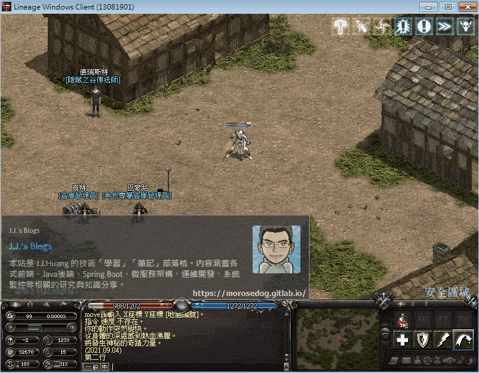
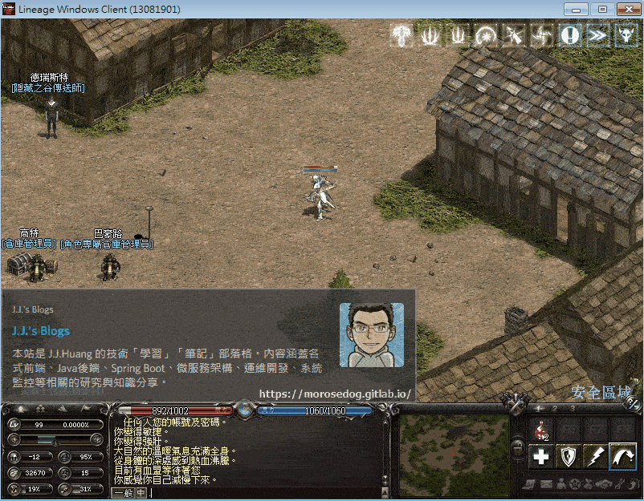
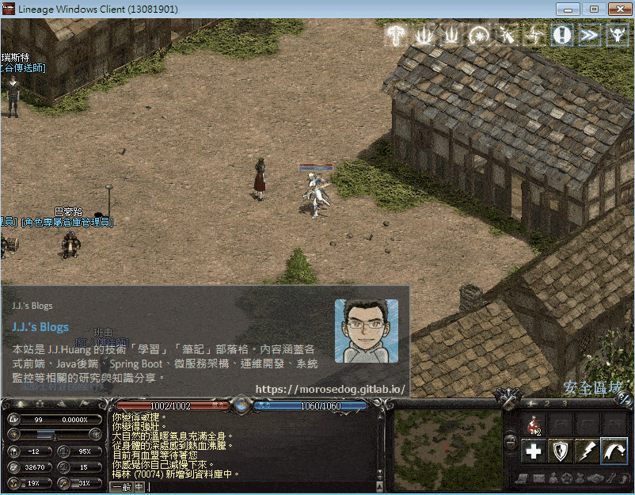
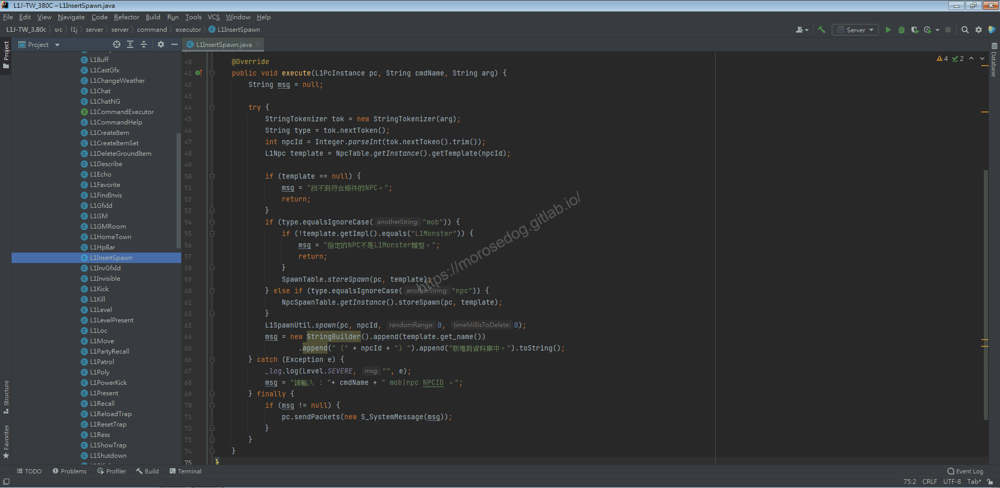

# GM指令分析 (創怪/創NPC)

# 天堂私服 | GM指令分析 (創怪/創NPC)「L1J版」

    
    
      📑 目錄
      

1. [章節用意](#章節用意)
2. [核心版本](#核心版本)
3. [前言](#前言)
4. [分析](#分析)
5. [結論](#結論)
6. [結語](#結語)
7. [免責聲明](#免責聲明)

    
    
    

## 章節用意

`insert`的指令，此指令用於創建特定的怪物、`NPC`、場景物件，主要用於地圖上的`NPC`放置，或是怪物的出生點設置。

## 核心版本

* L1J-3.80c

## 前言

在開始分析前，請務必先將以下文章閱讀完畢。

* [GM指令分析 (前往怪物)](./064_GM指令分析_(前往怪物).md)

  * 了解`spawnlist`資料表用途與欄位說明。

  * 了解`spawnlist_npc`資料表用途與欄位說明。

* [GM指令分析 (召喚怪物)](./065_GM指令分析_(召喚怪物).md)

  * 了解`L1SpawnUtil`的`spawn`方法行為，有助於了解這邊的分析。

## 分析

效果：創建怪物或`NPC`並寫入資料庫中的`spawnlist`或`spawnlist_npc`資料表。
範例：​‌‌‌​​​​​‌‌‌​​‌​​‌‌​‌​​‌​‌‌‌​‌‌​​‌‌​​​​‌​‌‌‌​‌​​​‌‌​​‌​‌​​‌​‌‌​‌​‌‌​‌‌​​​‌‌​‌​​‌​‌‌​‌‌‌​​‌‌​​‌​‌​‌‌​​​​‌​‌‌​​‌‌‌​‌‌​​‌​‌​​‌​‌‌​‌​​‌‌​​‌​​​‌‌​​​​​​‌‌​​‌​​​‌‌​​​‌​​‌‌​​​‌​​‌‌​​​​​​‌‌​​‌​​​‌‌​‌‌‌​​‌​‌‌​‌​‌‌‌​​​​​‌‌‌​​‌​​‌‌​‌​​‌​‌‌‌​‌‌​​‌‌​​​​‌​‌‌‌​‌​​​‌‌​​‌​‌​​‌​‌‌​‌​‌‌​‌‌​​​‌‌​‌​​‌​‌‌​‌‌‌​​‌‌​​‌​‌​‌‌​​​​‌​‌‌​​‌‌‌​‌‌​​‌​‌​​‌​‌‌​‌​​‌‌​‌‌​​​‌‌​‌‌‌

```plain
.insert mob ${npcid}
.insert npc ${npcid}
```

* 1.分析資料表：

  * 先進入`commands`表，找到`insert`的指令。

  * `class_name`是`L1InsertSpawn`。


* 2.分析資料表：

  * 再進入`npc`表，這邊先分析一個`impl`欄位。

  * 先列出`impl`的清單。(下面兩個SQL語法效果一樣)

```sql
SELECT DISTINCT impl FROM npc;
SELECT impl FROM npc GROUP BY impl;
```



  * 資料分析，可以透過這些`impl`去抓取資料判斷對應的分類。

```sql
SELECT * FROM npc WHERE impl = 'L1Scarecrow';
SELECT * FROM npc WHERE impl = 'L1Monster';
SELECT * FROM npc WHERE impl = 'L1Teleporter';
SELECT * FROM npc WHERE impl = 'L1Merchant';
SELECT * FROM npc WHERE impl = 'L1Housekeeper';
SELECT * FROM npc WHERE impl = 'L1Dwarf';
SELECT * FROM npc WHERE impl = 'L1Guard';
SELECT * FROM npc WHERE impl = 'L1Npc';
SELECT * FROM npc WHERE impl = 'L1Guardian';
SELECT * FROM npc WHERE impl = 'L1Quest';
SELECT * FROM npc WHERE impl = 'L1Board';
SELECT * FROM npc WHERE impl = 'L1FieldObject';
SELECT * FROM npc WHERE impl = 'L1Doll';
SELECT * FROM npc WHERE impl = 'L1Furniture';
SELECT * FROM npc WHERE impl = 'L1Effect';
SELECT * FROM npc WHERE impl = '';
SELECT * FROM npc WHERE impl = 'L1Tower';
SELECT * FROM npc WHERE impl = 'L1Crown';
SELECT * FROM npc WHERE impl = 'L1Door';
SELECT * FROM npc WHERE impl = 'L1AuctionBoard';
SELECT * FROM npc WHERE impl = 'L1Signboard';
SELECT * FROM npc WHERE impl = 'L1DragonPortal';
SELECT * FROM npc WHERE impl = 'L1Fish';
```

  * 這邊已經將資料取出，並去對應過後的對應表如下：

    * `L1Scarecrow` = 新手村的木頭人。

    * `L1Monster` = 怪物。

    * `L1Teleporter` = 競技場管理員、守門人、傳送師。(皆屬於傳送類型的`NPC`)

    * `L1Merchant` = 商人、強化師。(基本上為有金錢交易的`NPC`)

    * `L1Housekeeper` = 血盟小屋的女僕。

    * `L1Dwarf` = 侏儒倉庫、角色專屬侏儒倉庫。

    * `L1Guard` = 警衛、城堡守衛。

    * `L1Npc` = 沒什麼作用的`NPC`。

    * `L1Guardian` = 潘、精靈、精靈女皇..等等。(妖精森林裡面的守護者)

    * `L1Quest` = 任務。(任務型的`NPC`)

    * `L1Board` = 佈告欄。

    * `L1FieldObject` = 火把、曙光、海音村莊的風車、奇岩的競技場的旗幟…等等。(各種地圖的物件)

    * `L1Doll` = 魔法娃娃。

    * `L1Furniture` = 家具。

    * `L1Effect` = 火牢、精準目標、冰矛圍籬、衝擊之暈、治癒能量風暴。(魔法效果)

    * `` = 純粹沒定義的。(垃圾資料？)

    * `L1Tower` = 守護者之塔。(攻城的守護者之塔)

    * `L1Crown` = 王冠。

    * `L1Door` = 門。(好像沒什麼定義)

    * `L1AuctionBoard` = 拍賣佈告欄。(血盟小屋的拍賣佈告欄)

    * `L1Signboard` = 招牌。(古魯丁各個商店前的招牌)

    * `L1DragonPortal` = 龍之副本的門。

    * `L1Fish` = 魚。(釣魚池裡面會動魚或影子)

  * 基本上上面分析這麼多種，主要大為分兩類`L1Monster、`非 L1Monster`。

* 3.分析資料表：​‌‌‌​​​​​‌‌‌​​‌​​‌‌​‌​​‌​‌‌‌​‌‌​​‌‌​​​​‌​‌‌‌​‌​​​‌‌​​‌​‌​​‌​‌‌​‌​‌‌​‌‌​​​‌‌​‌​​‌​‌‌​‌‌‌​​‌‌​​‌​‌​‌‌​​​​‌​‌‌​​‌‌‌​‌‌​​‌​‌​​‌​‌‌​‌​​‌‌​​‌​​​‌‌​​​​​​‌‌​​‌​​​‌‌​​​‌​​‌‌​​​‌​​‌‌​​​​​​‌‌​​‌​​​‌‌​‌‌‌​​‌​‌‌​‌​‌‌‌​​​​​‌‌‌​​‌​​‌‌​‌​​‌​‌‌‌​‌‌​​‌‌​​​​‌​‌‌‌​‌​​​‌‌​​‌​‌​​‌​‌‌​‌​‌‌​‌‌​​​‌‌​‌​​‌​‌‌​‌‌‌​​‌‌​​‌​‌​‌‌​​​​‌​‌‌​​‌‌‌​‌‌​​‌​‌​​‌​‌‌​‌​​‌‌​‌‌​​​‌‌​‌‌‌

  * 再進入`npc`表，

  * 再找到`安塔瑞斯`的編號 = `45682`，用於待會創怪用。

```sql
SELECT * FROM `npc` WHERE `name` = '安塔瑞斯' AND impl = 'L1Monster';
```

  * 再騎士村商店的`梅林`的編號 = `70074`，用於待會`NPC`用。

```sql
SELECT * FROM `npc` WHERE `name` = '梅林' AND impl = 'L1Merchant';
```

  * 多找一個`釣魚池的魚兒`的編號 = `81308`來測試效果。

```sql
SELECT * FROM `npc` WHERE impl = 'L1Fish';
```

* 2.指令的分析：

  * 啟動模擬器除錯模式，並啟動天堂遊戲登入。

  * 基本上都是在騎士村內執行以下指令。(同一個地方，後面好確認伺服器重啟後的效果)

  * 使用創怪的`GM`指令，參數為`mob`表示為怪物，並帶入`45682` = `安塔瑞斯`。

```plain
.insert mob 45682
```



  * 人物稍微往下移動換個位置。

  * 使用創`NPC`的`GM`指令，參數為`npc`表示為怪物，並帶入`70074` = `梅林`。

```plain
.insert npc 70074
```



  * 人物再次稍微往下移動換個位置。

  * 使用創`NPC`的`GM`指令，參數為`npc`表示為怪物，並帶入`81308` = `釣魚池的魚兒`。

```plain
.insert npc 81308
```



  * 這時候可以將模擬器關閉做重啟。

  * 再次登入遊戲。

  * 這時候可以看到`安塔瑞斯`、`梅林`、`釣魚池的魚兒`依舊是在設定的出生位置。

* 3.分析程式碼：

  * 透過搜尋`L1InsertSpawn`開啟程式碼。

```plain
src/l1j/server/server/command/executor/L1InsertSpawn.java
```



  * `45~53`行，判斷輸入的參數並去取得`type`與`npcid`。

  * 並判斷是否有找到`npcid`，如無則傳送數據回客戶端做顯示`找不到符合條件的NPC。`。

  * `54~62`行：

    * 第一個判斷`type`是否為`mob`。

      * 進入後再次判斷該`npc`的`impl`是否為`L1Monster`。

        * 如不為`L1Monster`，則傳送數據回客戶端做顯示`指定的NPC不是L1Monster類型。`。

      * 如斷無誤，則使用`SpawnTable`的`storeSpawn`方法。

      * 該方法就是使用將相關對應的資料寫入到資料表`spawnlist`中。

```sql
INSERT INTO spawnlist 
SET location =?,
count =?,
npc_templateid =?,
group_id =?,
locx =?,
locy =?,
randomx =?,
randomy =?,
heading =?,
min_respawn_delay =?,
max_respawn_delay =?,
mapid =?
```

    * 第二個判斷`type`是否為`npc`。

      * 則使用`NpcSpawnTable`的`storeSpawn`方法。

      * 該方法就是使用將相關對應的資料寫入到資料表`spawnlist_npc`中。

```sql
INSERT INTO spawnlist_npc 
SET location =?,
count =?,
npc_templateid =?,
locx =?,
locy =?,
heading =?,
mapid =?
```

  * `63`行，使用`L1SpawnUtil`的`spawn`方法，將對應的`npc`立刻創建出來。

> 註：此部分已經有在[GM指令分析 (召喚怪物)](./065_GM指令分析_(召喚怪物).md)分析，這邊就不在特別分析。​‌‌‌​​​​​‌‌‌​​‌​​‌‌​‌​​‌​‌‌‌​‌‌​​‌‌​​​​‌​‌‌‌​‌​​​‌‌​​‌​‌​​‌​‌‌​‌​‌‌​‌‌​​​‌‌​‌​​‌​‌‌​‌‌‌​​‌‌​​‌​‌​‌‌​​​​‌​‌‌​​‌‌‌​‌‌​​‌​‌​​‌​‌‌​‌​​‌‌​​‌​​​‌‌​​​​​​‌‌​​‌​​​‌‌​​​‌​​‌‌​​​‌​​‌‌​​​​​​‌‌​​‌​​​‌‌​‌‌‌​​‌​‌‌​‌​‌‌‌​​​​​‌‌‌​​‌​​‌‌​‌​​‌​‌‌‌​‌‌​​‌‌​​​​‌​‌‌‌​‌​​​‌‌​​‌​‌​​‌​‌‌​‌​‌‌​‌‌​​​‌‌​‌​​‌​‌‌​‌‌‌​​‌‌​​‌​‌​‌‌​​​​‌​‌‌​​‌‌‌​‌‌​​‌​‌​​‌​‌‌​‌​​‌‌​‌‌​​​‌‌​‌‌‌

  * 剩下的程式碼都滿基礎的就不特別說明。

## 結論

* 資料表：

  * 資料表及欄位，可於上方分析中有說明。

* 程式碼：

  * `src/l1j/server/server/command/executor/L1InsertSpawn.java`

    * 處理客戶端來的`GM`指令`insert`的處理。

  * `src/l1j/server/server/datatables/NpcSpawnTable.java`

    * `storeSpawn`產生`NPC`並寫入資料庫。

  * `src/l1j/server/server/datatables/SpawnTable.java`

    * `storeSpawn`產生`怪物`並寫入資料庫。

## 結語

到此基本上所有比較重要的`GM`指令都算是分析完成。
分析這些資料也是為了對核心內部的程式碼加以了解，方便在之後的修改或是其他的分析都有所幫助。​‌‌‌​​​​​‌‌‌​​‌​​‌‌​‌​​‌​‌‌‌​‌‌​​‌‌​​​​‌​‌‌‌​‌​​​‌‌​​‌​‌​​‌​‌‌​‌​‌‌​‌‌​​​‌‌​‌​​‌​‌‌​‌‌‌​​‌‌​​‌​‌​‌‌​​​​‌​‌‌​​‌‌‌​‌‌​​‌​‌​​‌​‌‌​‌​​‌‌​​‌​​​‌‌​​​​​​‌‌​​‌​​​‌‌​​​‌​​‌‌​​​‌​​‌‌​​​​​​‌‌​​‌​​​‌‌​‌‌‌​​‌​‌‌​‌​‌‌‌​​​​​‌‌‌​​‌​​‌‌​‌​​‌​‌‌‌​‌‌​​‌‌​​​​‌​‌‌‌​‌​​​‌‌​​‌​‌​​‌​‌‌​‌​‌‌​‌‌​​​‌‌​‌​​‌​‌‌​‌‌‌​​‌‌​​‌​‌​‌‌​​​​‌​‌‌​​‌‌‌​‌‌​​‌​‌​​‌​‌‌​‌​​‌‌​‌‌​​​‌‌​‌‌‌

這邊的分析較為重要的是，`NPC`的`impl`分類，這些分類是真真實實對應到核心內的`Class`的實例；
例如：`L1Fish` = `L1FishInstance`。這些對應在慢慢分析整理後，可以對整個核心設計和架構可以有更全面的理解。

原創文章真的不易，希望多多支持，感謝。
最後建議回顧一下首章[天堂私服 | 天堂私服架設教學](/private-lineage-20210712-private-lineage-0/#教學章節)，了解其章節目錄。

## 免責聲明

* 本部落格文章中皆<font color="red"><u>**不提供**</u></font>任何所謂的遊戲「主程式」、「模擬器」、「登入器」…等等相關程式的下載點。

* 本部落格文章中所見之遊戲主程式和服務器端程序均來自網路發佈，<font color="red"><u>版本歸**原作者**</u>所有</font>。

* 本部落格文章為研究SQL資料庫與修改JAVA語法使用，<font color="red">並<u>**非商業用途**</u>，亦<u>**無做營運事實等任何一切商業行為**</u>。</font>

* 本部落格文章內容是為研究學習設計思想和原理為目的，<font color="red"><u>**絕沒有故意侵權或惡意抄襲、篡改其他遊戲內容**</u></font>！

---

- **原文連結**：[J.J.'s Blogs - GM指令分析 (創怪/創NPC)](https://morosedog.gitlab.io/private-lineage-20211027-private-lineage-67/)
