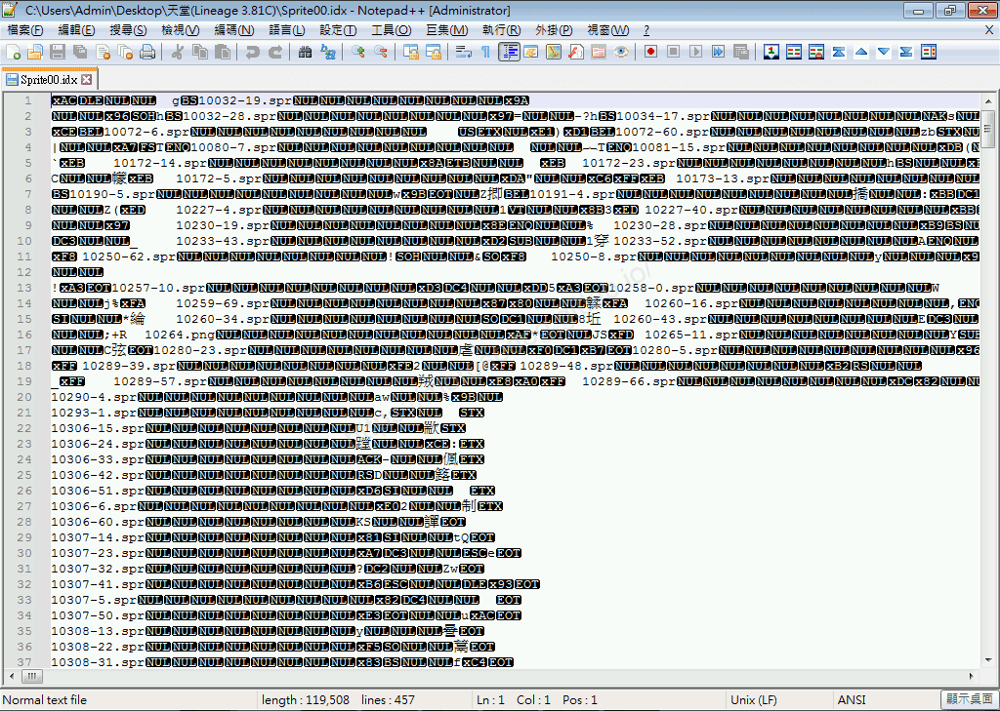
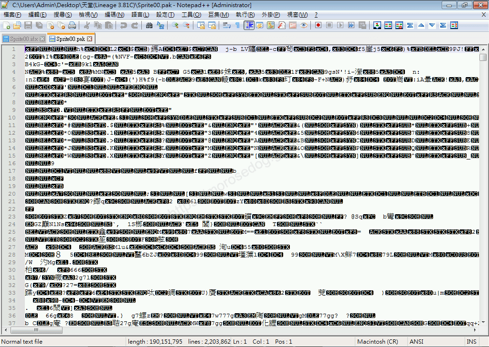
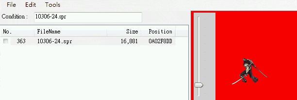
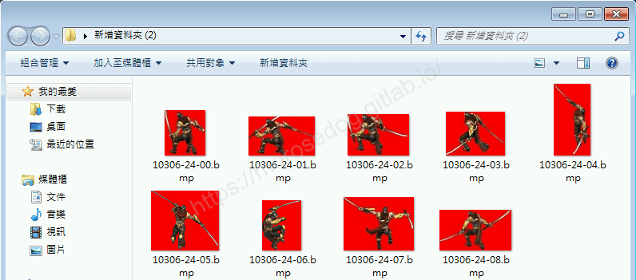

# 客戶端idx、pak說明

# 天堂私服 | 客戶端idx、pak說明

    
    
      📑 目錄
      

1. [章節用意](#章節用意)
2. [客戶端版本](#客戶端版本)
3. [前言](#前言)
4. [什麼是 idx 與 pak ?](#什麼是-idx-與-pak)
5. [結語](#結語)
6. [免責聲明](#免責聲明)

    
    
    

## 章節用意

此章節會針對`idx`、`pak`檔做簡單的介紹，讓在修改客戶端的變身、道具、對話…等等前有一個初步的了解。

## 客戶端版本

* 天堂(Lineage 3.81C)

## 前言

如果只是想要快速學習怎麼修改天堂變身，建議先打消此念頭，因為變身檔的修改，並不是單純的對程式碼、資料庫加加減減這樣去做調整。
需要對各種檔、各種位置、各個編碼指令、圖片張數、編碼用意…等等太多東西要先理解後再進行修改，不然將會受到很大挫折…。

建議一步一腳印，慢慢學習慢慢實作，最後再不斷的嘗試過後才能有所獲。​‌‌‌​​​​​‌‌‌​​‌​​‌‌​‌​​‌​‌‌‌​‌‌​​‌‌​​​​‌​‌‌‌​‌​​​‌‌​​‌​‌​​‌​‌‌​‌​‌‌​‌‌​​​‌‌​‌​​‌​‌‌​‌‌‌​​‌‌​​‌​‌​‌‌​​​​‌​‌‌​​‌‌‌​‌‌​​‌​‌​​‌​‌‌​‌​​‌‌​​‌​​​‌‌​​​​​​‌‌​​‌​​​‌‌​​‌​​​‌‌​​​​​​‌‌​​‌​​​‌‌​​​​​​‌‌​​​‌​​‌​‌‌​‌​‌‌‌​​​​​‌‌‌​​‌​​‌‌​‌​​‌​‌‌‌​‌‌​​‌‌​​​​‌​‌‌‌​‌​​​‌‌​​‌​‌​​‌​‌‌​‌​‌‌​‌‌​​​‌‌​‌​​‌​‌‌​‌‌‌​​‌‌​​‌​‌​‌‌​​​​‌​‌‌​​‌‌‌​‌‌​​‌​‌​​‌​‌‌​‌​​‌‌​‌‌​​​‌‌‌​​​

> 註：切記不要想一步登天…不然你想找人教，也不知道該怎麼問出一個比較好的問題。

另外以下說明可能並不是非常正確的，因為我也在自行分析學習中，所以只是做一個自己理解的簡單說明。
<如有錯誤或是可以提供更詳細的說明，歡迎糾正與分享。>

## 什麼是 idx 與 pak ?

* **idx**​‌‌‌​​​​​‌‌‌​​‌​​‌‌​‌​​‌​‌‌‌​‌‌​​‌‌​​​​‌​‌‌‌​‌​​​‌‌​​‌​‌​​‌​‌‌​‌​‌‌​‌‌​​​‌‌​‌​​‌​‌‌​‌‌‌​​‌‌​​‌​‌​‌‌​​​​‌​‌‌​​‌‌‌​‌‌​​‌​‌​​‌​‌‌​‌​​‌‌​​‌​​​‌‌​​​​​​‌‌​​‌​​​‌‌​​‌​​​‌‌​​​​​​‌‌​​‌​​​‌‌​​​​​​‌‌​​​‌​​‌​‌‌​‌​‌‌‌​​​​​‌‌‌​​‌​​‌‌​‌​​‌​‌‌‌​‌‌​​‌‌​​​​‌​‌‌‌​‌​​​‌‌​​‌​‌​​‌​‌‌​‌​‌‌​‌‌​​​‌‌​‌​​‌​‌‌​‌‌‌​​‌‌​​‌​‌​‌‌​​​​‌​‌‌​​‌‌‌​‌‌​​‌​‌​​‌​‌‌​‌​​‌‌​‌‌​​​‌‌‌​​​

  * 1. 網路上搜尋會找到說是類似影片的字幕所使用的檔，但是搜尋wiki後，有一句話比較正確「`IDX file extension, stores an index of files used by various programs`」，翻譯後為「IDX文件擴展名，存儲各種程序使用的文件索引」。

> 註：[IDX](https://en.wikipedia.org/wiki/IDX)

  * 1. 此初步定義為類似`index`的一個目錄清單檔。

> 註：索引( index )有點像是書的目錄一般，可以快速地翻到內容所在的位置，建立索引是為了在茫茫資料中，找到特定的值與欄位，如果沒有索引，資料庫將會從頭掃描到尾，一直到找尋到符合目標為止，一旦表中的資料量增加，搜尋的速度就會越慢，效能就會越差，因此一張好的資料表要有相對應的索引來幫助搜尋。

  * 1. 透過文字編輯器直接開啟，可以看到有編號和附檔名的清單`10306-24.spr        蹚  ?`。

* **pak**​‌‌‌​​​​​‌‌‌​​‌​​‌‌​‌​​‌​‌‌‌​‌‌​​‌‌​​​​‌​‌‌‌​‌​​​‌‌​​‌​‌​​‌​‌‌​‌​‌‌​‌‌​​​‌‌​‌​​‌​‌‌​‌‌‌​​‌‌​​‌​‌​‌‌​​​​‌​‌‌​​‌‌‌​‌‌​​‌​‌​​‌​‌‌​‌​​‌‌​​‌​​​‌‌​​​​​​‌‌​​‌​​​‌‌​​‌​​​‌‌​​​​​​‌‌​​‌​​​‌‌​​​​​​‌‌​​​‌​​‌​‌‌​‌​‌‌‌​​​​​‌‌‌​​‌​​‌‌​‌​​‌​‌‌‌​‌‌​​‌‌​​​​‌​‌‌‌​‌​​​‌‌​​‌​‌​​‌​‌‌​‌​‌‌​‌‌​​​‌‌​‌​​‌​‌‌​‌‌‌​​‌‌​​‌​‌​‌‌​​​​‌​‌‌​​‌‌‌​‌‌​​‌​‌​​‌​‌‌​‌​​‌‌​‌‌​​​‌‌‌​​​

  * 1. 網路上搜尋會找到較為關鍵的說明是一種壓縮技術，用於壓縮聲音、地圖、3D模型、材質貼圖等文件是按着保留目錄路徑結構的方式壓縮入。

> 註：[PAK](https://baike.baidu.hk/item/pak/7584518)

  * 1. 此初步定義為客戶端內要使用的所有聲音、圖檔…等等的壓縮包。

> 註： 客戶中所要調用的圖片都是透過這些pak去取得。

  * 1. 透過文字編輯器直接開啟，是無法看出是什麼東西，是因為該檔已經被壓縮處理過，無法直接打開。

  * 1. 透過網路上提供的工具開啟，可以發現`10306-24.spr`是一張動態圖方式呈現，如果將其匯出將得到九張圖片。

至此或許還是滿頭問號，請繼續往下面繼續閱讀學習，當有發現有所理解後，在返回此處重新閱讀一次，將會有更進一步的理解。​‌‌‌​​​​​‌‌‌​​‌​​‌‌​‌​​‌​‌‌‌​‌‌​​‌‌​​​​‌​‌‌‌​‌​​​‌‌​​‌​‌​​‌​‌‌​‌​‌‌​‌‌​​​‌‌​‌​​‌​‌‌​‌‌‌​​‌‌​​‌​‌​‌‌​​​​‌​‌‌​​‌‌‌​‌‌​​‌​‌​​‌​‌‌​‌​​‌‌​​‌​​​‌‌​​​​​​‌‌​​‌​​​‌‌​​‌​​​‌‌​​​​​​‌‌​​‌​​​‌‌​​​​​​‌‌​​​‌​​‌​‌‌​‌​‌‌‌​​​​​‌‌‌​​‌​​‌‌​‌​​‌​‌‌‌​‌‌​​‌‌​​​​‌​‌‌‌​‌​​​‌‌​​‌​‌​​‌​‌‌​‌​‌‌​‌‌​​​‌‌​‌​​‌​‌‌​‌‌‌​​‌‌​​‌​‌​‌‌​​​​‌​‌‌​​‌‌‌​‌‌​​‌​‌​​‌​‌‌​‌​​‌‌​‌‌​​​‌‌‌​​​

---

先讓我們看看客戶端底下擁有哪些`idx`與`pak`檔，並大概標示其用途：

> 部份檔並不是非常肯定其用途，所以在說明前方輸入`?`表示為`不確定`。

pak
idx
說明

launcher-c.Pak
X
?啟動時客戶端主程式用於..暫時不知。

launcher.Pak
X
?啟動時客戶端主程式需用於..暫時不知。

litolauncher-c.pak
X
?啟動時客戶端無界擂台主程式需用於..暫時不知。

以上三個檔，大致上可以猜測為當客戶端起動的時候，需要取得的一些資訊或是檔的壓縮檔。
透過網路搜尋有提到不同國家版本的`launcher.Pak`內容是不一樣，所以可以假設為各個版本啟動時候所需的`pak`。​‌‌‌​​​​​‌‌‌​​‌​​‌‌​‌​​‌​‌‌‌​‌‌​​‌‌​​​​‌​‌‌‌​‌​​​‌‌​​‌​‌​​‌​‌‌​‌​‌‌​‌‌​​​‌‌​‌​​‌​‌‌​‌‌‌​​‌‌​​‌​‌​‌‌​​​​‌​‌‌​​‌‌‌​‌‌​​‌​‌​​‌​‌‌​‌​​‌‌​​‌​​​‌‌​​​​​​‌‌​​‌​​​‌‌​​‌​​​‌‌​​​​​​‌‌​​‌​​​‌‌​​​​​​‌‌​​​‌​​‌​‌‌​‌​‌‌‌​​​​​‌‌‌​​‌​​‌‌​‌​​‌​‌‌‌​‌‌​​‌‌​​​​‌​‌‌‌​‌​​​‌‌​​‌​‌​​‌​‌‌​‌​‌‌​‌‌​​​‌‌​‌​​‌​‌‌​‌‌‌​​‌‌​​‌​‌​‌‌​​​​‌​‌‌​​‌‌‌​‌‌​​‌​‌​​‌​‌‌​‌​​‌‌​‌‌​​​‌‌‌​​​

---

pak
idx
說明

LTicon.pak
LTicon.idx
?無界擂台所使用的`icon`。

LTsprite.pak
LTsprite.idx
?無界擂台所使用的`動態檔(*.spr)`、道具,魔法,狀態圖(*.tbt)、*.png、*.img…等等。。

LTsurf.pak
LTsurf.idx
?無界擂台所使用的介面圖片，例如遊戲介面的血條，人物選單的人物動畫等等(*.img)…等等。

LTtext.pak
LTtext.idx
?無界擂台所使用的`對話檔(*.html)`、`純文字(*.txt)`、`變身清單檔(list.spr)`…等等。

LTtile.pak
LTtile.idx
?無界擂台所使用的地圖區塊材質檔(*.til)。

以上這些檔案會於客戶端內的`LiTo`資料夾內，初步斷定為`無界擂台`內所使用。

---

pak
idx
說明

Sprite.pak
Sprite.idx
客戶端所使用的`動態檔(*.spr)`、`道具,魔法,狀態圖(*.tbt)`、`*.png`、`*.img`…等等。

Sprite00.pak
Sprite00.idx
同上。

Sprite01.pak
Sprite01.idx
同上。

Sprite02.pak
Sprite02.idx
同上。

Sprite03.pak
Sprite03.idx
同上。

Sprite04.pak
Sprite04.idx
同上。

Sprite05.pak
Sprite05.idx
同上。

Sprite06.pak
Sprite06.idx
同上。

Sprite07.pak
Sprite07.idx
同上。

Sprite08.pak
Sprite08.idx
同上。

Sprite09.pak
Sprite09.idx
同上。

Sprite10.pak
Sprite10.idx
同上。

Sprite11.pak
Sprite11.idx
同上。

Sprite12.pak
Sprite12.idx
同上。

Sprite13.pak
Sprite13.idx
同上。

Sprite14.pak
Sprite14.idx
同上。

Sprite15.pak
Sprite15.idx
同上。

Text.pak
Text.idx
客戶端所使用的`對話檔(*.html)`、`表資料檔(*.tbl)`、`變身清單檔(list.spr、list.spz)`…等等。

Tile.pak
Tile.idx
客戶端所使用的地圖區塊材質檔(*.til)。

TW13081901.pak
X
?此暫時不是很肯定用途，應該是配合登入器使用自定的變身檔用的，後續會補上。

以上這些檔案會於客戶端跟目錄下找到，可以發現`idx`與`pak`基本上都是成雙成對的；
這邊猜測客戶端要調用`pak`裡面的內容，就是透過`idx`去尋找的。

---

* 為何會有這麼多個`Sprite`檔，並用數字區分？​‌‌‌​​​​​‌‌‌​​‌​​‌‌​‌​​‌​‌‌‌​‌‌​​‌‌​​​​‌​‌‌‌​‌​​​‌‌​​‌​‌​​‌​‌‌​‌​‌‌​‌‌​​​‌‌​‌​​‌​‌‌​‌‌‌​​‌‌​​‌​‌​‌‌​​​​‌​‌‌​​‌‌‌​‌‌​​‌​‌​​‌​‌‌​‌​​‌‌​​‌​​​‌‌​​​​​​‌‌​​‌​​​‌‌​​‌​​​‌‌​​​​​​‌‌​​‌​​​‌‌​​​​​​‌‌​​​‌​​‌​‌‌​‌​‌‌‌​​​​​‌‌‌​​‌​​‌‌​‌​​‌​‌‌‌​‌‌​​‌‌​​​​‌​‌‌‌​‌​​​‌‌​​‌​‌​​‌​‌‌​‌​‌‌​‌‌​​​‌‌​‌​​‌​‌‌​‌‌‌​​‌‌​​‌​‌​‌‌​​​​‌​‌‌​​‌‌‌​‌‌​​‌​‌​​‌​‌‌​‌​​‌‌​‌‌​​​‌‌‌​​​

* 這些區分是怎麼判別的？

  * 以上兩個問題，目前我沒有好的解答，基本上跟客戶端版本和`eat.exe`吃檔的行為有關吧？！

> 註：要是有機會再找時間去反解`eat.exe`或有人有提供原始碼可以參考，或許能找到答案。

* `pak`內提到的其他副檔名是什麼呢？  ​‌‌‌​​​​​‌‌‌​​‌​​‌‌​‌​​‌​‌‌‌​‌‌​​‌‌​​​​‌​‌‌‌​‌​​​‌‌​​‌​‌​​‌​‌‌​‌​‌‌​‌‌​​​‌‌​‌​​‌​‌‌​‌‌‌​​‌‌​​‌​‌​‌‌​​​​‌​‌‌​​‌‌‌​‌‌​​‌​‌​​‌​‌‌​‌​​‌‌​​‌​​​‌‌​​​​​​‌‌​​‌​​​‌‌​​‌​​​‌‌​​​​​​‌‌​​‌​​​‌‌​​​​​​‌‌​​​‌​​‌​‌‌​‌​‌‌‌​​​​​‌‌‌​​‌​​‌‌​‌​​‌​‌‌‌​‌‌​​‌‌​​​​‌​‌‌‌​‌​​​‌‌​​‌​‌​​‌​‌‌​‌​‌‌​‌‌​​​‌‌​‌​​‌​‌‌​‌‌‌​​‌‌​​‌​‌​‌‌​​​​‌​‌‌​​‌‌‌​‌‌​​‌​‌​​‌​‌‌​‌​​‌‌​‌‌​​​‌‌‌​​​

  * 這些將會在下一個章節稍微搭配一下遊戲內容與圖片做說明。

## 結語

此篇文章花費了我”數小時”自行研究才整理出一些東西，讓大家對`idx`與`pak`有一個基礎的了解，
並且在稍微說明`pak`內的一些內容。

再次先說聲抱歉，以上有很多的東西都還沒有說明或是解答，是小弟不才能力不足，待後續有時間慢慢研究後有其解答後，必定會再補充文章。

只能說真的不好整理這塊的教學文章，希望對自己與新手們有所幫助。​‌‌‌​​​​​‌‌‌​​‌​​‌‌​‌​​‌​‌‌‌​‌‌​​‌‌​​​​‌​‌‌‌​‌​​​‌‌​​‌​‌​​‌​‌‌​‌​‌‌​‌‌​​​‌‌​‌​​‌​‌‌​‌‌‌​​‌‌​​‌​‌​‌‌​​​​‌​‌‌​​‌‌‌​‌‌​​‌​‌​​‌​‌‌​‌​​‌‌​​‌​​​‌‌​​​​​​‌‌​​‌​​​‌‌​​‌​​​‌‌​​​​​​‌‌​​‌​​​‌‌​​​​​​‌‌​​​‌​​‌​‌‌​‌​‌‌‌​​​​​‌‌‌​​‌​​‌‌​‌​​‌​‌‌‌​‌‌​​‌‌​​​​‌​‌‌‌​‌​​​‌‌​​‌​‌​​‌​‌‌​‌​‌‌​‌‌​​​‌‌​‌​​‌​‌‌​‌‌‌​​‌‌​​‌​‌​‌‌​​​​‌​‌‌​​‌‌‌​‌‌​​‌​‌​​‌​‌‌​‌​​‌‌​‌‌​​​‌‌‌​​​

原創文章真的不易，希望多多支持，感謝。
最後建議回顧一下首章[天堂私服 | 天堂私服架設教學](/private-lineage-20210712-private-lineage-0/#教學章節)，了解其章節目錄。

## 免責聲明

* 本部落格文章中皆<u>**不提供**</u>任何所謂的遊戲「主程式」、「模擬器」、「登入器」…等等相關程式的下載點。

* 本部落格文章中所見之遊戲主程式和服務器端程序均來自網路發佈，<u>版本歸**原作者**</u>所有。

* 本部落格文章為研究SQL資料庫與修改JAVA語法使用，並<u>**非商業用途**</u>，亦<u>**無做營運事實等任何一切商業行為**</u>。

* 本部落格文章內容是為研究學習設計思想和原理為目的，<u>**絕沒有故意侵權或惡意抄襲、篡改其他遊戲內容**</u>！

---

- **原文連結**：[J.J.'s Blogs - 客戶端idx、pak說明](https://morosedog.gitlab.io/private-lineage-20220201-private-lineage-68/)
