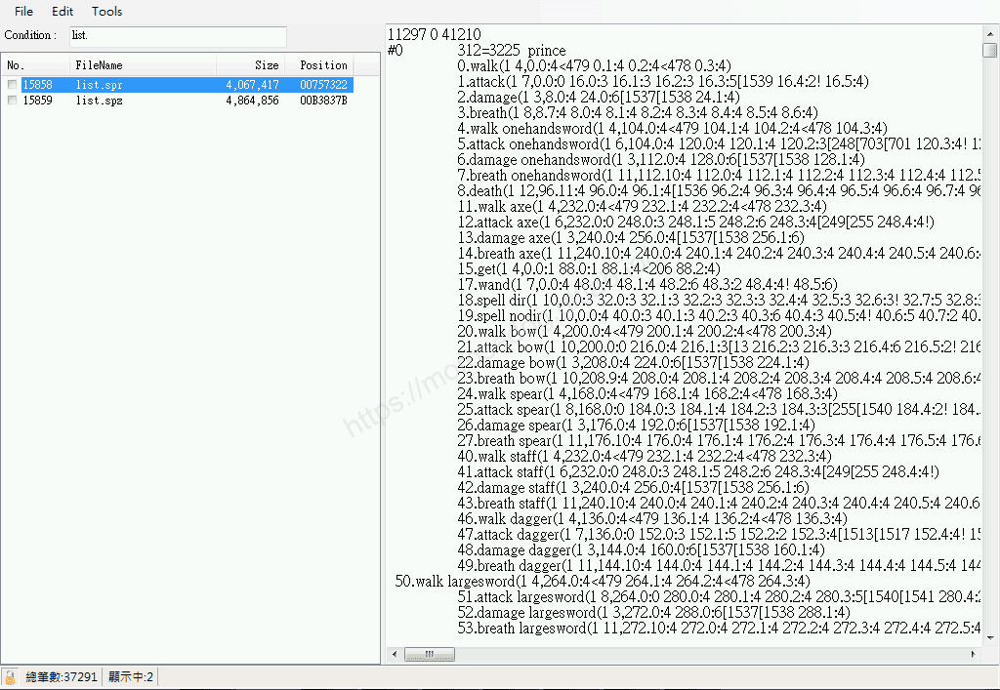
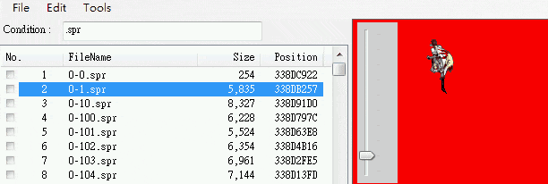
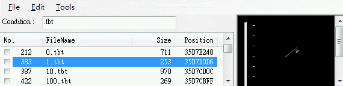
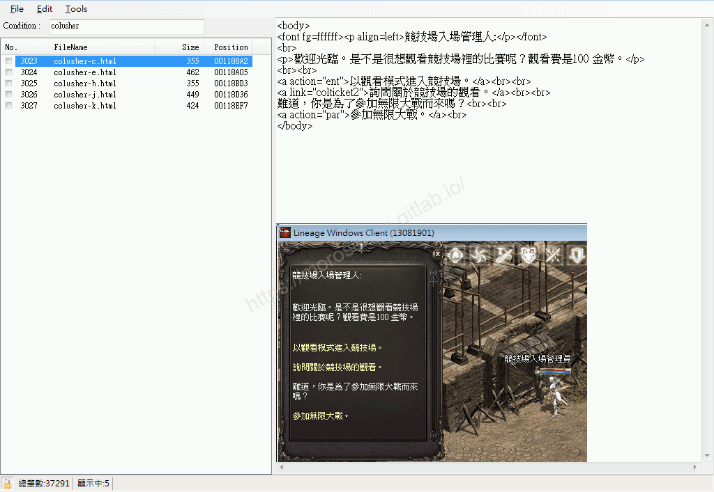
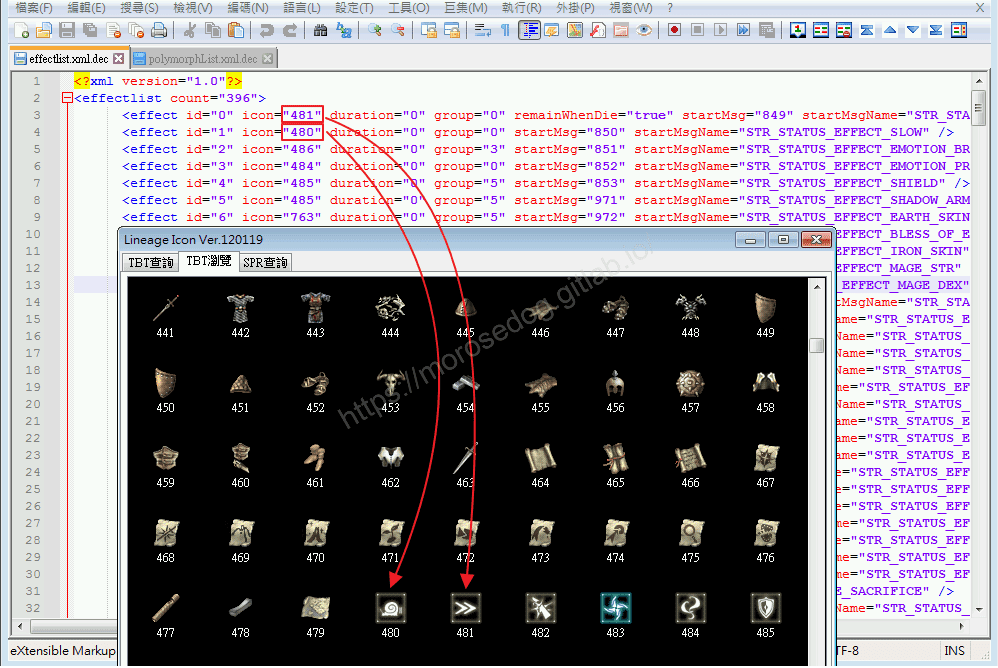
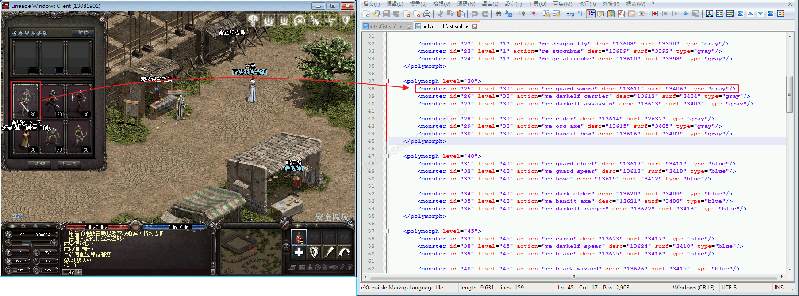
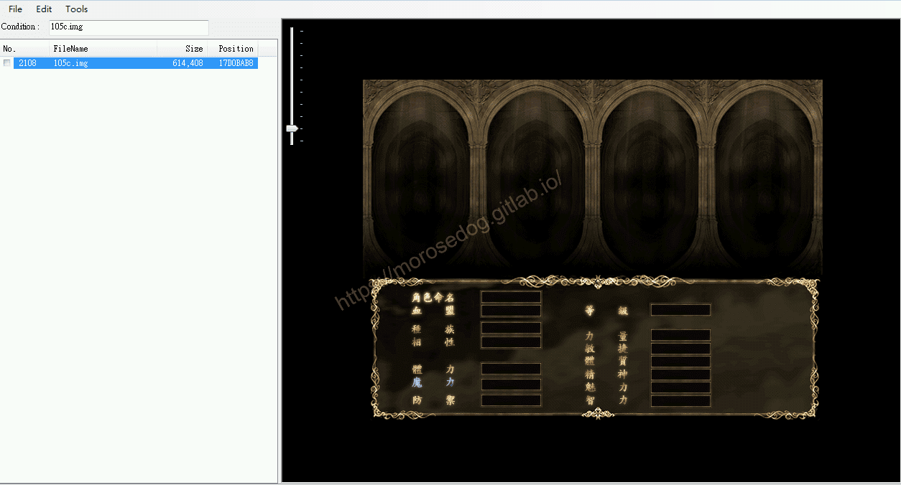
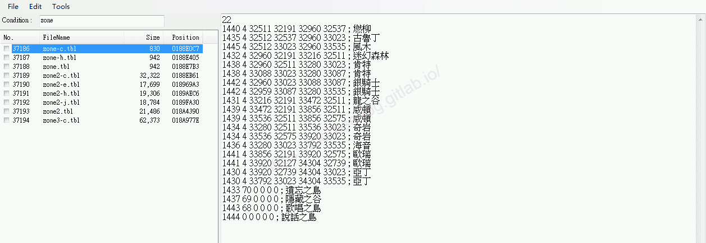
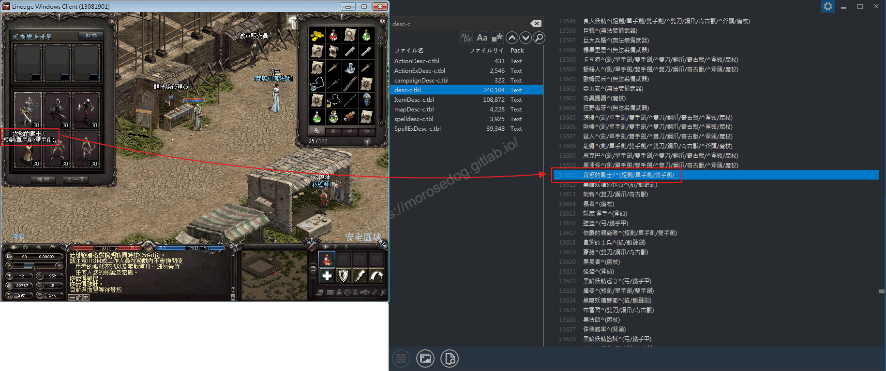

# 補丁副檔名對應說明

# 天堂私服 | 補丁副檔名對應說明

    
    
      📑 目錄
      

1. [章節用意](#章節用意)
2. [客戶端版本](#客戶端版本)
3. [前言](#前言)
4. [常見的各種格式說明](#常見的各種格式說明)
5. [結語](#結語)
6. [免責聲明](#免責聲明)

    
    
    

## 章節用意

此章節會針對`idx`、`pak`檔做簡單的介紹，讓在修改客戶端的變身、道具、對話…等等前有一個初步的了解。

## 客戶端版本

* 天堂(Lineage 3.81C)

## 前言

在開始分析前，請務必先將以下文章閱讀完畢。

* [客戶端idx、pak說明](./068_客戶端idx_pak說明.md)

  * 了解`idx`與`pak`檔。

  * 了解`pak`檔內壓縮了哪些檔。

另外以下說明可能並不是非常正確的，因為我也在自行分析學習中，所以只是做一個自己理解的簡單說明。
<font color="red"><如有錯誤或是可以提供更詳細的說明，歡迎糾正與分享。></font>​‌‌‌​​​​​‌‌‌​​‌​​‌‌​‌​​‌​‌‌‌​‌‌​​‌‌​​​​‌​‌‌‌​‌​​​‌‌​​‌​‌​​‌​‌‌​‌​‌‌​‌‌​​​‌‌​‌​​‌​‌‌​‌‌‌​​‌‌​​‌​‌​‌‌​​​​‌​‌‌​​‌‌‌​‌‌​​‌​‌​​‌​‌‌​‌​​‌‌​​‌​​​‌‌​​​​​​‌‌​​‌​​​‌‌​​‌​​​‌‌​​​​​​‌‌​​‌​​​‌‌​​​​​​‌‌​​‌​​​‌​‌‌​‌​‌‌‌​​​​​‌‌‌​​‌​​‌‌​‌​​‌​‌‌‌​‌‌​​‌‌​​​​‌​‌‌‌​‌​​​‌‌​​‌​‌​​‌​‌‌​‌​‌‌​‌‌​​​‌‌​‌​​‌​‌‌​‌‌‌​​‌‌​​‌​‌​‌‌​​​​‌​‌‌​​‌‌‌​‌‌​​‌​‌​​‌​‌‌​‌​​‌‌​‌‌​​​‌‌‌​​‌

## 常見的各種格式說明

於前一章有提到`pak`內包含了多種檔案格式的檔案，他們的內容或是呈現是什麼，實在太過抽象，對於新手們來說根本無法想像。
以下提供幾個比較重要且需要知道的檔案，盡量提供一些畫面和簡單舉例說明：

* **list.spr、list.spz**

  * 說明：大家最關心的變身檔如何修改，此檔裡面有針對每個變身的一系列動作做定義對應的圖片、張數，例如：攻擊、拿劍攻擊動作、拿弓呼吸…等等。

  * 舉例：`52死亡騎士`修改變成`素還真`，就需要將裡面對應的圖片代碼做更換…。

> 註：`list.spz`為加密過的變身檔。
> ​‌‌‌​​​​​‌‌‌​​‌​​‌‌​‌​​‌​‌‌‌​‌‌​​‌‌​​​​‌​‌‌‌​‌​​​‌‌​​‌​‌​​‌​‌‌​‌​‌‌​‌‌​​​‌‌​‌​​‌​‌‌​‌‌‌​​‌‌​​‌​‌​‌‌​​​​‌​‌‌​​‌‌‌​‌‌​​‌​‌​​‌​‌‌​‌​​‌‌​​‌​​​‌‌​​​​​​‌‌​​‌​​​‌‌​​‌​​​‌‌​​​​​​‌‌​​‌​​​‌‌​​​​​​‌‌​​‌​​​‌​‌‌​‌​‌‌‌​​​​​‌‌‌​​‌​​‌‌​‌​​‌​‌‌‌​‌‌​​‌‌​​​​‌​‌‌‌​‌​​​‌‌​​‌​‌​​‌​‌‌​‌​‌‌​‌‌​​​‌‌​‌​​‌​‌‌​‌‌‌​​‌‌​​‌​‌​‌‌​​​​‌​‌‌​​‌‌‌​‌‌​​‌​‌​​‌​‌‌​‌​​‌‌​‌‌​​​‌‌‌​​‌

* ***.spr**

  * 說明：每一個代表一個動畫、一個圖片。

  * 舉例：攻擊的動畫、施放魔法的動畫、影子的動畫…等等。


* **list.ico**

  * 說明：內容為數字，代表的是讓天堂客戶端顯示到編號多少的道具編碼。

  * 舉例：如果是`3000`就是顯示到編號`3000`的道具圖，`3001`以上的編碼會顯示不出，甚至變成錯誤訊息。

* ***.tbt**​‌‌‌​​​​​‌‌‌​​‌​​‌‌​‌​​‌​‌‌‌​‌‌​​‌‌​​​​‌​‌‌‌​‌​​​‌‌​​‌​‌​​‌​‌‌​‌​‌‌​‌‌​​​‌‌​‌​​‌​‌‌​‌‌‌​​‌‌​​‌​‌​‌‌​​​​‌​‌‌​​‌‌‌​‌‌​​‌​‌​​‌​‌‌​‌​​‌‌​​‌​​​‌‌​​​​​​‌‌​​‌​​​‌‌​​‌​​​‌‌​​​​​​‌‌​​‌​​​‌‌​​​​​​‌‌​​‌​​​‌​‌‌​‌​‌‌‌​​​​​‌‌‌​​‌​​‌‌​‌​​‌​‌‌‌​‌‌​​‌‌​​​​‌​‌‌‌​‌​​​‌‌​​‌​‌​​‌​‌‌​‌​‌‌​‌‌​​​‌‌​‌​​‌​‌‌​‌‌‌​​‌‌​​‌​‌​‌‌​​​​‌​‌‌​​‌‌‌​‌‌​​‌​‌​​‌​‌‌​‌​​‌‌​‌‌​​​‌‌‌​​‌

  * 說明：遊戲中的道具圖、魔法圖、人物狀態圖…等等。

  * 舉例：斧的`invgfx = 1`，找尋`0.tbt`、皮甲的`invgfx = 10`，找尋`10.tbt`。

```sql
SELECT invgfx FROM weapon WHERE `name` LIKE '斧'
-- get invgfx = 1
SELECT invgfx FROM armor WHERE `name` LIKE '皮甲'
-- get invgfx = 10
```

> 註：關於魔法圖、人物狀態圖，尚未找到”完整”對應其代碼的方法，所以這邊就不特別說明，圖示還是可以慢慢找到對應的`tbt`，輔助狀態可以參考`effectlist.xml`檔。
> 

* ***.html**

  * 說明：遊戲中的相關對話檔，是透過`.html`的方式去呈現還有伺服器互動動作(action)。

  * 舉例：競技場入場管理員的對話內容。此處秀出`colusher.html`的內容。(圖片下方為遊戲內畫面，方便比對)

```sql
SELECT npcid FROM `npc` where `name` like '競技場入場管理員'
-- get npcid = 50019
SELECT normal_action FROM npcaction WHERE npcid = '50019'
-- get colusher
```



* ***.xml**​‌‌‌​​​​​‌‌‌​​‌​​‌‌​‌​​‌​‌‌‌​‌‌​​‌‌​​​​‌​‌‌‌​‌​​​‌‌​​‌​‌​​‌​‌‌​‌​‌‌​‌‌​​​‌‌​‌​​‌​‌‌​‌‌‌​​‌‌​​‌​‌​‌‌​​​​‌​‌‌​​‌‌‌​‌‌​​‌​‌​​‌​‌‌​‌​​‌‌​​‌​​​‌‌​​​​​​‌‌​​‌​​​‌‌​​‌​​​‌‌​​​​​​‌‌​​‌​​​‌‌​​​​​​‌‌​​‌​​​‌​‌‌​‌​‌‌‌​​​​​‌‌‌​​‌​​‌‌​‌​​‌​‌‌‌​‌‌​​‌‌​​​​‌​‌‌‌​‌​​​‌‌​​‌​‌​​‌​‌‌​‌​‌‌​‌‌​​​‌‌​‌​​‌​‌‌​‌‌‌​​‌‌​​‌​‌​‌‌​​​​‌​‌‌​​‌‌‌​‌‌​​‌​‌​​‌​‌‌​‌​​‌‌​‌‌​​​‌‌‌​​‌

  * 說明：客戶端的一些設定檔。

  * 舉例：`effectlist.xml`輔助狀態圖的對應設定。


  * 舉例：`polymorphlist.xml`變身清單的設定。


* ***.img**

  * 說明：一些介面的圖片、背景圖、按鈕圖…等等，例如遊戲介面的血條，人物選單的人物動畫等等。

  * 舉例：選擇人物的介面。


* ***.tbl**

  * 說明：一些客戶端在顯示的句子描述。

  * 舉例：例如遊戲畫面中左下角的地圖描述。


  * 舉例：變身清單中的變身描述。


還有很多的副檔沒有說明，有一些是我不知道用途，有一些是我沒去解碼…建議大家自己摸摸看會比較有所得。
另外上面的一些舉例，可能舉例的檔案或是內容，可能不一定是完全正確，還請後面學習到工具使用後，再多多嘗試修改看看。​‌‌‌​​​​​‌‌‌​​‌​​‌‌​‌​​‌​‌‌‌​‌‌​​‌‌​​​​‌​‌‌‌​‌​​​‌‌​​‌​‌​​‌​‌‌​‌​‌‌​‌‌​​​‌‌​‌​​‌​‌‌​‌‌‌​​‌‌​​‌​‌​‌‌​​​​‌​‌‌​​‌‌‌​‌‌​​‌​‌​​‌​‌‌​‌​​‌‌​​‌​​​‌‌​​​​​​‌‌​​‌​​​‌‌​​‌​​​‌‌​​​​​​‌‌​​‌​​​‌‌​​​​​​‌‌​​‌​​​‌​‌‌​‌​‌‌‌​​​​​‌‌‌​​‌​​‌‌​‌​​‌​‌‌‌​‌‌​​‌‌​​​​‌​‌‌‌​‌​​​‌‌​​‌​‌​​‌​‌‌​‌​‌‌​‌‌​​​‌‌​‌​​‌​‌‌​‌‌‌​​‌‌​​‌​‌​‌‌​​​​‌​‌‌​​‌‌‌​‌‌​​‌​‌​​‌​‌‌​‌​​‌‌​‌‌​​​‌‌‌​​‌

## 結語

針對一些常用的檔案和例子，來幫助大家快速了解，各個檔案格式的初步用途。
希望在後面的修改或是分析上，可以更加得心應手。

原創文章真的不易，希望多多支持，感謝。
最後建議回顧一下首章[天堂私服 | 天堂私服架設教學](/private-lineage-20210712-private-lineage-0/#教學章節)，了解其章節目錄。

## 免責聲明

* 本部落格文章中皆<font color="red"><u>**不提供**</u></font>任何所謂的遊戲「主程式」、「模擬器」、「登入器」…等等相關程式的下載點。

* 本部落格文章中所見之遊戲主程式和服務器端程序均來自網路發佈，<font color="red"><u>版本歸**原作者**</u>所有</font>。

* 本部落格文章為研究SQL資料庫與修改JAVA語法使用，<font color="red">並<u>**非商業用途**</u>，亦<u>**無做營運事實等任何一切商業行為**</u>。</font>

* 本部落格文章內容是為研究學習設計思想和原理為目的，<font color="red"><u>**絕沒有故意侵權或惡意抄襲、篡改其他遊戲內容**</u></font>！

---

- **原文連結**：[J.J.'s Blogs - 補丁副檔名對應說明](https://morosedog.gitlab.io/private-lineage-20220202-private-lineage-69/)
