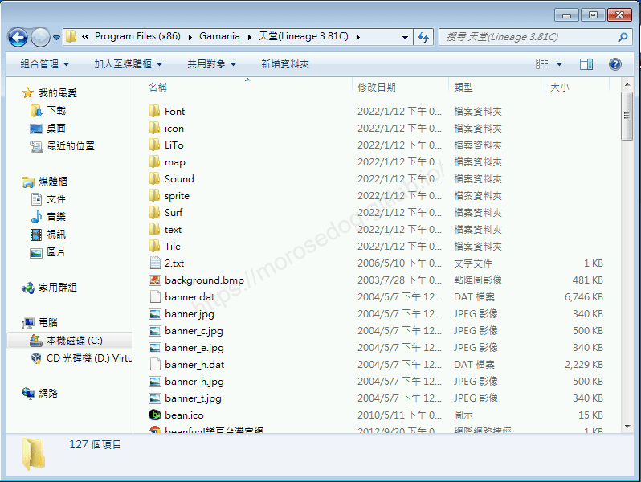

# 補丁吃檔資料夾對應

# 天堂私服 | 補丁吃檔資料夾對應

    
    
      📑 目錄
      

1. [章節用意](#章節用意)
2. [客戶端版本](#客戶端版本)
3. [前言](#前言)
4. [客戶端資料夾](#客戶端資料夾)
5. [注意事項](#注意事項)
6. [結語](#結語)
7. [免責聲明](#免責聲明)

    
    
    

## 章節用意

此章節會針對客戶端的目錄，其用於吃檔時，對應補丁檔案放置位置的說明。

## 客戶端版本

* 天堂(Lineage 3.81C)

## 前言

在開始分析前，請務必先將以下文章閱讀完畢。

* [客戶端idx、pak說明](./068_客戶端idx_pak說明.md)

  * 了解`idx`與`pak`檔。

  * 了解`pak`檔內壓縮了哪些檔。

* [補丁副檔名對應說明](./069_補丁副檔名對應說明.md)

  * 了解各種格式的基本對應和舉例說明。

另外以下說明可能並不是非常正確的，因為我也在自行分析學習中，所以只是做一個自己理解的簡單說明。
<如有錯誤或是可以提供更詳細的說明，歡迎糾正與分享。>​‌‌‌​​​​​‌‌‌​​‌​​‌‌​‌​​‌​‌‌‌​‌‌​​‌‌​​​​‌​‌‌‌​‌​​​‌‌​​‌​‌​​‌​‌‌​‌​‌‌​‌‌​​​‌‌​‌​​‌​‌‌​‌‌‌​​‌‌​​‌​‌​‌‌​​​​‌​‌‌​​‌‌‌​‌‌​​‌​‌​​‌​‌‌​‌​​‌‌​​‌​​​‌‌​​​​​​‌‌​​‌​​​‌‌​​‌​​​‌‌​​​​​​‌‌​​‌​​​‌‌​​​​​​‌‌​​‌‌​​‌​‌‌​‌​‌‌‌​​​​​‌‌‌​​‌​​‌‌​‌​​‌​‌‌‌​‌‌​​‌‌​​​​‌​‌‌‌​‌​​​‌‌​​‌​‌​​‌​‌‌​‌​‌‌​‌‌​​​‌‌​‌​​‌​‌‌​‌‌‌​​‌‌​​‌​‌​‌‌​​​​‌​‌‌​​‌‌‌​‌‌​​‌​‌​​‌​‌‌​‌​​‌‌​‌‌‌​​‌‌​​​​

## 客戶端資料夾

此處使用`天堂(Lineage 3.81C)`安裝版，直接安裝一份最乾淨的客戶端，安裝後的目錄如下：

* 跟吃檔**沒關係**的目錄：

資料夾
說明

Font
客戶端用的字體檔案存放的目錄。

LiTo
無界擂台所使用的目錄。

map
目錄內多個目錄其名稱代表每個地圖的代碼。

Sound
音樂檔(*.mp3)- 例如揮刀的聲音、被打的聲音、施展的聲音，
聲音檔(*.wav)- 例如澳塔音樂，水底音樂，打怪音樂，pk音樂。

* 吃檔**對應**的目錄：

資料夾
補丁類型
說明

icon
*.tbt, *.ico
遊戲中的道具圖、魔法圖、人物狀態圖…等等。

sprite
*.spr
每一個檔案代表一個動畫、一個圖片，其檔案編號是都是有其相對應的。
註：`list.spr`與`list.spz`是丟到`text`資料夾內吃檔。

Surf
*.img
遊戲中的介面圖片，例如遊戲介面的血條，人物選單的人物動畫等等。

text
*.html, *.tbl, 
 list.spr, list.spz
遊戲中的對話檔或是客戶端在顯示的句子描述。
註：檔案名稱後面的-c是繁體中文、-h是簡體中文、-j是日文、-e是英文、-k是韓文..等等。

Tile
*.xml, *.til
客戶端所使用的一些設定檔。

## 注意事項

在對任何的檔案做替換或是修改前，建議將其原始檔做備份，避免修改後發生例外狀況無法排除。

## 結語

原創文章真的不易，希望多多支持，感謝。
最後建議回顧一下首章[天堂私服 | 天堂私服架設教學](/private-lineage-20210712-private-lineage-0/#教學章節)，了解其章節目錄。​‌‌‌​​​​​‌‌‌​​‌​​‌‌​‌​​‌​‌‌‌​‌‌​​‌‌​​​​‌​‌‌‌​‌​​​‌‌​​‌​‌​​‌​‌‌​‌​‌‌​‌‌​​​‌‌​‌​​‌​‌‌​‌‌‌​​‌‌​​‌​‌​‌‌​​​​‌​‌‌​​‌‌‌​‌‌​​‌​‌​​‌​‌‌​‌​​‌‌​​‌​​​‌‌​​​​​​‌‌​​‌​​​‌‌​​‌​​​‌‌​​​​​​‌‌​​‌​​​‌‌​​​​​​‌‌​​‌‌​​‌​‌‌​‌​‌‌‌​​​​​‌‌‌​​‌​​‌‌​‌​​‌​‌‌‌​‌‌​​‌‌​​​​‌​‌‌‌​‌​​​‌‌​​‌​‌​​‌​‌‌​‌​‌‌​‌‌​​​‌‌​‌​​‌​‌‌​‌‌‌​​‌‌​​‌​‌​‌‌​​​​‌​‌‌​​‌‌‌​‌‌​​‌​‌​​‌​‌‌​‌​​‌‌​‌‌‌​​‌‌​​​​

## 免責聲明

* 本部落格文章中皆<u>**不提供**</u>任何所謂的遊戲「主程式」、「模擬器」、「登入器」…等等相關程式的下載點。

* 本部落格文章中所見之遊戲主程式和服務器端程序均來自網路發佈，<u>版本歸**原作者**</u>所有。

* 本部落格文章為研究SQL資料庫與修改JAVA語法使用，並<u>**非商業用途**</u>，亦<u>**無做營運事實等任何一切商業行為**</u>。

* 本部落格文章內容是為研究學習設計思想和原理為目的，<u>**絕沒有故意侵權或惡意抄襲、篡改其他遊戲內容**</u>！

---

- **原文連結**：[J.J.'s Blogs - 補丁吃檔資料夾對應](https://morosedog.gitlab.io/private-lineage-20220203-private-lineage-70/)
