# eat (吃檔教學)

# 天堂私服 | eat (吃檔教學)

    
    
      📑 目錄
      

1. [章節用意](#章節用意)
2. [客戶端版本](#客戶端版本)
3. [前言](#前言)
4. [客戶端](#客戶端)
5. [吃檔程式](#吃檔程式)
6. [吃檔教學](#吃檔教學)
7. [簡單示範](#簡單示範)
8. [注意事項](#注意事項)
9. [結語](#結語)
10. [免責聲明](#免責聲明)

    
    
    

## 章節用意

此章節會針對客戶端吃檔做一個示範教學。

## 客戶端版本

* 天堂(Lineage 3.81C)

## 前言

在開始分析前，請務必先將以下文章閱讀完畢。

* [客戶端idx、pak說明](../06_Client_Patching/068_客戶端idx_pak說明.md)

  * 了解`idx`與`pak`檔。

  * 了解`pak`檔內壓縮了哪些檔。

* [補丁副檔名對應說明](../06_Client_Patching/069_補丁副檔名對應說明.md)

  * 了解各種格式的基本對應和舉例說明。

* [補丁吃檔資料夾對應](../06_Client_Patching/070_補丁吃檔資料夾對應.md)

  * 了解各種補丁要放置的對應目錄。

## 客戶端

此處使用`天堂(Lineage 3.81C)`安裝版，直接安裝一份最乾淨的客戶端。
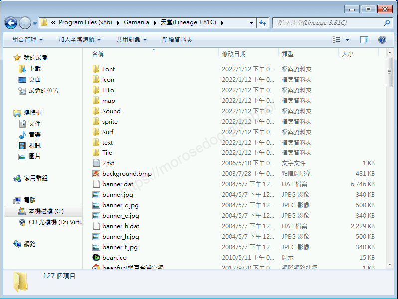​‌‌‌​​​​​‌‌‌​​‌​​‌‌​‌​​‌​‌‌‌​‌‌​​‌‌​​​​‌​‌‌‌​‌​​​‌‌​​‌​‌​​‌​‌‌​‌​‌‌​‌‌​​​‌‌​‌​​‌​‌‌​‌‌‌​​‌‌​​‌​‌​‌‌​​​​‌​‌‌​​‌‌‌​‌‌​​‌​‌​​‌​‌‌​‌​​‌‌​​‌​​​‌‌​​​​​​‌‌​​‌​​​‌‌​​‌​​​‌‌​​​​​​‌‌​​‌​​​‌‌​​​​​​‌‌​‌​​​​‌​‌‌​‌​‌‌‌​​​​​‌‌‌​​‌​​‌‌​‌​​‌​‌‌‌​‌‌​​‌‌​​​​‌​‌‌‌​‌​​​‌‌​​‌​‌​​‌​‌‌​‌​‌‌​‌‌​​​‌‌​‌​​‌​‌‌​‌‌‌​​‌‌​​‌​‌​‌‌​​​​‌​‌‌​​‌‌‌​‌‌​​‌​‌​​‌​‌‌​‌​​‌‌​‌‌‌​​‌‌​​​‌

## 吃檔程式

一般來說，登入器裡面都有提供吃檔程式，或是本身登入器就已經包含了吃檔功能。

對應所使用的登入器為「[Login_v380a.rar](/images/private-lineage/download_not_available.png)」登入器。**內含`eat.exe`與`eat.dll`**。

* 無法提供下載點，請根據關鍵字自行上網搜尋。

> 註：如登入器的內容有不了解的，可以參考[登入器相關文章](/categories/%E5%A4%A9%E5%A0%82%E7%A7%81%E6%9C%8D/3-%E7%99%BB%E5%85%A5%E5%99%A8%E7%9B%B8%E9%97%9C/)
> 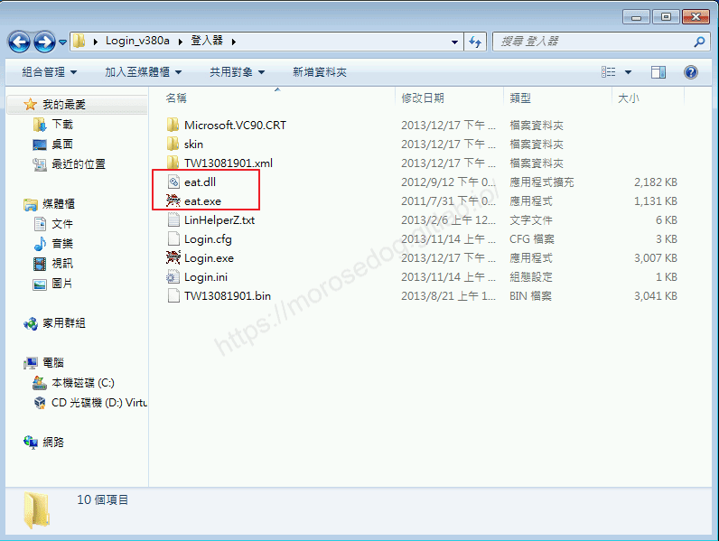​‌‌‌​​​​​‌‌‌​​‌​​‌‌​‌​​‌​‌‌‌​‌‌​​‌‌​​​​‌​‌‌‌​‌​​​‌‌​​‌​‌​​‌​‌‌​‌​‌‌​‌‌​​​‌‌​‌​​‌​‌‌​‌‌‌​​‌‌​​‌​‌​‌‌​​​​‌​‌‌​​‌‌‌​‌‌​​‌​‌​​‌​‌‌​‌​​‌‌​​‌​​​‌‌​​​​​​‌‌​​‌​​​‌‌​​‌​​​‌‌​​​​​​‌‌​​‌​​​‌‌​​​​​​‌‌​‌​​​​‌​‌‌​‌​‌‌‌​​​​​‌‌‌​​‌​​‌‌​‌​​‌​‌‌‌​‌‌​​‌‌​​​​‌​‌‌‌​‌​​​‌‌​​‌​‌​​‌​‌‌​‌​‌‌​‌‌​​​‌‌​‌​​‌​‌‌​‌‌‌​​‌‌​​‌​‌​‌‌​​​​‌​‌‌​​‌‌‌​‌‌​​‌​‌​​‌​‌‌​‌​​‌‌​‌‌‌​​‌‌​​​‌

## 吃檔教學

* 首先要將吃檔程式(`eat.exe`與`eat.dll`)搬移到客戶端目錄下。
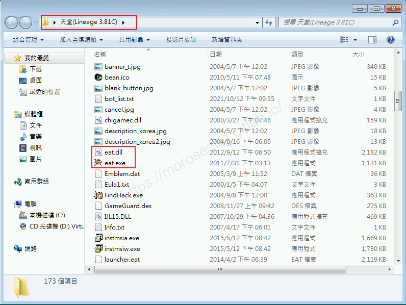

* 將要吃檔的檔案放入對應的目錄下。

> 註：如果不知道是哪些檔案或是要放哪個目錄下，請參考[補丁介紹說明文章](/categories/%E5%A4%A9%E5%A0%82%E7%A7%81%E6%9C%8D/6-%E8%A3%9C%E4%B8%81%E4%BB%8B%E7%B4%B9-%E8%AA%AA%E6%98%8E/)

* 接著在執行`eat.exe`檔，進行吃檔。

* 執行後會跳出類似天堂更新畫面進行吃檔。(此動作應該是自動的，如沒動作請按下`Start`)
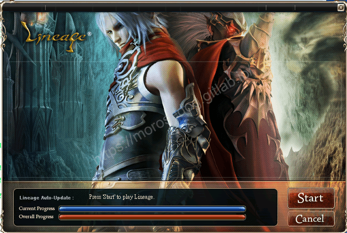

* 最後等待進度條完成，完成後會彈出`吃檔完成`。
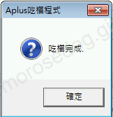

吃檔的方式就是這麼簡單容易。

## 簡單示範

網路上可以找到別人分享製作好的`畫面右上方狀態魔法圖示美化`。
將其解壓縮後，可以在裡面發現一個`icon`資料夾，裡面有很多的`.tbt`檔案。
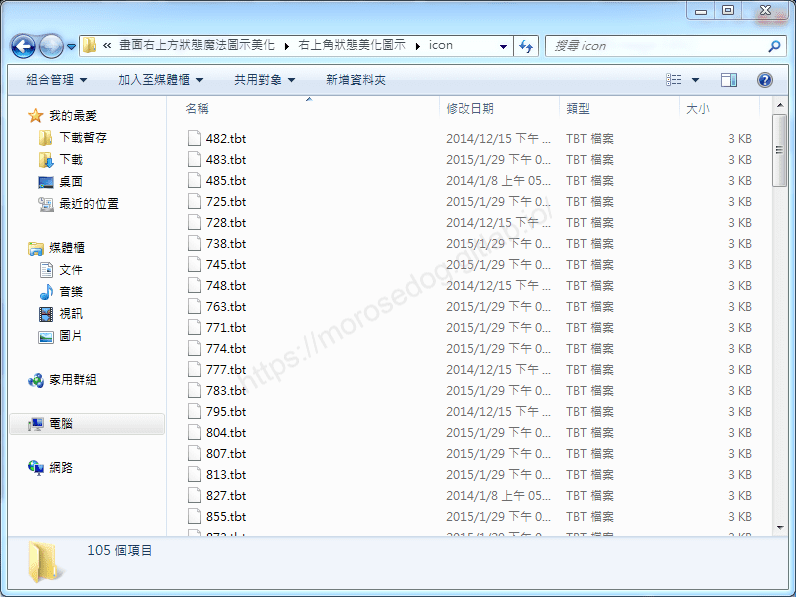​‌‌‌​​​​​‌‌‌​​‌​​‌‌​‌​​‌​‌‌‌​‌‌​​‌‌​​​​‌​‌‌‌​‌​​​‌‌​​‌​‌​​‌​‌‌​‌​‌‌​‌‌​​​‌‌​‌​​‌​‌‌​‌‌‌​​‌‌​​‌​‌​‌‌​​​​‌​‌‌​​‌‌‌​‌‌​​‌​‌​​‌​‌‌​‌​​‌‌​​‌​​​‌‌​​​​​​‌‌​​‌​​​‌‌​​‌​​​‌‌​​​​​​‌‌​​‌​​​‌‌​​​​​​‌‌​‌​​​​‌​‌‌​‌​‌‌‌​​​​​‌‌‌​​‌​​‌‌​‌​​‌​‌‌‌​‌‌​​‌‌​​​​‌​‌‌‌​‌​​​‌‌​​‌​‌​​‌​‌‌​‌​‌‌​‌‌​​​‌‌​‌​​‌​‌‌​‌‌‌​​‌‌​​‌​‌​‌‌​​​​‌​‌‌​​‌‌‌​‌‌​​‌​‌​​‌​‌‌​‌​​‌‌​‌‌‌​​‌‌​​​‌

這邊要示範的是將`體魄強健術`狀態圖示做替換。

* 首先透過工具觀看`體魄強健術`的對應編碼為：`482`。
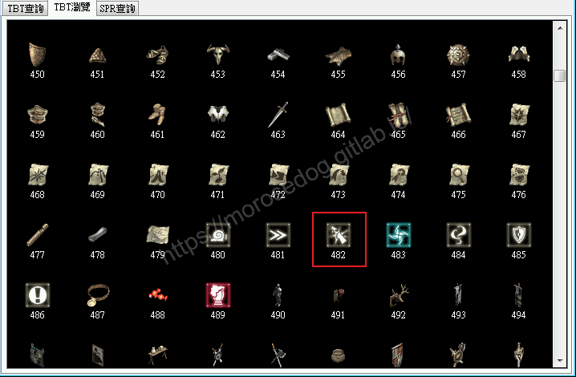

* 進入天堂遊戲可以看到右上方的狀態魔法圖示為原版的顏色。
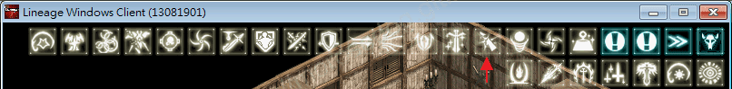​‌‌‌​​​​​‌‌‌​​‌​​‌‌​‌​​‌​‌‌‌​‌‌​​‌‌​​​​‌​‌‌‌​‌​​​‌‌​​‌​‌​​‌​‌‌​‌​‌‌​‌‌​​​‌‌​‌​​‌​‌‌​‌‌‌​​‌‌​​‌​‌​‌‌​​​​‌​‌‌​​‌‌‌​‌‌​​‌​‌​​‌​‌‌​‌​​‌‌​​‌​​​‌‌​​​​​​‌‌​​‌​​​‌‌​​‌​​​‌‌​​​​​​‌‌​​‌​​​‌‌​​​​​​‌‌​‌​​​​‌​‌‌​‌​‌‌‌​​​​​‌‌‌​​‌​​‌‌​‌​​‌​‌‌‌​‌‌​​‌‌​​​​‌​‌‌‌​‌​​​‌‌​​‌​‌​​‌​‌‌​‌​‌‌​‌‌​​​‌‌​‌​​‌​‌‌​‌‌‌​​‌‌​​‌​‌​‌‌​​​​‌​‌‌​​‌‌‌​‌‌​​‌​‌​​‌​‌‌​‌​​‌‌​‌‌‌​​‌‌​​​‌

* 將剛剛解壓縮出來的`482.tbt`檔案，複製進客戶端目錄下的`icon`目錄下。
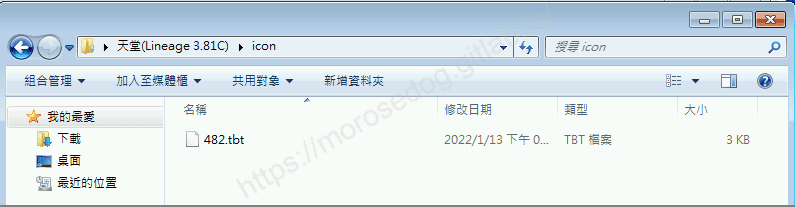

* 執行`eat.exe`檔，並等待吃檔完成。

* 重新進入天堂遊戲可以看到右上方的狀態魔法圖示為替換美化後的顏色。
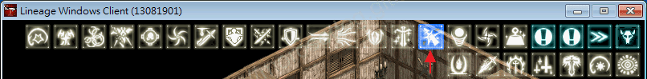​‌‌‌​​​​​‌‌‌​​‌​​‌‌​‌​​‌​‌‌‌​‌‌​​‌‌​​​​‌​‌‌‌​‌​​​‌‌​​‌​‌​​‌​‌‌​‌​‌‌​‌‌​​​‌‌​‌​​‌​‌‌​‌‌‌​​‌‌​​‌​‌​‌‌​​​​‌​‌‌​​‌‌‌​‌‌​​‌​‌​​‌​‌‌​‌​​‌‌​​‌​​​‌‌​​​​​​‌‌​​‌​​​‌‌​​‌​​​‌‌​​​​​​‌‌​​‌​​​‌‌​​​​​​‌‌​‌​​​​‌​‌‌​‌​‌‌‌​​​​​‌‌‌​​‌​​‌‌​‌​​‌​‌‌‌​‌‌​​‌‌​​​​‌​‌‌‌​‌​​​‌‌​​‌​‌​​‌​‌‌​‌​‌‌​‌‌​​​‌‌​‌​​‌​‌‌​‌‌‌​​‌‌​​‌​‌​‌‌​​​​‌​‌‌​​‌‌‌​‌‌​​‌​‌​​‌​‌‌​‌​​‌‌​‌‌‌​​‌‌​​​‌

## 注意事項

在對任何的檔案做替換或是修改前，建議將其原始檔做備份，避免修改後發生例外狀況無法排除。
可以參考備份方式：
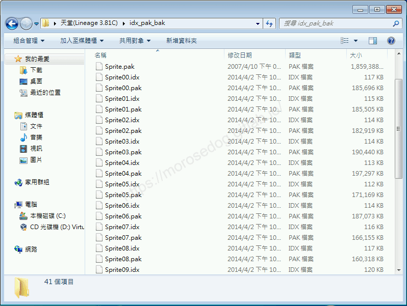

## 結語

原創文章真的不易，希望多多支持，感謝。
最後建議回顧一下首章[天堂私服 | 天堂私服架設教學](/private-lineage-20210712-private-lineage-0/#教學章節)，了解其章節目錄。

## 免責聲明

* 本部落格文章中皆<u>**不提供**</u>任何所謂的遊戲「主程式」、「模擬器」、「登入器」…等等相關程式的下載點。

* 本部落格文章中所見之遊戲主程式和服務器端程序均來自網路發佈，<u>版本歸**原作者**</u>所有。

* 本部落格文章為研究SQL資料庫與修改JAVA語法使用，並<u>**非商業用途**</u>，亦<u>**無做營運事實等任何一切商業行為**</u>。

* 本部落格文章內容是為研究學習設計思想和原理為目的，<u>**絕沒有故意侵權或惡意抄襲、篡改其他遊戲內容**</u>！

---

- **原文連結**：[J.J.'s Blogs - eat (吃檔教學)](https://morosedog.gitlab.io/private-lineage-20220204-private-lineage-71/)
