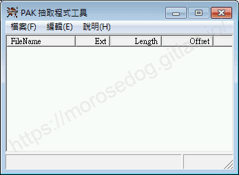
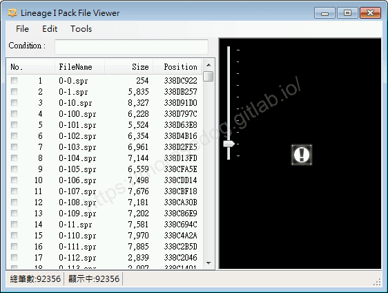
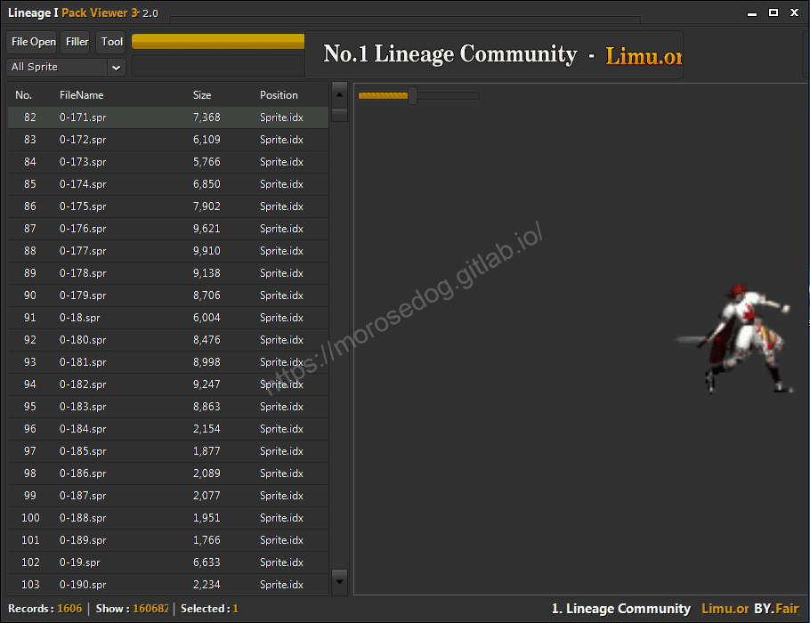
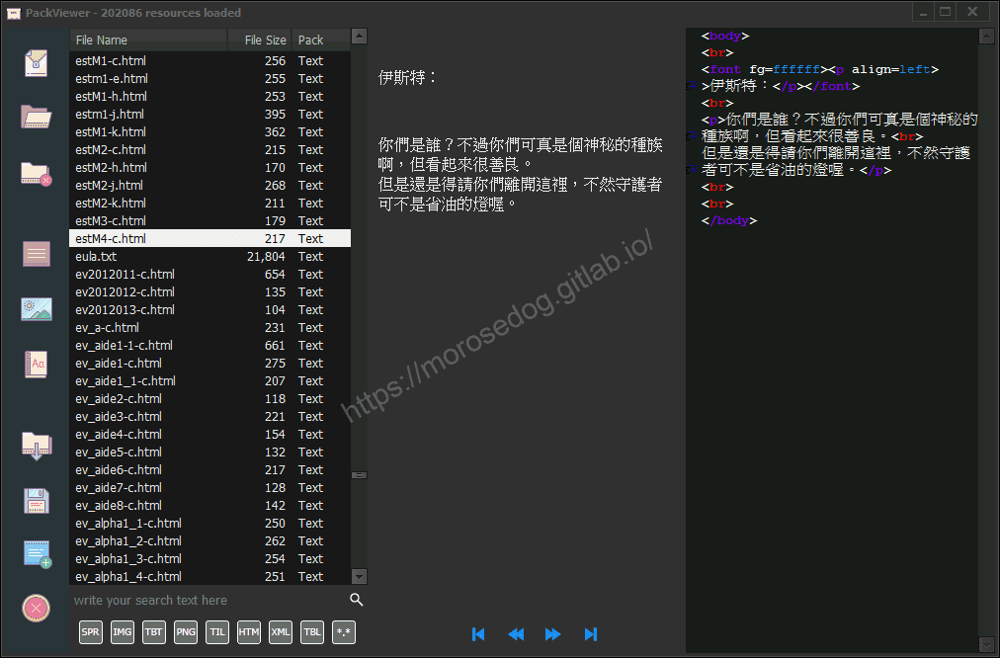
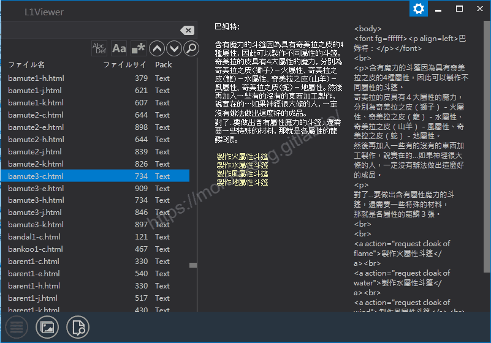
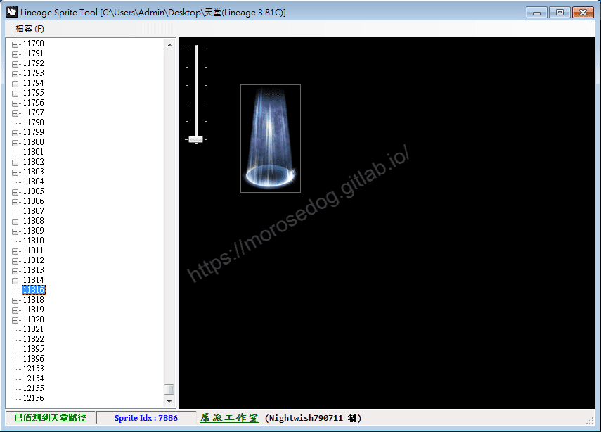
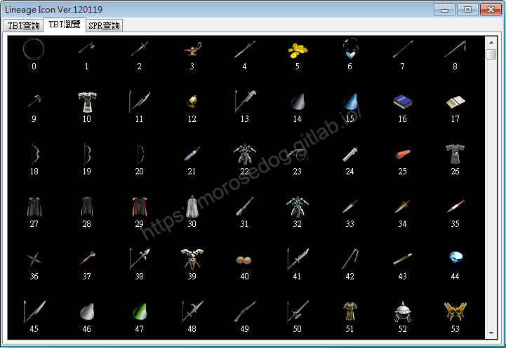
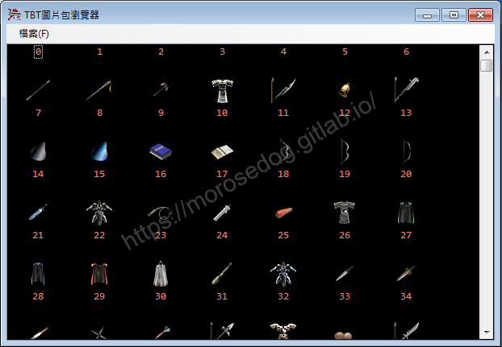

# PakViewer 介紹

# 天堂私服 | PakViewer 介紹

    
    
      📑 目錄
      

1. [章節用意](#章節用意)
2. [前言](#前言)
3. [PakViewer 是什麼?](#PakViewer-是什麼)
4. [注意事項](#注意事項)
5. [工具清單](#工具清單)
6. [結語](#結語)
7. [免責聲明](#免責聲明)

    
    
    

## 章節用意

此章節會針對`PakViewer`工具類做一個簡單的介紹。

## 前言

在開始了解這些工具前，請務必先閱讀過[補丁介紹說明文章](/categories/%E5%A4%A9%E5%A0%82%E7%A7%81%E6%9C%8D/6-%E8%A3%9C%E4%B8%81%E4%BB%8B%E7%B4%B9-%E8%AA%AA%E6%98%8E/)，這樣才能了解其工具的用途。

## PakViewer 是什麼?

`PakViewer`其又稱為`打包文件查看器`。​‌‌‌​​​​​‌‌‌​​‌​​‌‌​‌​​‌​‌‌‌​‌‌​​‌‌​​​​‌​‌‌‌​‌​​​‌‌​​‌​‌​​‌​‌‌​‌​‌‌​‌‌​​​‌‌​‌​​‌​‌‌​‌‌‌​​‌‌​​‌​‌​‌‌​​​​‌​‌‌​​‌‌‌​‌‌​​‌​‌​​‌​‌‌​‌​​‌‌​​‌​​​‌‌​​​​​​‌‌​​‌​​​‌‌​​‌​​​‌‌​​​​​​‌‌​​‌​​​‌‌​​​​​​‌‌​‌​‌​​‌​‌‌​‌​‌‌‌​​​​​‌‌‌​​‌​​‌‌​‌​​‌​‌‌‌​‌‌​​‌‌​​​​‌​‌‌‌​‌​​​‌‌​​‌​‌​​‌​‌‌​‌​‌‌​‌‌​​​‌‌​‌​​‌​‌‌​‌‌‌​​‌‌​​‌​‌​‌‌​​​​‌​‌‌​​‌‌‌​‌‌​​‌​‌​​‌​‌‌​‌​​‌‌​‌‌‌​​‌‌​​‌​

在[客戶端idx、pak說明](../06_Client_Patching/068_客戶端idx_pak說明.md)文章中已經介紹過`idx`與`pak`檔案，這些檔案並不能用待純的文字編輯器打開並看到我們能理解的內容。
所以這時候需要`打包文件查看器`來協助我們對其操作，其操作的動作要看`PakViewer`(打包文件查看器)提供了多少功能，常見的功能有：

* 解析`idx`與`pak`檔，列出內容清單。

* 解析`pak`檔的內容並做預覽(圖片、文字、動態圖…等等)。

* 匯出、匯入、刪除，`pak`檔的內容。

* 搜尋`pak`檔內容的檔案。(搜尋檔名、副檔名、文字內容…等等)

* 過濾`pak`檔內容的檔案，進行過濾僅顯示自己設定選擇的副檔名。

* 排序，針對解析後的檔案編號、檔案名稱、檔案大小、記憶體位置、語系…等等做排序。

* 檔案全選、取消全選。

* `xml`解密。

* `img`與`bmp`之間的轉換功能。

目前已知的多數`PakViewer`(打包文件查看器)，大致上就是上述這些功能。

## 注意事項

在開啟任何網路提供的工具前，請用小心謹慎的態度去使用，永遠要先假設其工具並非是安全的是惡意的，並保持著幾個要點：​‌‌‌​​​​​‌‌‌​​‌​​‌‌​‌​​‌​‌‌‌​‌‌​​‌‌​​​​‌​‌‌‌​‌​​​‌‌​​‌​‌​​‌​‌‌​‌​‌‌​‌‌​​​‌‌​‌​​‌​‌‌​‌‌‌​​‌‌​​‌​‌​‌‌​​​​‌​‌‌​​‌‌‌​‌‌​​‌​‌​​‌​‌‌​‌​​‌‌​​‌​​​‌‌​​​​​​‌‌​​‌​​​‌‌​​‌​​​‌‌​​​​​​‌‌​​‌​​​‌‌​​​​​​‌‌​‌​‌​​‌​‌‌​‌​‌‌‌​​​​​‌‌‌​​‌​​‌‌​‌​​‌​‌‌‌​‌‌​​‌‌​​​​‌​‌‌‌​‌​​​‌‌​​‌​‌​​‌​‌‌​‌​‌‌​‌‌​​​‌‌​‌​​‌​‌‌​‌‌‌​​‌‌​​‌​‌​‌‌​​​​‌​‌‌​​‌‌‌​‌‌​​‌​‌​​‌​‌‌​‌​​‌‌​‌‌‌​​‌‌​​‌​

1. 工具軟體下載後不點擊執行、開啟、解壓縮。

2. 將工具軟體透過掃毒軟體、線上掃毒先行掃描。

> 註：如被判定為惡意軟體請不要忽略、不要執行。(個人常用的免費線上掃毒：[VirusTotal](https://www.virustotal.com/gui/home/upload))

3. 將工具軟體移動至虛擬機環境下執行操作。(虛擬機安裝請參考：[VirtualBox Windows 7 安裝](../01_Getting_Started/003_VirtualBox_Windows_7_安裝.md))

基本上保持以上幾個要點，電腦比較不會淪為後門木馬的溫床。

> 註：並不是說保持以上幾個要點電腦就不會中毒，中毒的途徑太多了(USB、e-mail、區域網路…等等)，這只是盡量避免其中的一部分。​‌‌‌​​​​​‌‌‌​​‌​​‌‌​‌​​‌​‌‌‌​‌‌​​‌‌​​​​‌​‌‌‌​‌​​​‌‌​​‌​‌​​‌​‌‌​‌​‌‌​‌‌​​​‌‌​‌​​‌​‌‌​‌‌‌​​‌‌​​‌​‌​‌‌​​​​‌​‌‌​​‌‌‌​‌‌​​‌​‌​​‌​‌‌​‌​​‌‌​​‌​​​‌‌​​​​​​‌‌​​‌​​​‌‌​​‌​​​‌‌​​​​​​‌‌​​‌​​​‌‌​​​​​​‌‌​‌​‌​​‌​‌‌​‌​‌‌‌​​​​​‌‌‌​​‌​​‌‌​‌​​‌​‌‌‌​‌‌​​‌‌​​​​‌​‌‌‌​‌​​​‌‌​​‌​‌​​‌​‌‌​‌​‌‌​‌‌​​​‌‌​‌​​‌​‌‌​‌‌‌​​‌‌​​‌​‌​‌‌​​​​‌​‌‌​​‌‌‌​‌‌​​‌​‌​​‌​‌‌​‌​​‌‌​‌‌‌​​‌‌​​‌​

## 工具清單

這邊整理出來的`PakViewer`(打包文件查看器)工具清單，僅是作者能在網路上收集到的工具清單，並不表示其全部。

> 註：以下工具排序並不能表示任何意思，僅單純列出。

工具名稱：PAK 抽取程式工具
檔案名稱：**Pakext.exe**
版本訊息：Pack Extracter 0.06
介紹文章：[連結](./073_Pakext_工具.md)
病毒掃描：**結果：57 家安全供應商且沒有沙箱將此文件標記為惡意文件。**
​‌‌‌​​​​​‌‌‌​​‌​​‌‌​‌​​‌​‌‌‌​‌‌​​‌‌​​​​‌​‌‌‌​‌​​​‌‌​​‌​‌​​‌​‌‌​‌​‌‌​‌‌​​​‌‌​‌​​‌​‌‌​‌‌‌​​‌‌​​‌​‌​‌‌​​​​‌​‌‌​​‌‌‌​‌‌​​‌​‌​​‌​‌‌​‌​​‌‌​​‌​​​‌‌​​​​​​‌‌​​‌​​​‌‌​​‌​​​‌‌​​​​​​‌‌​​‌​​​‌‌​​​​​​‌‌​‌​‌​​‌​‌‌​‌​‌‌‌​​​​​‌‌‌​​‌​​‌‌​‌​​‌​‌‌‌​‌‌​​‌‌​​​​‌​‌‌‌​‌​​​‌‌​​‌​‌​​‌​‌‌​‌​‌‌​‌‌​​​‌‌​‌​​‌​‌‌​‌‌‌​​‌‌​​‌​‌​‌‌​​​​‌​‌‌​​‌‌‌​‌‌​​‌​‌​​‌​‌‌​‌​​‌‌​‌‌‌​​‌‌​​‌​

工具名稱：Lineage I Pack File Viewer
檔案名稱：**PakViewer.exe**
版本訊息：Ver 0.04
介紹文章：[連結](./074_PakViewe_工具.md)
病毒掃描：**結果：沒有安全供應商和沙箱將此文件標記為惡意文件。**

工具名稱：Lineage I Pack Viewer 3
檔案名稱：**PakViewer Ver.3.0.exe**
版本訊息：Ver.3.0
介紹文章：[連結](./075_PakViewer_Ver.3.0_工具.md)
病毒掃描：**結果：2 家安全供應商且沒有沙箱將此文件標記為惡意文件。**

工具名稱：PACK Viewer
檔案名稱：**PackViewer_beta2.exe**
版本訊息：beta2
介紹文章：[連結](./076_PackViewer_beta2_工具.md)
病毒掃描：**結果：4 家安全供應商且沒有沙箱將此文件標記為惡意文件。**
​‌‌‌​​​​​‌‌‌​​‌​​‌‌​‌​​‌​‌‌‌​‌‌​​‌‌​​​​‌​‌‌‌​‌​​​‌‌​​‌​‌​​‌​‌‌​‌​‌‌​‌‌​​​‌‌​‌​​‌​‌‌​‌‌‌​​‌‌​​‌​‌​‌‌​​​​‌​‌‌​​‌‌‌​‌‌​​‌​‌​​‌​‌‌​‌​​‌‌​​‌​​​‌‌​​​​​​‌‌​​‌​​​‌‌​​‌​​​‌‌​​​​​​‌‌​​‌​​​‌‌​​​​​​‌‌​‌​‌​​‌​‌‌​‌​‌‌‌​​​​​‌‌‌​​‌​​‌‌​‌​​‌​‌‌‌​‌‌​​‌‌​​​​‌​‌‌‌​‌​​​‌‌​​‌​‌​​‌​‌‌​‌​‌‌​‌‌​​​‌‌​‌​​‌​‌‌​‌‌‌​​‌‌​​‌​‌​‌‌​​​​‌​‌‌​​‌‌‌​‌‌​​‌​‌​​‌​‌‌​‌​​‌‌​‌‌‌​​‌‌​​‌​

工具名稱：L1Viewer
檔案名稱：**L1Viewer.exe**
版本訊息：v1.2
介紹文章：[連結](./077_L1Viewer_工具.md)
病毒掃描：**結果：沒有安全供應商和沙箱將此文件標記為惡意文件。**

工具名稱：Lineage Sprite Tool
檔案名稱：**LineageSpr.exe**
版本訊息：無
介紹文章：[連結](./078_LineageSpr_工具.md)
病毒掃描：**結果：沒有安全供應商和沙箱將此文件標記為惡意文件。**

工具名稱：Lineage Icon Ver.120119
檔案名稱：**Lineage Icon v120119.exe**
版本訊息：Ver.120119
介紹文章：[連結](./079_Lineage_Icon_v120119_工具.md)
病毒掃描：**結果：4 家安全供應商且沒有沙箱將此文件標記為惡意文件。**
​‌‌‌​​​​​‌‌‌​​‌​​‌‌​‌​​‌​‌‌‌​‌‌​​‌‌​​​​‌​‌‌‌​‌​​​‌‌​​‌​‌​​‌​‌‌​‌​‌‌​‌‌​​​‌‌​‌​​‌​‌‌​‌‌‌​​‌‌​​‌​‌​‌‌​​​​‌​‌‌​​‌‌‌​‌‌​​‌​‌​​‌​‌‌​‌​​‌‌​​‌​​​‌‌​​​​​​‌‌​​‌​​​‌‌​​‌​​​‌‌​​​​​​‌‌​​‌​​​‌‌​​​​​​‌‌​‌​‌​​‌​‌‌​‌​‌‌‌​​​​​‌‌‌​​‌​​‌‌​‌​​‌​‌‌‌​‌‌​​‌‌​​​​‌​‌‌‌​‌​​​‌‌​​‌​‌​​‌​‌‌​‌​‌‌​‌‌​​​‌‌​‌​​‌​‌‌​‌‌‌​​‌‌​​‌​‌​‌‌​​​​‌​‌‌​​‌‌‌​‌‌​​‌​‌​​‌​‌‌​‌​​‌‌​‌‌‌​​‌‌​​‌​

工具名稱：TBT圖片包瀏覽器
檔案名稱：**MTools.exe**
版本訊息：無
介紹文章：[連結](./080_MTools_工具.md)
病毒掃描：**結果：沒有安全供應商和沙箱將此文件標記為惡意文件。**

## 結語

原創文章真的不易，希望多多支持，感謝。
最後建議回顧一下首章[天堂私服 | 天堂私服架設教學](/private-lineage-20210712-private-lineage-0/#教學章節)，了解其章節目錄。

## 免責聲明

* 本部落格文章中皆<u>**不提供**</u>任何所謂的遊戲「主程式」、「模擬器」、「登入器」…等等相關程式的下載點。

* 本部落格文章中所見之遊戲主程式和服務器端程序均來自網路發佈，<u>版本歸**原作者**</u>所有。

* 本部落格文章為研究SQL資料庫與修改JAVA語法使用，並<u>**非商業用途**</u>，亦<u>**無做營運事實等任何一切商業行為**</u>。

* 本部落格文章內容是為研究學習設計思想和原理為目的，<u>**絕沒有故意侵權或惡意抄襲、篡改其他遊戲內容**</u>！

---

- **原文連結**：[J.J.'s Blogs - PakViewer 介紹](https://morosedog.gitlab.io/private-lineage-20220205-private-lineage-72/)
