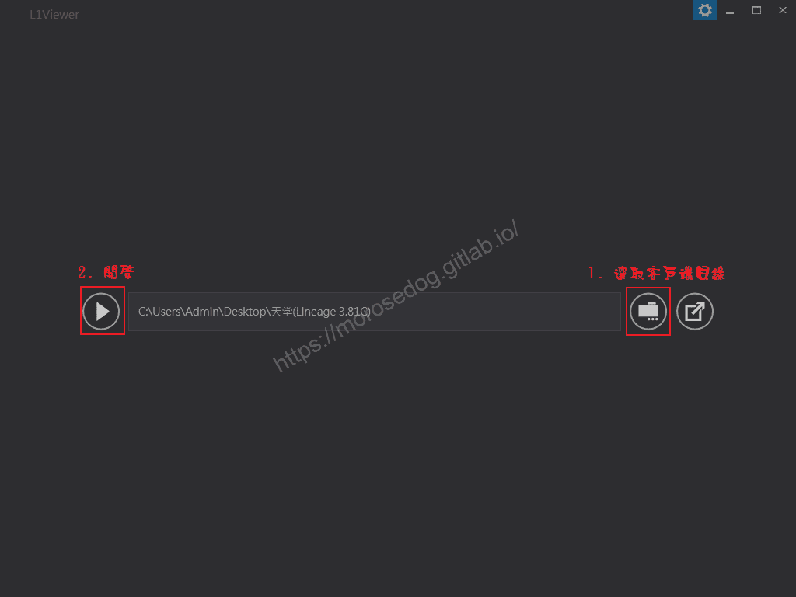
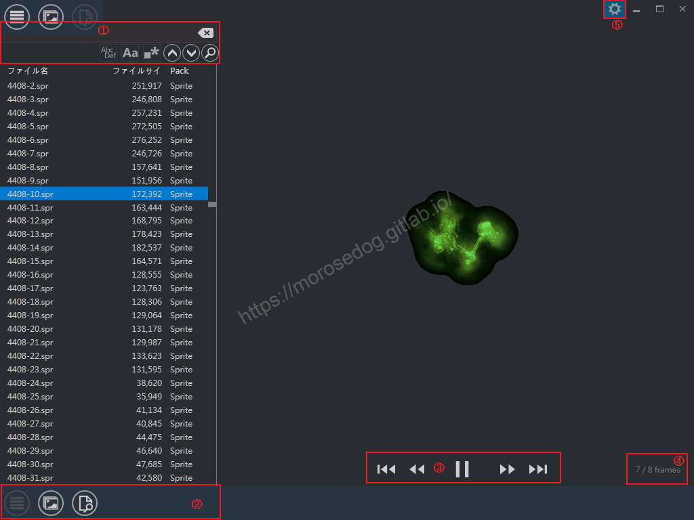
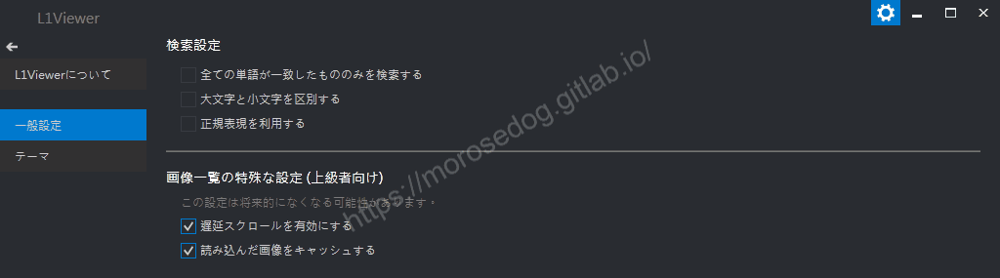
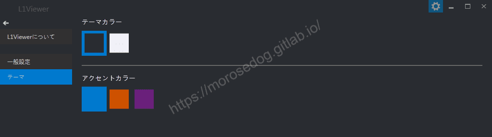
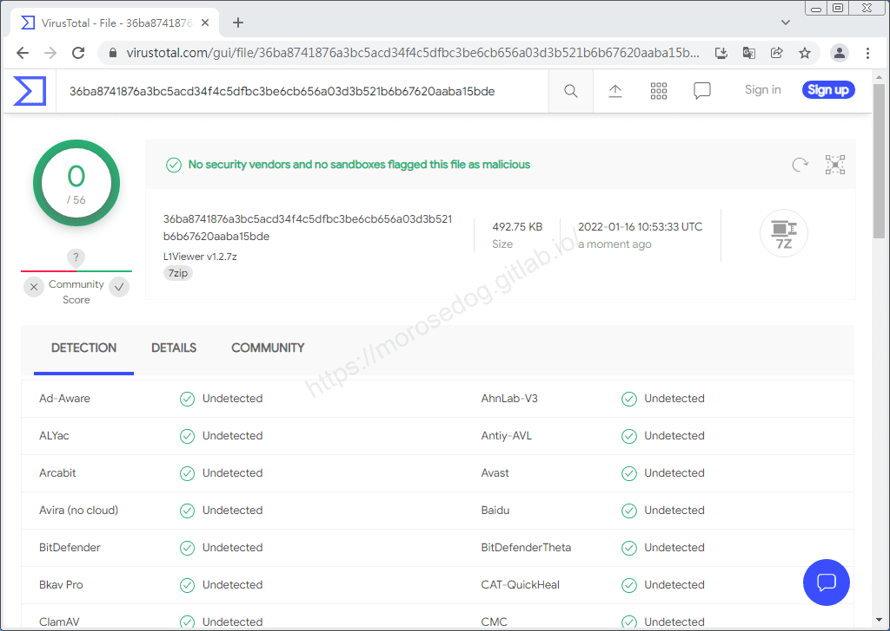

# L1Viewer 工具

# 天堂私服 | L1Viewer 工具

    
    
      📑 目錄
      

1. [章節用意](#章節用意)
2. [前言](#前言)
3. [功能介紹](#功能介紹)
4. [病毒掃描](#病毒掃描)
5. [工具下載](#工具下載)
6. [結語](#結語)
7. [免責聲明](#免責聲明)

    
    
    

## 章節用意

此章節會針對`L1Viewer(L1Viewer.exe)`工具做一個簡單的介紹。

## 前言

在開始閱讀前，請務必先將以下文章閱讀完畢。

* [補丁介紹說明文章](/categories/%E5%A4%A9%E5%A0%82%E7%A7%81%E6%9C%8D/6-%E8%A3%9C%E4%B8%81%E4%BB%8B%E7%B4%B9-%E8%AA%AA%E6%98%8E/)

  * 了解其工具的用途。

  * 了解其客戶端各種檔案的用途。

* [PakViewer 介紹](./072_PakViewer_介紹.md)

  * 初步對`PakViewer`的一個了解。

  * 務必閱讀[**注意事項**](./072_PakViewer_介紹.md#注意事項)所提的一些工具使用上的要點。

## 功能介紹

* 點擊`資料夾icon`->選擇客戶端目錄->點擊`啟動icon`開啟。

* 以下會針對區塊功能各別依序編號介紹：

* 1.搜尋功能：輸入名稱進行搜尋。(其他功能搜尋方式下方`icon`對應介紹)

  * ：只搜尋所有單詞匹配的項目。

  * ：區分大小寫搜尋。

  * ：正規表達式搜尋。

  * ：上/下次的搜尋。

  * ：執行過濾搜尋。

* 2.預覽功能：

  * ：文件列表顯示。

  * ：圖像文件列表。<僅顯示tbt格式>

  * ：全文檢索。<搜尋功能可以針對文件內容做搜尋>

* 3.播放功能：可針對每個`spr`動態圖做播放、漸進/退的方式做預覽。

* 4.圖片張數：顯示當前張數/總張數。

* 5.程式設定：可針對程式做一些預設設定/程式背景顏色…等等。

## 病毒掃描

**結果：沒有安全供應商和沙箱將此文件標記為惡意文件。**
**注意：結果並不完全證明其工具程式就沒有安全疑慮。**
​‌‌‌​​​​​‌‌‌​​‌​​‌‌​‌​​‌​‌‌‌​‌‌​​‌‌​​​​‌​‌‌‌​‌​​​‌‌​​‌​‌​​‌​‌‌​‌​‌‌​‌‌​​​‌‌​‌​​‌​‌‌​‌‌‌​​‌‌​​‌​‌​‌‌​​​​‌​‌‌​​‌‌‌​‌‌​​‌​‌​​‌​‌‌​‌​​‌‌​​‌​​​‌‌​​​​​​‌‌​​‌​​​‌‌​​‌​​​‌‌​​​​​​‌‌​​‌​​​‌‌​​​‌​​‌‌​​​​​​‌​‌‌​‌​‌‌‌​​​​​‌‌‌​​‌​​‌‌​‌​​‌​‌‌‌​‌‌​​‌‌​​​​‌​‌‌‌​‌​​​‌‌​​‌​‌​​‌​‌‌​‌​‌‌​‌‌​​​‌‌​‌​​‌​‌‌​‌‌‌​​‌‌​​‌​‌​‌‌​​​​‌​‌‌​​‌‌‌​‌‌​​‌​‌​​‌​‌‌​‌​​‌‌​‌‌‌​​‌‌​‌‌‌

## 工具下載

**工具程式皆可能含有惡意程式，請自行斟酌是否下載使用；文中提供病毒掃描結果，但不保證其安全性如同掃描結果，此處已善盡告知義務。**

* 載點：[L1Viewer v1.2.7z](/download/private-lineage/chapter77/L1Viewer%20v1.2.7z)

* 解壓縮密碼：

  
    🔒
    這段內容已加密
    需要 [**☕ 咖啡會員**](/support) 或更高等級的密碼才能閱讀
    
      
      解鎖
    
    
    💡 年度公開密碼，到 [/support](/support) 直接取得

## 結語

原創文章真的不易，希望多多支持，感謝。
最後建議回顧一下首章[天堂私服 | 天堂私服架設教學](/private-lineage-20210712-private-lineage-0/#教學章節)，了解其章節目錄。

## 免責聲明

* 本部落格文章中皆<u>**不提供**</u>任何所謂的遊戲「主程式」、「模擬器」、「登入器」…等等相關程式的下載點。

* 本部落格文章中所見之遊戲主程式和服務器端程序均來自網路發佈，<u>版本歸**原作者**</u>所有。

* 本部落格文章為研究SQL資料庫與修改JAVA語法使用，並<u>**非商業用途**</u>，亦<u>**無做營運事實等任何一切商業行為**</u>。

* 本部落格文章內容是為研究學習設計思想和原理為目的，<u>**絕沒有故意侵權或惡意抄襲、篡改其他遊戲內容**</u>！

---

- **原文連結**：[J.J.'s Blogs - L1Viewer 工具](https://morosedog.gitlab.io/private-lineage-20220210-private-lineage-77/)
