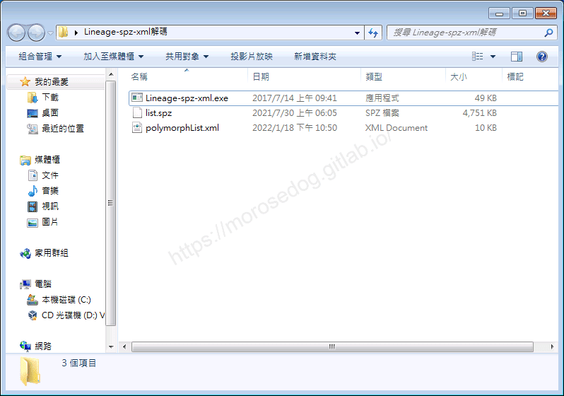
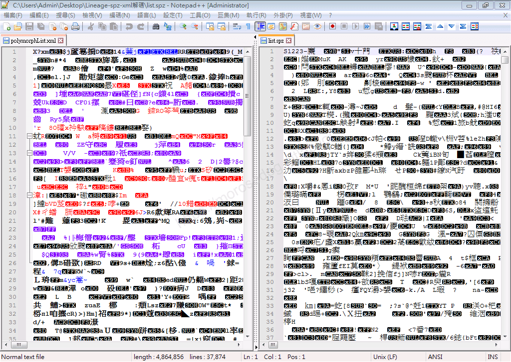
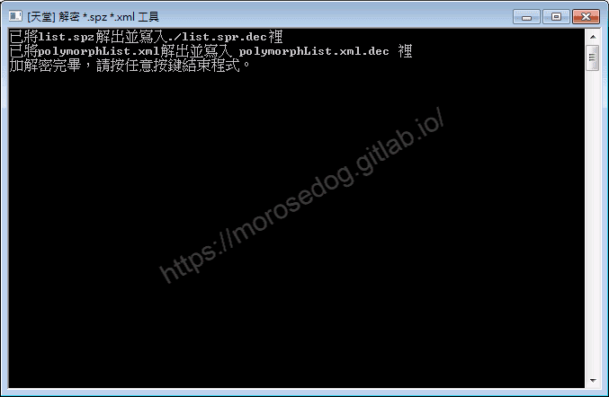
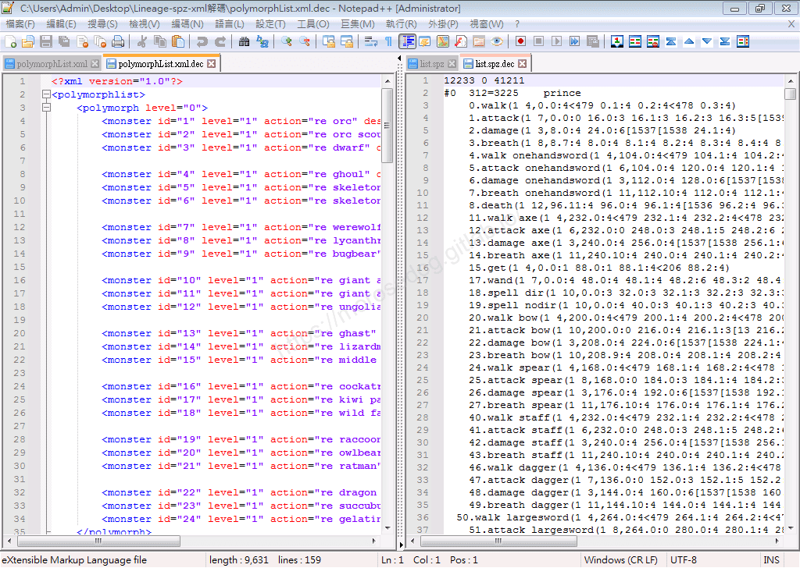
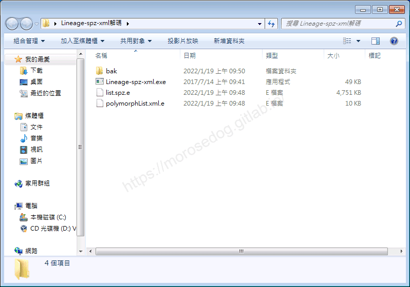
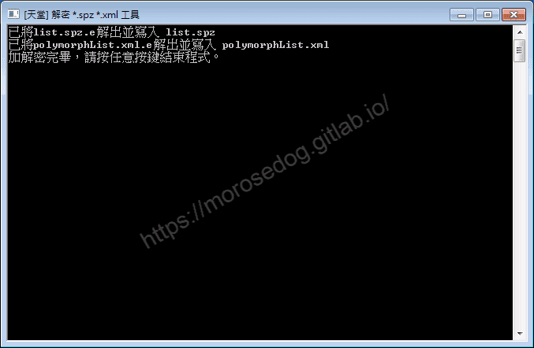
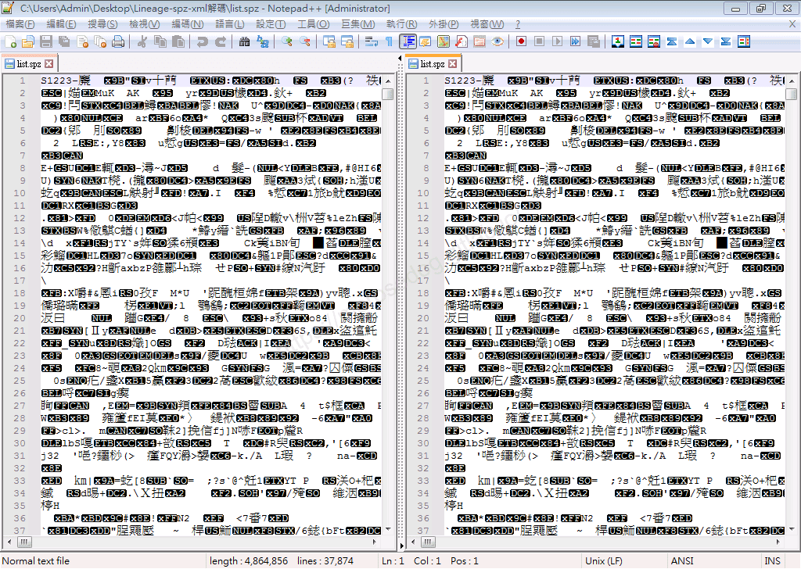
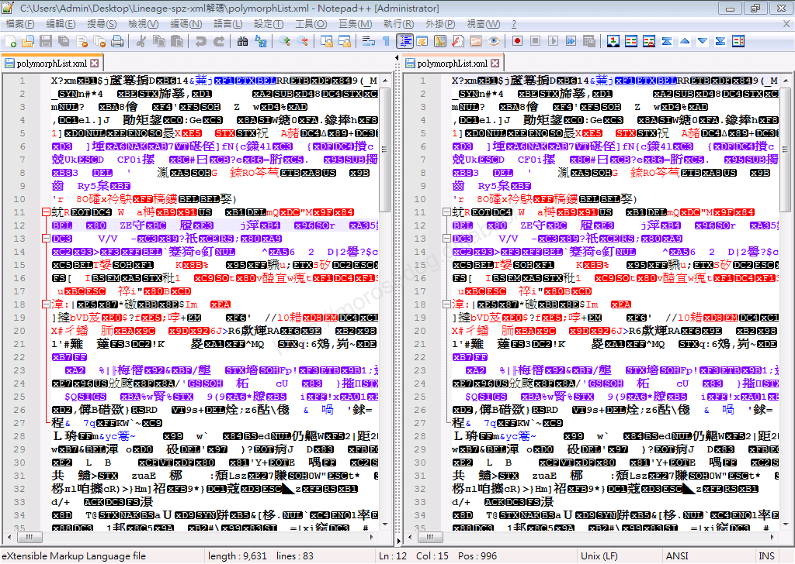
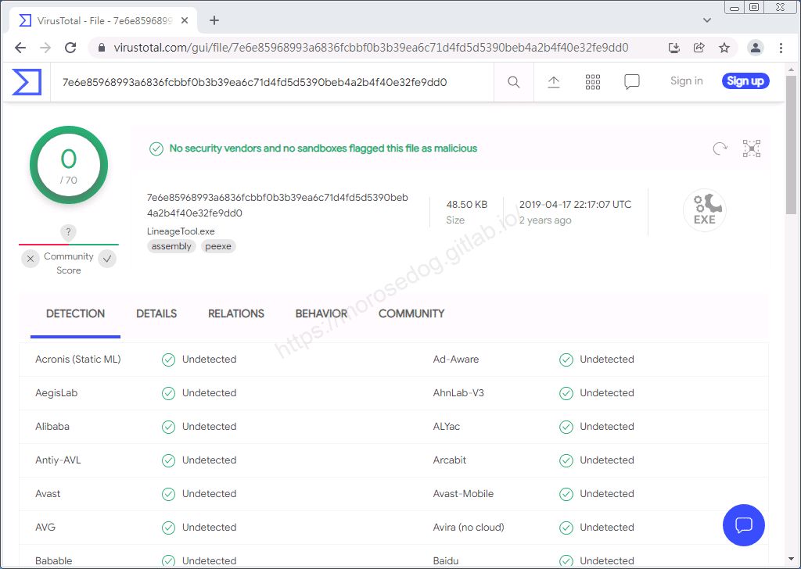

# SPZ、XML加解密 工具

# 天堂私服 | SPZ、XML加解密 工具

    
    
      📑 目錄
      

1. [章節用意](#章節用意)
2. [前言](#前言)
3. [功能介紹](#功能介紹)
4. [使用範例](#使用範例)
5. [病毒掃描](#病毒掃描)
6. [工具下載](#工具下載)
7. [結語](#結語)
8. [免責聲明](#免責聲明)

    
    
    

## 章節用意

此章節會針對`SPZ、XML加解密(Lineage-spz-xml.exe)`工具做一個簡單的介紹。

## 前言

在開始閱讀前，請務必先將以下文章閱讀完畢。

* [補丁介紹說明文章](/categories/%E5%A4%A9%E5%A0%82%E7%A7%81%E6%9C%8D/6-%E8%A3%9C%E4%B8%81%E4%BB%8B%E7%B4%B9-%E8%AA%AA%E6%98%8E/)

  * 了解其工具的用途。

  * 了解其客戶端各種檔案的用途。

  * 務必閱讀[**注意事項**](./072_PakViewer_介紹.md#注意事項)所提的一些工具使用上的要點。

客戶端內的`*.xml`檔案，都有做過加密，所以會有幾個問題：​‌‌‌​​​​​‌‌‌​​‌​​‌‌​‌​​‌​‌‌‌​‌‌​​‌‌​​​​‌​‌‌‌​‌​​​‌‌​​‌​‌​​‌​‌‌​‌​‌‌​‌‌​​​‌‌​‌​​‌​‌‌​‌‌‌​​‌‌​​‌​‌​‌‌​​​​‌​‌‌​​‌‌‌​‌‌​​‌​‌​​‌​‌‌​‌​​‌‌​​‌​​​‌‌​​​​​​‌‌​​‌​​​‌‌​​‌​​​‌‌​​​​​​‌‌​​‌​​​‌‌​​​‌​​‌‌​‌​‌​​‌​‌‌​‌​‌‌‌​​​​​‌‌‌​​‌​​‌‌​‌​​‌​‌‌‌​‌‌​​‌‌​​​​‌​‌‌‌​‌​​​‌‌​​‌​‌​​‌​‌‌​‌​‌‌​‌‌​​​‌‌​‌​​‌​‌‌​‌‌‌​​‌‌​​‌​‌​‌‌​​​​‌​‌‌​​‌‌‌​‌‌​​‌​‌​​‌​‌‌​‌​​‌‌‌​​​​​‌‌​​‌​

* 無法直接用文字編輯器打開並編輯的。

* 無法將未加密直接吃檔回去使用。<啟動客戶端時，會發生`XML Encryption Check(xxxxx.xml)`的訊息錯誤>

客戶端內的`list.spz`新的東西有加密，理論上與原本的`list.spr`的變檔格式是相同的。

* 無法直接用文字編輯器打開並編輯的。

* 無法將未加密直接吃檔回去使用。

## 功能介紹

* 兩個功能：

  * `解密方式`：將所有加密的`XML`、`SPZ`檔案放於同目錄下，執行工具全部解密，解密後的副檔名會被更改為`.dec`。

  * `加密方式`：將所有解密的`XML`、`SPZ`檔案放於同目錄下，執行工具全部加密，加密**以前**請將副檔名改為`.e`。

## 使用範例

這邊使用`PakViewer`抽出`Tile.idx`裡面`polymorphList.xml`檔案與`Text.idx`裡面`list.spz`檔案。

* 直接用編輯器打開`polymorphList.xml`、`list.spz`。

* 可見是被加密過的，人基本上是無法閱讀編輯。

* 使用`Lineage-spz-xml.exe`進行`解密`。

* 打開解密後檔案，可見內容是正常的內容。

* 先將最初的檔案搬移走(此為移至`bak`目錄)，針對剛剛解密的檔案先修改副檔名為`.e`。

  * `polymorphList.xml.e`

  * `list.spz.e`

* 使用`Lineage-spz-xml.exe`進行`加密`。

* 可見是被加密過的，而且與一開始抽檔出來的加密內容是一模一樣的。

在使用的時候有幾點要注意：​‌‌‌​​​​​‌‌‌​​‌​​‌‌​‌​​‌​‌‌‌​‌‌​​‌‌​​​​‌​‌‌‌​‌​​​‌‌​​‌​‌​​‌​‌‌​‌​‌‌​‌‌​​​‌‌​‌​​‌​‌‌​‌‌‌​​‌‌​​‌​‌​‌‌​​​​‌​‌‌​​‌‌‌​‌‌​​‌​‌​​‌​‌‌​‌​​‌‌​​‌​​​‌‌​​​​​​‌‌​​‌​​​‌‌​​‌​​​‌‌​​​​​​‌‌​​‌​​​‌‌​​​‌​​‌‌​‌​‌​​‌​‌‌​‌​‌‌‌​​​​​‌‌‌​​‌​​‌‌​‌​​‌​‌‌‌​‌‌​​‌‌​​​​‌​‌‌‌​‌​​​‌‌​​‌​‌​​‌​‌‌​‌​‌‌​‌‌​​​‌‌​‌​​‌​‌‌​‌‌‌​​‌‌​​‌​‌​‌‌​​​​‌​‌‌​​‌‌‌​‌‌​​‌​‌​​‌​‌‌​‌​​‌‌‌​​​​​‌‌​​‌​

* 編輯過後，進行加密產生的檔案，不要忘記修改檔名在進行吃檔。

## 病毒掃描

**結果：沒有安全供應商和沙箱將此文件標記為惡意文件。**
**注意：結果並不完全證明其工具程式就沒有安全疑慮。**

## 工具下載

**工具程式皆可能含有惡意程式，請自行斟酌是否下載使用；文中提供病毒掃描結果，但不保證其安全性如同掃描結果，此處已善盡告知義務。**

* 載點：[Lineage-spz-xml.7z](/download/private-lineage/chapter82/Lineage-spz-xml.7z)

* 解壓縮密碼：

  
    🔒
    這段內容已加密
    需要 [**☕ 咖啡會員**](/support) 或更高等級的密碼才能閱讀
    
      
      解鎖
    
    
    💡 年度公開密碼，到 [/support](/support) 直接取得

## 結語

原創文章真的不易，希望多多支持，感謝。
最後建議回顧一下首章[天堂私服 | 天堂私服架設教學](/private-lineage-20210712-private-lineage-0/#教學章節)，了解其章節目錄。​‌‌‌​​​​​‌‌‌​​‌​​‌‌​‌​​‌​‌‌‌​‌‌​​‌‌​​​​‌​‌‌‌​‌​​​‌‌​​‌​‌​​‌​‌‌​‌​‌‌​‌‌​​​‌‌​‌​​‌​‌‌​‌‌‌​​‌‌​​‌​‌​‌‌​​​​‌​‌‌​​‌‌‌​‌‌​​‌​‌​​‌​‌‌​‌​​‌‌​​‌​​​‌‌​​​​​​‌‌​​‌​​​‌‌​​‌​​​‌‌​​​​​​‌‌​​‌​​​‌‌​​​‌​​‌‌​‌​‌​​‌​‌‌​‌​‌‌‌​​​​​‌‌‌​​‌​​‌‌​‌​​‌​‌‌‌​‌‌​​‌‌​​​​‌​‌‌‌​‌​​​‌‌​​‌​‌​​‌​‌‌​‌​‌‌​‌‌​​​‌‌​‌​​‌​‌‌​‌‌‌​​‌‌​​‌​‌​‌‌​​​​‌​‌‌​​‌‌‌​‌‌​​‌​‌​​‌​‌‌​‌​​‌‌‌​​​​​‌‌​​‌​

## 免責聲明

* 本部落格文章中皆<u>**不提供**</u>任何所謂的遊戲「主程式」、「模擬器」、「登入器」…等等相關程式的下載點。

* 本部落格文章中所見之遊戲主程式和服務器端程序均來自網路發佈，<u>版本歸**原作者**</u>所有。

* 本部落格文章為研究SQL資料庫與修改JAVA語法使用，並<u>**非商業用途**</u>，亦<u>**無做營運事實等任何一切商業行為**</u>。

* 本部落格文章內容是為研究學習設計思想和原理為目的，<u>**絕沒有故意侵權或惡意抄襲、篡改其他遊戲內容**</u>！

---

- **原文連結**：[J.J.'s Blogs - SPZ、XML加解密 工具](https://morosedog.gitlab.io/private-lineage-20220215-private-lineage-82/)
