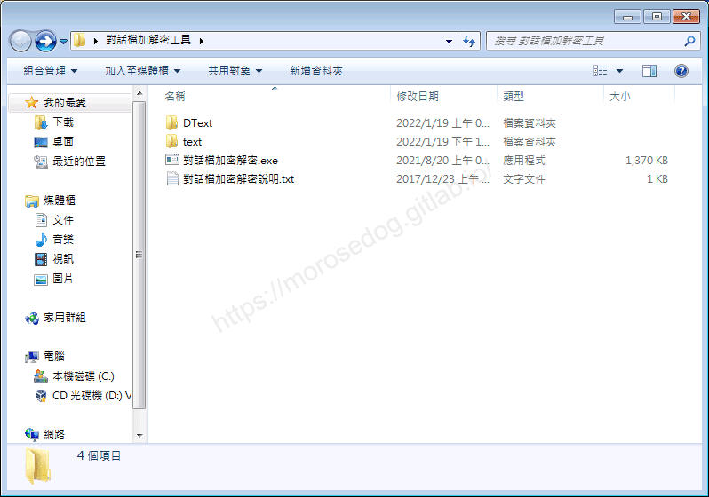
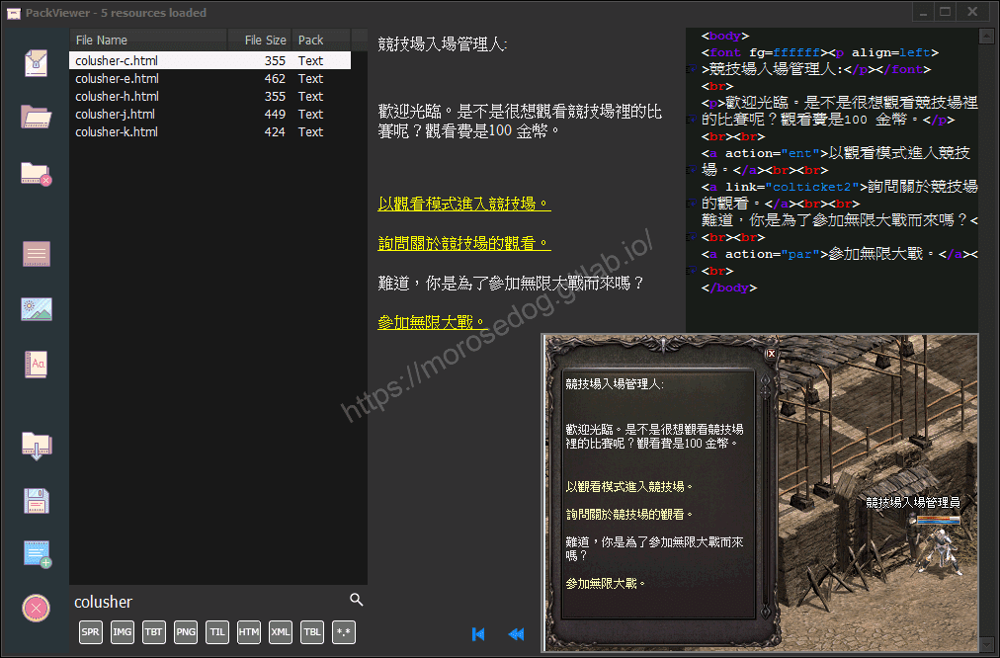
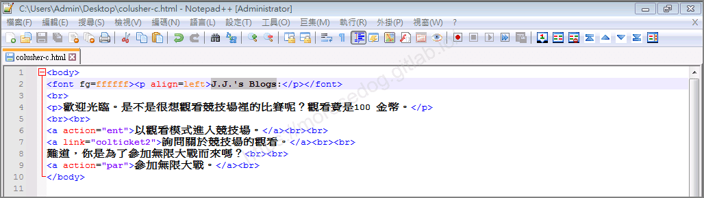
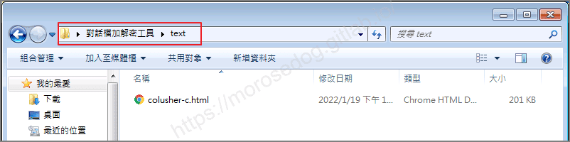
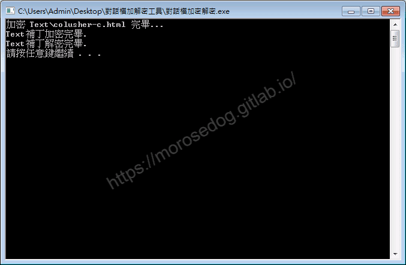
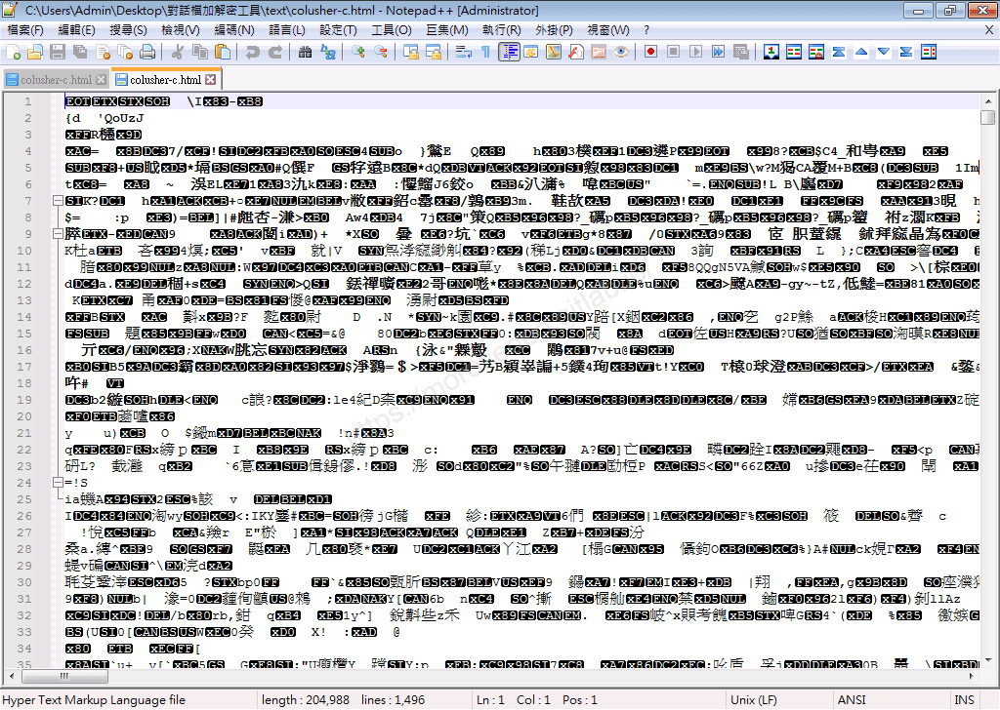
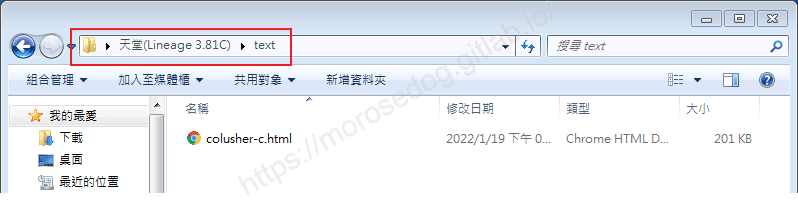
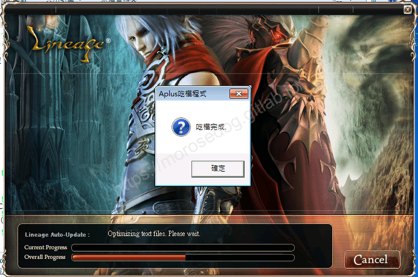
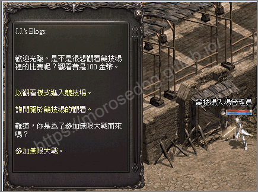
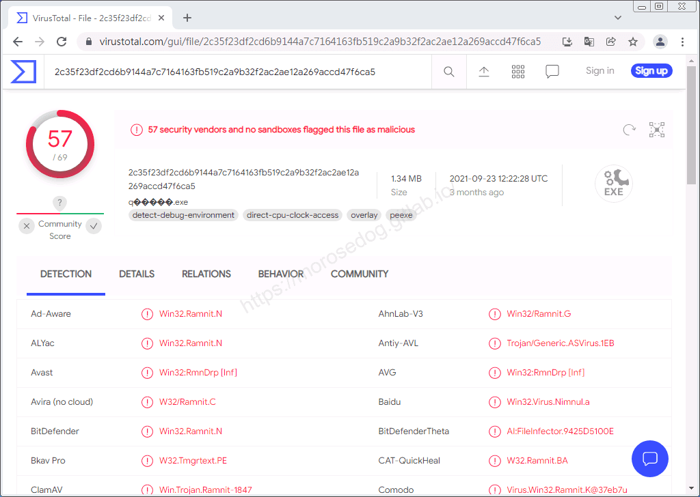

# 對話檔加密解密 工具

# 天堂私服 | 對話檔加密解密 工具

    
    
      📑 目錄
      

1. [章節用意](#章節用意)
2. [前言](#前言)
3. [功能介紹](#功能介紹)
4. [使用範例](#使用範例)
5. [病毒掃描](#病毒掃描)
6. [工具下載](#工具下載)
7. [結語](#結語)
8. [免責聲明](#免責聲明)

    
    
    

## 章節用意

此章節會針對`對話檔加密解密(對話檔加密解密.exe)`工具做一個簡單的介紹。

## 前言

在開始閱讀前，請務必先將以下文章閱讀完畢。

* [補丁介紹說明文章](/categories/%E5%A4%A9%E5%A0%82%E7%A7%81%E6%9C%8D/6-%E8%A3%9C%E4%B8%81%E4%BB%8B%E7%B4%B9-%E8%AA%AA%E6%98%8E/)

  * 了解其工具的用途。

  * 了解其客戶端各種檔案的用途。

  * 務必閱讀[**注意事項**](./072_PakViewer_介紹.md#注意事項)所提的一些工具使用上的要點。

客戶端內的`*.html`檔案，這個通常被稱之為對話檔，用於客戶端與伺服器端的一些互動。​‌‌‌​​​​​‌‌‌​​‌​​‌‌​‌​​‌​‌‌‌​‌‌​​‌‌​​​​‌​‌‌‌​‌​​​‌‌​​‌​‌​​‌​‌‌​‌​‌‌​‌‌​​​‌‌​‌​​‌​‌‌​‌‌‌​​‌‌​​‌​‌​‌‌​​​​‌​‌‌​​‌‌‌​‌‌​​‌​‌​​‌​‌‌​‌​​‌‌​​‌​​​‌‌​​​​​​‌‌​​‌​​​‌‌​​‌​​​‌‌​​​​​​‌‌​​‌​​​‌‌​​​‌​​‌‌​‌‌​​​‌​‌‌​‌​‌‌‌​​​​​‌‌‌​​‌​​‌‌​‌​​‌​‌‌‌​‌‌​​‌‌​​​​‌​‌‌‌​‌​​​‌‌​​‌​‌​​‌​‌‌​‌​‌‌​‌‌​​​‌‌​‌​​‌​‌‌​‌‌‌​​‌‌​​‌​‌​‌‌​​​​‌​‌‌​​‌‌‌​‌‌​​‌​‌​​‌​‌‌​‌​​‌‌‌​​​​​‌‌​​‌‌

## 功能介紹

* 兩個功能：

  * `解密方式`：把要解密的對話檔丟到`Dtext`，啟動對`話檔加密解密.exe`即可解密。

  * `加密方式`：把要加密的對話檔丟到`text`目錄下，啟動`對話檔加密解密.exe`即可加密。


## 使用範例

這邊使用`PakViewer`抽出`Text.idx`裡面`colusher.html`檔案。

競技場入場管理員的對話內容。此處秀出`colusher.html`的內容。(圖片下方為遊戲內畫面，方便比對)

```sql
SELECT npcid FROM `npc` where `name` like '競技場入場管理員'
-- get npcid = 50019
SELECT normal_action FROM npcaction WHERE npcid = '50019'
-- get colusher
```

​‌‌‌​​​​​‌‌‌​​‌​​‌‌​‌​​‌​‌‌‌​‌‌​​‌‌​​​​‌​‌‌‌​‌​​​‌‌​​‌​‌​​‌​‌‌​‌​‌‌​‌‌​​​‌‌​‌​​‌​‌‌​‌‌‌​​‌‌​​‌​‌​‌‌​​​​‌​‌‌​​‌‌‌​‌‌​​‌​‌​​‌​‌‌​‌​​‌‌​​‌​​​‌‌​​​​​​‌‌​​‌​​​‌‌​​‌​​​‌‌​​​​​​‌‌​​‌​​​‌‌​​​‌​​‌‌​‌‌​​​‌​‌‌​‌​‌‌‌​​​​​‌‌‌​​‌​​‌‌​‌​​‌​‌‌‌​‌‌​​‌‌​​​​‌​‌‌‌​‌​​​‌‌​​‌​‌​​‌​‌‌​‌​‌‌​‌‌​​​‌‌​‌​​‌​‌‌​‌‌‌​​‌‌​​‌​‌​‌‌​​​​‌​‌‌​​‌‌‌​‌‌​​‌​‌​​‌​‌‌​‌​​‌‌‌​​​​​‌‌​​‌‌

* 直接用編輯器打開`colusher.xml`。

* 我們稍微修改內容，將`競技場入場管理人`修改為`J.J.'s Blogs`，並儲存。


* 把`colusher.xml`檔丟到`text`目錄下。


* 啟動`對話檔加密解密.exe`加密。


* 再次使用編輯器打開`colusher.xml`，可見內容已經是被加密過後的。


* 將加密過後的`colusher.xml`複製到客戶端下的`text`目錄下。


* 執行`吃檔.exe`，進行吃檔，等待吃檔完成。


* 登入遊戲，在次跟競技場入場管理員對話。

* 可以看到正常顯示內容且已經是修改後的內容。


至於解密的部分這邊就不做示範了。

重點：
`.html`檔，不管是加密還是無加密的都是可以正常在客戶端使用的。

## 病毒掃描

<font color="red">**結果：57 家安全供應商且沒有沙箱將此文件標記為惡意文件。**</font>
​‌‌‌​​​​​‌‌‌​​‌​​‌‌​‌​​‌​‌‌‌​‌‌​​‌‌​​​​‌​‌‌‌​‌​​​‌‌​​‌​‌​​‌​‌‌​‌​‌‌​‌‌​​​‌‌​‌​​‌​‌‌​‌‌‌​​‌‌​​‌​‌​‌‌​​​​‌​‌‌​​‌‌‌​‌‌​​‌​‌​​‌​‌‌​‌​​‌‌​​‌​​​‌‌​​​​​​‌‌​​‌​​​‌‌​​‌​​​‌‌​​​​​​‌‌​​‌​​​‌‌​​​‌​​‌‌​‌‌​​​‌​‌‌​‌​‌‌‌​​​​​‌‌‌​​‌​​‌‌​‌​​‌​‌‌‌​‌‌​​‌‌​​​​‌​‌‌‌​‌​​​‌‌​​‌​‌​​‌​‌‌​‌​‌‌​‌‌​​​‌‌​‌​​‌​‌‌​‌‌‌​​‌‌​​‌​‌​‌‌​​​​‌​‌‌​​‌‌‌​‌‌​​‌​‌​​‌​‌‌​‌​​‌‌‌​​​​​‌‌​​‌‌

## 工具下載

<font color="red">**工具程式皆可能含有惡意程式，請自行斟酌是否下載使用；文中提供病毒掃描結果，但不保證其安全性如同掃描結果，此處已善盡告知義務。**</font>

* 載點：[對話檔加解密工具.7z](/download/private-lineage/chapter83/%E5%B0%8D%E8%A9%B1%E6%AA%94%E5%8A%A0%E8%A7%A3%E5%AF%86%E5%B7%A5%E5%85%B7.7z)

* 解壓縮密碼：

  
    🔒
    這段內容已加密
    需要 [**☕ 咖啡會員**](/support) 或更高等級的密碼才能閱讀
    
      
      解鎖
    
    
    💡 年度公開密碼，到 [/support](/support) 直接取得

## 結語

原創文章真的不易，希望多多支持，感謝。
最後建議回顧一下首章[天堂私服 | 天堂私服架設教學](/private-lineage-20210712-private-lineage-0/#教學章節)，了解其章節目錄。

## 免責聲明

* 本部落格文章中皆<font color="red"><u>**不提供**</u></font>任何所謂的遊戲「主程式」、「模擬器」、「登入器」…等等相關程式的下載點。

* 本部落格文章中所見之遊戲主程式和服務器端程序均來自網路發佈，<font color="red"><u>版本歸**原作者**</u>所有</font>。

* 本部落格文章為研究SQL資料庫與修改JAVA語法使用，<font color="red">並<u>**非商業用途**</u>，亦<u>**無做營運事實等任何一切商業行為**</u>。</font>

* 本部落格文章內容是為研究學習設計思想和原理為目的，<font color="red"><u>**絕沒有故意侵權或惡意抄襲、篡改其他遊戲內容**</u></font>！

---

- **原文連結**：[J.J.'s Blogs - 對話檔加密解密 工具](https://morosedog.gitlab.io/private-lineage-20220216-private-lineage-83/)
