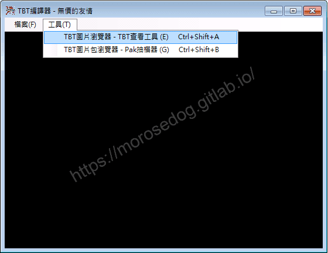
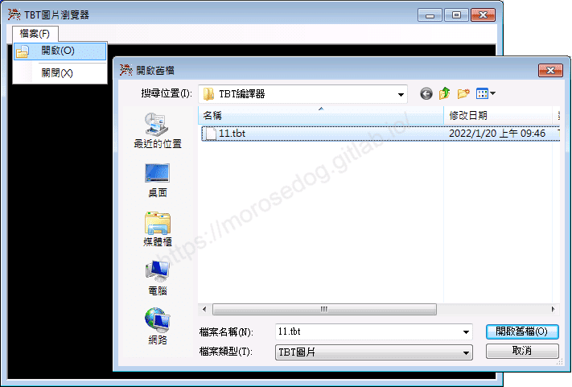
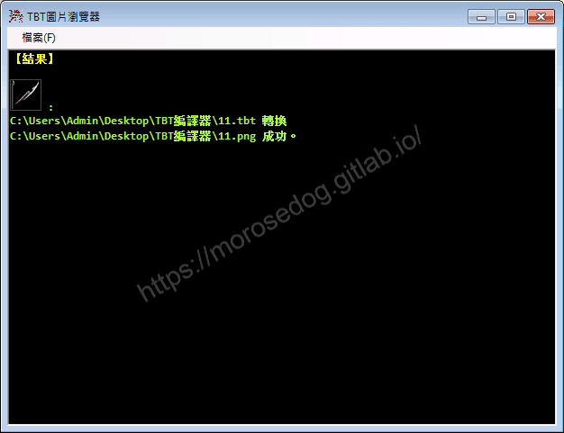
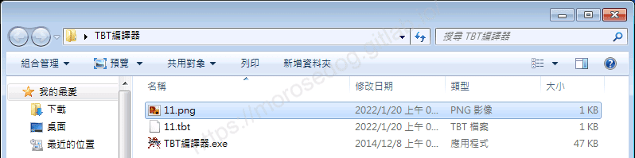
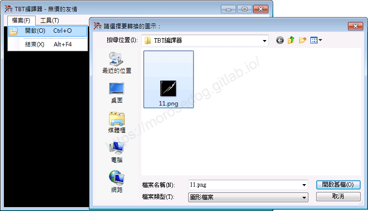
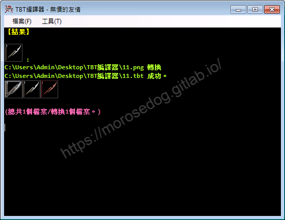
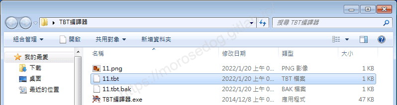
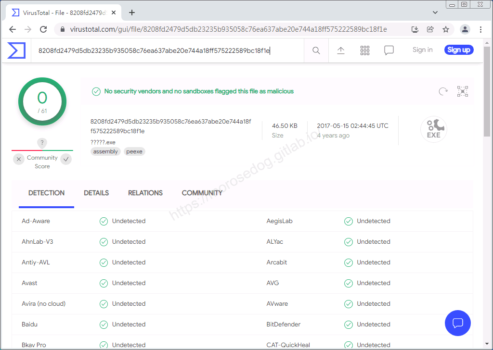

# TBT編譯器 工具(PNG↔TBT)

# 天堂私服 | TBT編譯器 工具(PNG↔TBT)

    
    
      📑 目錄
      

1. [章節用意](#章節用意)
2. [前言](#前言)
3. [功能介紹](#功能介紹)
6. [使用範例](#使用範例)

  1. [TBT->PNG](#TBT-gt-PNG)
  2. [PNG->TBT](#PNG-gt-TBT)
7. [病毒掃描](#病毒掃描)
8. [工具下載](#工具下載)
9. [結語](#結語)
10. [免責聲明](#免責聲明)

    
    
    

## 章節用意

此章節會針對`TBT編譯器(TBT編譯器.exe)`工具做一個簡單的介紹。

## 前言

在開始閱讀前，請務必閱讀[**注意事項**](./072_PakViewer_介紹.md#注意事項)所提的一些工具使用上的要點。

**工具用途**：像是要針對遊戲中的道具圖、魔法圖、人物狀態圖…等等，做所新增/修改。就需要修改`tbt`檔，而`tbt`無法直接修改，所以透過該工具將`tbt`轉換為`png`，然後修改`png`圖檔，後面再將修改好的`png`轉回`tbt`並吃檔回去，就可以修改道具圖、魔法圖、人物狀態圖…等等。​‌‌‌​​​​​‌‌‌​​‌​​‌‌​‌​​‌​‌‌‌​‌‌​​‌‌​​​​‌​‌‌‌​‌​​​‌‌​​‌​‌​​‌​‌‌​‌​‌‌​‌‌​​​‌‌​‌​​‌​‌‌​‌‌‌​​‌‌​​‌​‌​‌‌​​​​‌​‌‌​​‌‌‌​‌‌​​‌​‌​​‌​‌‌​‌​​‌‌​​‌​​​‌‌​​​​​​‌‌​​‌​​​‌‌​​‌​​​‌‌​​​​​​‌‌​​‌​​​‌‌​​​‌​​‌‌‌​​​​​‌​‌‌​‌​‌‌‌​​​​​‌‌‌​​‌​​‌‌​‌​​‌​‌‌‌​‌‌​​‌‌​​​​‌​‌‌‌​‌​​​‌‌​​‌​‌​​‌​‌‌​‌​‌‌​‌‌​​​‌‌​‌​​‌​‌‌​‌‌‌​​‌‌​​‌​‌​‌‌​​​​‌​‌‌​​‌‌‌​‌‌​​‌​‌​​‌​‌‌​‌​​‌‌‌​​​​​‌‌​‌​‌

## 功能介紹

* 兩個功能：

  * `TBT 轉 PNG`：使用`TBT圖片瀏覽器`。

  * `PNG 轉 TBT`：使用`TBT編譯器`。

* 點擊`工具(T)`->`TBT圖片瀏覽器 - TBT查看工具(E)`，會啟動另一個`TBT圖片瀏覽器`視窗。

* 於`TBT圖片瀏覽器`視窗，點擊`檔案(F)`->`開啟(O)`->選擇`TBT圖片`，進行轉為`PNG`檔。

* 檔案會產生在`TBT檔`的相同目錄下。

* 於`TBT編譯器`視窗，點擊`檔案(F)`->`開啟(O)`->選擇`PNG圖片`，進行轉為`TBT`檔。

* 檔案會產生在`PNG檔`的相同目錄下。

## 使用範例

* 啟動`TBT編譯器.exe`。

### TBT->PNG

* 點擊`工具(T)`->`TBT圖片瀏覽器 - TBT查看工具(E)`，會啟動另一個`TBT圖片瀏覽器`視窗。

* 於`TBT圖片瀏覽器`視窗，點擊`檔案(F)`->`開啟(O)`->選擇`TBT圖片`，進行轉為`PNG`檔。

* 此處選擇`11.tbt`檔。

* 可以看到轉換結果和檔案路徑。

* 檔案會產生在`TBT檔`的相同目錄下。

* 此處產生了`11.png`檔案。

### PNG->TBT

* 範例的前置作業：

  * 首先將`11.tbt`檔，進行改名`11.tbt.bak`。(主要是要看新的`png`轉`tbt`檔案有沒有正常產生)

> 註：正常的PNG->TBT轉換作業，是不需要上述的操作。

* 於`TBT編譯器`視窗，點擊`檔案(F)`->`開啟(O)`->選擇`PNG圖片`，進行轉為`TBT`檔。

* 此處選擇剛剛轉換的`11.png`檔。

* 可以看到轉換結果和檔案路徑。

* 檔案會產生在`PNG檔`的相同目錄下。

* 此處產生了新的`11.tbt`檔案。

## 病毒掃描

**結果：沒有安全供應商和沙箱將此文件標記為惡意文件。**
**注意：結果並不完全證明其工具程式就沒有安全疑慮。**

## 工具下載

**工具程式皆可能含有惡意程式，請自行斟酌是否下載使用；文中提供病毒掃描結果，但不保證其安全性如同掃描結果，此處已善盡告知義務。**​‌‌‌​​​​​‌‌‌​​‌​​‌‌​‌​​‌​‌‌‌​‌‌​​‌‌​​​​‌​‌‌‌​‌​​​‌‌​​‌​‌​​‌​‌‌​‌​‌‌​‌‌​​​‌‌​‌​​‌​‌‌​‌‌‌​​‌‌​​‌​‌​‌‌​​​​‌​‌‌​​‌‌‌​‌‌​​‌​‌​​‌​‌‌​‌​​‌‌​​‌​​​‌‌​​​​​​‌‌​​‌​​​‌‌​​‌​​​‌‌​​​​​​‌‌​​‌​​​‌‌​​​‌​​‌‌‌​​​​​‌​‌‌​‌​‌‌‌​​​​​‌‌‌​​‌​​‌‌​‌​​‌​‌‌‌​‌‌​​‌‌​​​​‌​‌‌‌​‌​​​‌‌​​‌​‌​​‌​‌‌​‌​‌‌​‌‌​​​‌‌​‌​​‌​‌‌​‌‌‌​​‌‌​​‌​‌​‌‌​​​​‌​‌‌​​‌‌‌​‌‌​​‌​‌​​‌​‌‌​‌​​‌‌‌​​​​​‌‌​‌​‌

* 載點：[TBT編譯器.7z](/download/private-lineage/chapter85/TBT%E7%B7%A8%E8%AD%AF%E5%99%A8.7z)

* 解壓縮密碼：

  
    🔒
    這段內容已加密
    需要 [**☕ 咖啡會員**](/support) 或更高等級的密碼才能閱讀
    
      
      解鎖
    
    
    💡 年度公開密碼，到 [/support](/support) 直接取得

## 結語

原創文章真的不易，希望多多支持，感謝。
最後建議回顧一下首章[天堂私服 | 天堂私服架設教學](/private-lineage-20210712-private-lineage-0/#教學章節)，了解其章節目錄。

## 免責聲明

* 本部落格文章中皆<u>**不提供**</u>任何所謂的遊戲「主程式」、「模擬器」、「登入器」…等等相關程式的下載點。

* 本部落格文章中所見之遊戲主程式和服務器端程序均來自網路發佈，<u>版本歸**原作者**</u>所有。

* 本部落格文章為研究SQL資料庫與修改JAVA語法使用，並<u>**非商業用途**</u>，亦<u>**無做營運事實等任何一切商業行為**</u>。

* 本部落格文章內容是為研究學習設計思想和原理為目的，<u>**絕沒有故意侵權或惡意抄襲、篡改其他遊戲內容**</u>！

---

- **原文連結**：[J.J.'s Blogs - TBT編譯器 工具(PNG↔TBT)](https://morosedog.gitlab.io/private-lineage-20220218-private-lineage-85/)
