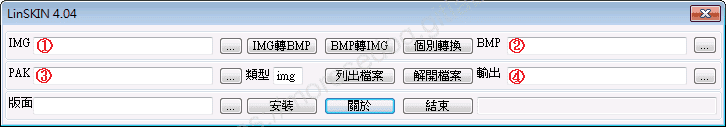
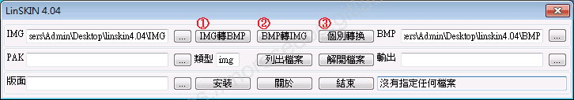
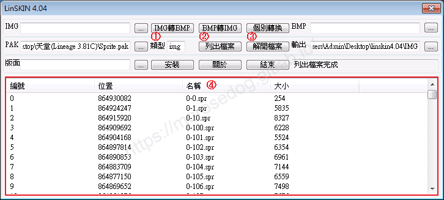
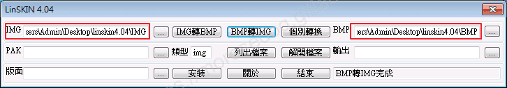
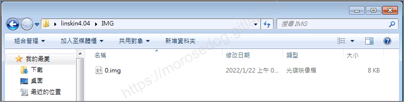
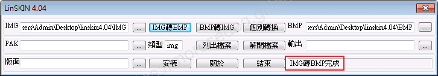
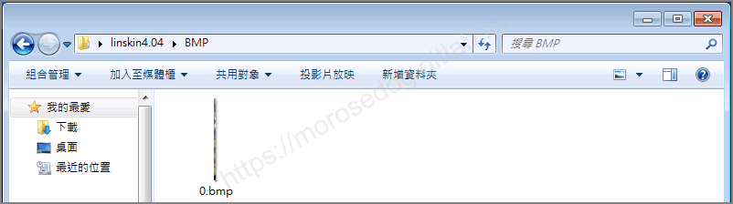
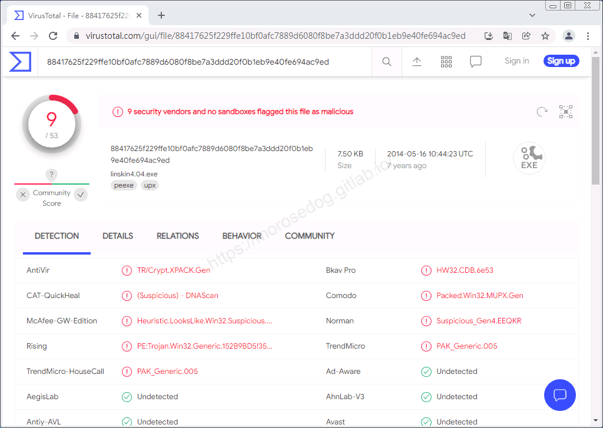

# Linskin4.04 工具(IMG↔BMP)

# 天堂私服 | Linskin4.04 工具(IMG↔BMP)

    
    
      📑 目錄
      

1. [章節用意](#章節用意)
2. [前言](#前言)
3. [功能介紹](#功能介紹)
6. [使用範例](#使用範例)

  1. [IMG->BMP](#IMG-gt-BMP)
  2. [BMP->IMG](#BMP-gt-IMG)
7. [病毒掃描](#病毒掃描)
8. [工具下載](#工具下載)
9. [結語](#結語)
10. [免責聲明](#免責聲明)

    
    
    

## 章節用意

此章節會針對`Linskin4.04 工具(linskin4.04.exe)`工具做一個簡單的介紹。

## 前言

在開始閱讀前，請務必閱讀[**注意事項**](./072_PakViewer_介紹.md#注意事項)所提的一些工具使用上的要點。

**工具用途**：修改遊戲內的介面，就需要修改`img`檔，而`img`無法直接修改，所以透過該工具將`img`轉換為`bmp`，然後修改`bmp`圖檔，後面再將修改好的`bmp`轉回`img`並吃檔回去，就可以修改遊戲內介面。​‌‌‌​​​​​‌‌‌​​‌​​‌‌​‌​​‌​‌‌‌​‌‌​​‌‌​​​​‌​‌‌‌​‌​​​‌‌​​‌​‌​​‌​‌‌​‌​‌‌​‌‌​​​‌‌​‌​​‌​‌‌​‌‌‌​​‌‌​​‌​‌​‌‌​​​​‌​‌‌​​‌‌‌​‌‌​​‌​‌​​‌​‌‌​‌​​‌‌​​‌​​​‌‌​​​​​​‌‌​​‌​​​‌‌​​‌​​​‌‌​​​​​​‌‌​​‌​​​‌‌​​​‌​​‌‌‌​​‌​​‌​‌‌​‌​‌‌‌​​​​​‌‌‌​​‌​​‌‌​‌​​‌​‌‌‌​‌‌​​‌‌​​​​‌​‌‌‌​‌​​​‌‌​​‌​‌​​‌​‌‌​‌​‌‌​‌‌​​​‌‌​‌​​‌​‌‌​‌‌‌​​‌‌​​‌​‌​‌‌​​​​‌​‌‌​​‌‌‌​‌‌​​‌​‌​​‌​‌‌​‌​​‌‌‌​​​​​‌‌​‌‌​

## 功能介紹

* 主要功能：

  * `img`↔`bmp`轉檔。

  * `pak`抽檔。

* 四個目錄設定：

  * 1. 設定`img`的批量的輸入/輸出目錄。

  * 1. 設定`bmp`的批量的輸入/輸出目錄。

  * 1. 設定要批量抽取的`pak`檔路徑。

  * 1. 設定將批量抽取的檔案輸出的目錄。

* 上方區塊說明：

  * 1. `IMG轉BMP`：將`img`目錄內的所有`img`檔轉換成`bmp`檔，並輸出至設定`bmp`目錄內。

  * 1. `BMP轉IMG`：將`bmp`目錄內的所有`bmp`檔轉換成`img`檔，並輸出至設定`img`目錄內。

  * 1. `個別轉換`：點選後自行選擇單一`img`或是`bmp`檔。(實測好像沒效果)

* 中間區塊說明：

  * 1. `類型`：根據想要抽出來的副檔名做填寫。(`img`、`spr`、`thml`、`tbt`、`xml`…等等)

  * 1. `列出檔案`：根據所選的`pak`檔，進行解析列出所有的檔案清單。

  * 1. `解開檔案`：根據所選的`pak`與設定的`類型`，將其抽出所有符合的檔案，並輸出至設定的目錄內。

  * 1. `清單`：點選`列出檔案`後顯示的清單，直接雙擊檔案即會各別抽出該檔案，並輸出至設定的目錄內。

## 使用範例

* 啟動`linskin4.04.exe`。

* 此處使用從`Sprite.pak`抽取`0.img`做示範。

### IMG->BMP

* 設定`img`的批量的輸入/輸出目錄與`bmp`的批量的輸入/輸出目錄。

* 將`0.img`檔，放入`img`的批量的輸入/輸出目錄。

* 點擊`IMG轉BMP`按鈕。

* 可見右下角顯示`IMG轉BMP完成`訊息。

* 此時進入`bmp`的批量的輸入/輸出目錄，可見`0.bmp`檔。

### BMP->IMG

這個轉檔的操作就是上方範例做點擊`BMP轉IMG`按鈕，這邊就不在特別用文與圖做示範了。

## 病毒掃描

**結果：9 家安全供應商且沒有沙箱將此文件標記為惡意文件。**

## 工具下載

**工具程式皆可能含有惡意程式，請自行斟酌是否下載使用；文中提供病毒掃描結果，但不保證其安全性如同掃描結果，此處已善盡告知義務。**​‌‌‌​​​​​‌‌‌​​‌​​‌‌​‌​​‌​‌‌‌​‌‌​​‌‌​​​​‌​‌‌‌​‌​​​‌‌​​‌​‌​​‌​‌‌​‌​‌‌​‌‌​​​‌‌​‌​​‌​‌‌​‌‌‌​​‌‌​​‌​‌​‌‌​​​​‌​‌‌​​‌‌‌​‌‌​​‌​‌​​‌​‌‌​‌​​‌‌​​‌​​​‌‌​​​​​​‌‌​​‌​​​‌‌​​‌​​​‌‌​​​​​​‌‌​​‌​​​‌‌​​​‌​​‌‌‌​​‌​​‌​‌‌​‌​‌‌‌​​​​​‌‌‌​​‌​​‌‌​‌​​‌​‌‌‌​‌‌​​‌‌​​​​‌​‌‌‌​‌​​​‌‌​​‌​‌​​‌​‌‌​‌​‌‌​‌‌​​​‌‌​‌​​‌​‌‌​‌‌‌​​‌‌​​‌​‌​‌‌​​​​‌​‌‌​​‌‌‌​‌‌​​‌​‌​​‌​‌‌​‌​​‌‌‌​​​​​‌‌​‌‌​

* 載點：[linskin4.04.7z](/download/private-lineage/chapter86/linskin4.04.7z)

* 解壓縮密碼：

  
    🔒
    這段內容已加密
    需要 [**☕ 咖啡會員**](/support) 或更高等級的密碼才能閱讀
    
      
      解鎖
    
    
    💡 年度公開密碼，到 [/support](/support) 直接取得

## 結語

原創文章真的不易，希望多多支持，感謝。
最後建議回顧一下首章[天堂私服 | 天堂私服架設教學](/private-lineage-20210712-private-lineage-0/#教學章節)，了解其章節目錄。

## 免責聲明

* 本部落格文章中皆<u>**不提供**</u>任何所謂的遊戲「主程式」、「模擬器」、「登入器」…等等相關程式的下載點。

* 本部落格文章中所見之遊戲主程式和服務器端程序均來自網路發佈，<u>版本歸**原作者**</u>所有。

* 本部落格文章為研究SQL資料庫與修改JAVA語法使用，並<u>**非商業用途**</u>，亦<u>**無做營運事實等任何一切商業行為**</u>。

* 本部落格文章內容是為研究學習設計思想和原理為目的，<u>**絕沒有故意侵權或惡意抄襲、篡改其他遊戲內容**</u>！

---

- **原文連結**：[J.J.'s Blogs - Linskin4.04 工具(IMG↔BMP)](https://morosedog.gitlab.io/private-lineage-20220219-private-lineage-86/)
