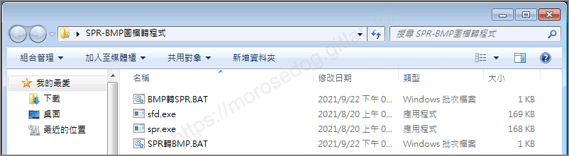
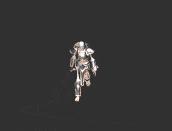
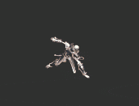
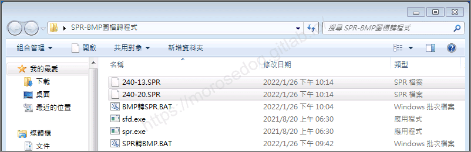
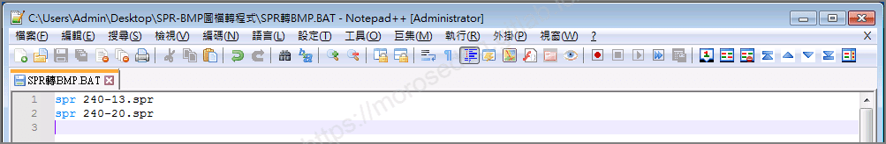
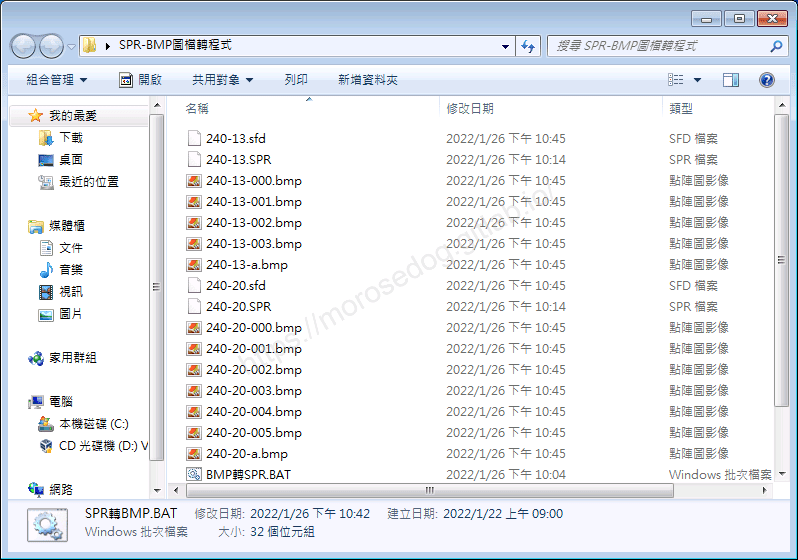
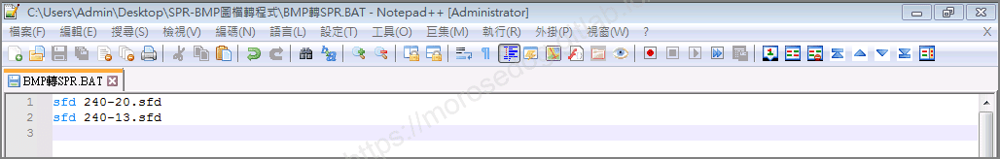
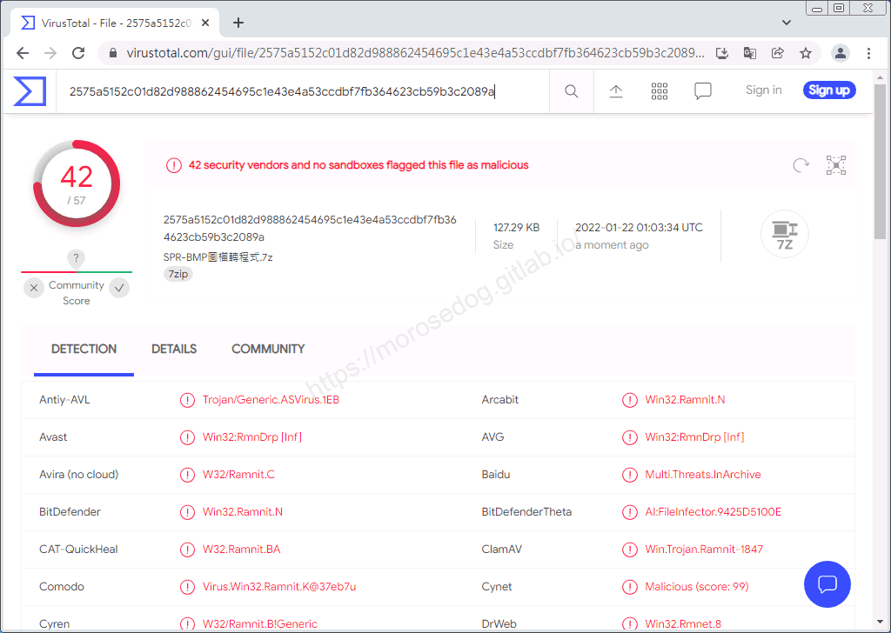

# SPR-BMP互轉 工具(SPR↔BMP)

# 天堂私服 | SPR-BMP互轉 工具(SPR↔BMP)

    
    
      📑 目錄
      

1. [章節用意](#章節用意)
2. [前言](#前言)
3. [功能介紹](#功能介紹)
6. [使用範例](#使用範例)

  1. [SPR->BMP](#SPR-gt-BMP)
  2. [BMP->SPR](#BMP-gt-SPR)
7. [轉檔錯誤](#轉檔錯誤)
8. [病毒掃描](#病毒掃描)
9. [工具下載](#工具下載)
10. [結語](#結語)
11. [免責聲明](#免責聲明)

    
    
    

## 章節用意

此章節會針對`SPR-BMP互轉(sfd.exe、spr.exe)`工具做一個簡單的介紹。

## 前言

在開始閱讀前，請務必閱讀[**注意事項**](./072_PakViewer_介紹.md#注意事項)所提的一些工具使用上的要點。

**工具用途**：修改遊戲內的動態圖檔，就需要修改`spr`檔，而`spr`無法直接修改，所以透過該工具將`spr`轉換為`bmp`與`sfd`檔，然後修改`bmp`圖檔，後面再將修改好的`bmp`轉回`spr`並吃檔回去，就可以修改遊戲內動態圖檔。​‌‌‌​​​​​‌‌‌​​‌​​‌‌​‌​​‌​‌‌‌​‌‌​​‌‌​​​​‌​‌‌‌​‌​​​‌‌​​‌​‌​​‌​‌‌​‌​‌‌​‌‌​​​‌‌​‌​​‌​‌‌​‌‌‌​​‌‌​​‌​‌​‌‌​​​​‌​‌‌​​‌‌‌​‌‌​​‌​‌​​‌​‌‌​‌​​‌‌​​‌​​​‌‌​​​​​​‌‌​​‌​​​‌‌​​‌​​​‌‌​​​​​​‌‌​​‌​​​‌‌​​‌​​​‌‌​​​​​​‌​‌‌​‌​‌‌‌​​​​​‌‌‌​​‌​​‌‌​‌​​‌​‌‌‌​‌‌​​‌‌​​​​‌​‌‌‌​‌​​​‌‌​​‌​‌​​‌​‌‌​‌​‌‌​‌‌​​​‌‌​‌​​‌​‌‌​‌‌‌​​‌‌​​‌​‌​‌‌​​​​‌​‌‌​​‌‌‌​‌‌​​‌​‌​​‌​‌‌​‌​​‌‌‌​​​​​‌‌​‌‌‌

## 功能介紹

* 主要功能：`spr`↔`bmp`轉檔。

* 四個檔案說明：

  * `BMP轉SPR.BAT`：批量執行`bmp`轉`spr`的批次檔。

  * `sfd.exe`：批次檔內所呼叫使用的執行檔，用於讀取`sfd`檔轉換成`spr`檔。

  * `SPR轉BMP.BAT`：批量執行`spr`轉`bmp`的批次檔。

  * `spr.exe`：批次檔內所呼叫使用的執行檔，用於讀取`spr`檔轉換成`bmp`與`sfd`檔。


## 使用範例

* 此處使用從`Sprite.pak`抽取兩個`spr`做示範。

  * `240-13.spr`：

  * `240-20.spr`：

* 將兩個`spr`檔案放入`SPR-BMP互轉`目錄內。


### SPR->BMP

* 編輯`SPR轉BMP.BAT`檔，修改內容對應檔案名稱，並儲存。

```plain
spr 240-13.spr
spr 240-20.spr
```



* 執行`SPR轉BMP.BAT`將會產生，`bmp`與`sfd`檔，如下清單。

```plain
240-13.sfd
240-13-000.bmp
240-13-001.bmp
240-13-002.bmp
240-13-003.bmp
240-13-a.bmp

240-20.sfd
240-20-000.bmp
240-20-001.bmp
240-20-002.bmp
240-20-003.bmp
240-20-004.bmp
240-20-005.bmp
240-20-a.bmp
```

> 註：有興趣可以看看`sfd`檔案的內容，裡面的設定和用途，主要搭配`SFDviewer`工具使用；之後會有文章介紹工具，日後或許會另開文章說明修改教學。
> 

### BMP->SPR

* 將`sfd`與`bmp`檔放置目錄內。

> 註：這邊就沿用上方產生的檔案直接示範。

* 編輯`BMP轉SPR.BAT`檔，修改內容對應檔案名稱，並儲存。

```plain
sfd 240-20.sfd
sfd 240-13.sfd
```



* 執行`BMP轉SPR.BAT`將會產生，`spr`檔，這邊會產生並直接覆蓋已經存在的`spr`檔。

## 轉檔錯誤

如果發生`spr.exe`已經停止運作；
可以將`spr`檔案吃檔進客戶端，使用[LineageSpr 工具](./078_LineageSpr_工具.md)，抽出指定的`BMP`。​‌‌‌​​​​​‌‌‌​​‌​​‌‌​‌​​‌​‌‌‌​‌‌​​‌‌​​​​‌​‌‌‌​‌​​​‌‌​​‌​‌​​‌​‌‌​‌​‌‌​‌‌​​​‌‌​‌​​‌​‌‌​‌‌‌​​‌‌​​‌​‌​‌‌​​​​‌​‌‌​​‌‌‌​‌‌​​‌​‌​​‌​‌‌​‌​​‌‌​​‌​​​‌‌​​​​​​‌‌​​‌​​​‌‌​​‌​​​‌‌​​​​​​‌‌​​‌​​​‌‌​​‌​​​‌‌​​​​​​‌​‌‌​‌​‌‌‌​​​​​‌‌‌​​‌​​‌‌​‌​​‌​‌‌‌​‌‌​​‌‌​​​​‌​‌‌‌​‌​​​‌‌​​‌​‌​​‌​‌‌​‌​‌‌​‌‌​​​‌‌​‌​​‌​‌‌​‌‌‌​​‌‌​​‌​‌​‌‌​​​​‌​‌‌​​‌‌‌​‌‌​​‌​‌​​‌​‌‌​‌​​‌‌‌​​​​​‌‌​‌‌‌

## 病毒掃描

<font color="red">**結果：42 家安全供應商且沒有沙箱將此文件標記為惡意文件。**</font>


## 工具下載

<font color="red">**工具程式皆可能含有惡意程式，請自行斟酌是否下載使用；文中提供病毒掃描結果，但不保證其安全性如同掃描結果，此處已善盡告知義務。**</font>

* 載點：[SPR-BMP圖檔轉程式.7z](/download/private-lineage/chapter87/SPR-BMP%E5%9C%96%E6%AA%94%E8%BD%89%E7%A8%8B%E5%BC%8F.7z)

* 解壓縮密碼：

  
    🔒
    這段內容已加密
    需要 [**☕ 咖啡會員**](/support) 或更高等級的密碼才能閱讀
    
      
      解鎖
    
    
    💡 年度公開密碼，到 [/support](/support) 直接取得

## 結語

原創文章真的不易，希望多多支持，感謝。
最後建議回顧一下首章[天堂私服 | 天堂私服架設教學](/private-lineage-20210712-private-lineage-0/#教學章節)，了解其章節目錄。​‌‌‌​​​​​‌‌‌​​‌​​‌‌​‌​​‌​‌‌‌​‌‌​​‌‌​​​​‌​‌‌‌​‌​​​‌‌​​‌​‌​​‌​‌‌​‌​‌‌​‌‌​​​‌‌​‌​​‌​‌‌​‌‌‌​​‌‌​​‌​‌​‌‌​​​​‌​‌‌​​‌‌‌​‌‌​​‌​‌​​‌​‌‌​‌​​‌‌​​‌​​​‌‌​​​​​​‌‌​​‌​​​‌‌​​‌​​​‌‌​​​​​​‌‌​​‌​​​‌‌​​‌​​​‌‌​​​​​​‌​‌‌​‌​‌‌‌​​​​​‌‌‌​​‌​​‌‌​‌​​‌​‌‌‌​‌‌​​‌‌​​​​‌​‌‌‌​‌​​​‌‌​​‌​‌​​‌​‌‌​‌​‌‌​‌‌​​​‌‌​‌​​‌​‌‌​‌‌‌​​‌‌​​‌​‌​‌‌​​​​‌​‌‌​​‌‌‌​‌‌​​‌​‌​​‌​‌‌​‌​​‌‌‌​​​​​‌‌​‌‌‌

## 免責聲明

* 本部落格文章中皆<font color="red"><u>**不提供**</u></font>任何所謂的遊戲「主程式」、「模擬器」、「登入器」…等等相關程式的下載點。

* 本部落格文章中所見之遊戲主程式和服務器端程序均來自網路發佈，<font color="red"><u>版本歸**原作者**</u>所有</font>。

* 本部落格文章為研究SQL資料庫與修改JAVA語法使用，<font color="red">並<u>**非商業用途**</u>，亦<u>**無做營運事實等任何一切商業行為**</u>。</font>

* 本部落格文章內容是為研究學習設計思想和原理為目的，<font color="red"><u>**絕沒有故意侵權或惡意抄襲、篡改其他遊戲內容**</u></font>！

---

- **原文連結**：[J.J.'s Blogs - SPR-BMP互轉 工具(SPR↔BMP)](https://morosedog.gitlab.io/private-lineage-20220220-private-lineage-87/)
