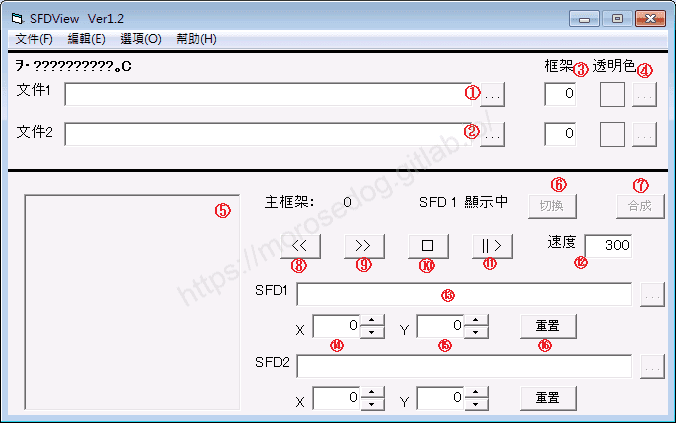
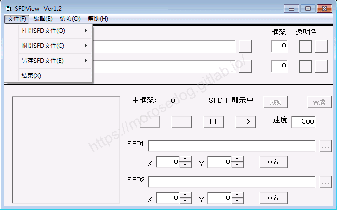
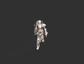
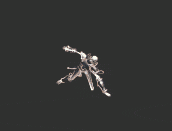
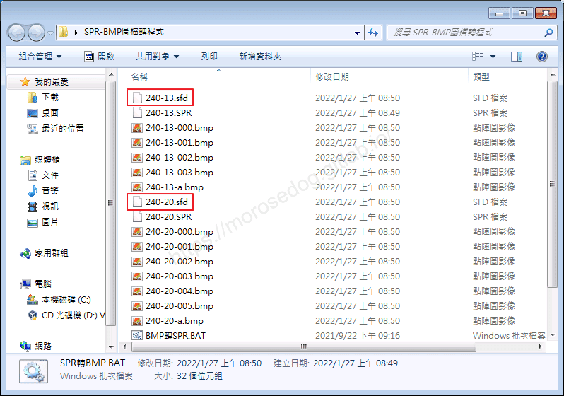
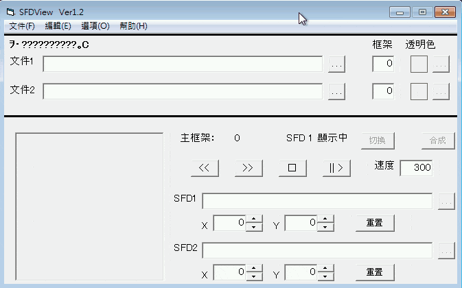
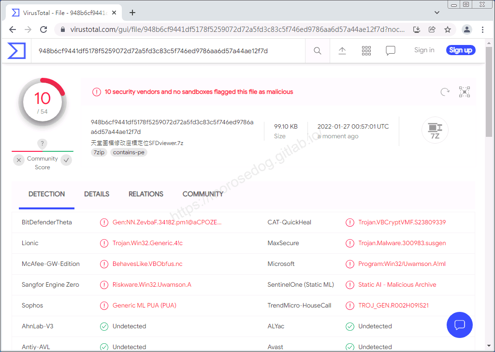

# SFDviewer 工具(圖檔座標定位)

# 天堂私服 | SFDviewer 工具(圖檔座標定位)

    
    
      📑 目錄
      

1. [章節用意](#章節用意)
2. [前言](#前言)
3. [功能介紹](#功能介紹)
4. [使用範例](#使用範例)
5. [病毒掃描](#病毒掃描)
6. [工具下載](#工具下載)
7. [結語](#結語)
8. [免責聲明](#免責聲明)

    
    
    

## 章節用意

此章節會針對`SFDviewer 工具(圖檔座標定位)(SFDviewer.exe)`工具做一個簡單的介紹。

## 前言

在開始閱讀前，請務必閱讀

* [**注意事項**](./072_PakViewer_介紹.md#注意事項)所提的一些工具使用上的要點。

* [SPR-BMP互轉 工具(SPR↔BMP)](./087_SPR-BMP互轉_工具(SPR↔BMP).md)，了解`sfd`檔如何取得。

**工具用途**：修改遊戲內的動態圖檔，就需要修改`spr`檔，而`spr`無法直接修改，所以透過該工具將`spr`轉換為`bmp`與`sfd`檔，然後修改`bmp`圖檔，後面再將修改好的`bmp`轉回`spr`並吃檔回去，就可以修改遊戲內動態圖檔；另外`sfd`檔是針對每張圖片定義其位置。​‌‌‌​​​​​‌‌‌​​‌​​‌‌​‌​​‌​‌‌‌​‌‌​​‌‌​​​​‌​‌‌‌​‌​​​‌‌​​‌​‌​​‌​‌‌​‌​‌‌​‌‌​​​‌‌​‌​​‌​‌‌​‌‌‌​​‌‌​​‌​‌​‌‌​​​​‌​‌‌​​‌‌‌​‌‌​​‌​‌​​‌​‌‌​‌​​‌‌​​‌​​​‌‌​​​​​​‌‌​​‌​​​‌‌​​‌​​​‌‌​​​​​​‌‌​​‌​​​‌‌​​‌​​​‌‌​​​‌​​‌​‌‌​‌​‌‌‌​​​​​‌‌‌​​‌​​‌‌​‌​​‌​‌‌‌​‌‌​​‌‌​​​​‌​‌‌‌​‌​​​‌‌​​‌​‌​​‌​‌‌​‌​‌‌​‌‌​​​‌‌​‌​​‌​‌‌​‌‌‌​​‌‌​​‌​‌​‌‌​​​​‌​‌‌​​‌‌‌​‌‌​​‌​‌​​‌​‌‌​‌​​‌‌‌​​​​​‌‌‌​​​

## 功能介紹

* 介面功能介紹：

  * ①`文件一`：開啟第一個`sfd`檔選擇，並開啟。

  * ②`文件二`：開啟第二個`sfd`檔選擇，並開啟。

  * ③`框架`：顯示總圖片張數。

  * ④`透明色`：替換透明背景顏色替代。

  * ⑤`預覽`：預覽對應的`bmp`圖片，位置也有其對應。

  * ⑥`切換`：當同時開啟兩個`sfd`檔的時候，用於切換預覽顯示。

  * ⑦`合成`：當同時開啟兩個`sfd`檔的時候，預覽會重疊兩個預覽圖。(舉例：用於人物+影子)

  * ⑧`上一張`：顯示上一張`bmp`。

  * ⑨`下一張`：顯示下一張`bmp`。

  * ⑩`停止`：停止動態預覽。

  * ⑪`播放`：撥放動態預覽。

  * ⑫`速度`：播放速度。(單位:毫秒 ms)

  * ⑬`SFD1`、`SFD2`：目前預覽的`bmp`圖檔名稱。

  * ⑭`X`：當前的`bmp`圖檔的`X`軸位置。

  * ⑮`Y`：當前的`bmp`圖檔的`Y`軸位置。

  * ⑯`重置`：恢復為`sfd`裡面設定的`X`,`Y`。

* 工具列功能介紹：

  * 文件

    * 打開`SFD`文件(O)

      * `SFD1`：開啟第一個`sfd`檔選擇，並開啟。

      * `SFD2`：開啟第二個`sfd`檔選擇，並開啟。

    * 關閉`SFD`文件(C)

      * `SFD1`：關閉第一個開啟的`sfd`。

      * `SFD2`：關閉第二個開啟的`sfd`。

    * 另存`SFD`文件(E)

      * `全部`：另存目前開啟的全部`sfd`檔。

      * `SFD1`：另存目前開啟第一個`sfd`檔。

      * `SFD2`：另存目前開啟第二個`sfd`檔。

    * 結束(X)

  * 編輯、選項、幫助：這三個就不特別介紹。

## 使用範例

* 此處使用從`Sprite.pak`抽取兩個`spr`做示範。

  * `240-13.spr`：

  * `240-20.spr`：

* 並搭配[SPR-BMP互轉 工具(SPR↔BMP)](./087_SPR-BMP互轉_工具(SPR↔BMP).md)使用抽取出`sfd`檔。

* 以下僅提供動圖，就不在特別說明，請看上方的[功能介紹](#功能介紹)。

* 修改完後，透過工具功能，另存檔案。

## 病毒掃描

**結果：10 家安全供應商且沒有沙箱將此文件標記為惡意文件。**

## 工具下載

**工具程式皆可能含有惡意程式，請自行斟酌是否下載使用；文中提供病毒掃描結果，但不保證其安全性如同掃描結果，此處已善盡告知義務。**

* 載點：[天堂圖檔修改座標定位SFDviewer.7z](/download/private-lineage/chapter88/%E5%A4%A9%E5%A0%82%E5%9C%96%E6%AA%94%E4%BF%AE%E6%94%B9%E5%BA%A7%E6%A8%99%E5%AE%9A%E4%BD%8DSFDviewer.7z)

* 解壓縮密碼：

  
    🔒
    這段內容已加密
    需要 [**☕ 咖啡會員**](/support) 或更高等級的密碼才能閱讀
    
      
      解鎖
    
    
    💡 年度公開密碼，到 [/support](/support) 直接取得

## 結語

原創文章真的不易，希望多多支持，感謝。
最後建議回顧一下首章[天堂私服 | 天堂私服架設教學](/private-lineage-20210712-private-lineage-0/#教學章節)，了解其章節目錄。​‌‌‌​​​​​‌‌‌​​‌​​‌‌​‌​​‌​‌‌‌​‌‌​​‌‌​​​​‌​‌‌‌​‌​​​‌‌​​‌​‌​​‌​‌‌​‌​‌‌​‌‌​​​‌‌​‌​​‌​‌‌​‌‌‌​​‌‌​​‌​‌​‌‌​​​​‌​‌‌​​‌‌‌​‌‌​​‌​‌​​‌​‌‌​‌​​‌‌​​‌​​​‌‌​​​​​​‌‌​​‌​​​‌‌​​‌​​​‌‌​​​​​​‌‌​​‌​​​‌‌​​‌​​​‌‌​​​‌​​‌​‌‌​‌​‌‌‌​​​​​‌‌‌​​‌​​‌‌​‌​​‌​‌‌‌​‌‌​​‌‌​​​​‌​‌‌‌​‌​​​‌‌​​‌​‌​​‌​‌‌​‌​‌‌​‌‌​​​‌‌​‌​​‌​‌‌​‌‌‌​​‌‌​​‌​‌​‌‌​​​​‌​‌‌​​‌‌‌​‌‌​​‌​‌​​‌​‌‌​‌​​‌‌‌​​​​​‌‌‌​​​

## 免責聲明

* 本部落格文章中皆<u>**不提供**</u>任何所謂的遊戲「主程式」、「模擬器」、「登入器」…等等相關程式的下載點。

* 本部落格文章中所見之遊戲主程式和服務器端程序均來自網路發佈，<u>版本歸**原作者**</u>所有。

* 本部落格文章為研究SQL資料庫與修改JAVA語法使用，並<u>**非商業用途**</u>，亦<u>**無做營運事實等任何一切商業行為**</u>。

* 本部落格文章內容是為研究學習設計思想和原理為目的，<u>**絕沒有故意侵權或惡意抄襲、篡改其他遊戲內容**</u>！

---

- **原文連結**：[J.J.'s Blogs - SFDviewer 工具(圖檔座標定位)](https://morosedog.gitlab.io/private-lineage-20220221-private-lineage-88/)
