# 超簡易地圖預覽 工具

# 天堂私服 | 超簡易地圖預覽 工具

    
    
      📑 目錄
      

1. [章節用意](#章節用意)
2. [前言](#前言)
3. [功能介紹](#功能介紹)
8. [使用範例](#使用範例)

  1. [預覽地圖](#預覽地圖)
  2. [匯出](#匯出)
  3. [全部匯出](#全部匯出)
  4. [顯示區域](#顯示區域)
9. [病毒掃描](#病毒掃描)
10. [工具下載](#工具下載)
11. [結語](#結語)
12. [免責聲明](#免責聲明)

    
    
    

## 章節用意

此章節會針對`超簡易地圖預覽(MapTool.exe)`工具做一個簡單的介紹。

## 前言

在開始閱讀前，請務必閱讀

* [**注意事項**](./072_PakViewer_介紹.md#注意事項)所提的一些工具使用上的要點。

**工具用途**：用於預覽客戶端地圖、讀取客戶端地圖並輸出為`txt`檔。​‌‌‌​​​​​‌‌‌​​‌​​‌‌​‌​​‌​‌‌‌​‌‌​​‌‌​​​​‌​‌‌‌​‌​​​‌‌​​‌​‌​​‌​‌‌​‌​‌‌​‌‌​​​‌‌​‌​​‌​‌‌​‌‌‌​​‌‌​​‌​‌​‌‌​​​​‌​‌‌​​‌‌‌​‌‌​​‌​‌​​‌​‌‌​‌​​‌‌​​‌​​​‌‌​​​​​​‌‌​​‌​​​‌‌​​‌​​​‌‌​​​​​​‌‌​​‌​​​‌‌​​‌​​​‌‌​​‌​​​‌​‌‌​‌​‌‌‌​​​​​‌‌‌​​‌​​‌‌​‌​​‌​‌‌‌​‌‌​​‌‌​​​​‌​‌‌‌​‌​​​‌‌​​‌​‌​​‌​‌‌​‌​‌‌​‌‌​​​‌‌​‌​​‌​‌‌​‌‌‌​​‌‌​​‌​‌​‌‌​​​​‌​‌‌​​‌‌‌​‌‌​​‌​‌​​‌​‌‌​‌​​‌‌‌​​​​​‌‌‌​​‌

## 功能介紹

* 介面功能介紹：

  * ①`工具列`：工具列區域。

  * ②`地圖清單`：在設定玩天堂路徑後，讀取的地圖清單。

  * ③`預覽地圖`：點選地圖清單中的地圖後，預覽地圖。

  * ④`地圖資訊`：點選地圖清單中的地圖後，顯示地圖的相關資訊。
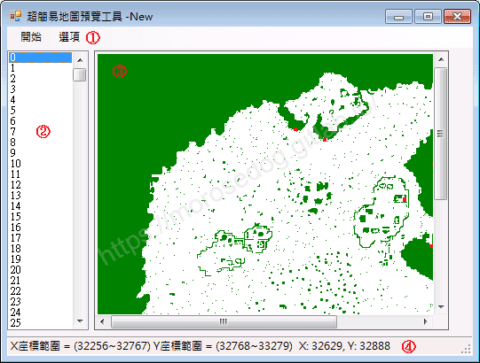

* 工具列功能介紹：

  * 開始

    * 設定天堂路徑：設定客戶端的天堂路徑。

    * 匯出：指定點選地圖清單中的地圖後，點選即可匯出該地圖的`.txt`檔。

    * 全部匯出：將地圖清單中的所有地圖，會產生一個`all`資料夾存放所有的地圖`.txt`檔。

    * 離開：離開程式。

> 註：以上匯出功能(預設存放與`MapTool`程式目錄相同)，輸出格式預設為`L1J`。

  * 選項

    * 視角

      * 天堂視角(`45`度)

    * 圖片倍率

      * `1`倍

      * `2`倍

      * `4`倍

      * `8`倍

    * 顯示區域

      * 一般區域

      * 安全區域

      * 戰鬥區域

> 註：以上調整主要用於預覽地圖區塊。

    * 輸出格式(目前暫時不清楚這幾個格式的差異(尚未研究))

      * `L1J`

      * `DIR`

      * `DEBUG`
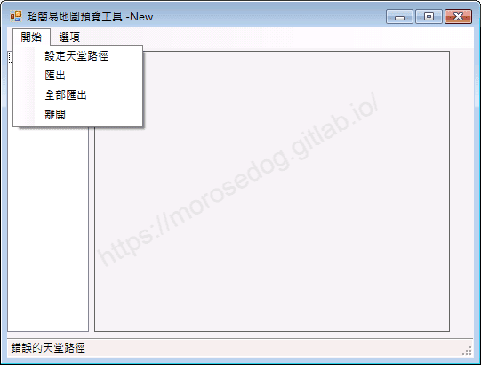
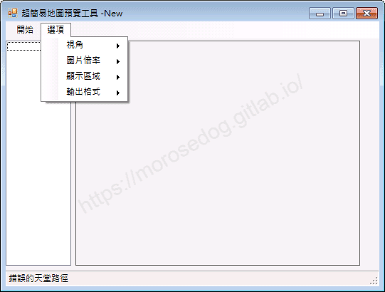

## 使用範例

* 啟動`MapTool.exe`。

* 設定天堂路徑。
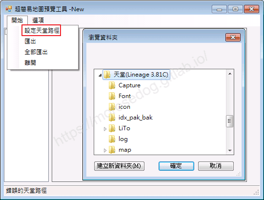

### 預覽地圖

* 點選地圖清單中的`1`，可見右方顯示地圖。
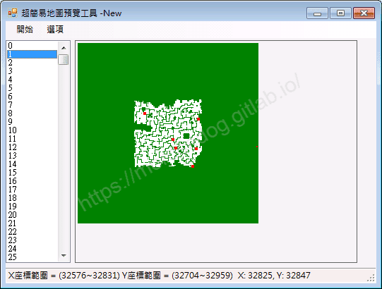

### 匯出

* 點選地圖清單中的`1`，並點選工具列 -> 匯出。

* 可見彈出訊息提示：`1.txt已存至此工具目錄下`。
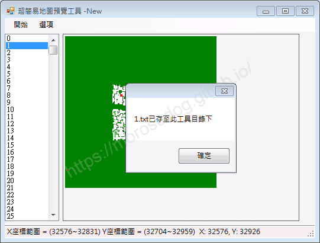

* 觀察工具目錄下，可見`1.txt`檔。
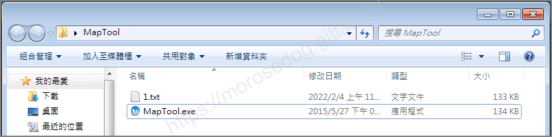

### 全部匯出

* 點選工具列 -> 全部 匯出。

* 等待進度條跑完。
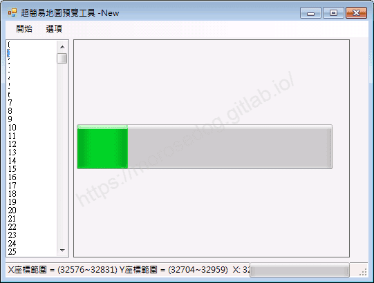

* 可見彈出訊息提示：`9999.txt已存至此工具目錄下`。
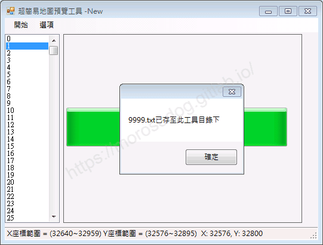

* 觀察工具目錄，可見多一個`all`資料夾，內容如下圖。
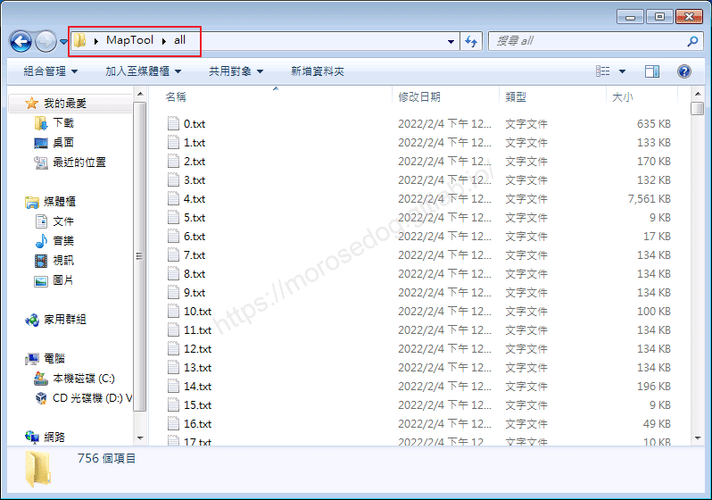

### 顯示區域

* 以下透過動態圖片顯示其功能效果。(其餘功能請自行嘗試)
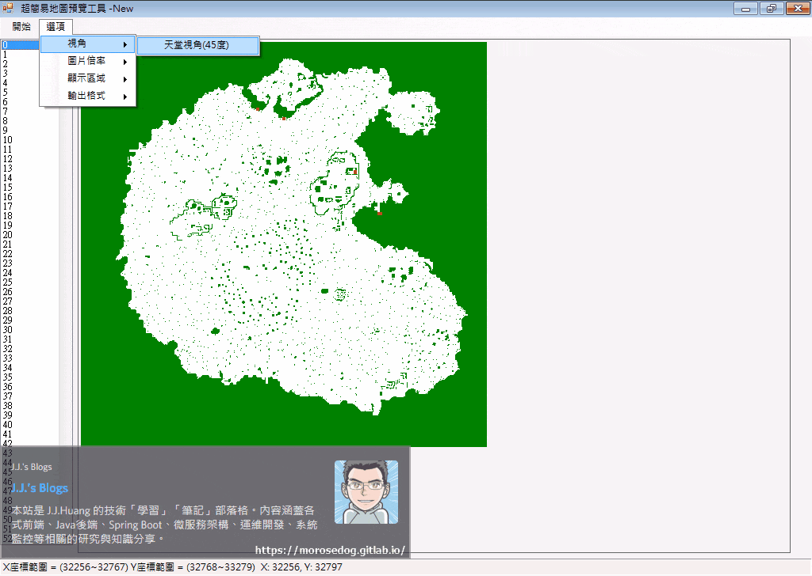

## 病毒掃描

**結果：1 家安全供應商且沒有沙箱將此文件標記為惡意文件。**
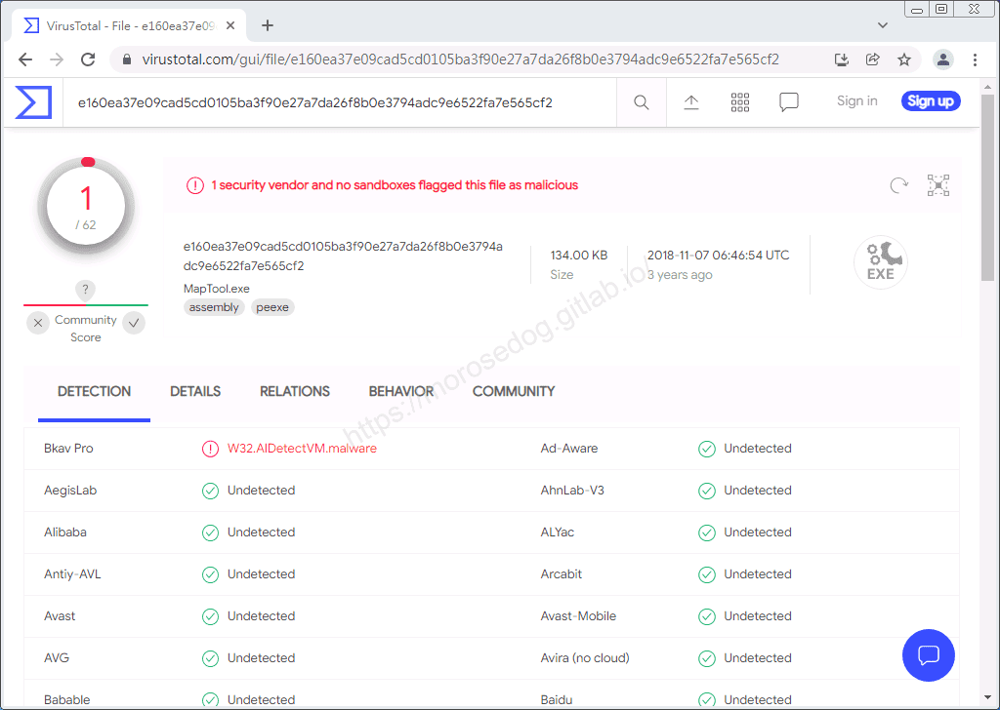​‌‌‌​​​​​‌‌‌​​‌​​‌‌​‌​​‌​‌‌‌​‌‌​​‌‌​​​​‌​‌‌‌​‌​​​‌‌​​‌​‌​​‌​‌‌​‌​‌‌​‌‌​​​‌‌​‌​​‌​‌‌​‌‌‌​​‌‌​​‌​‌​‌‌​​​​‌​‌‌​​‌‌‌​‌‌​​‌​‌​​‌​‌‌​‌​​‌‌​​‌​​​‌‌​​​​​​‌‌​​‌​​​‌‌​​‌​​​‌‌​​​​​​‌‌​​‌​​​‌‌​​‌​​​‌‌​​‌​​​‌​‌‌​‌​‌‌‌​​​​​‌‌‌​​‌​​‌‌​‌​​‌​‌‌‌​‌‌​​‌‌​​​​‌​‌‌‌​‌​​​‌‌​​‌​‌​​‌​‌‌​‌​‌‌​‌‌​​​‌‌​‌​​‌​‌‌​‌‌‌​​‌‌​​‌​‌​‌‌​​​​‌​‌‌​​‌‌‌​‌‌​​‌​‌​​‌​‌‌​‌​​‌‌‌​​​​​‌‌‌​​‌

## 工具下載

**工具程式皆可能含有惡意程式，請自行斟酌是否下載使用；文中提供病毒掃描結果，但不保證其安全性如同掃描結果，此處已善盡告知義務。**

* 載點：[MapTool.7z](/download/private-lineage/chapter89/MapTool.7z)

* 解壓縮密碼：

  
    🔒
    這段內容已加密
    需要 [**☕ 咖啡會員**](/support) 或更高等級的密碼才能閱讀
    
      
      解鎖
    
    
    💡 年度公開密碼，到 [/support](/support) 直接取得

## 結語

原創文章真的不易，希望多多支持，感謝。
最後建議回顧一下首章[天堂私服 | 天堂私服架設教學](/private-lineage-20210712-private-lineage-0/#教學章節)，了解其章節目錄。

## 免責聲明

* 本部落格文章中皆<u>**不提供**</u>任何所謂的遊戲「主程式」、「模擬器」、「登入器」…等等相關程式的下載點。

* 本部落格文章中所見之遊戲主程式和服務器端程序均來自網路發佈，<u>版本歸**原作者**</u>所有。

* 本部落格文章為研究SQL資料庫與修改JAVA語法使用，並<u>**非商業用途**</u>，亦<u>**無做營運事實等任何一切商業行為**</u>。

* 本部落格文章內容是為研究學習設計思想和原理為目的，<u>**絕沒有故意侵權或惡意抄襲、篡改其他遊戲內容**</u>！

---

- **原文連結**：[J.J.'s Blogs - 超簡易地圖預覽 工具](https://morosedog.gitlab.io/private-lineage-20220222-private-lineage-89/)
