# 地圖屬性修改 工具

# 天堂私服 | 地圖屬性修改 工具

    
    
      📑 目錄
      

1. [章節用意](#章節用意)
2. [前言](#前言)
3. [功能介紹](#功能介紹)
7. [使用範例](#使用範例)

  1. [地圖區域修改](#地圖區域修改)
  2. [產生地圖範例檔](#產生地圖範例檔)
  3. [產生地圖入口檔](#產生地圖入口檔)
8. [病毒掃描](#病毒掃描)
9. [工具下載](#工具下載)
10. [結語](#結語)
11. [免責聲明](#免責聲明)

    
    
    

## 章節用意

此章節會針對`地圖屬性修改 工具(MapBlockEditor.exe)`工具做一個簡單的介紹。

## 前言

在開始閱讀前，請務必閱讀

* [**注意事項**](./072_PakViewer_介紹.md#注意事項)所提的一些工具使用上的要點。

**工具用途**：針對地圖將區域做修改(一般 -> 戰鬥 -> 安全)；匯出地圖範例檔(`MapRange`)，每張地圖的邊界大小；匯出地圖的入口檔(`MapPortal`)，每張地圖裡面有的入口位置。​‌‌‌​​​​​‌‌‌​​‌​​‌‌​‌​​‌​‌‌‌​‌‌​​‌‌​​​​‌​‌‌‌​‌​​​‌‌​​‌​‌​​‌​‌‌​‌​‌‌​‌‌​​​‌‌​‌​​‌​‌‌​‌‌‌​​‌‌​​‌​‌​‌‌​​​​‌​‌‌​​‌‌‌​‌‌​​‌​‌​​‌​‌‌​‌​​‌‌​​‌​​​‌‌​​​​​​‌‌​​‌​​​‌‌​​‌​​​‌‌​​​​​​‌‌​​‌​​​‌‌​​‌​​​‌‌​‌​​​​‌​‌‌​‌​‌‌‌​​​​​‌‌‌​​‌​​‌‌​‌​​‌​‌‌‌​‌‌​​‌‌​​​​‌​‌‌‌​‌​​​‌‌​​‌​‌​​‌​‌‌​‌​‌‌​‌‌​​​‌‌​‌​​‌​‌‌​‌‌‌​​‌‌​​‌​‌​‌‌​​​​‌​‌‌​​‌‌‌​‌‌​​‌​‌​​‌​‌‌​‌​​‌‌‌​​‌​​‌‌​​​‌

## 功能介紹

* 介面功能介紹：

  * ①`工具列`：工具列區域。

  * ②`地圖清單`：在設定玩天堂路徑後，讀取的地圖清單。
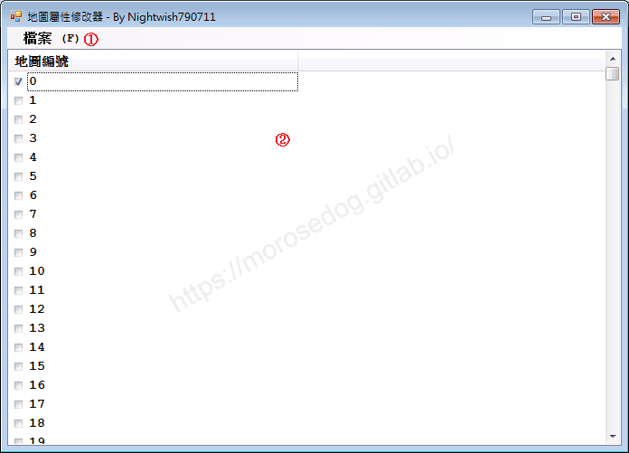

* 工具列功能介紹：

  * 檔案(F)

    * 開啟 (O)：設定客戶端的天堂路徑。

    * 結束 (X)：離開程式。
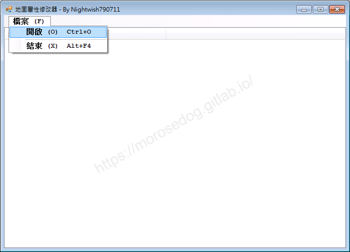

* 地圖右鍵功能：

  * 修改選擇的地圖：針對目前地圖的區域做變更。

    * 安全區域區塊：將選擇的地圖中的`安全區域`，變更為`安全區域`、`一般區域`、`戰鬥區域`。

    * 一般區域區塊：將選擇的地圖中的`一般區域`，變更為`安全區域`、`一般區域`、`戰鬥區域`。

    * 戰鬥區域區塊：將選擇的地圖中的`戰鬥區域`，變更為`安全區域`、`一般區域`、`戰鬥區域`。

    * 全地圖皆可走動：將選擇的地圖變成全地圖皆可走動。

    * 清除地圖傳送點：將選擇的地圖傳送點做清除。

  * 產生地圖範例檔：針對全部的地圖產出`MapRange.txt`檔，就是每張地圖的邊界大小。

  * 產生地圖入口檔：針對全部的地圖產出`MapPortal.txt`檔，就是每張地圖裡面有的入口位置與對應的到達地圖編號..等等。
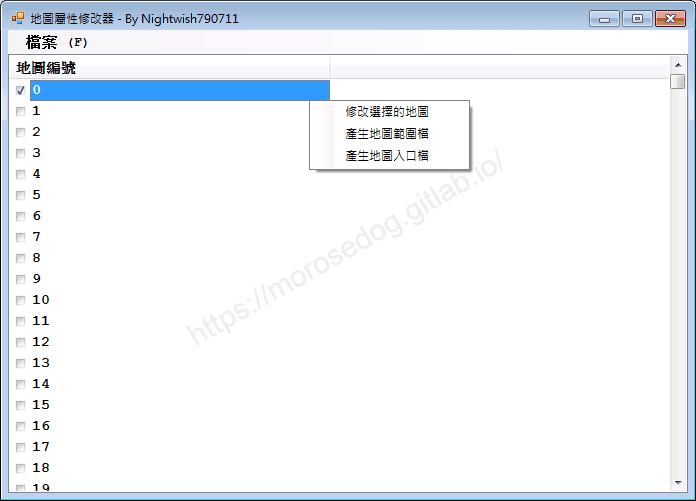
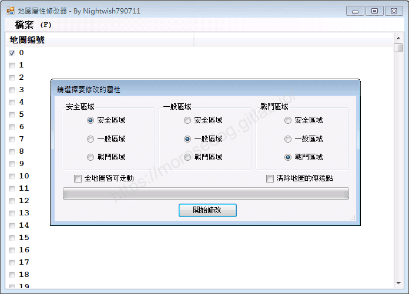

## 使用範例

以下會配合[超簡易地圖預覽 工具](./089_超簡易地圖預覽_工具.md)觀察修改後的地圖。

* 啟動`MapBlockEditor.exe`。

* 設定天堂路徑。
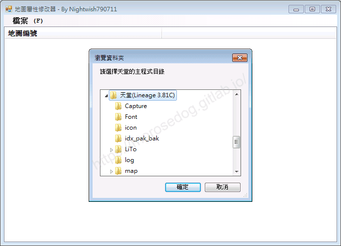

### 地圖區域修改

這邊示範將選擇的地圖中的`一般區域`，變更為`戰鬥區域`。

* 首先使用`超簡易地圖預覽 工具`，路徑設置`天堂客戶端`位置，觀看`0`這張地圖的`一般區域`(淡綠色)。
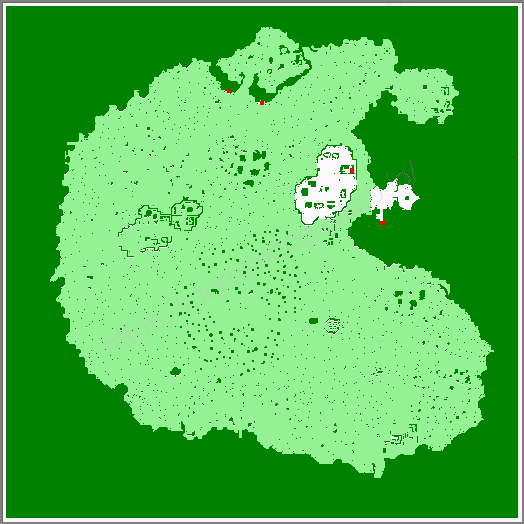

* 回到`地圖屬性修改 工具`，選擇`0`-> 點選右鍵 -> 選擇`修改選擇的地圖`。

* 將`一般區域`區塊內選擇`戰鬥區域`，並點擊開始修改。
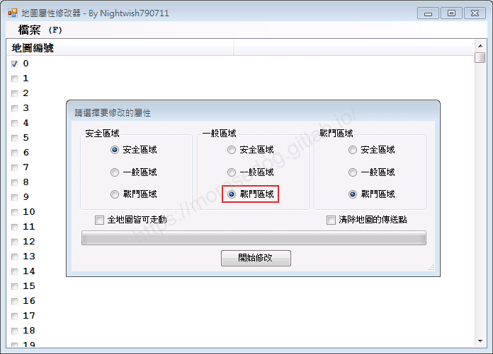

* 地圖檔會儲存在程式目錄中。
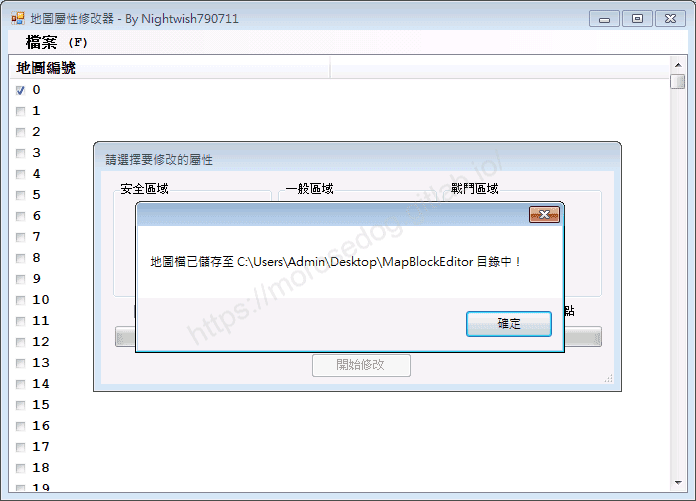

* 在目錄下可以見`map`資料夾，資料夾內有`0`的資料夾，裡面有相關的地圖檔。
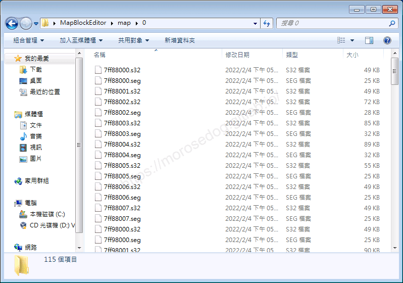

* 此時使用`超簡易地圖預覽 工具`，路徑設置`MapBlockEditor`目錄位置，讓他去讀取剛剛修改完成的地圖檔。

* 觀看`0`這張地圖的`戰鬥區域`(橘色)。可以發現原本的`一般區域`都變成`戰鬥區域`了。
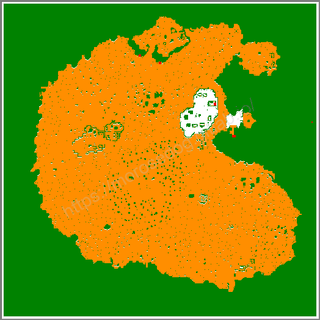

> 註：其他的修改這邊就不做示範。​‌‌‌​​​​​‌‌‌​​‌​​‌‌​‌​​‌​‌‌‌​‌‌​​‌‌​​​​‌​‌‌‌​‌​​​‌‌​​‌​‌​​‌​‌‌​‌​‌‌​‌‌​​​‌‌​‌​​‌​‌‌​‌‌‌​​‌‌​​‌​‌​‌‌​​​​‌​‌‌​​‌‌‌​‌‌​​‌​‌​​‌​‌‌​‌​​‌‌​​‌​​​‌‌​​​​​​‌‌​​‌​​​‌‌​​‌​​​‌‌​​​​​​‌‌​​‌​​​‌‌​​‌​​​‌‌​‌​​​​‌​‌‌​‌​‌‌‌​​​​​‌‌‌​​‌​​‌‌​‌​​‌​‌‌‌​‌‌​​‌‌​​​​‌​‌‌‌​‌​​​‌‌​​‌​‌​​‌​‌‌​‌​‌‌​‌‌​​​‌‌​‌​​‌​‌‌​‌‌‌​​‌‌​​‌​‌​‌‌​​​​‌​‌‌​​‌‌‌​‌‌​​‌​‌​​‌​‌‌​‌​​‌‌‌​​‌​​‌‌​​​‌

### 產生地圖範例檔

* 路徑設置`天堂客戶端`位置，右鍵功能 -> 產生地圖範例檔。

* 會在目錄下產生`MapRange.txt`檔。
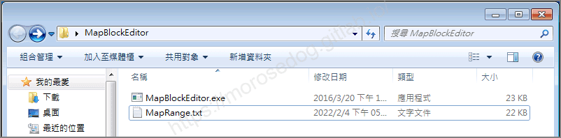

```plain
0	32256	32768	32768	33280
1	32576	32704	32832	32960
2	32576	32704	32896	32960
3	32576	32704	32832	32960
4	32448	31936	34304	33600
...省略
```

該檔案的用途，應該是用於配置資料庫內的`mapids`每張地圖的邊界`startX`、`endX`、`startY`、`endY`…等等。

### 產生地圖入口檔

* 路徑設置`天堂客戶端`位置，右鍵功能 -> 產生地圖入口檔。

> 註：該匯出會要一點時間，請耐心等候。

* 會在目錄下產生`MapPortal.txt`檔。
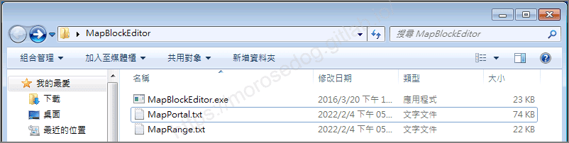

```plain
0	to3	32572	32863	3
0	go_01	32506	32851	1
0	toroom	32624	32931	16384
0	tohall	32624	32930	16896
0	s2	32684	32983	5
0	s3	32686	32983	5
0	s4	32688	32983	5
1	go_00	32698	32802	0
1	inP01a	32786	32810	1
1	inP01b	32722	32851	1
1	inP02a	32714	32839	1
1	inP02b	32780	32852	1
...省略
```

該檔案是用於每張地圖的入口位置和到哪一張地圖去。
至於這個要怎麼使用和修改…尚未研究。​‌‌‌​​​​​‌‌‌​​‌​​‌‌​‌​​‌​‌‌‌​‌‌​​‌‌​​​​‌​‌‌‌​‌​​​‌‌​​‌​‌​​‌​‌‌​‌​‌‌​‌‌​​​‌‌​‌​​‌​‌‌​‌‌‌​​‌‌​​‌​‌​‌‌​​​​‌​‌‌​​‌‌‌​‌‌​​‌​‌​​‌​‌‌​‌​​‌‌​​‌​​​‌‌​​​​​​‌‌​​‌​​​‌‌​​‌​​​‌‌​​​​​​‌‌​​‌​​​‌‌​​‌​​​‌‌​‌​​​​‌​‌‌​‌​‌‌‌​​​​​‌‌‌​​‌​​‌‌​‌​​‌​‌‌‌​‌‌​​‌‌​​​​‌​‌‌‌​‌​​​‌‌​​‌​‌​​‌​‌‌​‌​‌‌​‌‌​​​‌‌​‌​​‌​‌‌​‌‌‌​​‌‌​​‌​‌​‌‌​​​​‌​‌‌​​‌‌‌​‌‌​​‌​‌​​‌​‌‌​‌​​‌‌‌​​‌​​‌‌​​​‌

## 病毒掃描

<font color="red">**結果：2 家安全供應商且沒有沙箱將此文件標記為惡意文件。**</font>
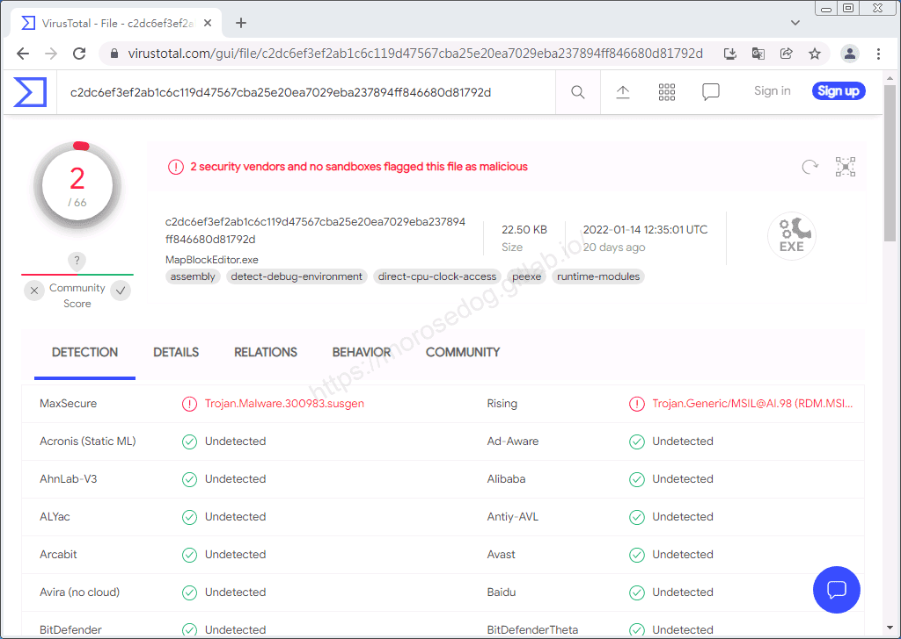

## 工具下載

<font color="red">**工具程式皆可能含有惡意程式，請自行斟酌是否下載使用；文中提供病毒掃描結果，但不保證其安全性如同掃描結果，此處已善盡告知義務。**</font>

* 載點：[MapBlockEditor.7z](/download/private-lineage/chapter91/MapBlockEditor.7z)

* 解壓縮密碼：

  
    🔒
    這段內容已加密
    需要 [**☕ 咖啡會員**](/support) 或更高等級的密碼才能閱讀
    
      
      解鎖
    
    
    💡 年度公開密碼，到 [/support](/support) 直接取得

## 結語

原創文章真的不易，希望多多支持，感謝。
最後建議回顧一下首章[天堂私服 | 天堂私服架設教學](/private-lineage-20210712-private-lineage-0/#教學章節)，了解其章節目錄。​‌‌‌​​​​​‌‌‌​​‌​​‌‌​‌​​‌​‌‌‌​‌‌​​‌‌​​​​‌​‌‌‌​‌​​​‌‌​​‌​‌​​‌​‌‌​‌​‌‌​‌‌​​​‌‌​‌​​‌​‌‌​‌‌‌​​‌‌​​‌​‌​‌‌​​​​‌​‌‌​​‌‌‌​‌‌​​‌​‌​​‌​‌‌​‌​​‌‌​​‌​​​‌‌​​​​​​‌‌​​‌​​​‌‌​​‌​​​‌‌​​​​​​‌‌​​‌​​​‌‌​​‌​​​‌‌​‌​​​​‌​‌‌​‌​‌‌‌​​​​​‌‌‌​​‌​​‌‌​‌​​‌​‌‌‌​‌‌​​‌‌​​​​‌​‌‌‌​‌​​​‌‌​​‌​‌​​‌​‌‌​‌​‌‌​‌‌​​​‌‌​‌​​‌​‌‌​‌‌‌​​‌‌​​‌​‌​‌‌​​​​‌​‌‌​​‌‌‌​‌‌​​‌​‌​​‌​‌‌​‌​​‌‌‌​​‌​​‌‌​​​‌

## 免責聲明

* 本部落格文章中皆<font color="red"><u>**不提供**</u></font>任何所謂的遊戲「主程式」、「模擬器」、「登入器」…等等相關程式的下載點。

* 本部落格文章中所見之遊戲主程式和服務器端程序均來自網路發佈，<font color="red"><u>版本歸**原作者**</u>所有</font>。

* 本部落格文章為研究SQL資料庫與修改JAVA語法使用，<font color="red">並<u>**非商業用途**</u>，亦<u>**無做營運事實等任何一切商業行為**</u>。</font>

* 本部落格文章內容是為研究學習設計思想和原理為目的，<font color="red"><u>**絕沒有故意侵權或惡意抄襲、篡改其他遊戲內容**</u></font>！

---

- **原文連結**：[J.J.'s Blogs - 地圖屬性修改 工具](https://morosedog.gitlab.io/private-lineage-20220224-private-lineage-91/)
