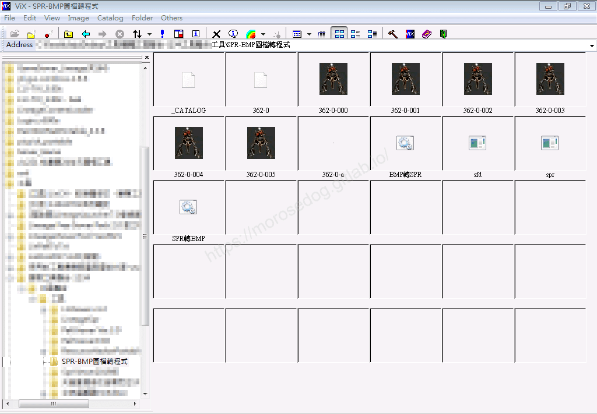
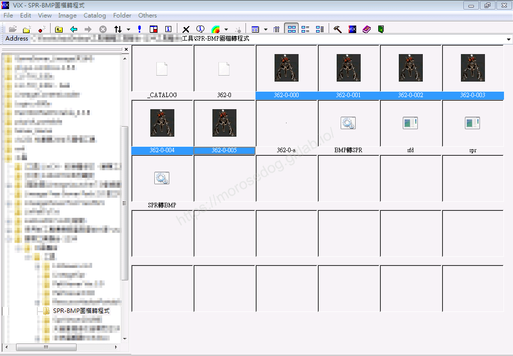
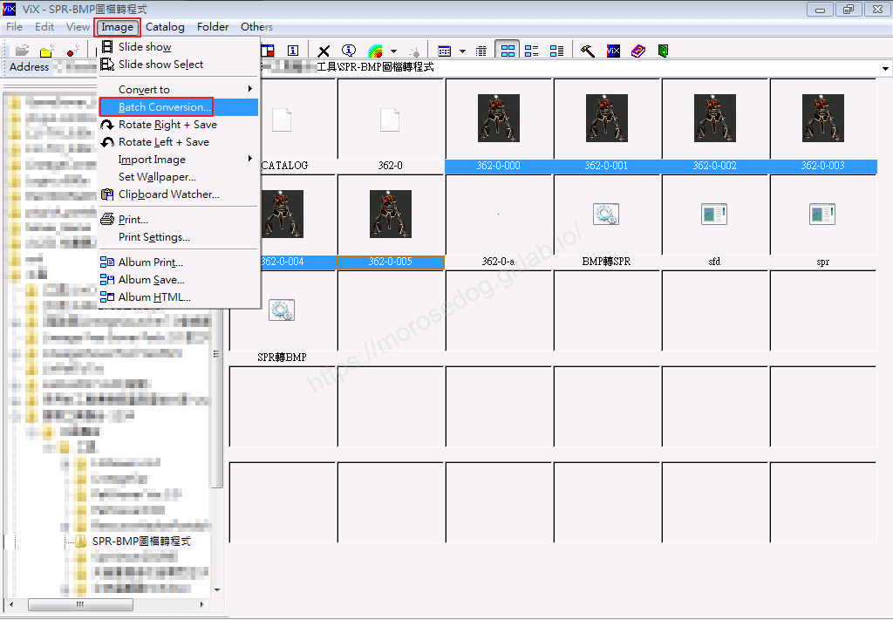
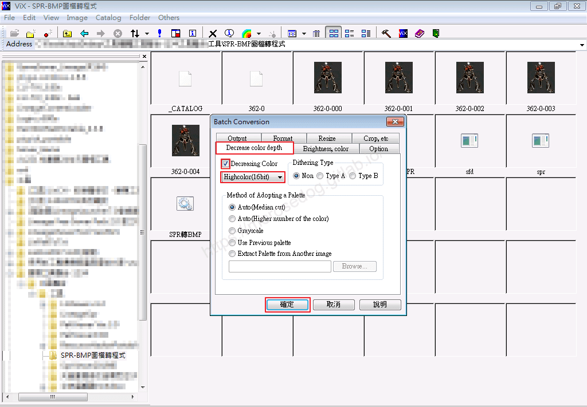
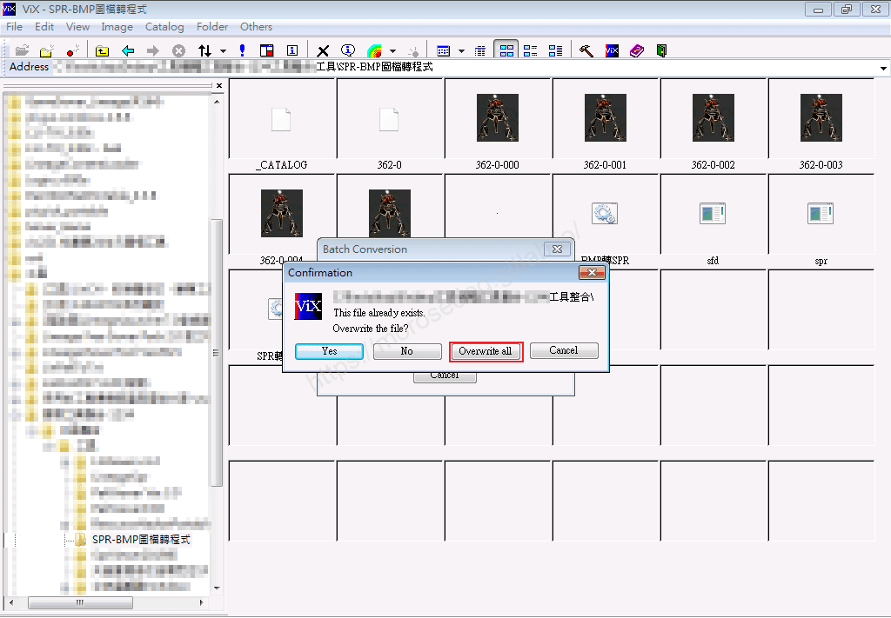
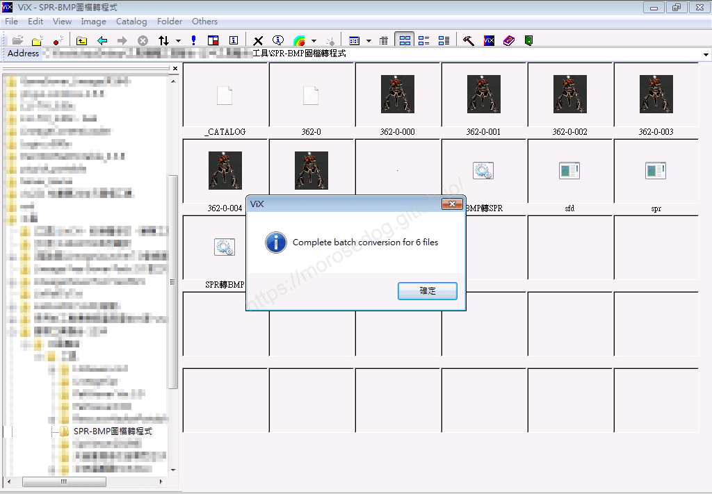
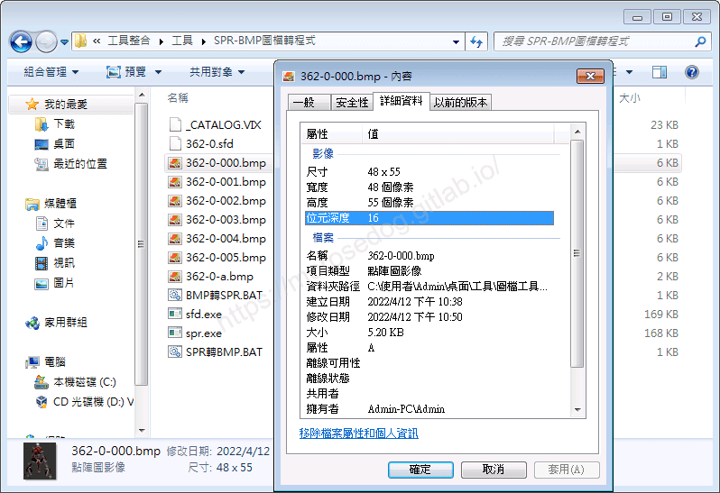
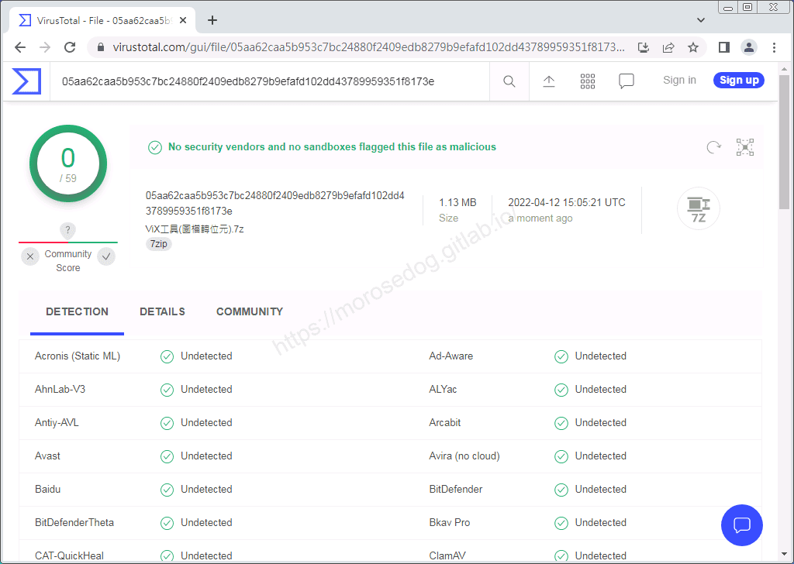

# ViX 工具(圖檔轉位元)

# 天堂私服 | ViX 工具(圖檔轉位元)

    
    
      📑 目錄
      

1. [章節用意](#章節用意)
2. [前言](#前言)
3. [使用範例](#使用範例)
4. [病毒掃描](#病毒掃描)
5. [工具下載](#工具下載)
6. [結語](#結語)
7. [免責聲明](#免責聲明)

    
    
    

## 章節用意

此章節會針對`ViX 工具(圖檔轉位元)(ViX.exe)`工具做一個簡單的介紹。

## 前言

在開始閱讀前，請務必閱讀

* [**注意事項**](./072_PakViewer_介紹.md#注意事項)所提的一些工具使用上的要點。

* [SPR-BMP互轉 工具(SPR↔BMP)](./087_SPR-BMP互轉_工具(SPR↔BMP).md)，了解`bmp`檔如何取得。

**工具用途**：`spr`圖檔轉換後，有時`bmp`圖檔的位元深度會變成`32`，或是編輯後位元深度會變成`24`，但轉回需要修改`spr`檔位元深度為`16`，可以透過此工具去做批量圖檔位元轉換。​‌‌‌​​​​​‌‌‌​​‌​​‌‌​‌​​‌​‌‌‌​‌‌​​‌‌​​​​‌​‌‌‌​‌​​​‌‌​​‌​‌​​‌​‌‌​‌​‌‌​‌‌​​​‌‌​‌​​‌​‌‌​‌‌‌​​‌‌​​‌​‌​‌‌​​​​‌​‌‌​​‌‌‌​‌‌​​‌​‌​​‌​‌‌​‌​​‌‌​​‌​​​‌‌​​​​​​‌‌​​‌​​​‌‌​​‌​​​‌‌​​​​​​‌‌​‌​‌​​‌‌​​​​​​‌‌​​​‌​​‌​‌‌​‌​‌‌‌​​​​​‌‌‌​​‌​​‌‌​‌​​‌​‌‌‌​‌‌​​‌‌​​​​‌​‌‌‌​‌​​​‌‌​​‌​‌​​‌​‌‌​‌​‌‌​‌‌​​​‌‌​‌​​‌​‌‌​‌‌‌​​‌‌​​‌​‌​‌‌​​​​‌​‌‌​​‌‌‌​‌‌​​‌​‌​​‌​‌‌​‌​​‌‌‌​​‌​​‌‌​‌‌​

## 使用範例

* 介面功能介紹：

  * 功能眾多，請自行研究，以下僅介紹批量圖檔轉位元的步驟。

  * 開啟圖檔的目錄。

  * 可以透過壓著`Ctrl`鍵盤，各別選取需要轉換的圖檔；亦可壓住`Shift`鍵，範圍選取圖檔。

  * 點選 → `Image` → `Batch Conversion...`。

  * 頁籤選擇`Decrease color depth`。

  * 勾選`Decreasing Color`。

  * 選擇要轉換的位元。

  * 最後點擊`確認`。

  * 詢問是否要覆蓋這個圖檔，選擇`Overwrite all`，全部覆蓋即可，

  * 彈出完成批量轉換圖檔的訊息。

  * 此時在去對圖檔案下右鍵看位元深度，已經變為`16`了。

## 病毒掃描

**結果：沒有安全供應商和沙箱將此文件標記為惡意文件。**
**注意：結果並不完全證明其工具程式就沒有安全疑慮。**

## 工具下載

**工具程式皆可能含有惡意程式，請自行斟酌是否下載使用；文中提供病毒掃描結果，但不保證其安全性如同掃描結果，此處已善盡告知義務。**

* 載點：[ViX圖檔轉位元工具.7z](/download/private-lineage/chapter96/ViX%E5%9C%96%E6%AA%94%E8%BD%89%E4%BD%8D%E5%85%83%E5%B7%A5%E5%85%B7.7z)

* 解壓縮密碼：

  
    🔒
    這段內容已加密
    需要 [**☕ 咖啡會員**](/support) 或更高等級的密碼才能閱讀
    
      
      解鎖
    
    
    💡 年度公開密碼，到 [/support](/support) 直接取得

## 結語

原創文章真的不易，希望多多支持，感謝。
最後建議回顧一下首章[天堂私服 | 天堂私服架設教學](/private-lineage-20210712-private-lineage-0/#教學章節)，了解其章節目錄。​‌‌‌​​​​​‌‌‌​​‌​​‌‌​‌​​‌​‌‌‌​‌‌​​‌‌​​​​‌​‌‌‌​‌​​​‌‌​​‌​‌​​‌​‌‌​‌​‌‌​‌‌​​​‌‌​‌​​‌​‌‌​‌‌‌​​‌‌​​‌​‌​‌‌​​​​‌​‌‌​​‌‌‌​‌‌​​‌​‌​​‌​‌‌​‌​​‌‌​​‌​​​‌‌​​​​​​‌‌​​‌​​​‌‌​​‌​​​‌‌​​​​​​‌‌​‌​‌​​‌‌​​​​​​‌‌​​​‌​​‌​‌‌​‌​‌‌‌​​​​​‌‌‌​​‌​​‌‌​‌​​‌​‌‌‌​‌‌​​‌‌​​​​‌​‌‌‌​‌​​​‌‌​​‌​‌​​‌​‌‌​‌​‌‌​‌‌​​​‌‌​‌​​‌​‌‌​‌‌‌​​‌‌​​‌​‌​‌‌​​​​‌​‌‌​​‌‌‌​‌‌​​‌​‌​​‌​‌‌​‌​​‌‌‌​​‌​​‌‌​‌‌​

## 免責聲明

* 本部落格文章中皆<u>**不提供**</u>任何所謂的遊戲「主程式」、「模擬器」、「登入器」…等等相關程式的下載點。

* 本部落格文章中所見之遊戲主程式和服務器端程序均來自網路發佈，<u>版本歸**原作者**</u>所有。

* 本部落格文章為研究SQL資料庫與修改JAVA語法使用，並<u>**非商業用途**</u>，亦<u>**無做營運事實等任何一切商業行為**</u>。

* 本部落格文章內容是為研究學習設計思想和原理為目的，<u>**絕沒有故意侵權或惡意抄襲、篡改其他遊戲內容**</u>！

---

- **原文連結**：[J.J.'s Blogs - ViX 工具(圖檔轉位元)](https://morosedog.gitlab.io/private-lineage-20220501-private-lineage-96/)
