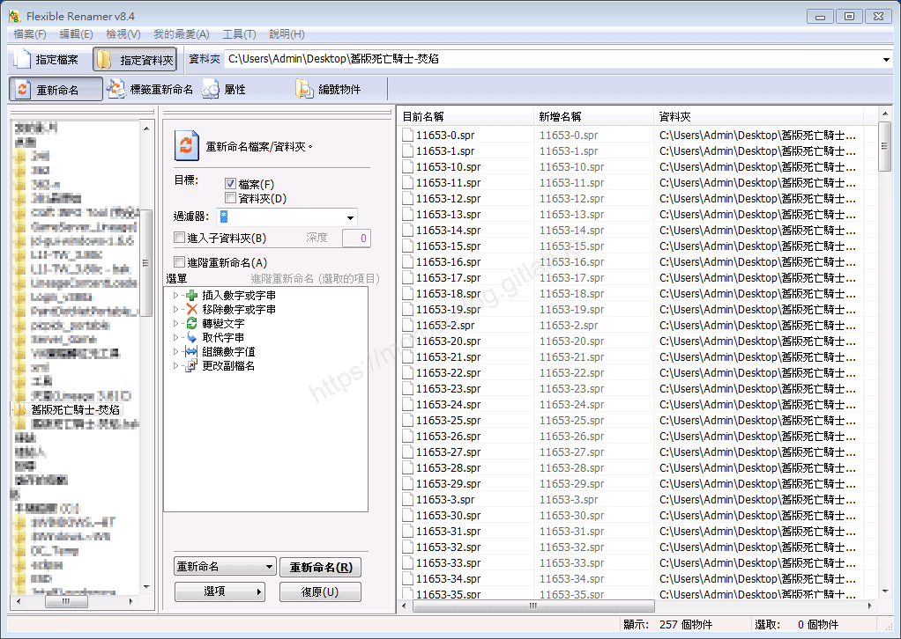
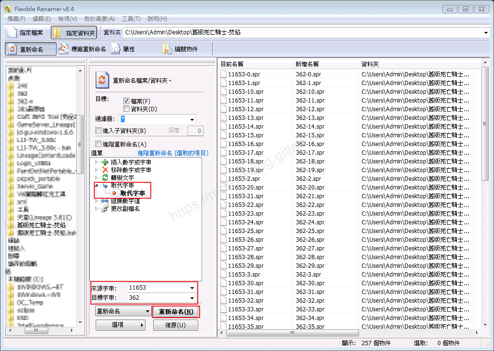
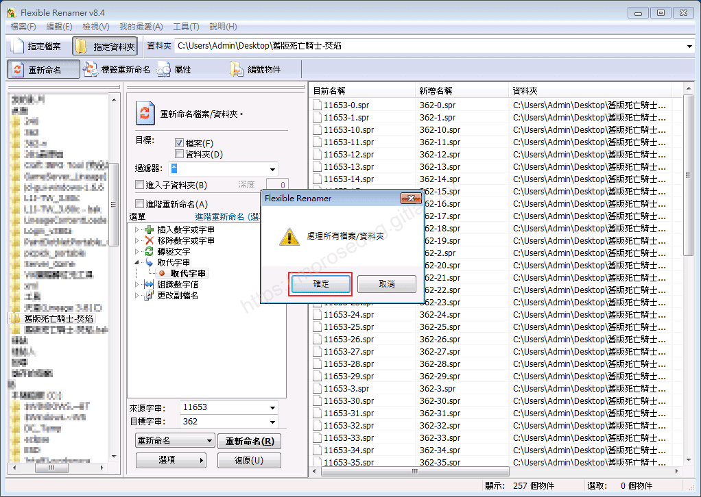
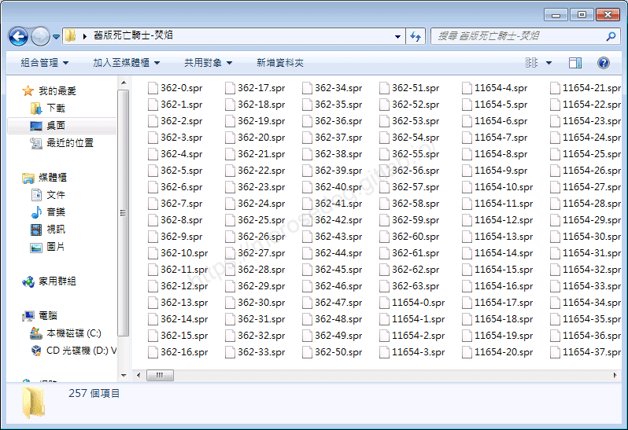
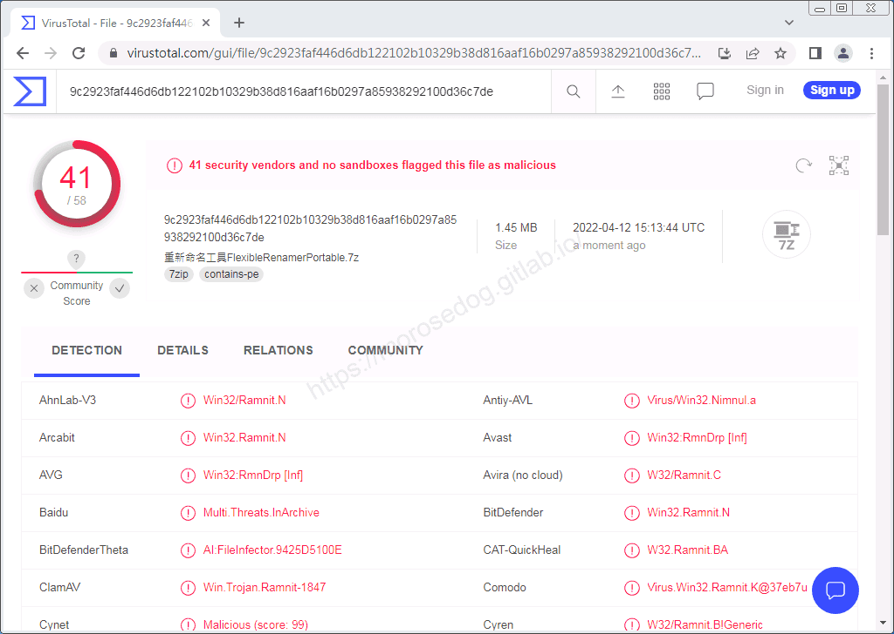

# Flexible Renamer 工具(批量修改檔名)

# 天堂私服 | Flexible Renamer 工具(批量修改檔名)

    
    
      📑 目錄
      

1. [章節用意](#章節用意)
2. [前言](#前言)
3. [使用範例](#使用範例)
4. [病毒掃描](#病毒掃描)
5. [工具下載](#工具下載)
6. [結語](#結語)
7. [免責聲明](#免責聲明)

    
    
    

## 章節用意

此章節會針對`Flexible Renamer 工具(批量修改檔名)(FlexibleRenamerPortable.exe)`工具做一個簡單的介紹。

## 前言

在開始閱讀前，請務必閱讀

* [**注意事項**](./072_PakViewer_介紹.md#注意事項)所提的一些工具使用上的要點。

**工具用途**：在編輯變身檔的時候，要對應的大量`spr`檔名也要一起異動，這時候批量對應的修改檔名就靠此程式完成。​‌‌‌​​​​​‌‌‌​​‌​​‌‌​‌​​‌​‌‌‌​‌‌​​‌‌​​​​‌​‌‌‌​‌​​​‌‌​​‌​‌​​‌​‌‌​‌​‌‌​‌‌​​​‌‌​‌​​‌​‌‌​‌‌‌​​‌‌​​‌​‌​‌‌​​​​‌​‌‌​​‌‌‌​‌‌​​‌​‌​​‌​‌‌​‌​​‌‌​​‌​​​‌‌​​​​​​‌‌​​‌​​​‌‌​​‌​​​‌‌​​​​​​‌‌​‌​‌​​‌‌​​​​​​‌‌​​‌​​​‌​‌‌​‌​‌‌‌​​​​​‌‌‌​​‌​​‌‌​‌​​‌​‌‌‌​‌‌​​‌‌​​​​‌​‌‌‌​‌​​​‌‌​​‌​‌​​‌​‌‌​‌​‌‌​‌‌​​​‌‌​‌​​‌​‌‌​‌‌‌​​‌‌​​‌​‌​‌‌​​​​‌​‌‌​​‌‌‌​‌‌​​‌​‌​​‌​‌‌​‌​​‌‌‌​​‌​​‌‌​‌‌‌

## 使用範例

像是`舊版死亡騎士-焚焰`提供的`spr`檔，分別為`11653`、`11654`、`11655`、`11656`。
在確認變身編號後，需要來做替換：

```plain
`11653` → `362`
`11654` → `363`
`11655` → `364`
`11656` → `365`
```

* 介面功能介紹：

  * 功能眾多，請自行研究，以下僅介紹批量圖檔轉位元的步驟。

  * 開啟圖檔的目錄。


  * 點選 → `取代字串` → `取代字串`。

  * 於`來於字串`輸入`11653`，輸入後右邊應該會出現檔案名稱符合的檔案。

  * 於`目標字串`輸入`362`，可以觀察右邊的`目前名稱`與`新增名稱`，就是修改前/修改後的檔案名稱。

  * 最後點擊`重新命名(R)`


  * 彈出`處理所有檔案/資料夾`，點擊`確定`。


  * 在開啟圖檔目錄，可以觀察到剛剛的`11653`已經被替換成`362`的檔名了。


  * 至於其他的檔名替換，只要重複上面的步驟就可以全部替換完畢，快速又方便。

## 病毒掃描

<font color="red">**結果：41 家安全供應商且沒有沙箱將此文件標記為惡意文件。**</font>


## 工具下載

<font color="red">**工具程式皆可能含有惡意程式，請自行斟酌是否下載使用；文中提供病毒掃描結果，但不保證其安全性如同掃描結果，此處已善盡告知義務。**</font>​‌‌‌​​​​​‌‌‌​​‌​​‌‌​‌​​‌​‌‌‌​‌‌​​‌‌​​​​‌​‌‌‌​‌​​​‌‌​​‌​‌​​‌​‌‌​‌​‌‌​‌‌​​​‌‌​‌​​‌​‌‌​‌‌‌​​‌‌​​‌​‌​‌‌​​​​‌​‌‌​​‌‌‌​‌‌​​‌​‌​​‌​‌‌​‌​​‌‌​​‌​​​‌‌​​​​​​‌‌​​‌​​​‌‌​​‌​​​‌‌​​​​​​‌‌​‌​‌​​‌‌​​​​​​‌‌​​‌​​​‌​‌‌​‌​‌‌‌​​​​​‌‌‌​​‌​​‌‌​‌​​‌​‌‌‌​‌‌​​‌‌​​​​‌​‌‌‌​‌​​​‌‌​​‌​‌​​‌​‌‌​‌​‌‌​‌‌​​​‌‌​‌​​‌​‌‌​‌‌‌​​‌‌​​‌​‌​‌‌​​​​‌​‌‌​​‌‌‌​‌‌​​‌​‌​​‌​‌‌​‌​​‌‌‌​​‌​​‌‌​‌‌‌

* 載點：[重新命名工具FlexibleRenamerPortable.7z](/download/private-lineage/chapter97/%E9%87%8D%E6%96%B0%E5%91%BD%E5%90%8D%E5%B7%A5%E5%85%B7FlexibleRenamerPortable.7z)

* 解壓縮密碼：

  
    🔒
    這段內容已加密
    需要 [**☕ 咖啡會員**](/support) 或更高等級的密碼才能閱讀
    
      
      解鎖
    
    
    💡 年度公開密碼，到 [/support](/support) 直接取得

## 結語

原創文章真的不易，希望多多支持，感謝。
最後建議回顧一下首章[天堂私服 | 天堂私服架設教學](/private-lineage-20210712-private-lineage-0/#教學章節)，了解其章節目錄。

## 免責聲明

* 本部落格文章中皆<font color="red"><u>**不提供**</u></font>任何所謂的遊戲「主程式」、「模擬器」、「登入器」…等等相關程式的下載點。

* 本部落格文章中所見之遊戲主程式和服務器端程序均來自網路發佈，<font color="red"><u>版本歸**原作者**</u>所有</font>。

* 本部落格文章為研究SQL資料庫與修改JAVA語法使用，<font color="red">並<u>**非商業用途**</u>，亦<u>**無做營運事實等任何一切商業行為**</u>。</font>

* 本部落格文章內容是為研究學習設計思想和原理為目的，<font color="red"><u>**絕沒有故意侵權或惡意抄襲、篡改其他遊戲內容**</u></font>！

---

- **原文連結**：[J.J.'s Blogs - Flexible Renamer 工具(批量修改檔名)](https://morosedog.gitlab.io/private-lineage-20220502-private-lineage-97/)
