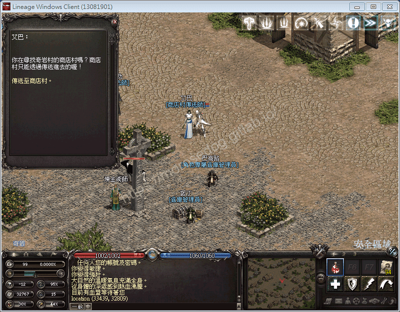
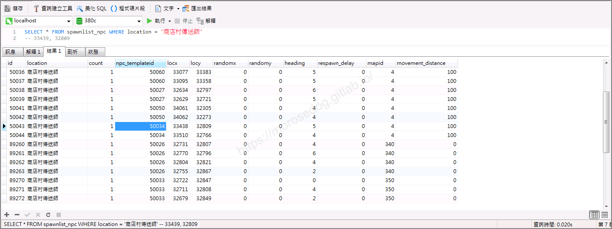
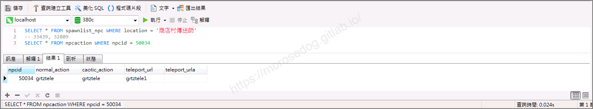
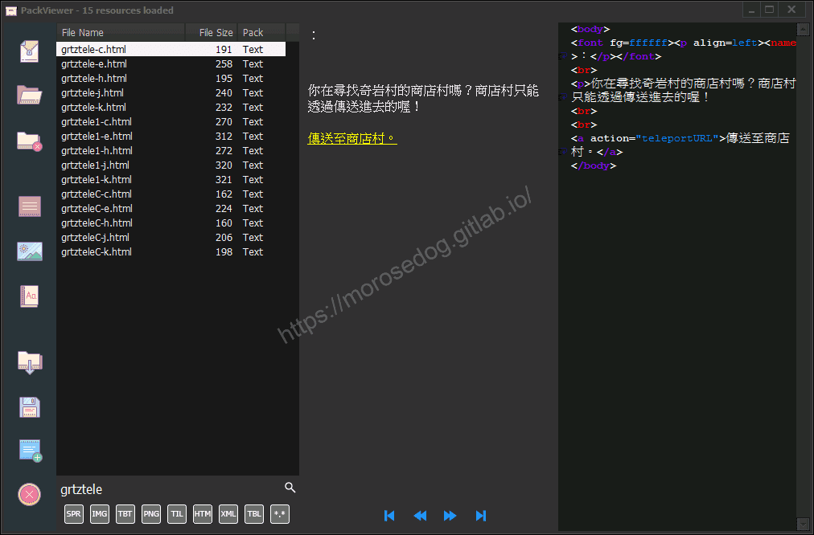
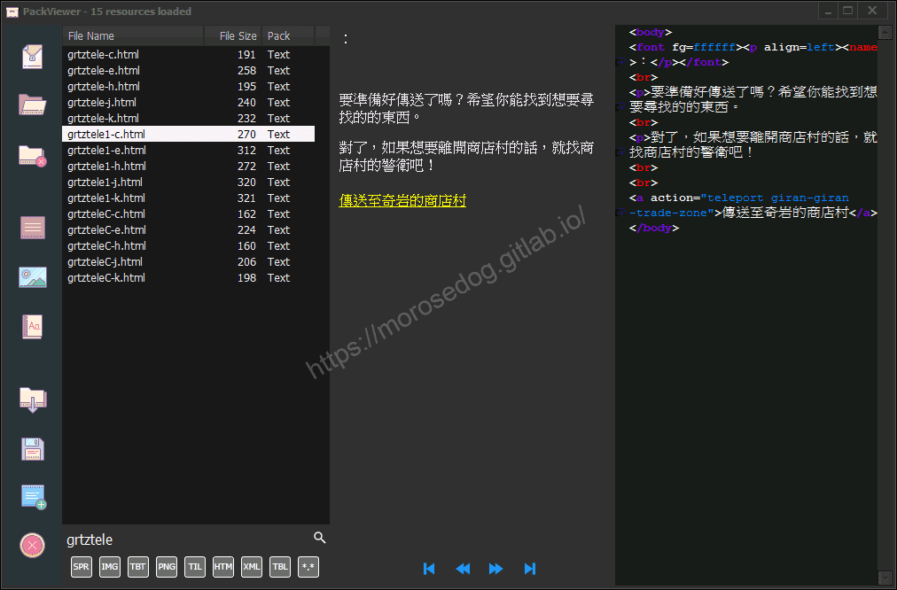
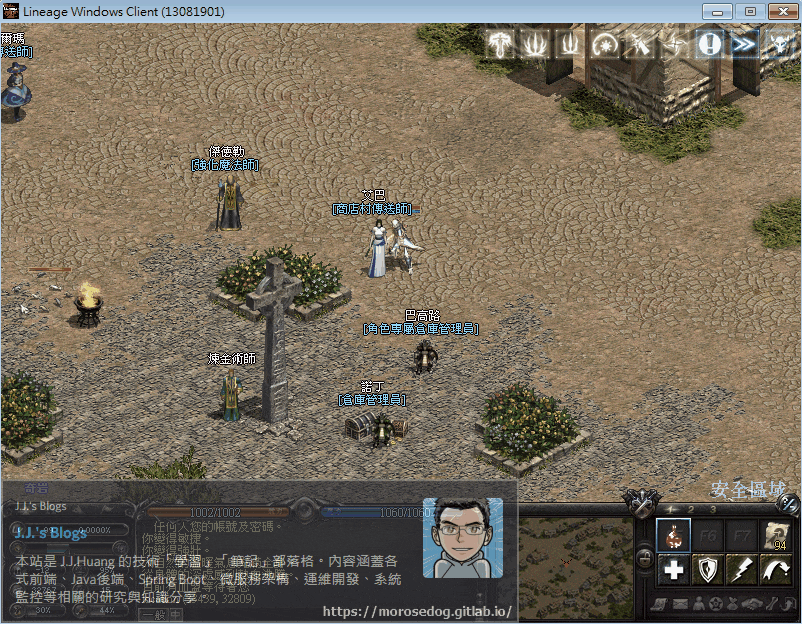

# NPC對應對話檔分析

# 天堂私服 | NPC對應對話檔分析

    
    
      📑 目錄
      

1. [章節用意](#章節用意)
2. [版本資訊](#版本資訊)
3. [前言](#前言)
4. [分析](#分析)
5. [結論](#結論)
6. [結語](#結語)
7. [免責聲明](#免責聲明)

    
    
    

## 章節用意

透過分析找尋特定`NPC`的對話檔，進而了解其對應的方式、進行抽檔或是修改；另外可反思自建`NPC`、對話檔…等等應用。

## 版本資訊

* **客戶端版本**

  * 天堂(Lineage 3.81C)

* **核心版本**

  * L1J-3.80c

## 前言

在開始分析前，請務必先將以下文章閱讀完畢。

* [GM指令分析 (前往怪物)](../05_Core_Modification/064_GM指令分析_(前往怪物).md)

  * 了解`spawnlist`資料表用途與欄位說明。

  * 了解`spawnlist_npc`資料表用途與欄位說明。

* [GM指令分析 (創怪/創NPC)](../05_Core_Modification/067_GM指令分析_(創怪_創NPC).md)

  * 了解創建`NPC`時，會針對`spawnlist_npc`資料表寫入資料。

* [PakViewer 介紹](../07_Developer_Tools/072_PakViewer_介紹.md)

  * 了解抽檔工具的使用。

* 額外提及：對話檔與`NPC`的對應是使用`npcaction`資料表。

  * 當點擊`NPC`時候會照這張表的設定去讀取相對應的`html`檔。

## 分析

以下分析使用`奇岩村`的`商店村傳送師`-`艾巴`來做分析範例。​‌‌‌​​​​​‌‌‌​​‌​​‌‌​‌​​‌​‌‌‌​‌‌​​‌‌​​​​‌​‌‌‌​‌​​​‌‌​​‌​‌​​‌​‌‌​‌​‌‌​‌‌​​​‌‌​‌​​‌​‌‌​‌‌‌​​‌‌​​‌​‌​‌‌​​​​‌​‌‌​​‌‌‌​‌‌​​‌​‌​​‌​‌‌​‌​​‌‌​​‌​​​‌‌​​​​​​‌‌​​‌​​​‌‌​​‌​​​‌‌​​​​​​‌‌​​‌​​​‌‌​​‌​​​‌‌​‌‌​​​‌​‌‌​‌​‌‌‌​​​​​‌‌‌​​‌​​‌‌​‌​​‌​‌‌‌​‌‌​​‌‌​​​​‌​‌‌‌​‌​​​‌‌​​‌​‌​​‌​‌‌​‌​‌‌​‌‌​​​‌‌​‌​​‌​‌‌​‌‌‌​​‌‌​​‌​‌​‌‌​​​​‌​‌‌​​‌‌‌​‌‌​​‌​‌​​‌​‌‌​‌​​‌‌‌​​‌​​‌‌​​‌‌

* 1.使用座標位置找尋：

  * 移動到`NPC`旁邊。

  * 輸入`/loc`指令輸出當前的人物座標位置。

  * 可得`33439, 32809`座標位置。


  * 進入資料庫搜尋`spawnlist_npc`的`location`為`商店村傳送師`。

```sql
SELECT * FROM spawnlist_npc WHERE location = '商店村傳送師'
```

  * 可見列出`19`筆，找尋`locx`與`locy`接近`33439, 32809`座標的資料。

  * 可見`npc_templateid` = `50034`。


  * 透過`npcid`去搜尋對應的行動。

  * 資料庫搜尋`npcaction`的`npcid`為`50034`。

  * 可見列出`1`筆，這邊我們只需先注意`normal_action`與`teleport_url`；其他的欄位下方有稍微解釋。

    * `normal_action` = 一般對話檔(當人物為：中立、正義，顯示該對話檔內容)

    * `caotic_action` = 混亂對話檔(當人物為：邪惡，顯示該對話檔內容)

    * `teleport_url` = 傳送對話檔(主要用於傳送師，亦可以理解為第二頁對話檔)

    * `teleport_urla` = 傳送對話檔(主要用於傳送師，亦可以理解為第二頁對話檔)

> 註：建議自行找位`NPC`去看對話檔內容，就可以理解其欄位用途。

  * 可見有兩個對話檔名稱為`grtztele`與`grtztele1`


* 2.使用抽檔工具查看：  

  * 這邊透過抽檔工具去看`grtztele`與`grtztele1`這兩個對話檔。

> 註：抽檔工具請參考。[PakViewer 介紹](../07_Developer_Tools/072_PakViewer_介紹.md)

  * 以下為這兩個對話檔的內容，對應艾巴的對話框內容，可以發現是對應的上的。



  * 以下是遊戲內的對話檔動態示範。


## 結論

根據分析，大致上可以理出一些東西。​‌‌‌​​​​​‌‌‌​​‌​​‌‌​‌​​‌​‌‌‌​‌‌​​‌‌​​​​‌​‌‌‌​‌​​​‌‌​​‌​‌​​‌​‌‌​‌​‌‌​‌‌​​​‌‌​‌​​‌​‌‌​‌‌‌​​‌‌​​‌​‌​‌‌​​​​‌​‌‌​​‌‌‌​‌‌​​‌​‌​​‌​‌‌​‌​​‌‌​​‌​​​‌‌​​​​​​‌‌​​‌​​​‌‌​​‌​​​‌‌​​​​​​‌‌​​‌​​​‌‌​​‌​​​‌‌​‌‌​​​‌​‌‌​‌​‌‌‌​​​​​‌‌‌​​‌​​‌‌​‌​​‌​‌‌‌​‌‌​​‌‌​​​​‌​‌‌‌​‌​​​‌‌​​‌​‌​​‌​‌‌​‌​‌‌​‌‌​​​‌‌​‌​​‌​‌‌​‌‌‌​​‌‌​​‌​‌​‌‌​​​​‌​‌‌​​‌‌‌​‌‌​​‌​‌​​‌​‌‌​‌​​‌‌‌​​‌​​‌‌​​‌‌

* 資料表：

  * `npcaction`.`normal_action`一般對話檔(當人物為：中立、正義，顯示該對話檔內容)。

  * `npcaction`.`caotic_action`混亂對話檔(當人物為：邪惡，顯示該對話檔內容)。

  * `npcaction`.`teleport_url`傳送對話檔(主要用於傳送師，亦可以理解為第二頁對話檔)。

  * `npcaction`.`teleport_urla`傳送對話檔(主要用於傳送師，亦可以理解為第二頁對話檔)。

## 結語

此處透過座標位置去找尋`NPC`然後再透過`npcid`去找尋他對應的行動；或許有其他的方式也歡迎下面留言分享，作者就不另外教學了…。

原創文章真的不易，希望多多支持，感謝。
最後建議回顧一下首章[天堂私服 | 天堂私服架設教學](/private-lineage-20210712-private-lineage-0/#教學章節)，了解其章節目錄。

## 免責聲明

* 本部落格文章中皆<font color="red"><u>**不提供**</u></font>任何所謂的遊戲「主程式」、「模擬器」、「登入器」…等等相關程式的下載點。

* 本部落格文章中所見之遊戲主程式和服務器端程序均來自網路發佈，<font color="red"><u>版本歸**原作者**</u>所有</font>。

* 本部落格文章為研究SQL資料庫與修改JAVA語法使用，<font color="red">並<u>**非商業用途**</u>，亦<u>**無做營運事實等任何一切商業行為**</u>。</font>

* 本部落格文章內容是為研究學習設計思想和原理為目的，<font color="red"><u>**絕沒有故意侵權或惡意抄襲、篡改其他遊戲內容**</u></font>！

---

- **原文連結**：[J.J.'s Blogs - NPC對應對話檔分析](https://morosedog.gitlab.io/private-lineage-20220226-private-lineage-93/)
