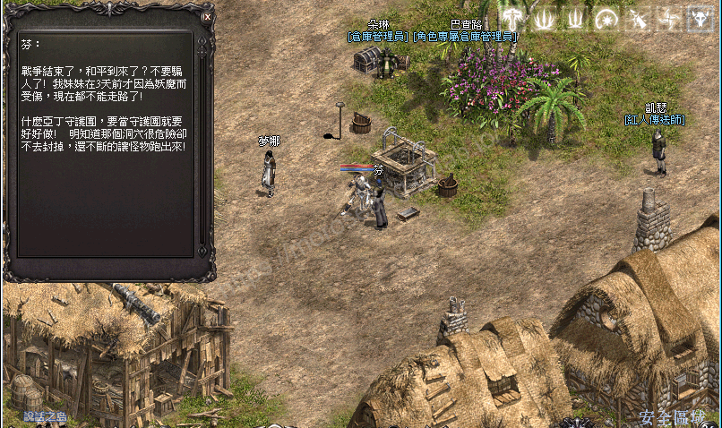
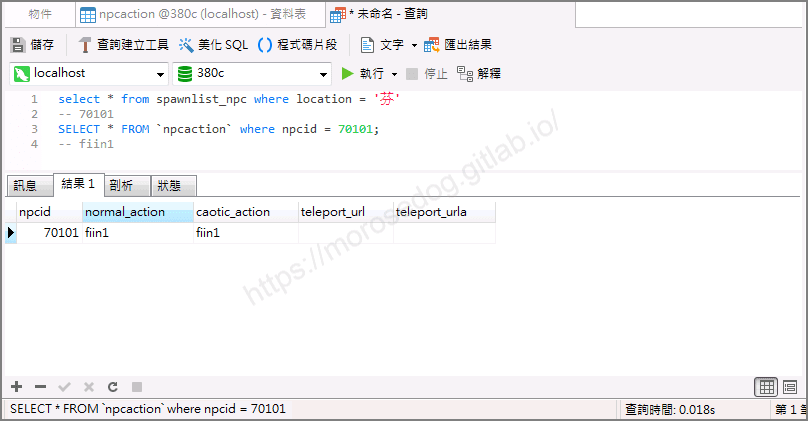
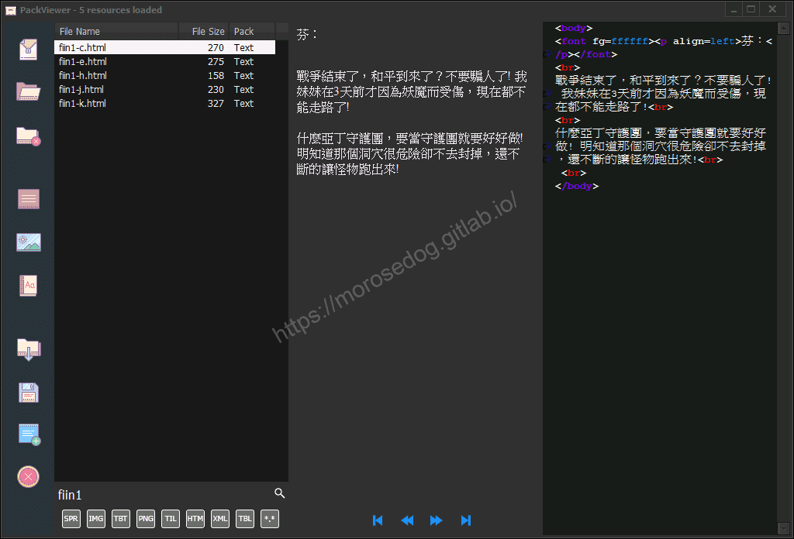
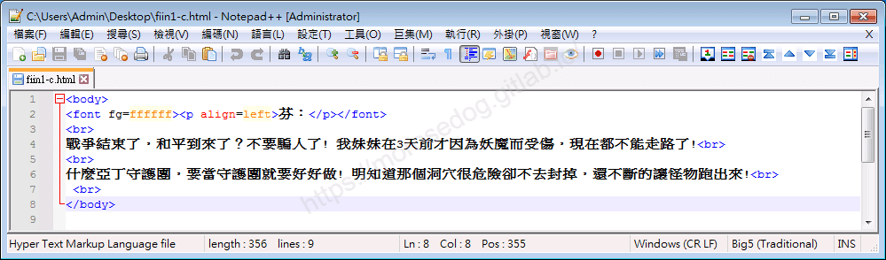
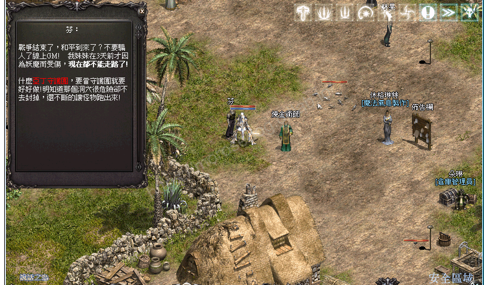
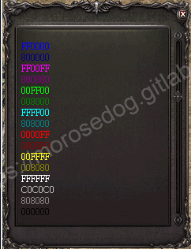
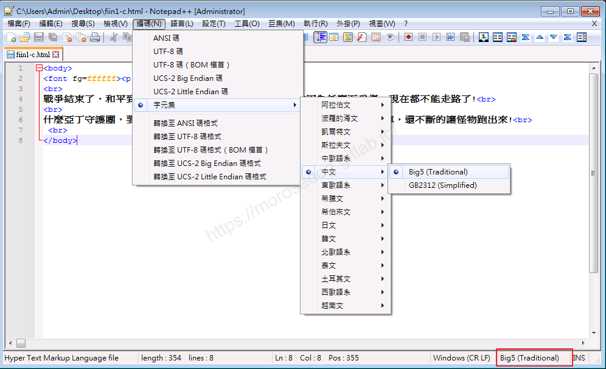
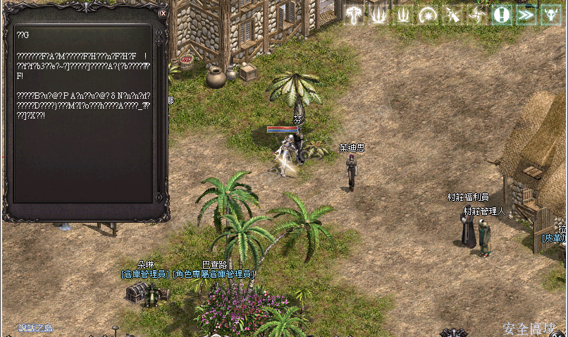

# 文字對話檔分析

# 天堂私服 | 文字對話檔分析

    
    
      📑 目錄
      

1. [章節用意](#章節用意)
2. [版本資訊](#版本資訊)
3. [前言](#前言)
4. [分析](#分析)
5. [注意事項](#注意事項)
6. [結論](#結論)
7. [結語](#結語)
8. [免責聲明](#免責聲明)

    
    
    

## 章節用意

透過分析找尋特定`NPC`的對話檔，嘗試修改文字與元素的內容，進而豐富對話檔。

## 版本資訊

* **客戶端版本**

  * 天堂(Lineage 3.81C)

* **核心版本**

  * L1J-3.80c

## 前言

在開始分析前，請務必先將以下文章閱讀完畢。

* [NPC對應對話檔分析](./093_NPC對應對話檔分析.md)

  * 了解如何找到`NPC`對應的對話檔。

* 抽檔工具請參考：[PakViewer 介紹](../07_Developer_Tools/072_PakViewer_介紹.md)

## 分析

以下分析使用`說話之島`的`芬`來做分析修改範例。​‌‌‌​​​​​‌‌‌​​‌​​‌‌​‌​​‌​‌‌‌​‌‌​​‌‌​​​​‌​‌‌‌​‌​​​‌‌​​‌​‌​​‌​‌‌​‌​‌‌​‌‌​​​‌‌​‌​​‌​‌‌​‌‌‌​​‌‌​​‌​‌​‌‌​​​​‌​‌‌​​‌‌‌​‌‌​​‌​‌​​‌​‌‌​‌​​‌‌​​‌​​​‌‌​​​​​​‌‌​​‌​​​‌‌​​‌​​​‌‌​​​​​​‌‌​​‌​​​‌‌​​‌​​​‌‌​‌‌‌​​‌​‌‌​‌​‌‌‌​​​​​‌‌‌​​‌​​‌‌​‌​​‌​‌‌‌​‌‌​​‌‌​​​​‌​‌‌‌​‌​​​‌‌​​‌​‌​​‌​‌‌​‌​‌‌​‌‌​​​‌‌​‌​​‌​‌‌​‌‌‌​​‌‌​​‌​‌​‌‌​​​​‌​‌‌​​‌‌‌​‌‌​​‌​‌​​‌​‌‌​‌​​‌‌‌​​‌​​‌‌​‌​​

* 1.`NPC`對話檔尋找：

  * 移動到`NPC`旁邊。


  * 進入資料庫搜尋`spawnlist_npc`的`location`為`芬`。

  * 透過`npcid`去搜尋對應的行動。

  * 資料庫搜尋`npcaction`的`npcid`為`70101`。

  * 最終可以取得對話檔名稱為`fiin1`。

```sql
SELECT * FROM spawnlist_npc WHERE location = '芬'
-- 70101
SELECT * FROM npcaction WHERE npcid = 70101
-- fiin1
```



* 2.使用抽檔程式抽檔：  

  * 使用抽檔工具去看`fiin1`對話檔。

  * 以下為對話檔的內容，對應`芬`的對話框內容，可以發現是對應的上的。


  * 透過抽檔工具匯出該對話檔`fiin1-c.html`。

* 3.查看對話檔：  

  * 以下使用編輯器去開啟。


```html
<body>
   <font fg=ffffff>
      <p align=left>芬：</p>
   </font>
   <br>
   戰爭結束了，和平到來了？不要騙人了! 我妹妹在3天前才因為妖魔而受傷，現在都不能走路了!<br>
   <br>
   什麼亞丁守護團，要當守護團就要好好做! 明知道那個洞穴很危險卻不去封掉，還不斷的讓怪物跑出來!<br>
   <br>
</body>
```

  * 這邊來大概說明一下對話檔的內容。<如果有`html`經驗，請直接忽略>

  * 這邊看到很多使用`<>`包起來的內容，稱為標籤，相關標籤使用可以參考[HTML標籤列表](http://web.thu.edu.tw/hzed/www/tag.htm)文章。

  * <font color="red">`<body>`</font>：

    * <font color="blue">說明</font>：`HTML body`標籤是網頁內容的主要部分，網頁大多數的內容如文字、圖片、影片、表單、表格 … 等元素，都是寫在`body`標籤內，每一個獨立網頁都只能有一組`body`標籤。

  * <font color="red">`<font>`</font>：

    * <font color="blue">說明</font>：`HTML font`對文字的設定有顏色（`color`）、大小（`size`）以及字型（`face`），標準的`HTML`文字標籤是由`<font>`開始，以及`</font>`標籤結束，兩個標籤中的文字可以做不同的變化。

    * <font color="orange">屬性</font>：

      * `size`：文字大小。<為`1~7`，若沒設定`size`，預設為`3`>

      * `face`：字型。

      * `color`：文字顏色。<網頁顏色是以16進位代碼表示，一般以「#」號開頭>

> 註：在天堂內的`color`這個屬性是沒有效果的，要使用`fg`！而且色碼表無法完全對照網頁色碼表，可能要自己多嘗試。

  * <font color="red">`<p>`</font>：

    * <font color="blue">說明</font>：段落的意思，亦可用為換行(換兩行)。

    * <font color="orange">屬性</font>：

      * `align`：對齊方式。<`left`、`right`、`center`、`justify`>

  * <font color="red">`<br>`</font>：

    * <font color="blue">說明</font>：換行(換一行)。

  * 另外對話檔內可以使用額外的標籤來顯示遊戲內的人物資訊：

    * `<username>`：顯示玩家名稱。

> 註：如果後續知道更多的標籤會在此繼續更新。

  * 特別說明：是否其他的`HTML`標籤也有支援，可能需要自行嘗試才能知道其效果。

* 4.編輯對話檔：

  * 此處稍微對對話檔進行編輯。

```html
<body>
   <font fg=ffffff>
      <p align=center>芬：</p>
   </font>
   <br>
   戰爭結束了，和平到來了？不要騙人了<username>! 我妹妹在3天前才因為妖魔而受傷，<b>現在都不能走路了!</b><br>
   <br>
   什麼<font fg=0000FF>亞丁守護團</font>，要當守護團就要好好做! 明知道那個洞穴很危險卻不去封掉，還不斷的讓怪物跑出來!<br>
   <br>
</body>
```

  * 以上的修改說明：

    * 1.將`芬：`字串的位置變為置中(`center`)。

    * 2.在`不要騙人了`的字串後面加入顯示對話的遊戲玩家名稱(`username`)。

    * 3.在`現在都不能走路了!`這個字串用粗體標籤(`b`)來特別顯示。

    * 4.在`亞丁守護團`這個字串使用(`font`)包覆並將其顏色更換為`0000FF`的顏色。

  * 修改完畢後，將檔案儲存，並讓天堂進行吃檔。

  * 再次進入遊戲與`NPC`對話，可以看到其效果。


* 5.色碼表對應：

  * 由於無法使用`HTML`色碼表去做對應，以下使用簡單的方式取得一些顏色的對應。

```html
<body>
 <font fg=FF0000>FF0000</font><br>
 <font fg=800000>800000</font><br>
 <font fg=FF00FF>FF00FF</font><br>
 <font fg=800080>800080</font><br>
 <font fg=00FF00>00FF00</font><br>
 <font fg=008000>008000</font><br>
 <font fg=FFFF00>FFFF00</font><br>
 <font fg=808000>808000</font><br>
 <font fg=0000FF>0000FF</font><br>
 <font fg=000080>000080</font><br>
 <font fg=00FFFF>00FFFF</font><br>
 <font fg=008080>008080</font><br>
 <font fg=FFFFFF>FFFFFF</font><br>
 <font fg=C0C0C0>C0C0C0</font><br>
 <font fg=808080>808080</font><br>
 <font fg=000000>000000</font><br>
</body>
```



## 注意事項

在編輯修改對話檔的時候，要注意到其檔案的編碼格式必須為`Big5`，
​‌‌‌​​​​​‌‌‌​​‌​​‌‌​‌​​‌​‌‌‌​‌‌​​‌‌​​​​‌​‌‌‌​‌​​​‌‌​​‌​‌​​‌​‌‌​‌​‌‌​‌‌​​​‌‌​‌​​‌​‌‌​‌‌‌​​‌‌​​‌​‌​‌‌​​​​‌​‌‌​​‌‌‌​‌‌​​‌​‌​​‌​‌‌​‌​​‌‌​​‌​​​‌‌​​​​​​‌‌​​‌​​​‌‌​​‌​​​‌‌​​​​​​‌‌​​‌​​​‌‌​​‌​​​‌‌​‌‌‌​​‌​‌‌​‌​‌‌‌​​​​​‌‌‌​​‌​​‌‌​‌​​‌​‌‌‌​‌‌​​‌‌​​​​‌​‌‌‌​‌​​​‌‌​​‌​‌​​‌​‌‌​‌​‌‌​‌‌​​​‌‌​‌​​‌​‌‌​‌‌‌​​‌‌​​‌​‌​‌‌​​​​‌​‌‌​​‌‌‌​‌‌​​‌​‌​​‌​‌‌​‌​​‌‌‌​​‌​​‌‌​‌​​

否則儲存並吃檔後，於遊戲內顯示的內容將會為亂碼，如下圖：


## 結論

* 對話檔是使用`HTML`組合而成。

* 基本的標籤都可以做使用。

* 顏色的部分需要自己嘗試，並非完全對照色碼表(`HTML4.0`中`color`屬性)。

  * 像是`FF00FF`的顏色是對的上色碼表。

  * 但是`00FFFF`與`FFFF00`的顏色表示就完全相反了！難道是順序？

## 結語

基礎的文字對話檔的說明和修改在此初步的介紹和使用，更為複雜的圖片和互動的部分，會在後面慢慢介紹。

原創文章真的不易，希望多多支持，感謝。
最後建議回顧一下首章[天堂私服 | 天堂私服架設教學](/private-lineage-20210712-private-lineage-0/#教學章節)，了解其章節目錄。​‌‌‌​​​​​‌‌‌​​‌​​‌‌​‌​​‌​‌‌‌​‌‌​​‌‌​​​​‌​‌‌‌​‌​​​‌‌​​‌​‌​​‌​‌‌​‌​‌‌​‌‌​​​‌‌​‌​​‌​‌‌​‌‌‌​​‌‌​​‌​‌​‌‌​​​​‌​‌‌​​‌‌‌​‌‌​​‌​‌​​‌​‌‌​‌​​‌‌​​‌​​​‌‌​​​​​​‌‌​​‌​​​‌‌​​‌​​​‌‌​​​​​​‌‌​​‌​​​‌‌​​‌​​​‌‌​‌‌‌​​‌​‌‌​‌​‌‌‌​​​​​‌‌‌​​‌​​‌‌​‌​​‌​‌‌‌​‌‌​​‌‌​​​​‌​‌‌‌​‌​​​‌‌​​‌​‌​​‌​‌‌​‌​‌‌​‌‌​​​‌‌​‌​​‌​‌‌​‌‌‌​​‌‌​​‌​‌​‌‌​​​​‌​‌‌​​‌‌‌​‌‌​​‌​‌​​‌​‌‌​‌​​‌‌‌​​‌​​‌‌​‌​​

## 免責聲明

* 本部落格文章中皆<font color="red"><u>**不提供**</u></font>任何所謂的遊戲「主程式」、「模擬器」、「登入器」…等等相關程式的下載點。

* 本部落格文章中所見之遊戲主程式和服務器端程序均來自網路發佈，<font color="red"><u>版本歸**原作者**</u>所有</font>。

* 本部落格文章為研究SQL資料庫與修改JAVA語法使用，<font color="red">並<u>**非商業用途**</u>，亦<u>**無做營運事實等任何一切商業行為**</u>。</font>

* 本部落格文章內容是為研究學習設計思想和原理為目的，<font color="red"><u>**絕沒有故意侵權或惡意抄襲、篡改其他遊戲內容**</u></font>！

> 註：以上參考了
> [維基百科 - 網頁顏色](https://zh.wikipedia.org/wiki/%E7%BD%91%E9%A1%B5%E9%A2%9C%E8%89%B2)
> [HTML標籤列表](http://web.thu.edu.tw/hzed/www/tag.htm)

---

- **原文連結**：[J.J.'s Blogs - 文字對話檔分析](https://morosedog.gitlab.io/private-lineage-20220227-private-lineage-94/)
