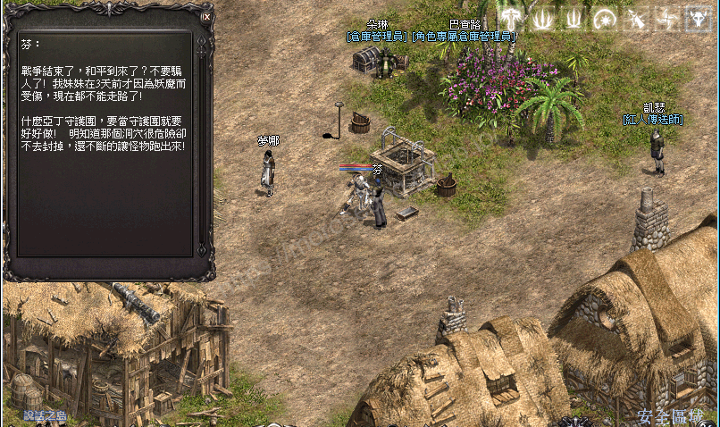
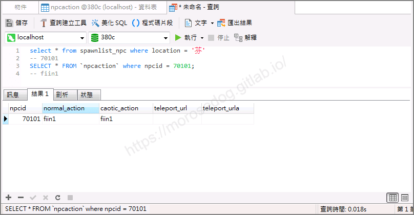
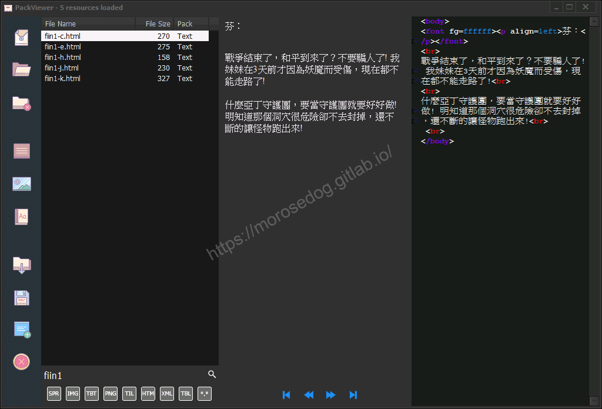
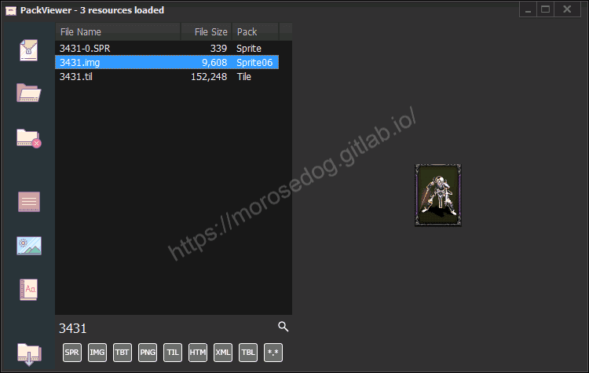
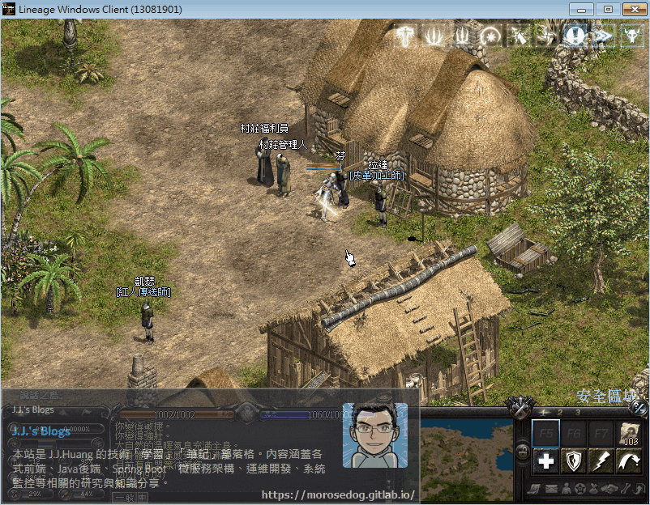

# 圖片對話檔分析

# 天堂私服 | 圖片對話檔分析

    
    
      📑 目錄
      

1. [章節用意](#章節用意)
2. [版本資訊](#版本資訊)
3. [前言](#前言)
4. [分析](#分析)
5. [注意事項](#注意事項)
6. [額外問題](#額外問題)
7. [結論](#結論)
8. [結語](#結語)
9. [免責聲明](#免責聲明)

    
    
    

## 章節用意

透過分析找尋特定`NPC`的對話檔，嘗試修改圖片或是加入圖片的內容，進而了解於對話檔內使用圖的方式。

## 版本資訊

* **客戶端版本**

  * 天堂(Lineage 3.81C)

* **核心版本**

  * L1J-3.80c

## 前言

在開始分析前，請務必先將以下文章閱讀完畢。

* [NPC對應對話檔分析](./093_NPC對應對話檔分析.md)

  * 了解如何找到`NPC`對應的對話檔。

* 抽檔工具請參考：[PakViewer 介紹](../07_Developer_Tools/072_PakViewer_介紹.md)

## 分析

以下分析使用`說話之島`的`芬`來做分析修改範例。​‌‌‌​​​​​‌‌‌​​‌​​‌‌​‌​​‌​‌‌‌​‌‌​​‌‌​​​​‌​‌‌‌​‌​​​‌‌​​‌​‌​​‌​‌‌​‌​‌‌​‌‌​​​‌‌​‌​​‌​‌‌​‌‌‌​​‌‌​​‌​‌​‌‌​​​​‌​‌‌​​‌‌‌​‌‌​​‌​‌​​‌​‌‌​‌​​‌‌​​‌​​​‌‌​​​​​​‌‌​​‌​​​‌‌​​‌​​​‌‌​​​​​​‌‌​​‌​​​‌‌​​‌​​​‌‌‌​​​​​‌​‌‌​‌​‌‌‌​​​​​‌‌‌​​‌​​‌‌​‌​​‌​‌‌‌​‌‌​​‌‌​​​​‌​‌‌‌​‌​​​‌‌​​‌​‌​​‌​‌‌​‌​‌‌​‌‌​​​‌‌​‌​​‌​‌‌​‌‌‌​​‌‌​​‌​‌​‌‌​​​​‌​‌‌​​‌‌‌​‌‌​​‌​‌​​‌​‌‌​‌​​‌‌‌​​‌​​‌‌​‌​‌

* 1.使用名稱找尋：

  * 移動到`NPC`旁邊。


  * 進入資料庫搜尋`spawnlist_npc`的`location`為`芬`。

  * 透過`npcid`去搜尋對應的行動。

  * 資料庫搜尋`npcaction`的`npcid`為`70101`。

  * 最終可以取得對話檔名稱為`fiin1`。

```sql
SELECT * FROM spawnlist_npc WHERE location = '芬'
-- 70101
SELECT * FROM npcaction WHERE npcid = 70101
-- fiin1
```



* 2.使用抽檔程式抽檔：  

  * 使用抽檔工具去看`fiin1`對話檔。

  * 以下為對話檔的內容，對應`芬`的對話框內容，可以發現是對應的上的。


  * 透過抽檔工具匯出該對話檔`fiin1-c.html`。

* 4.編輯對話檔：

  * 此處我們希望在對話檔中插入幾張圖片做顯示。

  * 修改前先對插入圖片`HTML`標籤做說明。<如果有`html`經驗，請直接忽略>

  * <font color="red">``</font>：

    * <font color="blue">說明</font>：`HTML img`圖片標籤用來在網頁上插入圖片，增加網頁的豐富程度。

    * <font color="orange">屬性</font>：

      * `src`：圖片網址，必要項目。<參數對應客戶端內的`img`檔名稱>

      * `tooltip`：當滑鼠游標移到圖片上時出現的提示。

    * 以下屬性在客戶端中是<font color="red">**沒有效果**</font>的：

      * `border`：圖片邊框，例如`border="0"`代表邊框為`0`。

      * `alt`：圖片替代文字，當圖片顯示失效，則顯示`alt`文字。

      * `title`：圖片文字標示，當滑鼠移經圖片，自動顯示的文字。

      * `width`：圖片寬度，例如`width="120px"`代表寬度限制在`120px`。

      * `height`：圖片高度，例如`height="100px"`代表高度限制在`100px`。

  * 下方為編輯後的對話檔內容：

```html
<body>
   <font fg=ffffff>
      <p align=left>芬：</p>
   </font>
   <br>
   戰爭結束了，和平到來了？不要騙人了! 我妹妹在3天前才因為妖魔而受傷，現在都不能走路了!<br>
   <br>
   什麼亞丁守護團，要當守護團就要好好做! 明知道那個洞穴很危險卻不去封掉，還不斷的讓怪物跑出來!<br>
   <br>
   </img>
</body>
```

  * 以上的修改說明：

    * 於最下方加入一張`3431`的圖片。

    * `3431`是什麼圖片，請使用抽檔預覽工具觀看即可。


  * 修改完畢後，將檔案儲存，並讓天堂進行吃檔。

  * 再次進入遊戲與`NPC`對話，可以看到其效果。


## 注意事項

設定圖片的時候，所使用的客戶端`img`檔，其檔名是有使用順序的。
當對話檔內設定的`src="#3431"`時，根據客戶端語系的不同而讀取的檔案名稱順序亦會不同。

> 註：檔案名稱後面的c是繁體中文、h是簡體中文、j是日文、e是英文、k是韓文..等等。

---

此處用`繁體中文`來做示範：​‌‌‌​​​​​‌‌‌​​‌​​‌‌​‌​​‌​‌‌‌​‌‌​​‌‌​​​​‌​‌‌‌​‌​​​‌‌​​‌​‌​​‌​‌‌​‌​‌‌​‌‌​​​‌‌​‌​​‌​‌‌​‌‌‌​​‌‌​​‌​‌​‌‌​​​​‌​‌‌​​‌‌‌​‌‌​​‌​‌​​‌​‌‌​‌​​‌‌​​‌​​​‌‌​​​​​​‌‌​​‌​​​‌‌​​‌​​​‌‌​​​​​​‌‌​​‌​​​‌‌​​‌​​​‌‌‌​​​​​‌​‌‌​‌​‌‌‌​​​​​‌‌‌​​‌​​‌‌​‌​​‌​‌‌‌​‌‌​​‌‌​​​​‌​‌‌‌​‌​​​‌‌​​‌​‌​​‌​‌‌​‌​‌‌​‌‌​​​‌‌​‌​​‌​‌‌​‌‌‌​​‌‌​​‌​‌​‌‌​​​​‌​‌‌​​‌‌‌​‌‌​​‌​‌​​‌​‌‌​‌​​‌‌‌​​‌​​‌‌​‌​‌

**範例一**：

* 當客戶端內有以下`img`檔存在時：

  * `3431.img`

  * `3431c.img`

* 優先使用`3431c.img`做顯示。

**範例二**：

* 當客戶端內有以下`img`檔存在時：

  * `3431.img`

* 使用`3431.img`做顯示。

規則說明：
同組數字，優先讀`C`，沒`C`的話，讀數字。​‌‌‌​​​​​‌‌‌​​‌​​‌‌​‌​​‌​‌‌‌​‌‌​​‌‌​​​​‌​‌‌‌​‌​​​‌‌​​‌​‌​​‌​‌‌​‌​‌‌​‌‌​​​‌‌​‌​​‌​‌‌​‌‌‌​​‌‌​​‌​‌​‌‌​​​​‌​‌‌​​‌‌‌​‌‌​​‌​‌​​‌​‌‌​‌​​‌‌​​‌​​​‌‌​​​​​​‌‌​​‌​​​‌‌​​‌​​​‌‌​​​​​​‌‌​​‌​​​‌‌​​‌​​​‌‌‌​​​​​‌​‌‌​‌​‌‌‌​​​​​‌‌‌​​‌​​‌‌​‌​​‌​‌‌‌​‌‌​​‌‌​​​​‌​‌‌‌​‌​​​‌‌​​‌​‌​​‌​‌‌​‌​‌‌​‌‌​​​‌‌​‌​​‌​‌‌​‌‌‌​​‌‌​​‌​‌​‌‌​​​​‌​‌‌​​‌‌‌​‌‌​​‌​‌​​‌​‌‌​‌​​‌‌‌​​‌​​‌‌​‌​‌

以上規則由<font color="red">`Discord-柴犬網遊技研所`</font>的”<font color="blue"><u>骷髏弓箭手</u></font>“成員提供的資訊，**非常感謝**。

## 額外問題

可以看到商店的`買`和`賣`是透過圖片呈現的，分別為`#312`、`#314`；
然後透過抽檔預覽程式去看檔名為`312.img`、`314.img`、`312c.img`、`314c.img`，會發現圖片是不一致的。

初步有稍微翻找過核心原始碼、客戶端`xml`檔，並未查到有用的資訊來解釋上述的問題。​‌‌‌​​​​​‌‌‌​​‌​​‌‌​‌​​‌​‌‌‌​‌‌​​‌‌​​​​‌​‌‌‌​‌​​​‌‌​​‌​‌​​‌​‌‌​‌​‌‌​‌‌​​​‌‌​‌​​‌​‌‌​‌‌‌​​‌‌​​‌​‌​‌‌​​​​‌​‌‌​​‌‌‌​‌‌​​‌​‌​​‌​‌‌​‌​​‌‌​​‌​​​‌‌​​​​​​‌‌​​‌​​​‌‌​​‌​​​‌‌​​​​​​‌‌​​‌​​​‌‌​​‌​​​‌‌‌​​​​​‌​‌‌​‌​‌‌‌​​​​​‌‌‌​​‌​​‌‌​‌​​‌​‌‌‌​‌‌​​‌‌​​​​‌​‌‌‌​‌​​​‌‌​​‌​‌​​‌​‌‌​‌​‌‌​‌‌​​​‌‌​‌​​‌​‌‌​‌‌‌​​‌‌​​‌​‌​‌‌​​​​‌​‌‌​​‌‌‌​‌‌​​‌​‌​​‌​‌‌​‌​​‌‌‌​​‌​​‌‌​‌​‌

## 結論

* 對話檔是使用`HTML`的`img`標籤插入圖片。

* 部分的屬性名稱和效果是不一樣的。

* 另外一提，`img`標籤是可以不需要結束的標籤：

  * 有結束標籤。

```html
</img>
```

  * 無結束標籤。

```html

```

> 註：以上兩個效果都是一樣的。

## 結語

原創文章真的不易，希望多多支持，感謝。
最後建議回顧一下首章[天堂私服 | 天堂私服架設教學](/private-lineage-20210712-private-lineage-0/#教學章節)，了解其章節目錄。

## 免責聲明

* 本部落格文章中皆<font color="red"><u>**不提供**</u></font>任何所謂的遊戲「主程式」、「模擬器」、「登入器」…等等相關程式的下載點。

* 本部落格文章中所見之遊戲主程式和服務器端程序均來自網路發佈，<font color="red"><u>版本歸**原作者**</u>所有</font>。

* 本部落格文章為研究SQL資料庫與修改JAVA語法使用，<font color="red">並<u>**非商業用途**</u>，亦<u>**無做營運事實等任何一切商業行為**</u>。</font>

* 本部落格文章內容是為研究學習設計思想和原理為目的，<font color="red"><u>**絕沒有故意侵權或惡意抄襲、篡改其他遊戲內容**</u></font>！

> 註：以上參考了
> [HTML標籤列表](http://web.thu.edu.tw/hzed/www/tag.htm)​‌‌‌​​​​​‌‌‌​​‌​​‌‌​‌​​‌​‌‌‌​‌‌​​‌‌​​​​‌​‌‌‌​‌​​​‌‌​​‌​‌​​‌​‌‌​‌​‌‌​‌‌​​​‌‌​‌​​‌​‌‌​‌‌‌​​‌‌​​‌​‌​‌‌​​​​‌​‌‌​​‌‌‌​‌‌​​‌​‌​​‌​‌‌​‌​​‌‌​​‌​​​‌‌​​​​​​‌‌​​‌​​​‌‌​​‌​​​‌‌​​​​​​‌‌​​‌​​​‌‌​​‌​​​‌‌‌​​​​​‌​‌‌​‌​‌‌‌​​​​​‌‌‌​​‌​​‌‌​‌​​‌​‌‌‌​‌‌​​‌‌​​​​‌​‌‌‌​‌​​​‌‌​​‌​‌​​‌​‌‌​‌​‌‌​‌‌​​​‌‌​‌​​‌​‌‌​‌‌‌​​‌‌​​‌​‌​‌‌​​​​‌​‌‌​​‌‌‌​‌‌​​‌​‌​​‌​‌‌​‌​​‌‌‌​​‌​​‌‌​‌​‌

---

- **原文連結**：[J.J.'s Blogs - 圖片對話檔分析](https://morosedog.gitlab.io/private-lineage-20220228-private-lineage-95/)
