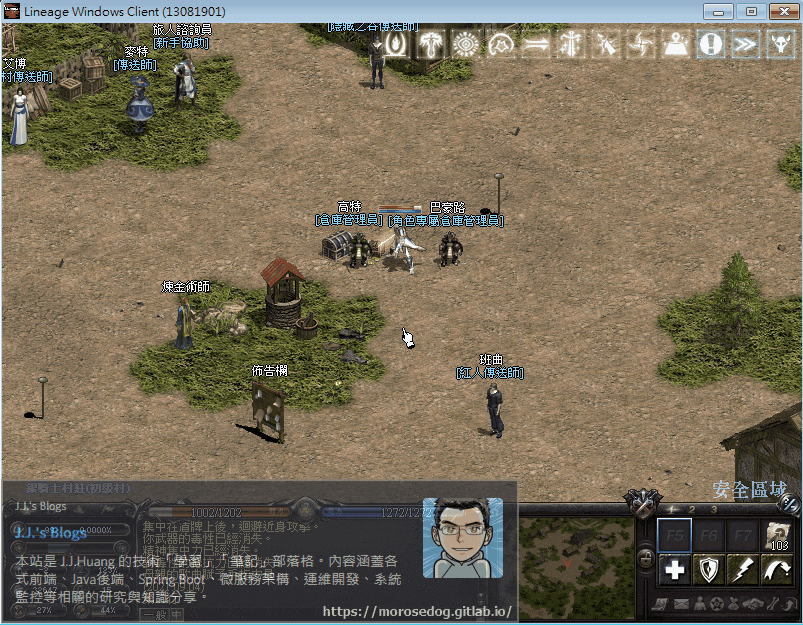
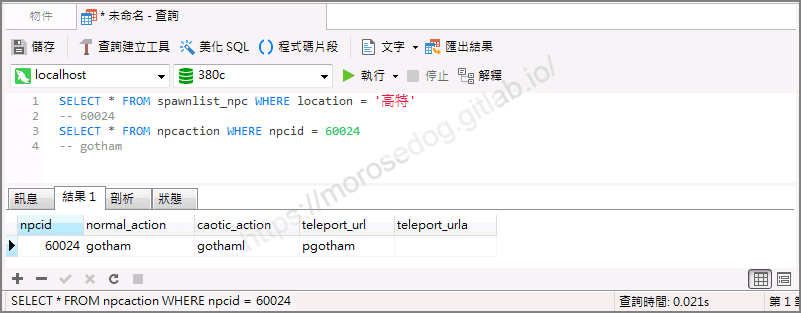
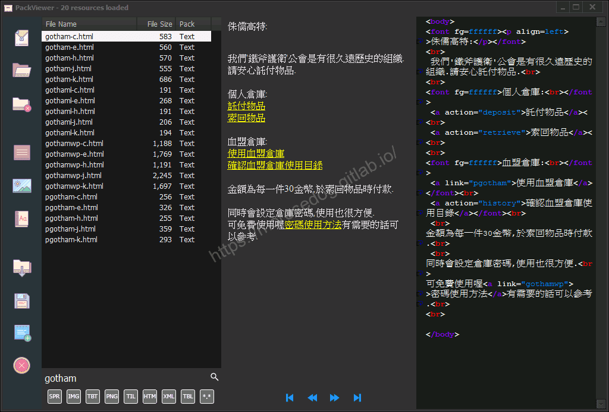
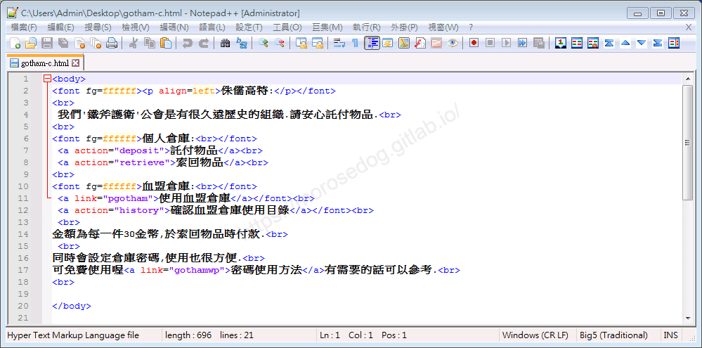
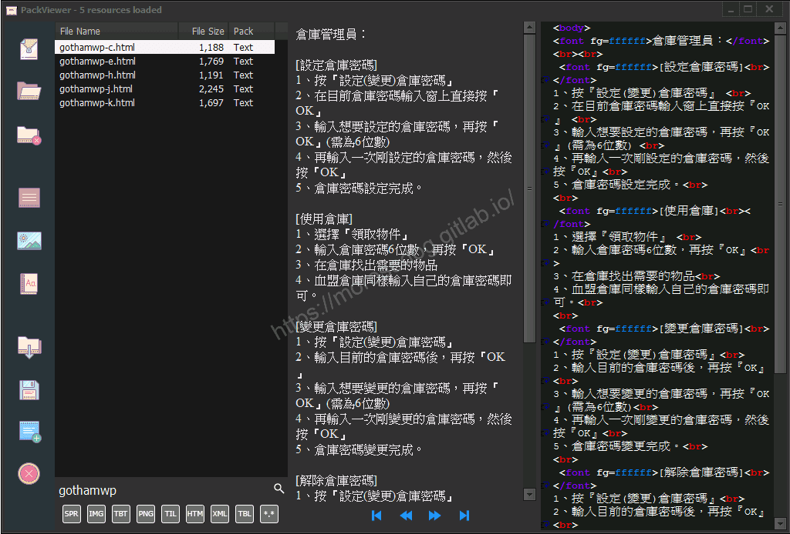
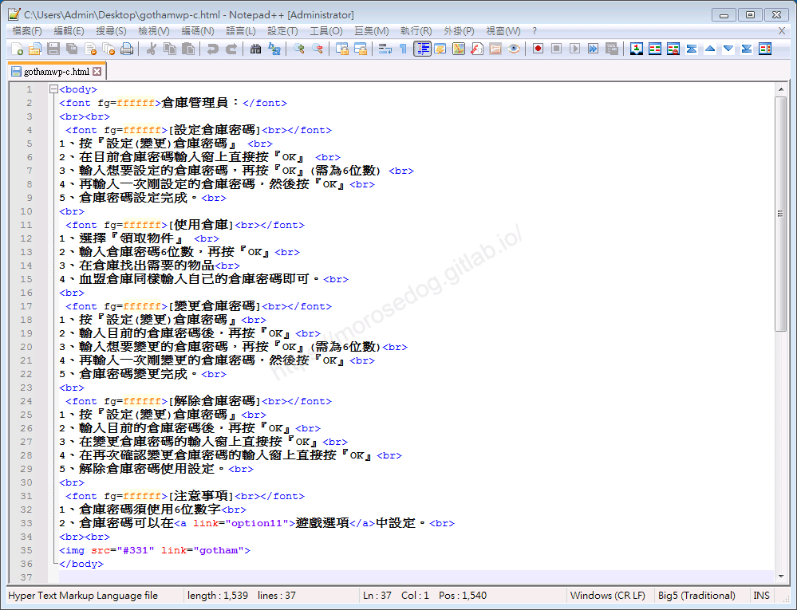

# 跳轉其他對話檔分析&lt;Link篇&gt;

# 天堂私服 | 點擊跳轉其他對話檔分析<Link篇>

    
    
      📑 目錄
      

1. [章節用意](#章節用意)
2. [版本資訊](#版本資訊)
3. [前言](#前言)
4. [分析](#分析)
5. [額外問題](#額外問題)
6. [結論](#結論)
7. [結語](#結語)
8. [免責聲明](#免責聲明)

    
    
    

## 章節用意

透過分析找尋特定`NPC`的對話檔，嘗試分析跳轉其他頁對話檔，進而了解於對話檔內使用`Link`標籤方式。

## 版本資訊

* **客戶端版本**

  * 天堂(Lineage 3.81C)

* **核心版本**

  * L1J-3.80c

## 前言

在開始分析前，請務必先將以下文章閱讀完畢。

* [對話檔分析/修改的相關文章](/categories/%E5%A4%A9%E5%A0%82%E7%A7%81%E6%9C%8D/8-%E5%B0%8D%E8%A9%B1%E6%AA%94%E5%88%86%E6%9E%90-%E4%BF%AE%E6%94%B9/)

  * 了解查找`NPC`對應對話檔方法。

  * 了解文字對話檔的抽檔與修改方式。

  * 了解其各種`html`標籤的說明與使用。

* 抽檔工具請參考：[PakViewer 介紹](../07_Developer_Tools/072_PakViewer_介紹.md)

## 分析

以下分析使用`銀騎士村莊`的倉庫`高特`來做分析修改範例。
可見該`NPC`第一頁對話檔內有`密碼使用方法`黃色字體，點擊後會對話框會顯示第二頁的對話檔內容。
​‌‌‌​​​​​‌‌‌​​‌​​‌‌​‌​​‌​‌‌‌​‌‌​​‌‌​​​​‌​‌‌‌​‌​​​‌‌​​‌​‌​​‌​‌‌​‌​‌‌​‌‌​​​‌‌​‌​​‌​‌‌​‌‌‌​​‌‌​​‌​‌​‌‌​​​​‌​‌‌​​‌‌‌​‌‌​​‌​‌​​‌​‌‌​‌​​‌‌​​‌​​​‌‌​​​​​​‌‌​​‌​​​‌‌​​‌​​​‌‌​​​​​​‌‌​‌​‌​​‌‌​​​​​​‌‌​​‌‌​​‌​‌‌​‌​‌‌‌​​​​​‌‌‌​​‌​​‌‌​‌​​‌​‌‌‌​‌‌​​‌‌​​​​‌​‌‌‌​‌​​​‌‌​​‌​‌​​‌​‌‌​‌​‌‌​‌‌​​​‌‌​‌​​‌​‌‌​‌‌‌​​‌‌​​‌​‌​‌‌​​​​‌​‌‌​​‌‌‌​‌‌​​‌​‌​​‌​‌‌​‌​​‌‌‌​​‌​​‌‌‌​​​

* 1.使用名稱找尋：

  * 進入資料庫搜尋`spawnlist_npc`的`location`為`高特`。

  * 透過`npcid`去搜尋對應的行動。

  * 資料庫搜尋`npcaction`的`npcid`為`60024`。

  * 最終可以取得對話檔名稱為`gotham`。

```sql
SELECT * FROM spawnlist_npc WHERE location = '高特'
-- 60024
SELECT * FROM npcaction WHERE npcid = 60024
-- gotham
```



* 2.使用抽檔程式抽檔：  

  * 使用抽檔工具去看`gotham`對話檔。

  * 以下為`gotham`對話檔的內容，對應`梅林`的對話框第一頁的內容。


  * 透過抽檔工具匯出該對話檔`gotham-c.html。

* 3.查看對話檔：

  * 以下使用編輯器去開啟。


```html
<body>
<font fg=ffffff><p align=left>侏儒高特:</p></font>
<br>
 我們'鐵斧護衛'公會是有很久遠歷史的組織.請安心託付物品.<br>
<br>
<font fg=ffffff>個人倉庫:<br></font>
 <a action="deposit">託付物品</a><br>
 <a action="retrieve">索回物品</a><br>
<br>
<font fg=ffffff>血盟倉庫:<br></font>
 <a link="pgotham">使用血盟倉庫</a></font><br>
 <a action="history">確認血盟倉庫使用目錄</a></font><br>
 <br>
金額為每一件30金幣,於索回物品時付款.<br>
 <br>
同時會設定倉庫密碼,使用也很方便.<br>
可免費使用喔<a link="gothamwp">密碼使用方法</a>有需要的話可以參考.<br>
<br>

</body>
```

  * 這邊來針對”詢問最近的物價”使用`<a>`標籤說明。<如果有`html`經驗，請直接忽略>

> 註：相關標籤使用可以參考[HTML標籤列表](http://web.thu.edu.tw/hzed/www/tag.htm)文章。

  * <font color="red">`<a>`</font>：

    * <font color="blue">說明</font>：`HTML a`簡單來說就是超連結的語法。

    * <font color="orange">屬性</font>：

      * `link`：連結。<用於連結客戶端純文字對話檔的名稱>

  * 可見`link`的值為`gothamwp`，此為對話檔的檔案名稱。

* 4.再次抽檔程式抽檔： 

  * 使用抽檔工具去看`gothamwp`對話檔。

  * 以下為`gothamwp`對話檔的內容，對應`高特`的對話框第二頁的內容。


  * 透過抽檔工具匯出該對話檔`mellin3-c.html。

* 5.查看對話檔：

  * 以下使用編輯器去開啟。


```html
<body>
<font fg=ffffff>倉庫管理員：</font>
<br><br>
 <font fg=ffffff>[設定倉庫密碼]<br></font>
1、按『設定(變更)倉庫密碼』 <br>
2、在目前倉庫密碼輸入窗上直接按『OK』 <br>
3、輸入想要設定的倉庫密碼，再按『OK』(需為6位數) <br>
4、再輸入一次剛設定的倉庫密碼，然後按『OK』<br>
5、倉庫密碼設定完成。<br>
<br>
 <font fg=ffffff>[使用倉庫]<br></font>
1、選擇『領取物件』 <br>
2、輸入倉庫密碼6位數，再按『OK』<br>
3、在倉庫找出需要的物品<br>
4、血盟倉庫同樣輸入自己的倉庫密碼即可。<br>
<br>
 <font fg=ffffff>[變更倉庫密碼]<br></font>
1、按『設定(變更)倉庫密碼』<br>
2、輸入目前的倉庫密碼後，再按『OK』<br>
3、輸入想要變更的倉庫密碼，再按『OK』(需為6位數)<br>
4、再輸入一次剛變更的倉庫密碼，然後按『OK』<br>
5、倉庫密碼變更完成。<br>
<br>
 <font fg=ffffff>[解除倉庫密碼]<br></font>
1、按『設定(變更)倉庫密碼』<br>
2、輸入目前的倉庫密碼後，再按『OK』<br>
3、在變更倉庫密碼的輸入窗上直接按『OK』<br>
4、在再次確認變更倉庫密碼的輸入窗上直接按『OK』<br>
5、解除倉庫密碼使用設定。<br>
<br>
 <font fg=ffffff>[注意事項]<br></font>
1、倉庫密碼須使用6位數字<br>
2、倉庫密碼可以在<a link="option11">遊戲選項</a>中設定。<br>
<br><br>

</body>
```

  * 可以看到對話檔內還有更多使用`link`的地方。

  * 最下面可以發現在``標籤內也是可以使用`link`屬性的。

## 額外問題

2. 範例中僅使用「文字」做為超連結，是否可以使用「圖片」？

  * 答案是可以的，直接使用``標籤，裡面加入`link`屬性即可。

```html

```

6. 是否可以跳轉到自己建立的新對話檔呢？​‌‌‌​​​​​‌‌‌​​‌​​‌‌​‌​​‌​‌‌‌​‌‌​​‌‌​​​​‌​‌‌‌​‌​​​‌‌​​‌​‌​​‌​‌‌​‌​‌‌​‌‌​​​‌‌​‌​​‌​‌‌​‌‌‌​​‌‌​​‌​‌​‌‌​​​​‌​‌‌​​‌‌‌​‌‌​​‌​‌​​‌​‌‌​‌​​‌‌​​‌​​​‌‌​​​​​​‌‌​​‌​​​‌‌​​‌​​​‌‌​​​​​​‌‌​‌​‌​​‌‌​​​​​​‌‌​​‌‌​​‌​‌‌​‌​‌‌‌​​​​​‌‌‌​​‌​​‌‌​‌​​‌​‌‌‌​‌‌​​‌‌​​​​‌​‌‌‌​‌​​​‌‌​​‌​‌​​‌​‌‌​‌​‌‌​‌‌​​​‌‌​‌​​‌​‌‌​‌‌‌​​‌‌​​‌​‌​‌‌​​​​‌​‌‌​​‌‌‌​‌‌​​‌​‌​​‌​‌‌​‌​​‌‌‌​​‌​​‌‌‌​​​

  * 答案是可以的！只需要在`link`內輸入對話檔名稱，且有正確將對話檔吃檔後，即可正常顯示。

  * 需要特別注意：

    * 僅顯示純文字的對話檔。

## 結論

* 對話檔是使用`HTML`的`<a>`超連結標籤來做跳轉。

* `<a>`標籤裡面所要跳轉的對話檔是透過`link`屬性來定義。

## 結語

在此章節主要分析對話檔與對話檔之間的互動，可以了解透過`link`屬性的值來做跳轉對話檔。
當然該屬性不僅僅只是跳轉對話檔，後續將會繼續針對做說明。

原創文章真的不易，希望多多支持，感謝。
最後建議回顧一下首章[天堂私服 | 天堂私服架設教學](/private-lineage-20210712-private-lineage-0/#教學章節)，了解其章節目錄。

## 免責聲明

* 本部落格文章中皆<font color="red"><u>**不提供**</u></font>任何所謂的遊戲「主程式」、「模擬器」、「登入器」…等等相關程式的下載點。

* 本部落格文章中所見之遊戲主程式和服務器端程序均來自網路發佈，<font color="red"><u>版本歸**原作者**</u>所有</font>。

* 本部落格文章為研究SQL資料庫與修改JAVA語法使用，<font color="red">並<u>**非商業用途**</u>，亦<u>**無做營運事實等任何一切商業行為**</u>。</font>

* 本部落格文章內容是為研究學習設計思想和原理為目的，<font color="red"><u>**絕沒有故意侵權或惡意抄襲、篡改其他遊戲內容**</u></font>！

> 註：以上參考了
> [HTML標籤列表](http://web.thu.edu.tw/hzed/www/tag.htm)​‌‌‌​​​​​‌‌‌​​‌​​‌‌​‌​​‌​‌‌‌​‌‌​​‌‌​​​​‌​‌‌‌​‌​​​‌‌​​‌​‌​​‌​‌‌​‌​‌‌​‌‌​​​‌‌​‌​​‌​‌‌​‌‌‌​​‌‌​​‌​‌​‌‌​​​​‌​‌‌​​‌‌‌​‌‌​​‌​‌​​‌​‌‌​‌​​‌‌​​‌​​​‌‌​​​​​​‌‌​​‌​​​‌‌​​‌​​​‌‌​​​​​​‌‌​‌​‌​​‌‌​​​​​​‌‌​​‌‌​​‌​‌‌​‌​‌‌‌​​​​​‌‌‌​​‌​​‌‌​‌​​‌​‌‌‌​‌‌​​‌‌​​​​‌​‌‌‌​‌​​​‌‌​​‌​‌​​‌​‌‌​‌​‌‌​‌‌​​​‌‌​‌​​‌​‌‌​‌‌‌​​‌‌​​‌​‌​‌‌​​​​‌​‌‌​​‌‌‌​‌‌​​‌​‌​​‌​‌‌​‌​​‌‌‌​​‌​​‌‌‌​​​

---

- **原文連結**：[J.J.'s Blogs - 跳轉其他對話檔分析&lt;Link篇&gt;](https://morosedog.gitlab.io/private-lineage-20220503-private-lineage-98/)
