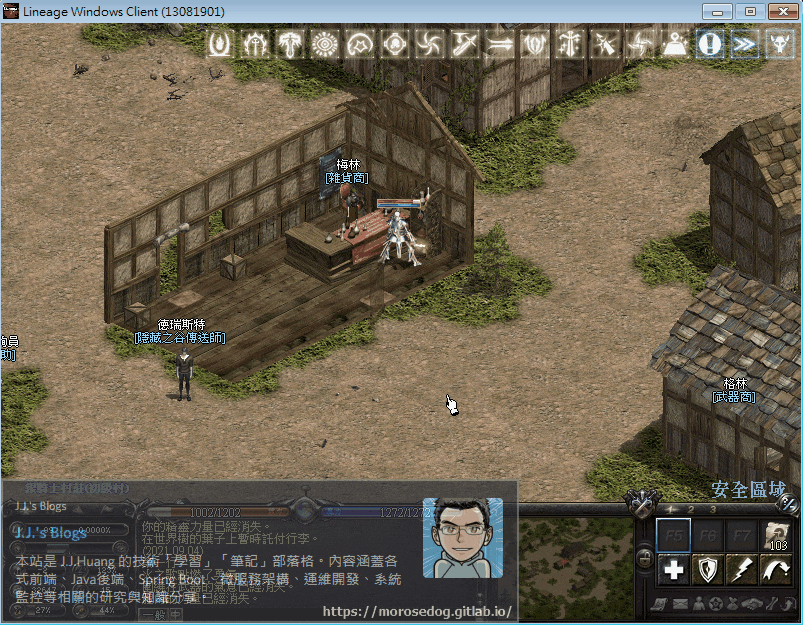
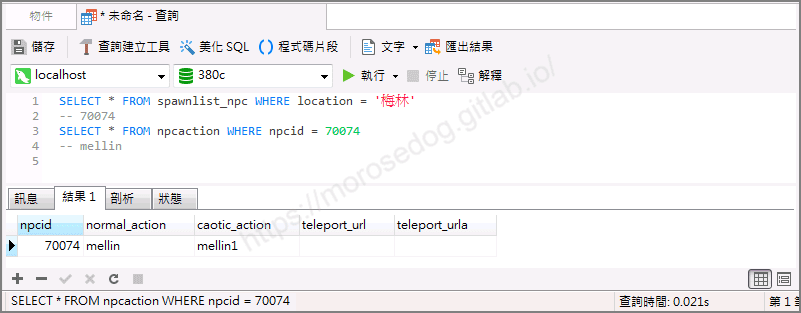
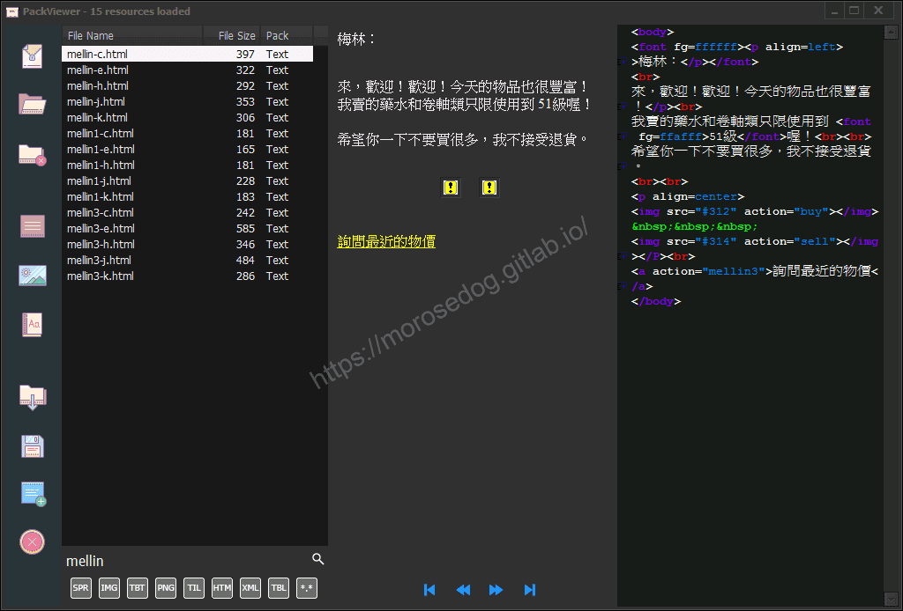
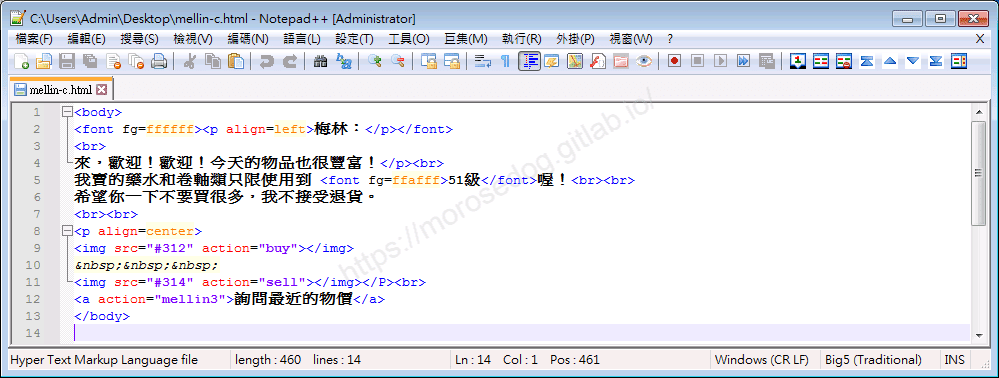
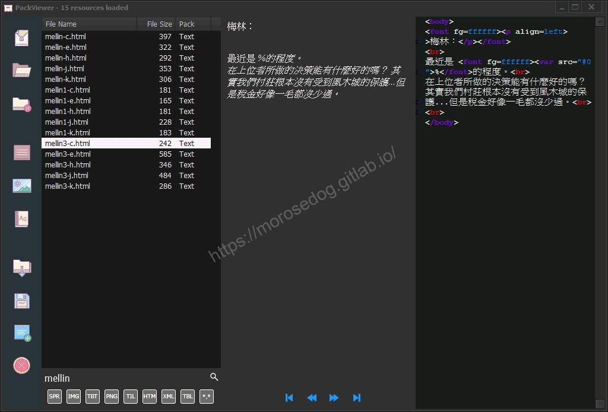
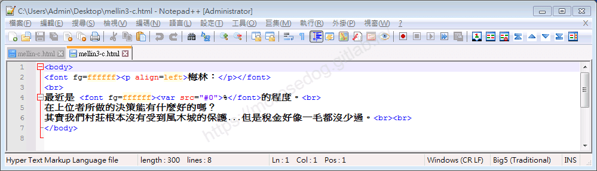
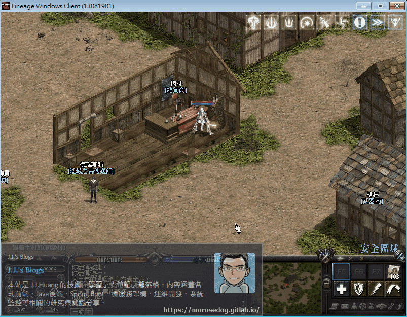
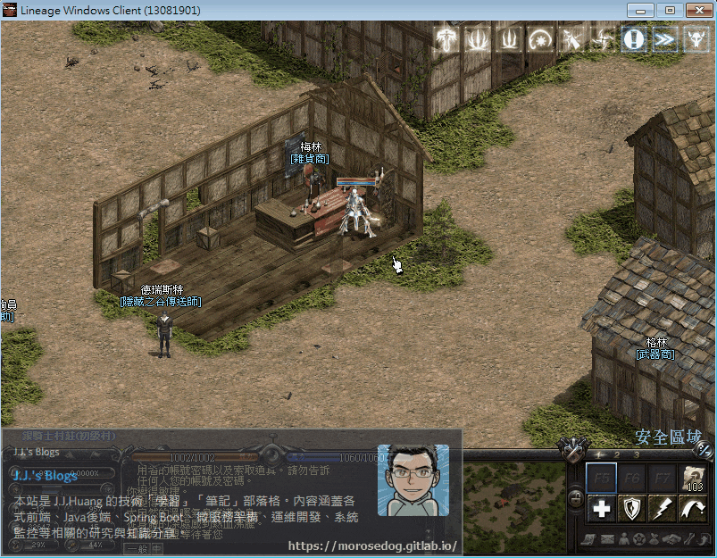

# 跳轉其他對話檔分析&lt;Action篇&gt;

# 天堂私服 | 點擊跳轉其他對話檔分析<Action篇>

    
    
      📑 目錄
      

1. [章節用意](#章節用意)
2. [版本資訊](#版本資訊)
3. [前言](#前言)
4. [分析](#分析)
5. [額外問題](#額外問題)
6. [結論](#結論)
7. [結語](#結語)
8. [免責聲明](#免責聲明)

    
    
    

## 章節用意

透過分析找尋特定`NPC`的對話檔，嘗試分析跳轉其他頁對話檔，進而了解於對話檔內使用`Action`標籤方式。

## 版本資訊

* **客戶端版本**

  * 天堂(Lineage 3.81C)

* **核心版本**

  * L1J-3.80c

## 前言

在開始分析前，請務必先將以下文章閱讀完畢。

* [對話檔分析/修改的相關文章](/categories/%E5%A4%A9%E5%A0%82%E7%A7%81%E6%9C%8D/8-%E5%B0%8D%E8%A9%B1%E6%AA%94%E5%88%86%E6%9E%90-%E4%BF%AE%E6%94%B9/)

  * 了解查找`NPC`對應對話檔方法。

  * 了解文字對話檔的抽檔與修改方式。

  * 了解其各種`html`標籤的說明與使用。

* 抽檔工具請參考：[PakViewer 介紹](../07_Developer_Tools/072_PakViewer_介紹.md)

## 分析

以下分析使用`銀騎士村莊`的`梅林`來做分析修改範例。
可見該`NPC`第一頁對話檔內有`詢問最近的物價`黃色字體，點擊後會對話框會顯示第二頁的對話檔內容。
​‌‌‌​​​​​‌‌‌​​‌​​‌‌​‌​​‌​‌‌‌​‌‌​​‌‌​​​​‌​‌‌‌​‌​​​‌‌​​‌​‌​​‌​‌‌​‌​‌‌​‌‌​​​‌‌​‌​​‌​‌‌​‌‌‌​​‌‌​​‌​‌​‌‌​​​​‌​‌‌​​‌‌‌​‌‌​​‌​‌​​‌​‌‌​‌​​‌‌​​‌​​​‌‌​​​​​​‌‌​​‌​​​‌‌​​‌​​​‌‌​​​​​​‌‌​‌​‌​​‌‌​​​​​​‌‌​‌​​​​‌​‌‌​‌​‌‌‌​​​​​‌‌‌​​‌​​‌‌​‌​​‌​‌‌‌​‌‌​​‌‌​​​​‌​‌‌‌​‌​​​‌‌​​‌​‌​​‌​‌‌​‌​‌‌​‌‌​​​‌‌​‌​​‌​‌‌​‌‌‌​​‌‌​​‌​‌​‌‌​​​​‌​‌‌​​‌‌‌​‌‌​​‌​‌​​‌​‌‌​‌​​‌‌‌​​‌​​‌‌‌​​‌

* 1.使用名稱找尋：

  * 進入資料庫搜尋`spawnlist_npc`的`location`為`梅林`。

  * 透過`npcid`去搜尋對應的行動。

  * 資料庫搜尋`npcaction`的`npcid`為`70074`。

  * 最終可以取得對話檔名稱為`telescave1`與`telescave2`。

```sql
SELECT * FROM spawnlist_npc WHERE location = '梅林'
-- 70074
SELECT * FROM npcaction WHERE npcid = 70101
-- mellin
```



* 2.使用抽檔程式抽檔：  

  * 使用抽檔工具去看`mellin`對話檔。

  * 以下為`mellin`對話檔的內容，對應`梅林`的對話框第一頁的內容。


  * 透過抽檔工具匯出該對話檔`mellin-c.html。

* 3.查看對話檔：

  * 以下使用編輯器去開啟。


```html
<body>
<font fg=ffffff><p align=left>梅林：</p></font>
<br>
來，歡迎！歡迎！今天的物品也很豐富！</p><br>
我賣的藥水和卷軸類只限使用到 <font fg=ffafff>51級</font>喔！<br><br>
希望你一下不要買很多，我不接受退貨。
<br><br>
<p align=center>
</img>
   
</img></P><br>
<a action="mellin3">詢問最近的物價</a>
</body>
```

  * 這邊來針對”詢問最近的物價”使用`<a>`標籤說明。<如果有`html`經驗，請直接忽略>

> 註：相關標籤使用可以參考[HTML標籤列表](http://web.thu.edu.tw/hzed/www/tag.htm)文章。

  * <font color="red">`<a>`</font>：

    * <font color="blue">說明</font>：`HTML a`簡單來說就是超連結的語法。

    * <font color="orange">屬性</font>：

      * `action`：動作、行動。<用於與伺服器端作互動的判斷內容>

> 註：此`action`當前可能不是很了解，屬於正常現象；因為需要與核心代碼相互呼應才能夠理解，請先專注於對話檔的分析使用和修改。

  * 可見`action`的值為`mellin3`，基本上可斷定為一個對話檔的檔案名稱。

> 註：如果是行為動作的操作，通常會用動詞命名，例如：`buy`。​‌‌‌​​​​​‌‌‌​​‌​​‌‌​‌​​‌​‌‌‌​‌‌​​‌‌​​​​‌​‌‌‌​‌​​​‌‌​​‌​‌​​‌​‌‌​‌​‌‌​‌‌​​​‌‌​‌​​‌​‌‌​‌‌‌​​‌‌​​‌​‌​‌‌​​​​‌​‌‌​​‌‌‌​‌‌​​‌​‌​​‌​‌‌​‌​​‌‌​​‌​​​‌‌​​​​​​‌‌​​‌​​​‌‌​​‌​​​‌‌​​​​​​‌‌​‌​‌​​‌‌​​​​​​‌‌​‌​​​​‌​‌‌​‌​‌‌‌​​​​​‌‌‌​​‌​​‌‌​‌​​‌​‌‌‌​‌‌​​‌‌​​​​‌​‌‌‌​‌​​​‌‌​​‌​‌​​‌​‌‌​‌​‌‌​‌‌​​​‌‌​‌​​‌​‌‌​‌‌‌​​‌‌​​‌​‌​‌‌​​​​‌​‌‌​​‌‌‌​‌‌​​‌​‌​​‌​‌‌​‌​​‌‌‌​​‌​​‌‌‌​​‌

* 4.再次抽檔程式抽檔： 

  * 使用抽檔工具去看`mellin3`對話檔。

  * 以下為`mellin3`對話檔的內容，對應`梅林`的對話框第二頁的內容。


  * 透過抽檔工具匯出該對話檔`mellin3-c.html。

* 5.查看對話檔：

  * 以下使用編輯器去開啟。


```html
<body>
<font fg=ffffff><p align=left>梅林：</p></font>
<br>
最近是 <font fg=ffffff><var src="#0">%</font>的程度。<br>
在上位者所做的決策能有什麼好的嗎？
其實我們村莊根本沒有受到風木城的保護...但是稅金好像一毛都沒少過。<br><br>
</body>
```

  * 這邊來針對”%”使用`<var>`標籤說明。<如果有`html`經驗，請直接忽略>

  * <font color="red">`<var>`</font>：

    * <font color="blue">說明</font>：`HTML Variable (<var>)`表示數學表達式或程式上下文中的變數名稱。

    * <font color="orange">屬性</font>：

      * `src`：變數名稱，必要項目。<參數對應伺服器端提供的變數名稱或是索引位置>

> 註：此`var`標籤的使用，可能不是很了解，屬於正常現象；因為需要與核心代碼相互呼應才能夠理解，請先專注於對話檔的分析使用和修改。

## 額外問題

2. 範例中僅使用「文字」做為超連結，是否可以使用「圖片」？

  * 答案是可以的，直接使用``標籤，裡面加入`action`屬性即可。

```html
</img>
```



5. 是否可以使用`action`跳轉到自己建立的新對話檔呢？​‌‌‌​​​​​‌‌‌​​‌​​‌‌​‌​​‌​‌‌‌​‌‌​​‌‌​​​​‌​‌‌‌​‌​​​‌‌​​‌​‌​​‌​‌‌​‌​‌‌​‌‌​​​‌‌​‌​​‌​‌‌​‌‌‌​​‌‌​​‌​‌​‌‌​​​​‌​‌‌​​‌‌‌​‌‌​​‌​‌​​‌​‌‌​‌​​‌‌​​‌​​​‌‌​​​​​​‌‌​​‌​​​‌‌​​‌​​​‌‌​​​​​​‌‌​‌​‌​​‌‌​​​​​​‌‌​‌​​​​‌​‌‌​‌​‌‌‌​​​​​‌‌‌​​‌​​‌‌​‌​​‌​‌‌‌​‌‌​​‌‌​​​​‌​‌‌‌​‌​​​‌‌​​‌​‌​​‌​‌‌​‌​‌‌​‌‌​​​‌‌​‌​​‌​‌‌​‌‌‌​​‌‌​​‌​‌​‌‌​​​​‌​‌‌​​‌‌‌​‌‌​​‌​‌​​‌​‌‌​‌​​‌‌‌​​‌​​‌‌‌​​‌

  * 答案是可以的！但是<font color="red">**需要修改核心**</font>。

  * 詳細的修改方式就不特別說明，以下僅提供可以達成此效果的動態圖。

> 註：詳細的修改會另開章節介紹，請先專注於對話檔的分析使用和修改。
> 

## 結論

* 對話檔是使用`HTML`的`<a>`超連結標籤來做跳轉。

* `<a>`標籤裡面所要跳轉的對話檔是可以透過`action`屬性來定義。

* 互動式內容是透過`<var>`標籤來顯示的。

## 結語

在此章節主要分析對話檔與伺服器端之間的互動，可以了解透過`action`屬性的值來做跳轉對話檔。
當然該屬性不僅僅只是跳轉對話檔，後續將會繼續針對做說明。

原創文章真的不易，希望多多支持，感謝。
最後建議回顧一下首章[天堂私服 | 天堂私服架設教學](/private-lineage-20210712-private-lineage-0/#教學章節)，了解其章節目錄。​‌‌‌​​​​​‌‌‌​​‌​​‌‌​‌​​‌​‌‌‌​‌‌​​‌‌​​​​‌​‌‌‌​‌​​​‌‌​​‌​‌​​‌​‌‌​‌​‌‌​‌‌​​​‌‌​‌​​‌​‌‌​‌‌‌​​‌‌​​‌​‌​‌‌​​​​‌​‌‌​​‌‌‌​‌‌​​‌​‌​​‌​‌‌​‌​​‌‌​​‌​​​‌‌​​​​​​‌‌​​‌​​​‌‌​​‌​​​‌‌​​​​​​‌‌​‌​‌​​‌‌​​​​​​‌‌​‌​​​​‌​‌‌​‌​‌‌‌​​​​​‌‌‌​​‌​​‌‌​‌​​‌​‌‌‌​‌‌​​‌‌​​​​‌​‌‌‌​‌​​​‌‌​​‌​‌​​‌​‌‌​‌​‌‌​‌‌​​​‌‌​‌​​‌​‌‌​‌‌‌​​‌‌​​‌​‌​‌‌​​​​‌​‌‌​​‌‌‌​‌‌​​‌​‌​​‌​‌‌​‌​​‌‌‌​​‌​​‌‌‌​​‌

## 免責聲明

* 本部落格文章中皆<font color="red"><u>**不提供**</u></font>任何所謂的遊戲「主程式」、「模擬器」、「登入器」…等等相關程式的下載點。

* 本部落格文章中所見之遊戲主程式和服務器端程序均來自網路發佈，<font color="red"><u>版本歸**原作者**</u>所有</font>。

* 本部落格文章為研究SQL資料庫與修改JAVA語法使用，<font color="red">並<u>**非商業用途**</u>，亦<u>**無做營運事實等任何一切商業行為**</u>。</font>

* 本部落格文章內容是為研究學習設計思想和原理為目的，<font color="red"><u>**絕沒有故意侵權或惡意抄襲、篡改其他遊戲內容**</u></font>！

> 註：以上參考了
> [HTML標籤列表](http://web.thu.edu.tw/hzed/www/tag.htm)

---

- **原文連結**：[J.J.'s Blogs - 跳轉其他對話檔分析&lt;Action篇&gt;](https://morosedog.gitlab.io/private-lineage-20220504-private-lineage-99/)
