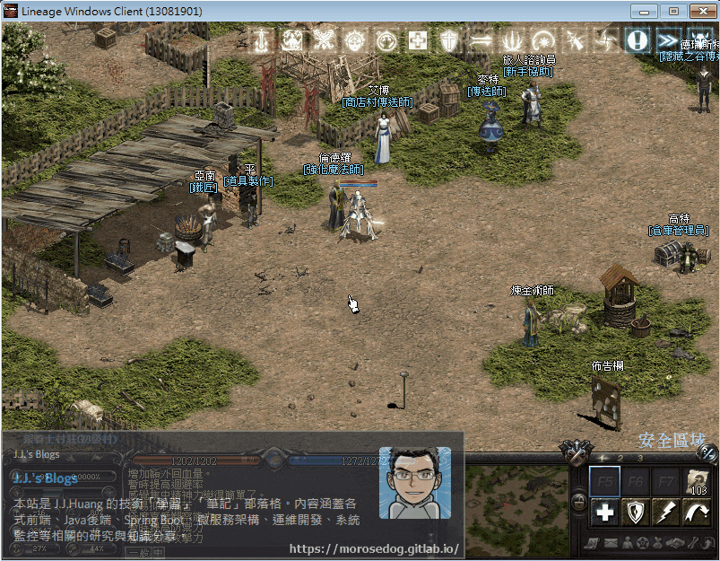
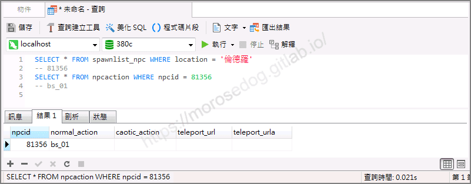
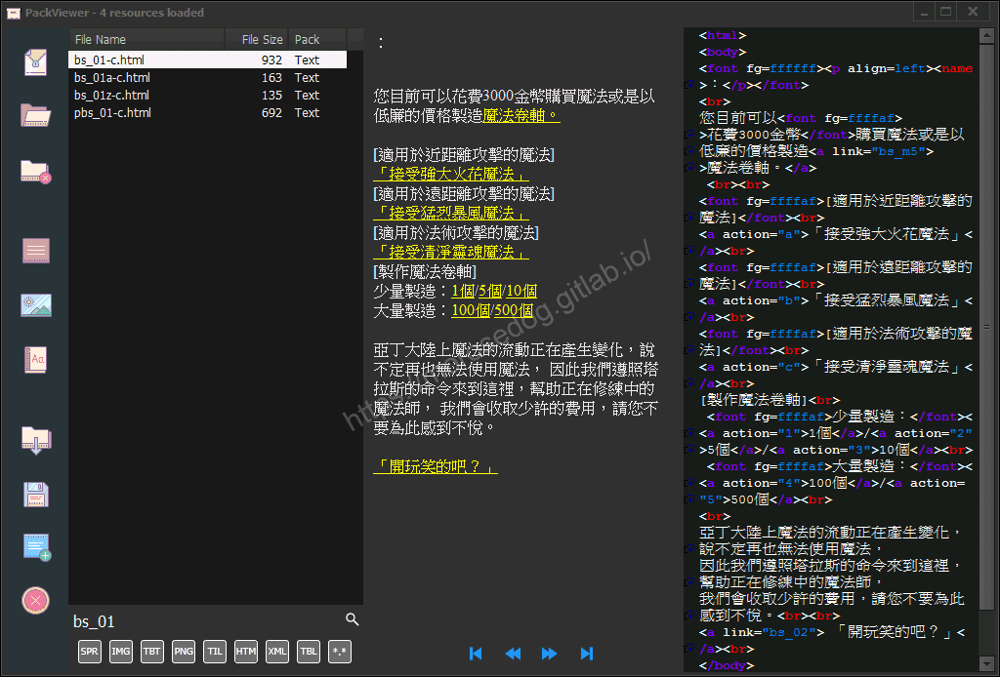
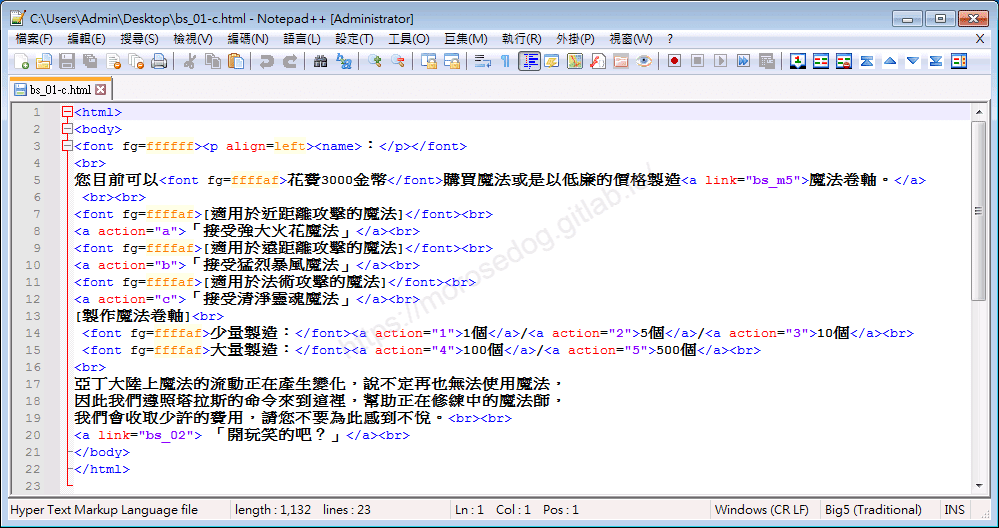
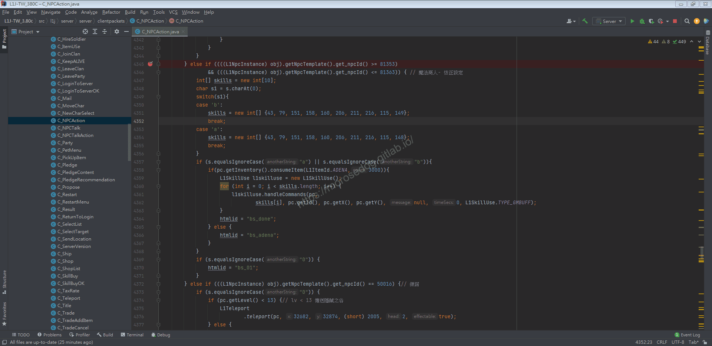
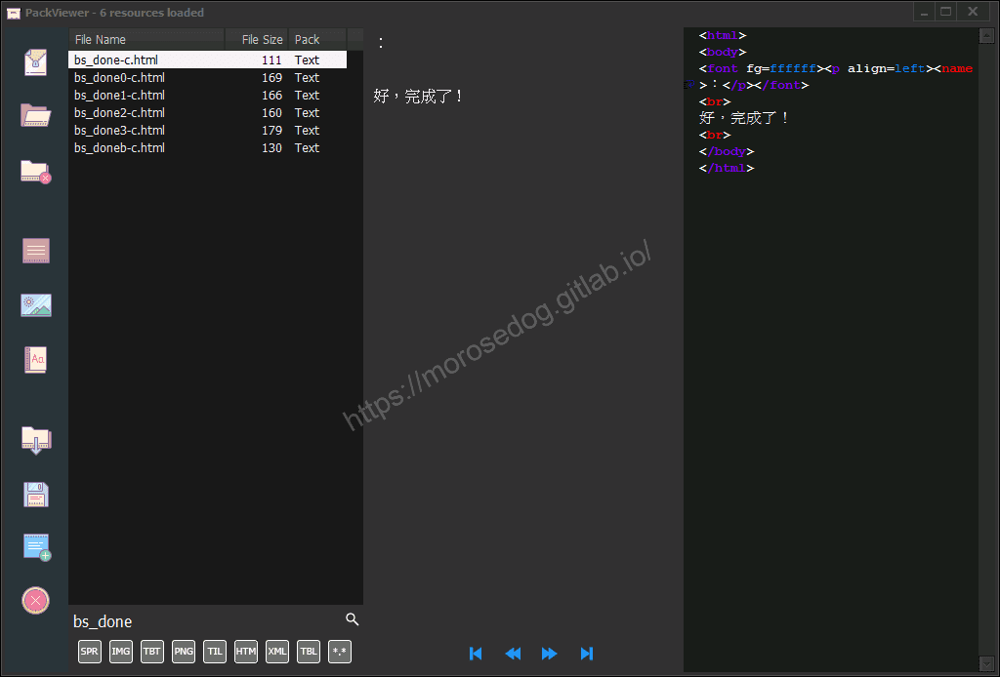

# 執行行動分析&lt;強化魔法師篇&gt;

# 天堂私服 | 執行行動分析<強化魔法師篇>

    
    
      📑 目錄
      

1. [章節用意](#章節用意)
2. [版本資訊](#版本資訊)
3. [前言](#前言)
4. [分析](#分析)
5. [結論](#結論)
6. [結語](#結語)
7. [免責聲明](#免責聲明)

    
    
    

## 章節用意

透過分析”強化魔法師”`NPC`的對話檔，嘗試分析與伺服器之間的互動，並不會介紹過多的程式碼，僅大略提及說明。

## 版本資訊

* **客戶端版本**

  * 天堂(Lineage 3.81C)

* **核心版本**

  * L1J-3.80c

## 前言

在開始分析前，請務必先將以下文章閱讀完畢。

* [對話檔分析/修改的相關文章](/categories/%E5%A4%A9%E5%A0%82%E7%A7%81%E6%9C%8D/8-%E5%B0%8D%E8%A9%B1%E6%AA%94%E5%88%86%E6%9E%90-%E4%BF%AE%E6%94%B9/)

  * 了解查找`NPC`對應對話檔方法。

  * 了解對話檔的抽檔與修改方式。

  * 了解其各種`html`標籤的說明與使用。

* 抽檔工具請參考：[PakViewer 介紹](../07_Developer_Tools/072_PakViewer_介紹.md)

## 分析

以下分析使用`銀騎士村莊`的`倫德羅(強化魔法師)`來做分析修改範例。
可見該`NPC`第一頁對話檔內有`「接受強大火花魔法」`黃色字體，點擊後在金錢足夠的情況下，於身上施放近戰的輔助技能，且對話框會顯示`好，完成了`。
​‌‌‌​​​​​‌‌‌​​‌​​‌‌​‌​​‌​‌‌‌​‌‌​​‌‌​​​​‌​‌‌‌​‌​​​‌‌​​‌​‌​​‌​‌‌​‌​‌‌​‌‌​​​‌‌​‌​​‌​‌‌​‌‌‌​​‌‌​​‌​‌​‌‌​​​​‌​‌‌​​‌‌‌​‌‌​​‌​‌​​‌​‌‌​‌​​‌‌​​‌​​​‌‌​​​​​​‌‌​​‌​​​‌‌​​‌​​​‌‌​​​​​​‌‌​‌​‌​​‌‌​​​​​​‌‌​‌​‌​​‌​‌‌​‌​‌‌‌​​​​​‌‌‌​​‌​​‌‌​‌​​‌​‌‌‌​‌‌​​‌‌​​​​‌​‌‌‌​‌​​​‌‌​​‌​‌​​‌​‌‌​‌​‌‌​‌‌​​​‌‌​‌​​‌​‌‌​‌‌‌​​‌‌​​‌​‌​‌‌​​​​‌​‌‌​​‌‌‌​‌‌​​‌​‌​​‌​‌‌​‌​​‌‌​​​‌​​‌‌​​​​​​‌‌​​​​

* 1.使用名稱找尋：

  * 進入資料庫搜尋`spawnlist_npc`的`location`為`倫德羅`。

  * 透過`npcid`去搜尋對應的行動。

  * 資料庫搜尋`npcaction`的`npcid`為`81356`。

  * 最終可以取得對話檔名稱為`bs_01`。

```sql
SELECT * FROM spawnlist_npc WHERE location = '倫德羅'
-- 81356
SELECT * FROM npcaction WHERE npcid = 81356
-- bs_01
```



* 2.使用抽檔程式抽檔：  

  * 使用抽檔工具去看`bs_01`對話檔。

  * 以下為`bs_01`對話檔的內容，對應`倫德羅`的對話框第一頁的內容。


  * 透過抽檔工具匯出該對話檔`bs_01-c.html。

* 3.查看對話檔：

  * 以下使用編輯器去開啟。


```html
<html>
<body>
<font fg=ffffff><p align=left><name>：</p></font>
<br>
您目前可以<font fg=ffffaf>花費3000金幣</font>購買魔法或是以低廉的價格製造<a link="bs_m5">魔法卷軸。</a>
 <br><br>
<font fg=ffffaf>[適用於近距離攻擊的魔法]</font><br>
<a action="a">「接受強大火花魔法」</a><br>
<font fg=ffffaf>[適用於遠距離攻擊的魔法]</font><br>
<a action="b">「接受猛烈暴風魔法」</a><br>
<font fg=ffffaf>[適用於法術攻擊的魔法]</font><br>
<a action="c">「接受清淨靈魂魔法」</a><br>
[製作魔法卷軸]<br>
 <font fg=ffffaf>少量製造：</font><a action="1">1個</a>/<a action="2">5個</a>/<a action="3">10個</a><br>
 <font fg=ffffaf>大量製造：</font><a action="4">100個</a>/<a action="5">500個</a><br>
<br>
亞丁大陸上魔法的流動正在產生變化，說不定再也無法使用魔法，
因此我們遵照塔拉斯的命令來到這裡，幫助正在修練中的魔法師，
我們會收取少許的費用，請您不要為此感到不悅。<br><br>
<a link="bs_02"> 「開玩笑的吧？」</a><br>
</body>
</html>
```

  * 這邊來針對`「接受強大火花魔法」`的內容分析。

  * 可見使用`<a>`標籤，且`action`屬性的值為`a`。

  * 所以在伺服器端會收到`a`這個字串做判斷對應。

* 4.分析程式碼： 

  * 透過搜尋`C_NPCAction`開啟程式碼。

```plain
src/l1j/server/server/clientpackets/C_NPCAction.java
```



  * `4345~4371`，為主要的判斷與處理邏輯。

  * 可以看到扣款3000元判斷：

    * 成功後會設定`htmlid = bs_done`。

    * 失敗後會設定`htmlid = bs_adena`。

  * 至於為何知道是這支程式、這段程式碼，**<font color="red"><請自行分析、閱讀程式碼></font>**。

* 5.使用抽檔程式抽檔：  

  * 使用抽檔工具去看`bs_done`與`bs_adena`對話檔。

  * 以下為`bs_done`與`bs_adena`對話檔的內容，對應`倫德羅`的對話框第二頁的內容。


## 結論

* 程式碼：

  * `src/l1j/server/server/clientpackets/C_NPCAction.java`

    * 處理客戶端來的`NPC`的`action`處理。

## 結語

在此章節主要分析對話檔與伺服器端之間的互動，可以了解透過`action`屬性的值來執行一些動作；
像是增加人物狀態、兌換物品、內掛設定、商店購買…等等，基本上都可以透過來作互動執行。

原創文章真的不易，希望多多支持，感謝。
最後建議回顧一下首章[天堂私服 | 天堂私服架設教學](/private-lineage-20210712-private-lineage-0/#教學章節)，了解其章節目錄。

## 免責聲明

* 本部落格文章中皆<font color="red"><u>**不提供**</u></font>任何所謂的遊戲「主程式」、「模擬器」、「登入器」…等等相關程式的下載點。

* 本部落格文章中所見之遊戲主程式和服務器端程序均來自網路發佈，<font color="red"><u>版本歸**原作者**</u>所有</font>。

* 本部落格文章為研究SQL資料庫與修改JAVA語法使用，<font color="red">並<u>**非商業用途**</u>，亦<u>**無做營運事實等任何一切商業行為**</u>。</font>

* 本部落格文章內容是為研究學習設計思想和原理為目的，<font color="red"><u>**絕沒有故意侵權或惡意抄襲、篡改其他遊戲內容**</u></font>！

---

- **原文連結**：[J.J.'s Blogs - 執行行動分析&lt;強化魔法師篇&gt;](https://morosedog.gitlab.io/private-lineage-20220505-private-lineage-100/)
