# 執行行動分析&lt;傳送師篇&gt;

# 天堂私服 | 執行行動分析<傳送師篇>

    
    
      📑 目錄
      

1. [章節用意](#章節用意)
2. [版本資訊](#版本資訊)
3. [前言](#前言)
4. [分析](#分析)
5. [其他](#其他)
6. [結論](#結論)
7. [結語](#結語)
8. [免責聲明](#免責聲明)

    
    
    

## 章節用意

透過分析”傳送師”`NPC`的對話檔，嘗試分析與伺服器之間的互動，並不會介紹過多的程式碼，僅大略提及說明。

## 版本資訊

* **客戶端版本**

  * 天堂(Lineage 3.81C)

* **核心版本**

  * L1J-3.80c

## 前言

在開始分析前，請務必先將以下文章閱讀完畢。

* [對話檔分析/修改的相關文章](/categories/%E5%A4%A9%E5%A0%82%E7%A7%81%E6%9C%8D/8-%E5%B0%8D%E8%A9%B1%E6%AA%94%E5%88%86%E6%9E%90-%E4%BF%AE%E6%94%B9/)

  * 了解查找`NPC`對應對話檔方法。

  * 了解對話檔的抽檔與修改方式。

  * 了解其各種`html`標籤的說明與使用。

* 抽檔工具請參考：[PakViewer 介紹](../07_Developer_Tools/072_PakViewer_介紹.md)

## 分析

以下分析使用`銀騎士村莊`的`麥特(傳送師)`來做分析修改範例。
可見該`NPC`第一頁對話檔內有`我想要到其他村莊`黃色字體，點擊後會對話框會顯示第二頁的對話檔內容。
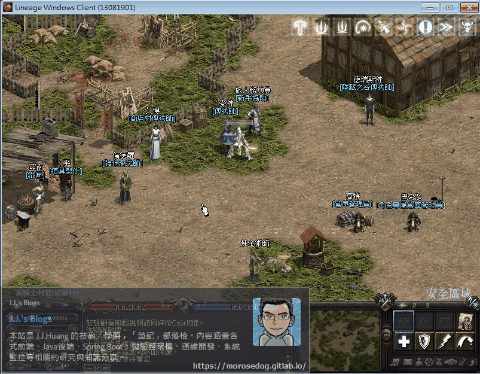​‌‌‌​​​​​‌‌‌​​‌​​‌‌​‌​​‌​‌‌‌​‌‌​​‌‌​​​​‌​‌‌‌​‌​​​‌‌​​‌​‌​​‌​‌‌​‌​‌‌​‌‌​​​‌‌​‌​​‌​‌‌​‌‌‌​​‌‌​​‌​‌​‌‌​​​​‌​‌‌​​‌‌‌​‌‌​​‌​‌​​‌​‌‌​‌​​‌‌​​‌​​​‌‌​​​​​​‌‌​​‌​​​‌‌​​‌​​​‌‌​​​​​​‌‌​‌​‌​​‌‌​​​​​​‌‌​‌‌​​​‌​‌‌​‌​‌‌‌​​​​​‌‌‌​​‌​​‌‌​‌​​‌​‌‌‌​‌‌​​‌‌​​​​‌​‌‌‌​‌​​​‌‌​​‌​‌​​‌​‌‌​‌​‌‌​‌‌​​​‌‌​‌​​‌​‌‌​‌‌‌​​‌‌​​‌​‌​‌‌​​​​‌​‌‌​​‌‌‌​‌‌​​‌​‌​​‌​‌‌​‌​​‌‌​​​‌​​‌‌​​​​​​‌‌​​​‌

* 1.使用名稱找尋：

  * 進入資料庫搜尋`spawnlist_npc`的`location`為`麥特`。

  * 透過`npcid`去搜尋對應的行動。

  * 資料庫搜尋`npcaction`的`npcid`為`50056`。

  * 最終可以取得對話檔名稱為`telesilver1`。

```sql
SELECT * FROM spawnlist_npc WHERE location = '麥特'
-- 50056
SELECT * FROM npcaction WHERE npcid = 50056
-- telesilver1

-- telesilver2
-- telesilver3
```

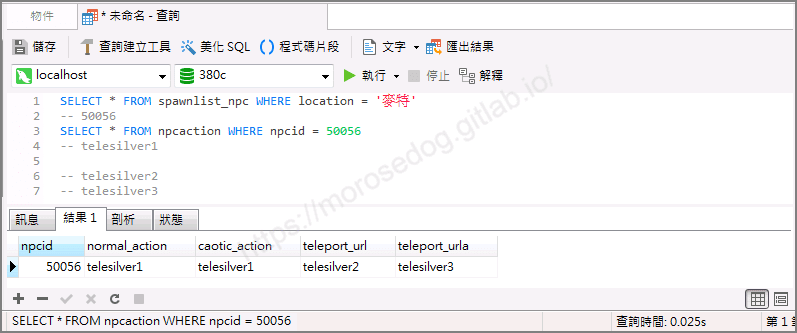

* 2.使用抽檔程式抽檔：  

  * 使用抽檔工具去看`telesilver1`對話檔。

  * 以下為`telesilver1`對話檔的內容，對應`麥特`的對話框第一頁的內容。
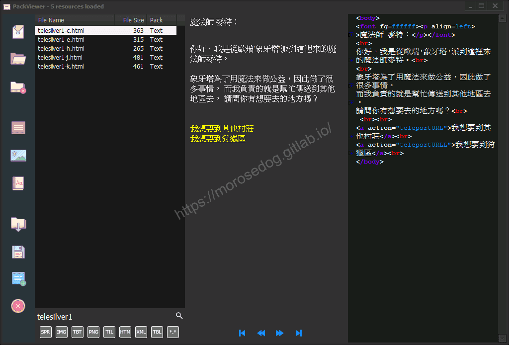

  * 透過抽檔工具匯出該對話檔`telesilver1-c.html。

* 3.查看對話檔：

  * 以下使用編輯器去開啟。
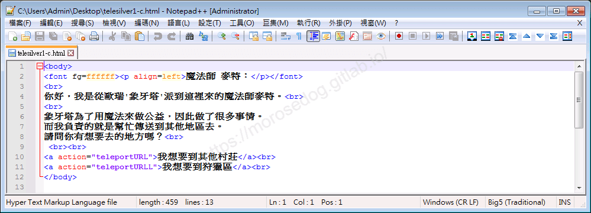

```html
<body>
<font fg=ffffff><p align=left>魔法師 麥特：</p></font>
<br>
你好，我是從歐瑞'象牙塔'派到這裡來的魔法師麥特。<br>
<br>
象牙塔為了用魔法來做公益，因此做了很多事情。
而我負責的就是幫忙傳送到其他地區去。
請問你有想要去的地方嗎？<br>
 <br><br>
<a action="teleportURL">我想要到其他村莊</a><br>
<a action="teleportURLL">我想要到狩獵區</a><br>
</body>
```

  * 這邊來針對`我想要到其他村莊`的內容分析。

  * 可見使用`<a>`標籤，且`action`屬性的值為`teleportURL`。

  * 所以在伺服器端會收到`teleportURL`這個字串做判斷對應。

* 4.分析`XML`檔：

  * 透過搜尋`teleportURL`關鍵字，開啟檔案。

```plain
data/xml/NpcActions/Teleporter.xml
```

  * 可以發現針對`NpcId="50056"`的以下內容。

```xml
<!--銀騎士村莊-->
	<!--麥特 / 肯特村莊-->
	<Action Name="teleport silver-kent" NpcId="50056">
		<Teleport X="33050" Y="32782" Map="4" Heading="5" Price="55" />
	</Action>
	<!--麥特 / 風木村莊-->
	<Action Name="teleport silver-woods" NpcId="50056">
		<Teleport X="32640" Y="33203" Map="4" Heading="5" Price="55" />
	</Action>
	<!--麥特 / 海音村莊-->
	<Action Name="teleport silver-heine" NpcId="50056">
		<Teleport X="33612" Y="33257" Map="4" Heading="5" Price="55" />
	</Action>
	<!--麥特 / 古魯丁村莊-->
	<Action Name="teleport silver-gludin" NpcId="50056">
		<Teleport X="32608" Y="32734" Map="4" Heading="5" Price="132" />
	</Action>
	<!--麥特 / 奇岩村莊-->
	<Action Name="teleport silver-giran" NpcId="50056">
		<Teleport X="33438" Y="32796" Map="4" Heading="5" Price="132" />
	</Action>
	<!--麥特 / 亞丁城鎮-->
	<Action Name="teleport silver-aden" NpcId="50056">
		<Teleport X="33965" Y="33253" Map="4" Heading="5" Price="132" />
	</Action>
	<!--麥特 / 燃柳村莊-->
	<Action Name="teleport silver-willow" NpcId="50056">
		<Teleport X="32715" Y="32448" Map="4" Heading="5" Price="198" />
	</Action>
	<!--麥特 / 威頓村莊-->
	<Action Name="teleport silver-werldern" NpcId="50056">
		<Teleport X="33709" Y="32500" Map="4" Heading="5" Price="198" />
	</Action>
	<!--麥特 / 貝希摩斯村莊-->
	<Action Name="teleport silver-behemoth" NpcId="50056">
		<Teleport X="32779" Y="32887" Map="1001" Heading="5" Price="198" />
	</Action>
	<!--麥特 / 希培利亞村莊-->
	<Action Name="teleport silver-silveria" NpcId="50056">
		<Teleport X="32841" Y="32856" Map="1000" Heading="2" Price="246" />
	</Action>
	<!--麥特 / 歐瑞村莊-->
	<Action Name="teleport silver-oren" NpcId="50056">
		<Teleport X="34062" Y="32278" Map="4" Heading="5" Price="246" />
	</Action>
	<!--麥特 / 正義神殿-->
	<Action Name="teleport silver-lowful" NpcId="50056">
		<Teleport X="33118" Y="32933" Map="4" Heading="5" Price="330" />
	</Action>
	<!--麥特 / 邪惡神殿-->
	<Action Name="teleport silver-chaos" NpcId="50056">
		<Teleport X="32885" Y="32652" Map="4" Heading="5" Price="330" />
	</Action>
	<!--麥特 / 肯特葡萄園-->
	<Action Name="teleport silver-grape" NpcId="50056">
		<Teleport X="32871" Y="32805" Map="4" Heading="5" Price="330" />
	</Action>
	<!--麥特 / 說話之島-->
	<Action Name="teleport silver-island" NpcId="50056">
		<Teleport X="32583" Y="32924" Map="0" Heading="5" Price="770" />
	</Action>
	<!--麥特 / 狄亞得要塞-->
	<Action Name="teleport silver-diad" NpcId="50056">
		<Teleport X="32828" Y="32900" Map="320" Heading="5" Price="7480" />
	</Action>
	<!--顯示金額-->
	<ShowHtml Name="teleportURL" HtmlId="telesilver2" NpcId="50056">
		<Data Value="55" /><!--肯特村莊-->
		<Data Value="55" /><!--風木村莊-->
		<Data Value="55" /><!--海音村莊-->
		<Data Value="132" /><!--古魯丁村莊-->
		<Data Value="132" /><!--奇岩村莊-->
		<Data Value="132" /><!--亞丁城鎮-->
		<Data Value="198" /><!--燃柳村莊-->
		<Data Value="198" /><!--威頓村莊-->
		<Data Value="198" /><!--貝希摩斯村莊-->
		<Data Value="246" /><!--希培利亞村莊-->
		<Data Value="246" /><!--歐瑞村莊-->
		<Data Value="330" /><!--正義神殿-->
		<Data Value="330" /><!--邪惡神殿-->
		<Data Value="330" /><!--肯特葡萄園-->
		<Data Value="770" /><!--說話之島-->
		<Data Value="7480" /><!--狄亞得要塞-->
	</ShowHtml>
```

* 5.使用抽檔程式抽檔：  

  * 使用抽檔工具去看`telesilver2`對話檔。

  * 以下為`telesilver2`對話檔的內容，對應`麥特`的對話框第二頁的內容。
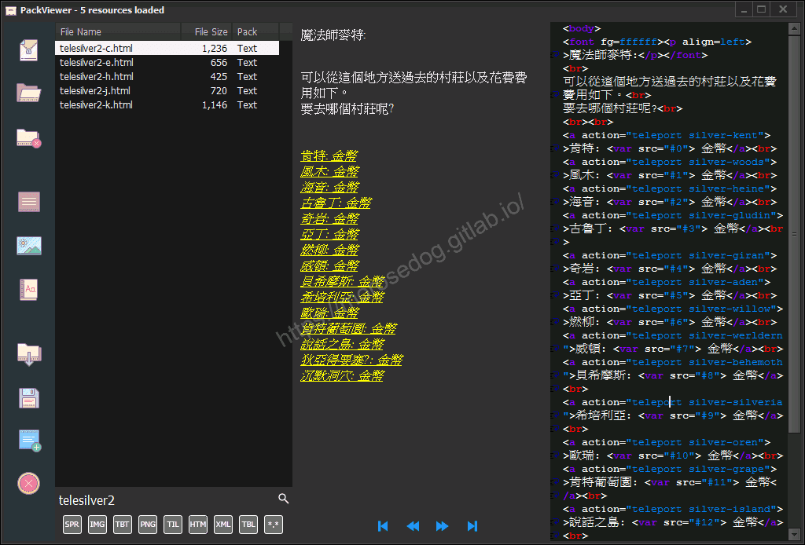

  * 透過抽檔工具匯出該對話檔`telesilver2-c.html。

* 6.查看對話檔：

  * 以下使用編輯器去開啟。
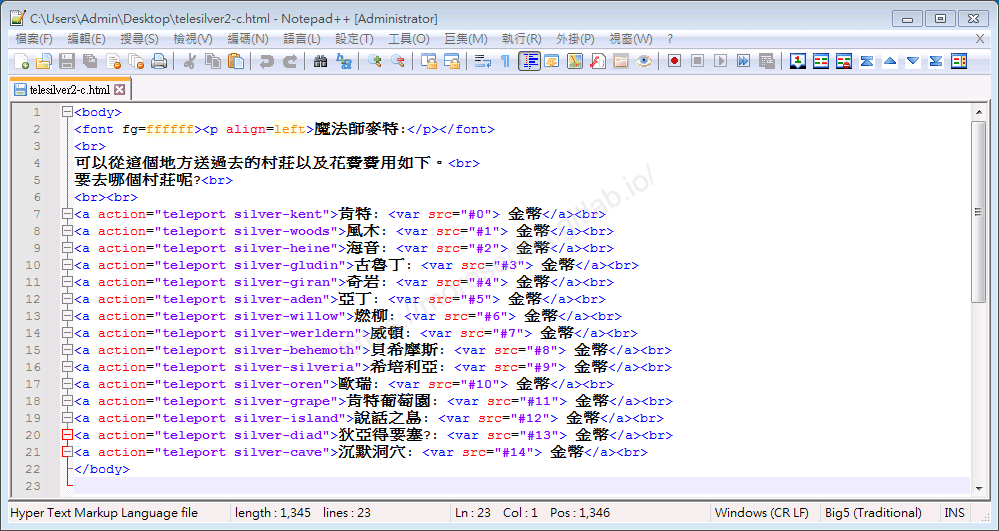

```html
<body>
<font fg=ffffff><p align=left>魔法師麥特:</p></font>
<br>
可以從這個地方送過去的村莊以及花費費用如下。<br>
要去哪個村莊呢?<br>
<br><br>
<a action="teleport silver-kent">肯特: <var src="#0"> 金幣</a><br>
<a action="teleport silver-woods">風木: <var src="#1"> 金幣</a><br>
<a action="teleport silver-heine">海音: <var src="#2"> 金幣</a><br>
<a action="teleport silver-gludin">古魯丁: <var src="#3"> 金幣</a><br>
<a action="teleport silver-giran">奇岩: <var src="#4"> 金幣</a><br>
<a action="teleport silver-aden">亞丁: <var src="#5"> 金幣</a><br>
<a action="teleport silver-willow">燃柳: <var src="#6"> 金幣</a><br>
<a action="teleport silver-werldern">威頓: <var src="#7"> 金幣</a><br>
<a action="teleport silver-behemoth">貝希摩斯: <var src="#8"> 金幣</a><br>
<a action="teleport silver-silveria">希培利亞: <var src="#9"> 金幣</a><br>
<a action="teleport silver-oren">歐瑞: <var src="#10"> 金幣</a><br>
<a action="teleport silver-grape">肯特葡萄園: <var src="#11"> 金幣</a><br>
<a action="teleport silver-island">說話之島: <var src="#12"> 金幣</a><br>
<a action="teleport silver-diad">狄亞得要塞?: <var src="#13"> 金幣</a><br>
<a action="teleport silver-cave">沉默洞穴: <var src="#14"> 金幣</a><br>
</body>
```

  * 觀察到`action`與上方`XML`內容的`Action Name`是相呼應的，並對應`Teleport`傳送的做標位置和地圖…等等資訊。

  * 觀察到`var src`與上方`XML`內容的`Data Value`是相對位置對應，代表顯示傳送的金額。

## 其他

* 關於程式碼的部分請自行分析，非此篇重點**<font color="red"><請自行閱讀程式碼></font>**。

  * 關於對應對話檔和`XML`的部分。

```sql
SELECT * FROM npc WHERE npcid = 50056
-- L1Teleporter
```

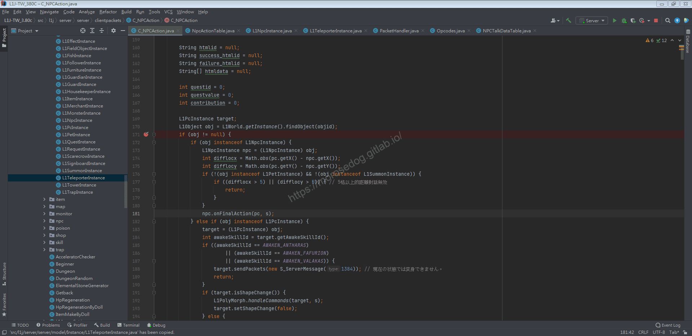
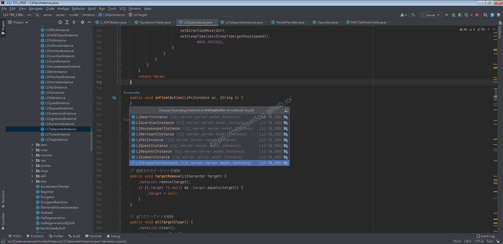
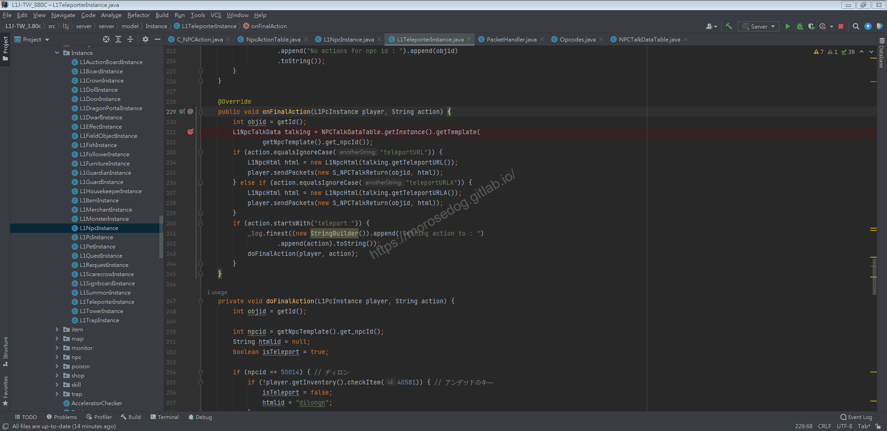
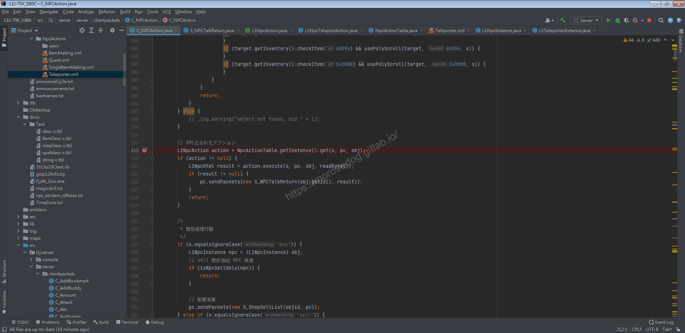
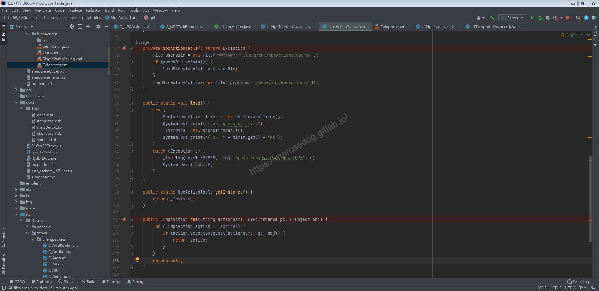

  * 關於執行傳送時的部分。
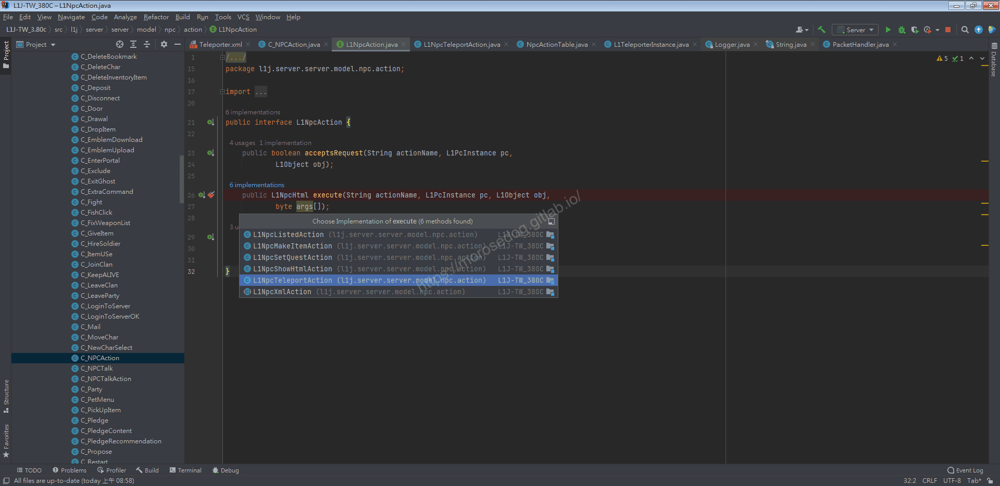
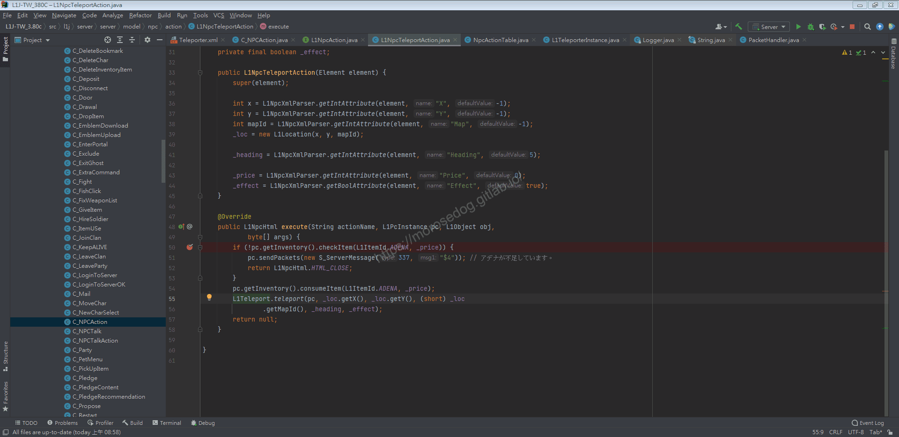

## 結論

* 流程：

  * 客戶端：點選`NPC`

    * → 伺服器：搜尋資料庫設定的`normal_action`對話檔名稱 

      * → 回傳客戶端：顯示對話檔。

  * 客戶端：點選對話檔內容<我想要到其他村莊>

    * → 伺服器： 根據`action`執行對應動作<此為取得資料庫`teleport_url`對話檔名稱>，搭配`XML`內容

      * → 回傳客戶端：顯示對話檔。

  * 客戶端：點選對話檔內容<肯特>

    * → 伺服器： 根據`action`執行對應動作<此為傳送操作>

      * → 回傳客戶端：傳送封包並結束，客戶端畫面更新至傳送地點。

## 結語

在此章節主要分析傳送的對話檔與伺服器端搭配`XML`之間的互動。
其實可以嘗試自己動手新增`NPC` → 新增對應的對話檔 → 新增`XML`內容，最後登入遊戲嘗試是否有效果。

原創文章真的不易，希望多多支持，感謝。
最後建議回顧一下首章[天堂私服 | 天堂私服架設教學](/private-lineage-20210712-private-lineage-0/#教學章節)，了解其章節目錄。

## 免責聲明

* 本部落格文章中皆<font color="red"><u>**不提供**</u></font>任何所謂的遊戲「主程式」、「模擬器」、「登入器」…等等相關程式的下載點。

* 本部落格文章中所見之遊戲主程式和服務器端程序均來自網路發佈，<font color="red"><u>版本歸**原作者**</u>所有</font>。

* 本部落格文章為研究SQL資料庫與修改JAVA語法使用，<font color="red">並<u>**非商業用途**</u>，亦<u>**無做營運事實等任何一切商業行為**</u>。</font>

* 本部落格文章內容是為研究學習設計思想和原理為目的，<font color="red"><u>**絕沒有故意侵權或惡意抄襲、篡改其他遊戲內容**</u></font>！

---

- **原文連結**：[J.J.'s Blogs - 執行行動分析&lt;傳送師篇&gt;](https://morosedog.gitlab.io/private-lineage-20220506-private-lineage-101/)
