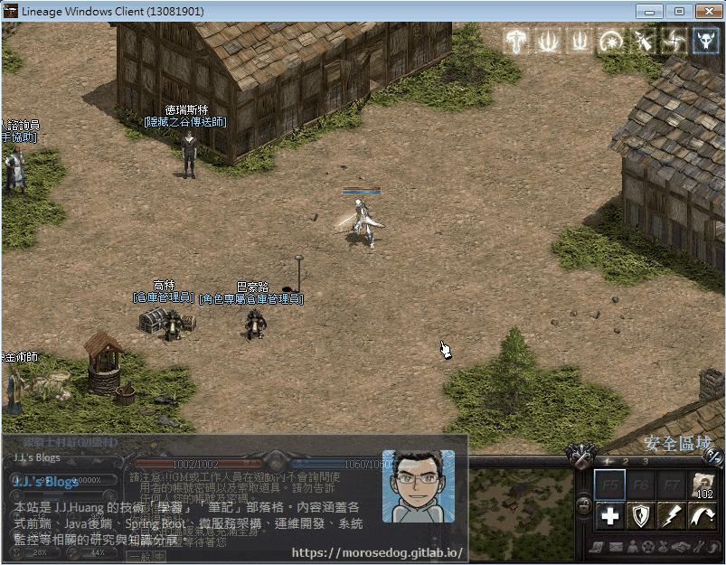
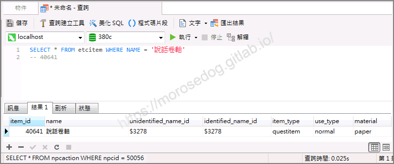
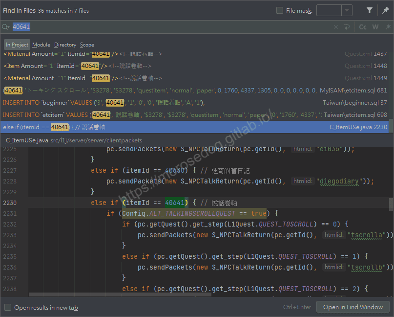
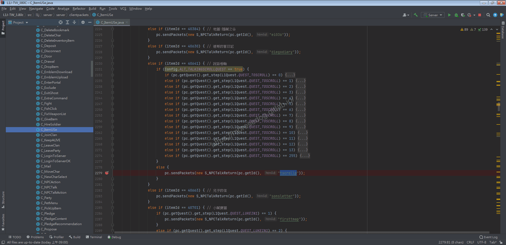
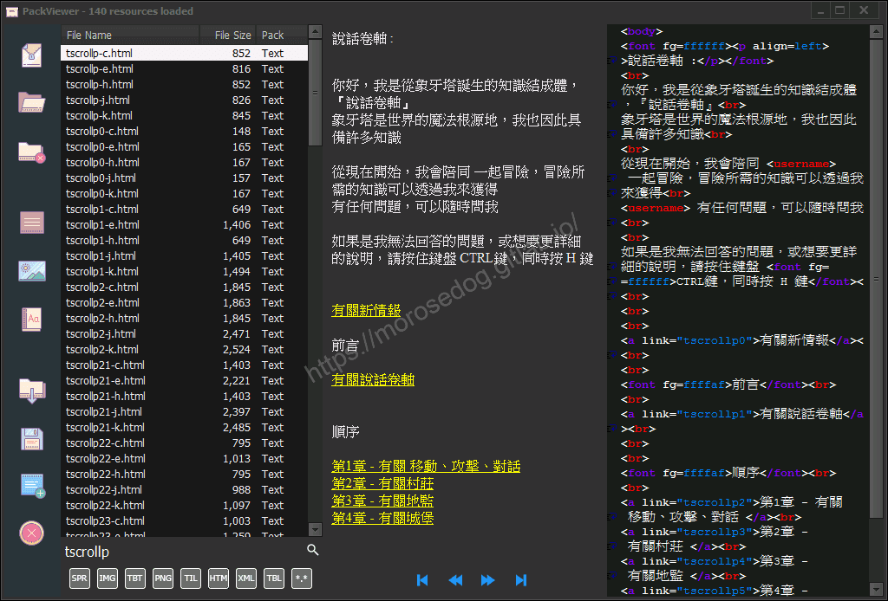
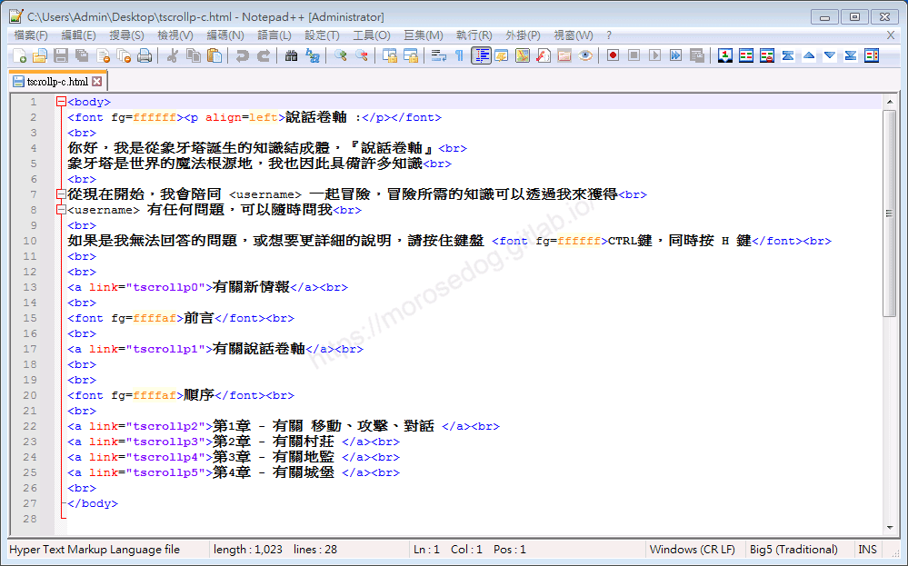

# 執行行動分析&lt;道具篇&gt;

# 天堂私服 | 執行行動分析<道具篇>

    
    
      📑 目錄
      

1. [章節用意](#章節用意)
2. [版本資訊](#版本資訊)
3. [前言](#前言)
4. [分析](#分析)
5. [結論](#結論)
6. [結語](#結語)
7. [免責聲明](#免責聲明)

    
    
    

## 章節用意

透過分析”說話卷軸”的道具，嘗試分析與伺服器之間的互動，並不會介紹過多的程式碼，僅大略提及說明。
常見應用用途：

* 道具 → 變身清單

* 道具 → 內掛選單

* 道具 → 隨身商店

* 道具 → 隨身倉庫

## 版本資訊

* **客戶端版本**

  * 天堂(Lineage 3.81C)

* **核心版本**

  * L1J-3.80c

## 前言

在開始分析前，請務必先將以下文章閱讀完畢。

* [對話檔分析/修改的相關文章](/categories/%E5%A4%A9%E5%A0%82%E7%A7%81%E6%9C%8D/8-%E5%B0%8D%E8%A9%B1%E6%AA%94%E5%88%86%E6%9E%90-%E4%BF%AE%E6%94%B9/)

  * 了解查找`NPC`對應對話檔方法。

  * 了解對話檔的抽檔與修改方式。

  * 了解其各種`html`標籤的說明與使用。

* 抽檔工具請參考：[PakViewer 介紹](../07_Developer_Tools/072_PakViewer_介紹.md)

## 分析

以下分析使用`說話卷軸`來做分析。
可見`說話卷軸`點擊使用後顯示對話檔內容。
​‌‌‌​​​​​‌‌‌​​‌​​‌‌​‌​​‌​‌‌‌​‌‌​​‌‌​​​​‌​‌‌‌​‌​​​‌‌​​‌​‌​​‌​‌‌​‌​‌‌​‌‌​​​‌‌​‌​​‌​‌‌​‌‌‌​​‌‌​​‌​‌​‌‌​​​​‌​‌‌​​‌‌‌​‌‌​​‌​‌​​‌​‌‌​‌​​‌‌​​‌​​​‌‌​​​​​​‌‌​​‌​​​‌‌​​‌​​​‌‌​​​​​​‌‌​‌​‌​​‌‌​​​​​​‌‌​‌‌‌​​‌​‌‌​‌​‌‌‌​​​​​‌‌‌​​‌​​‌‌​‌​​‌​‌‌‌​‌‌​​‌‌​​​​‌​‌‌‌​‌​​​‌‌​​‌​‌​​‌​‌‌​‌​‌‌​‌‌​​​‌‌​‌​​‌​‌‌​‌‌‌​​‌‌​​‌​‌​‌‌​​​​‌​‌‌​​‌‌‌​‌‌​​‌​‌​​‌​‌‌​‌​​‌‌​​​‌​​‌‌​​​​​​‌‌​​‌​

* 1.使用名稱找尋：

  * 進入資料庫搜尋`etcitem`的`name`為`說話卷軸`。

  * 結果的`item_id`為`40641`。

```sql
SELECT * FROM	etcitem WHERE NAME = '說話卷軸'
-- 40641
```



* 2.分析對應的程式碼：

  * 關於細部程式碼請自行分析，非此篇重點**<font color="red"><請自行閱讀程式碼></font>**。

  * 搜尋關鍵字`40641`找尋哪裡有在做判斷。

  * 可以發現有一段程式碼在判斷使用。

```java
`else if (itemId == 40641) { // 說話卷軸`
```

  * 該`class`如下。

```plain
src/l1j/server/server/clientpackets/C_ItemUSe.java
```



  * 關鍵的程式碼為下面這段去呼叫開啟`tscrollp`的對話檔。

```java
pc.sendPackets(new S_NPCTalkReturn(pc.getId(), "tscrollp"));
```



* 3.使用抽檔程式抽檔：  

  * 使用抽檔工具去看`tscrollp`對話檔。

  * 以下為`tscrollp`對話檔的內容，對應`說話卷軸`的內容。


  * 透過抽檔工具匯出該對話檔`tscrollp-c.html。

* 3.查看對話檔：

  * 以下使用編輯器去開啟。


```html
<body>
<font fg=ffffff><p align=left>說話卷軸 :</p></font>
<br>
你好，我是從象牙塔誕生的知識結成體，『說話卷軸』<br>
象牙塔是世界的魔法根源地，我也因此具備許多知識<br>
<br>
從現在開始，我會陪同 <username> 一起冒險，冒險所需的知識可以透過我來獲得<br>
<username> 有任何問題，可以隨時問我<br>
<br>
如果是我無法回答的問題，或想要更詳細的說明，請按住鍵盤 <font fg=ffffff>CTRL鍵，同時按 H 鍵</font><br>
<br>
<br>
<a link="tscrollp0">有關新情報</a><br>
<br>
<font fg=ffffaf>前言</font><br>
<br>
<a link="tscrollp1">有關說話卷軸</a><br>
<br>
<br>
<font fg=ffffaf>順序</font><br>
<br>
<a link="tscrollp2">第1章 - 有關 移動、攻擊、對話 </a><br>
<a link="tscrollp3">第2章 - 有關村莊 </a><br>             
<a link="tscrollp4">第3章 - 有關地監 </a><br>             
<a link="tscrollp5">第4章 - 有關城堡 </a><br>             
<br>
</body>
```

  * 這邊就不特別做說明，主要是了解到使用道具去呼叫對話檔的一個分析。

## 結論

* 程式碼：

  * `src/l1j/server/server/clientpackets/C_ItemUSe.java`

    * 處理客戶端來的使用道具時的處理。

## 結語

在此章節主要分析使用道具時與伺服器端互動所對應的對話檔。
所以這個可以運用的地方就很多了，只需要發揮點巧思很多東西都可以透過這方是去製作，就像文章開頭提到的那些應用。

原創文章真的不易，希望多多支持，感謝。
最後建議回顧一下首章[天堂私服 | 天堂私服架設教學](/private-lineage-20210712-private-lineage-0/#教學章節)，了解其章節目錄。

## 免責聲明

* 本部落格文章中皆<font color="red"><u>**不提供**</u></font>任何所謂的遊戲「主程式」、「模擬器」、「登入器」…等等相關程式的下載點。

* 本部落格文章中所見之遊戲主程式和服務器端程序均來自網路發佈，<font color="red"><u>版本歸**原作者**</u>所有</font>。

* 本部落格文章為研究SQL資料庫與修改JAVA語法使用，<font color="red">並<u>**非商業用途**</u>，亦<u>**無做營運事實等任何一切商業行為**</u>。</font>

* 本部落格文章內容是為研究學習設計思想和原理為目的，<font color="red"><u>**絕沒有故意侵權或惡意抄襲、篡改其他遊戲內容**</u></font>！

---

- **原文連結**：[J.J.'s Blogs - 執行行動分析&lt;道具篇&gt;](https://morosedog.gitlab.io/private-lineage-20220507-private-lineage-102/)
