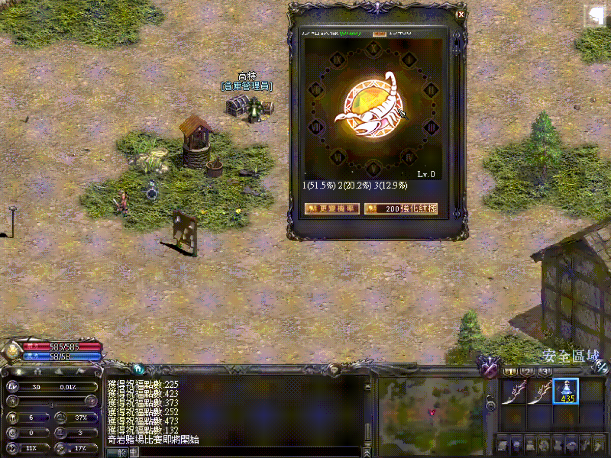

# 圖片對話檔動畫原理

# 天堂私服 | 圖片對話檔動畫原理：透過 var img 換圖製作假動畫

## 前言

研究紋樣、強化、抽選類對話檔時，常會看到對話框內的圖片像動畫一樣變化。
直覺上可能會以為對話檔支援 GIF，但實際觀察 HTML 與核心行為後，比較合理的判斷是：

> 對話檔本身不是播放 GIF，而是伺服器連續更新同一個圖片變數，讓客戶端重繪不同圖片編號，形成逐格動畫效果。

這篇紀錄此類做法的基本原理，方便後續製作圖片式 UI、抽獎演出、強化演出、圖鑑完成提示等功能時參考。

## 動態效果範例

下圖是紋樣/強化類對話檔中常見的跑圖效果範例。畫面看起來像動畫，但實際上可以拆解成伺服器連續替換圖片編號後，讓客戶端重繪同一個圖片位置。



## 對話檔範例

以下是一段常見的圖片型對話檔結構，重點在 `<var img src="#2"></img>`：

> 補充：此處提到的 `wenyangsh-c.html` 屬於工程師自製對話檔範例，並非原始客戶端一定存在的內建 HTML。本文目的只是在說明「圖片變數 + 伺服器換圖」的概念，不應直接硬編碼依賴這個檔名、action 名稱或圖片編號。

```html
<body>
沙哈紋樣<font fg=00DD00><var src="#0"><font fg=ffffff>    </font></img>  </font><var src="#1"></font><br>
<var img src="#2"></img><br>
<var src="#3"><br>
<br>
  </font><var img src="#4" tooltip="開始強化^開始強化" action="shstart"></img><br>
</body><br>
```

其中：

- `<var src="#0">`：顯示伺服器傳入的文字參數。
- ``：顯示固定圖片編號。
- `<var img src="#2">`：顯示伺服器傳入的圖片編號。
- `action="shstart"`：玩家點擊後，客戶端回送 `shstart` 給伺服器。

## Action 與核心流程

點擊開始強化後，伺服器會收到 action 字串，例如：

```text
shstart
```

核心通常會有類似以下的分派：

```java
public static boolean shaha(String cmd, L1PcInstance pc) {
    try {
        if (cmd.equalsIgnoreCase("wenyangsh")) {
            L1Shaha.WenyangUp(pc);
        } else if (cmd.equalsIgnoreCase("shjilv")) {
            L1Shaha.WenyangRnd(pc);
        } else if (cmd.equalsIgnoreCase("shstart")) {
            L1Shaha.WenyangLevel(pc);
        }
    } catch (Exception e) {
        _log.error(e.getLocalizedMessage(), e);
    }
    return false;
}
```

`WenyangLevel(pc)` 內再依照目前階段或狀態，呼叫對應的動畫/結果更新方法。

## 動畫真正發生的位置

關鍵通常是伺服器端的 `String[] data` 或類似參數陣列。

假設 HTML 內有：

```html
<var img src="#2"></img>
```

那麼伺服器只要更新對應索引的圖片編號即可。以下 `wenyangsh-c` 與 `5510/5511/5512` 只是示意用名稱與圖片 ID，實際專案應改由設定、資料表或對應的 UI 定義提供：

```java
data[2] = "5510";
pc.sendPackets(new S_NPCTalkReturn(pc.getId(), "wenyangsh-c", data));

data[2] = "5511";
pc.sendPackets(new S_NPCTalkReturn(pc.getId(), "wenyangsh-c", data));

data[2] = "5512";
pc.sendPackets(new S_NPCTalkReturn(pc.getId(), "wenyangsh-c", data));
```

客戶端看到的就是同一個圖片位置依序顯示：

```text
5510 -> 5511 -> 5512
```

只要這些圖片本身是連續畫面，就會產生類似動畫的效果。

## 結論

這類效果的本質是：

```text
HTML 預留圖片變數
        ↓
伺服器連續替換圖片 ID
        ↓
重送 S_NPCTalkReturn
        ↓
客戶端重繪對話框
        ↓
形成逐格動畫
```

所以它不是 GIF，也不是客戶端真的在跑動畫腳本，而是伺服器用多張圖片編號做 frame-by-frame 更新。

## 工程化建議

有些舊實作會針對每個階段寫大量重複程式碼，例如 33 階每階重複一段 100 多行的換圖流程。
這種寫法可以運作，但後續維護成本很高。

建議改成資料驅動：

```java
int[] frames = { 5510, 5511, 5512 };
String htmlId = "your-custom-dialog";

for (int frame : frames) {
    data[2] = String.valueOf(frame);
    pc.sendPackets(new S_NPCTalkReturn(pc.getId(), htmlId, data));
    // 使用排程器或安全的延遲方式控制節奏
}
```

更完整的設計可以抽成：

```java
public final class DialogFrameSequence {
    private final String htmlId;
    private final int variableIndex;
    private final int[] frameImageIds;
    private final int frameDelayMillis;
}
```

再由統一服務播放：

```java
DialogFrameAnimator.play(pc, sequence, baseData);
```

## 注意事項

- 不建議在主執行緒直接 `sleep` 跑動畫，避免卡住遊戲邏輯。
- 不建議做長時間循環動畫，封包量與閃爍都可能造成體感問題。
- 建議使用短動畫，例如 3 到 8 張圖。
- 圖片 ID 必須先確認客戶端存在。
- 需要實際登入客戶端測試重繪速度、閃爍程度與按鈕是否仍可正常點擊。
- 若對話框被玩家關閉或切到其他頁，動畫應停止。

## 適合用途

這個方法適合：

- 強化成功/失敗演出。
- 抽獎或跑燈演出。
- 任務完成提示。
- 圖鑑完成條目的短暫亮光或章節完成動畫。

不適合：

- 長時間常駐動畫。
- 需要高 FPS 的動畫。
- 複雜互動介面。
- 取代正常的文字進度資訊。

## 與圖鑑系統的關係

若用於圖鑑系統，建議定位如下：

- 圖鑑道具：只查看進度，不負責接任務或回報任務。
- 主城 NPC：負責接任務、回報任務、領取獎勵。
- 圖片動畫：放在主城 NPC 回報成功、章節完成、解鎖新圖鑑時播放。

這樣可以保留玩家回村互動的設計，同時讓圖片式 UI 成為回報時的儀式感，而不是讓圖鑑道具取代 NPC 流程。
