# 變身檔新增修改&lt;快速入門&gt;

# 天堂私服 | 變身檔新增修改<快速入門>

    
    
      📑 目錄
      

1. [章節用意](#章節用意)
2. [版本資訊](#版本資訊)
3. [前言](#前言)
4. [準備](#準備)
5. [開始操作](#開始操作)
6. [結語](#結語)
7. [免責聲明](#免責聲明)

    
    
    

## 章節用意

快速讓零基礎的新手們手把手教學新增一個變身檔；在此過程中將不會講解任何的操作用意，僅提供步驟與呈現結果。

## 版本資訊

* **客戶端版本**

  * 天堂(Lineage 3.81C)

* **核心版本**

  * L1J-3.80c

* **登入器版本**  

  * L1J-3.80c

## 前言

成果展示：
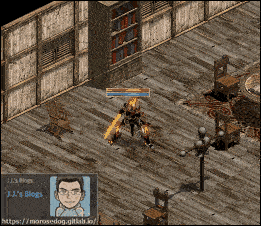

## 準備

2. 在開始前需要準備「天堂模擬器」，此處所使用的是「[L1J-3.80c](/images/private-lineage/download_not_available.png)」由`日本開發團隊`研發的版本做示範。且已經是設置完畢可以開啟狀態。可以參考[天堂私服 | 前言](/private-lineage-20210712-private-lineage-0)的完整教學。

  * 無法提供下載點，請根據關鍵字自行上網搜尋。

4. 天堂(Lineage 3.81C)主程式，安裝版或是免安裝版本都可以。

  * 無法提供下載點，請根據關鍵字自行上網搜尋。

6. 天堂「Login_v380a.rar」登入器。

  * 無法提供下載點，請根據關鍵字自行上網搜尋。

8. 變身圖檔

  * 此處提供變身圖`spr`檔與`spr`編碼[舊版死亡騎士-焚焰.rar](/download/private-lineage/chapter103/舊版死亡騎士-焚焰.rar)下載。

注意：此處新增變身檔，是<font color="red">透過</font>**登入器**的**變身檔編碼**做新增和使用。​‌‌‌​​​​​‌‌‌​​‌​​‌‌​‌​​‌​‌‌‌​‌‌​​‌‌​​​​‌​‌‌‌​‌​​​‌‌​​‌​‌​​‌​‌‌​‌​‌‌​‌‌​​​‌‌​‌​​‌​‌‌​‌‌‌​​‌‌​​‌​‌​‌‌​​​​‌​‌‌​​‌‌‌​‌‌​​‌​‌​​‌​‌‌​‌​​‌‌​​‌​​​‌‌​​​​​​‌‌​​‌​​​‌‌​​‌​​​‌‌​​​​​​‌‌​‌​‌​​‌‌​​​​​​‌‌‌​​​​​‌​‌‌​‌​‌‌‌​​​​​‌‌‌​​‌​​‌‌​‌​​‌​‌‌‌​‌‌​​‌‌​​​​‌​‌‌‌​‌​​​‌‌​​‌​‌​​‌​‌‌​‌​‌‌​‌‌​​​‌‌​‌​​‌​‌‌​‌‌‌​​‌‌​​‌​‌​‌‌​​​​‌​‌‌​​‌‌‌​‌‌​​‌​‌​​‌​‌‌​‌​​‌‌​​​‌​​‌‌​​​​​​‌‌​​‌‌

## 開始操作

* 1.編輯登入器變身檔編碼

  * 解壓縮`Login_v380a.rar`登入器，目錄內容如下：

    * LoginUpdate

    * 登入器

    * 編碼器

    * 封包加密核心修改.txt

    * 移動封包修改.txt

  * 此處將只需要關注「登入器」與「編碼器」即可。

  * 進入`編碼器`目錄。

  * 會發現有一該登入器版本所使用的`TW13081901.txt`變身檔編碼。
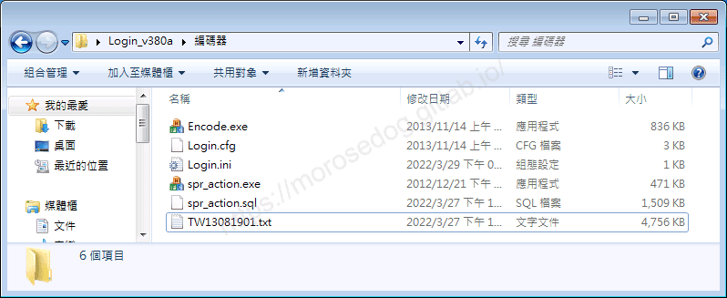

  * 使用編輯器去開啟。

  * 搜尋使用`dummy`關鍵字的編號，`dummy`表示為空的未使用的編號<建議最好找一堆是連號>。

  * 此處先記住像是`362~374`這些編號。
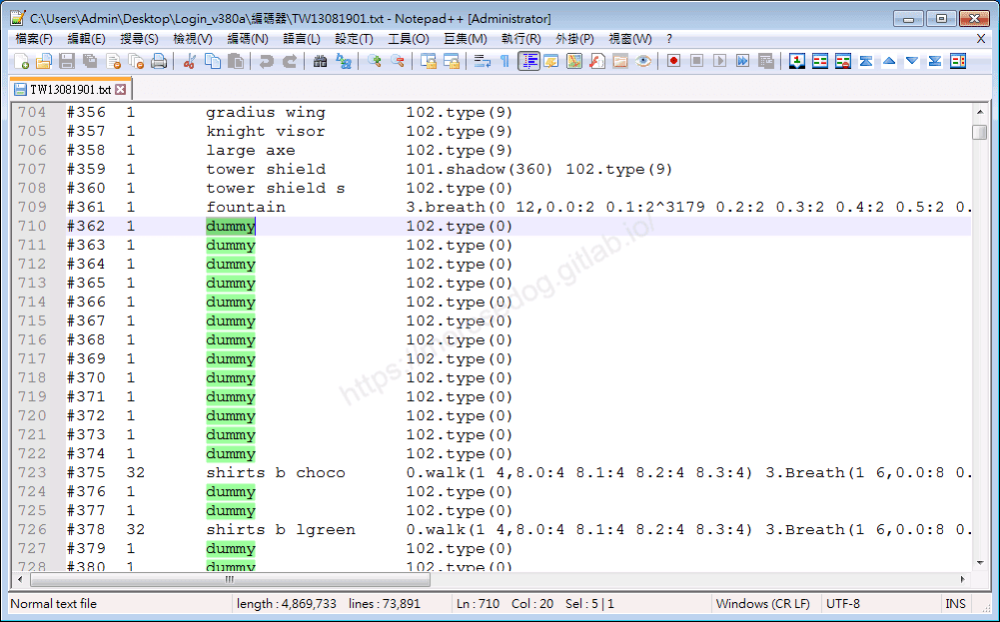

* 2.使用下載的變身圖檔/編碼：

  * 解壓縮`舊版死亡騎士-焚焰.rar`檔。

  * 通常網路上提供比較完整的會有一堆的`spr`檔、`編碼.txt`甚至有的還有`聲音檔.wav`。
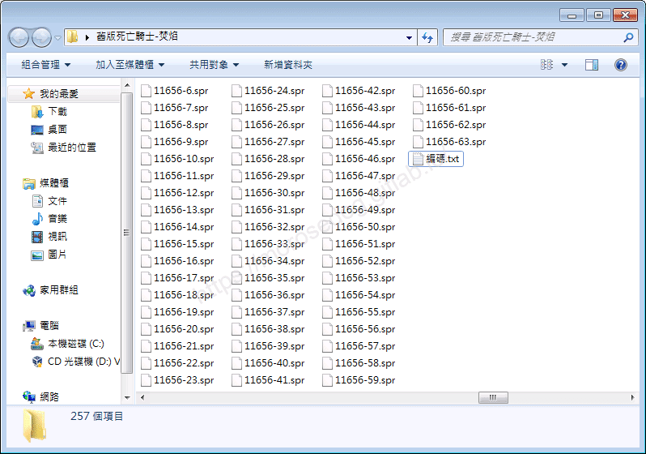

  * 此處我們先開啟`編碼.txt`。

  * 可以看到編號總共使用了<font color="red">**`4`**</font>個，分別為：`11653`、`11654`、`11655`、`11656`。

  * 可以發現變身圖檔裡面也有由這`4`個編號開頭的`spr`檔；例：`11653-0.spr`、`11653-1.spr`…`11656-63.spr`。
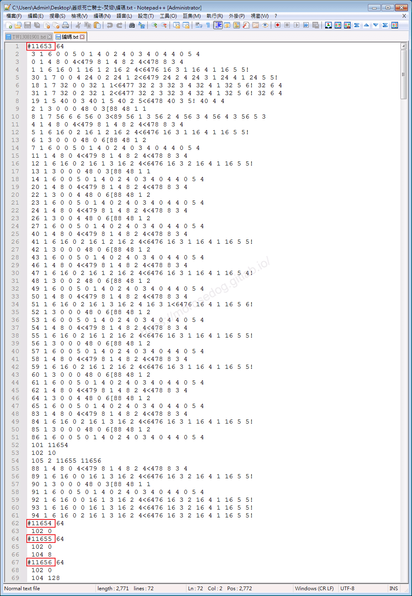

  * 此時用剛剛開啟`TW13081901.txt`檔找到`dummy`的編號，這邊選<font color="red">**`4`**</font>個，分別為：`362`、`363`、`364`、`365`。

  * 來做替換：

    * `11653` → `362`

    * `11654` → `363`

    * `11655` → `364`

    * `11656` → `365`

  * 這邊要注意不是只有`#`後方的編號要替換而已，裡面的動作編號也要替換到，請參考下圖：
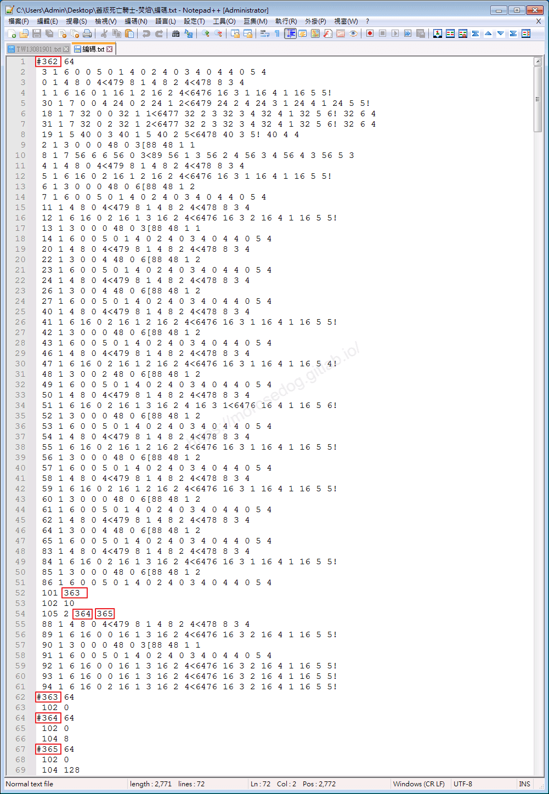

  * 替換完畢後，會用於下一步替換`TW13081901.txt`檔內容。

* 3.修改`TW13081901.txt`檔：

  * 回到`TW13081901.txt`檔，將`362`、`363`、`364`、`365`<font color="red">**這4行**</font>替換成剛剛`編碼.txt`的內容，並**儲存**。
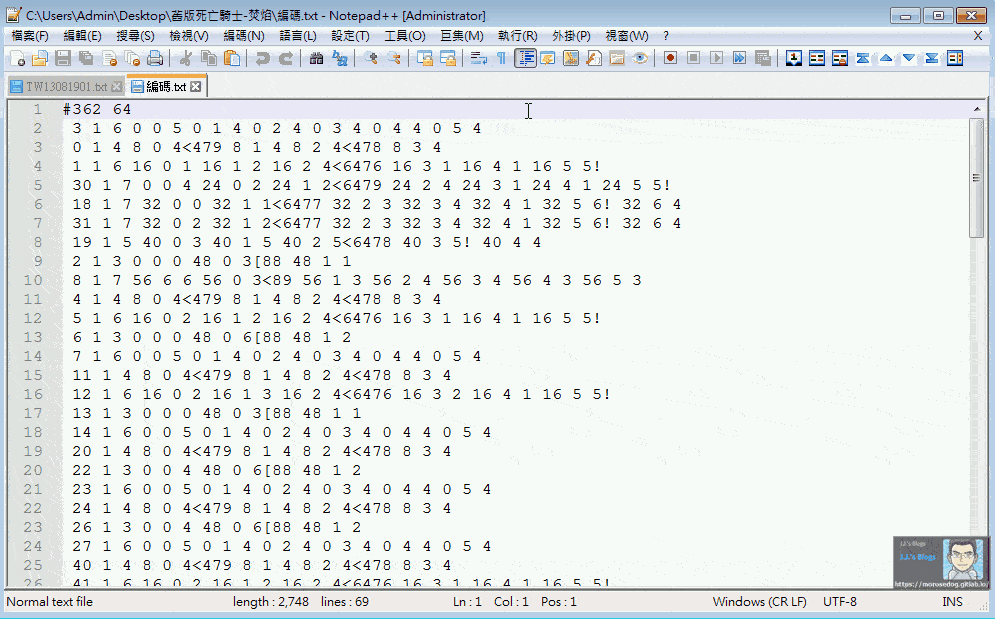

* 4.修改`spr`檔的檔名：

  * 上方有提到變身圖檔裡面的`spr`檔名與編號是對應上的，所以此處也要修改檔名，但是要維持`-xx`後的數字。

  * 可以使用修改檔名的工具[Flexible Renamer 工具(批量修改檔名)](../07_Developer_Tools/097_Flexible_Renamer_工具(批量修改檔名).md)去做修改。

> 註：如果不想用工具，自己想要一個一個改也行…。
> 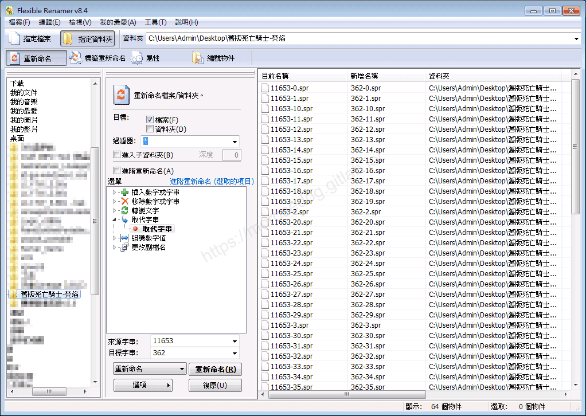

  * 下方有舉例修改檔名的範例：

    * `11653-0.spr` → `362-0.spr`

    * `11653-1.spr` → `362-1.spr`

    * …中間省略

    * `11653-63.spr` → `362-63.spr`

---

    * `11654-0.spr` → `363-0.spr`

    * `11654-1.spr` → `363-1.spr`

    * …中間省略

    * `11654-63.spr` → `363-63.spr`

---

    * `11655-0.spr` → `364-0.spr`

    * `11655-1.spr` → `364-1.spr`

    * …中間省略

    * `11655-63.spr` → `364-63.spr`

---

    * `11656-0.spr` → `365-0.spr`

    * `11656-1.spr` → `365-1.spr`

    * …中間省略

    * `11656-63.spr` → `365-63.spr`

  * 最後修改完畢應該會如下圖：
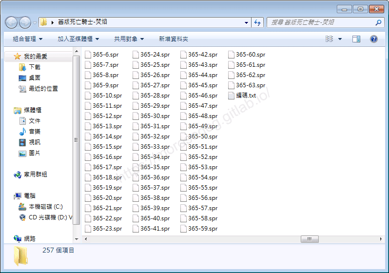

* 5.先進行吃檔

  * 將剛剛改好檔名的所有`spr`檔們，放於客戶端的`sprite`資料夾內。
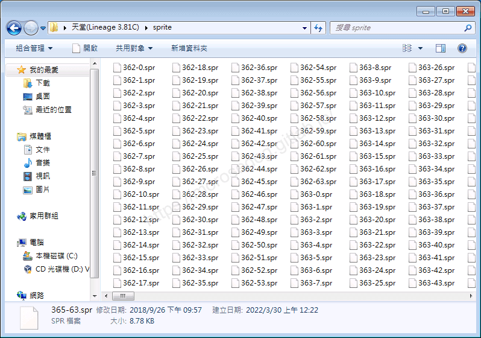

  * 執行客戶端`eat.exe`吃檔。

> 註：如果發生吃檔失敗，可能你的抽檔沒有關閉，咬住了那些`.pak`檔，關閉抽檔程式即可。

* 6.打包變身檔編碼

  * 回到`編碼器`目錄，並且點擊`Encode.exe`

  * 點選`工具`頁籤。

  * 點擊`變檔編碼`按鈕。
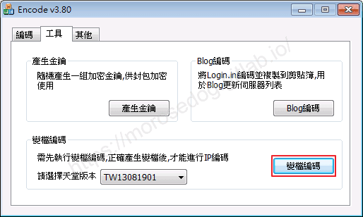

  * 成功彈出`變檔編碼完成`確認視窗。

  * 此時`編碼器`目錄內會產生`TW13081901.pak`檔。
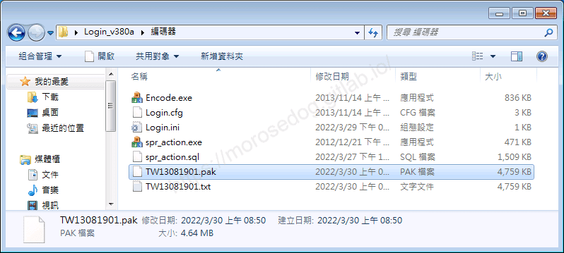

  * 繼續點選切換`編碼`頁籤。

  * 設定如下後，並點擊編碼。

    * 名稱：快樂天堂 <可自行定義名稱>。

    * IP：127.0.0.1 <此處為單機示範，預設即可>

    * Port：2000 <預設即可>

    * 版本：<預設即可>

    * 其他選項，如圖勾選即可。

  * 成功彈出`編碼完成`確認視窗。
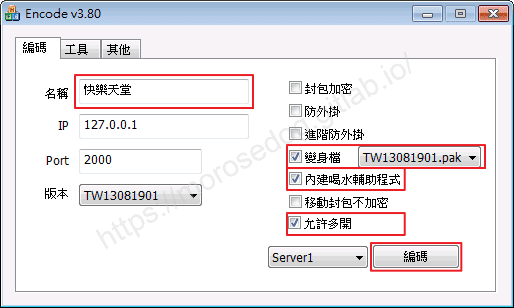

  * 關閉`Encode v3.80`程式視窗，可見`Login.ini`檔為新的檔案。
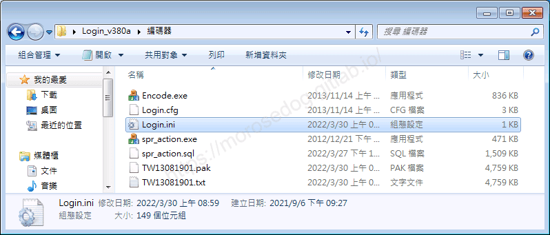

  * 複製`Login.ini`與`TW13081901.pak`檔案，並回到上一層目錄，並進入`登入器`目錄貼上檔案，並點擊`複製並取代`。
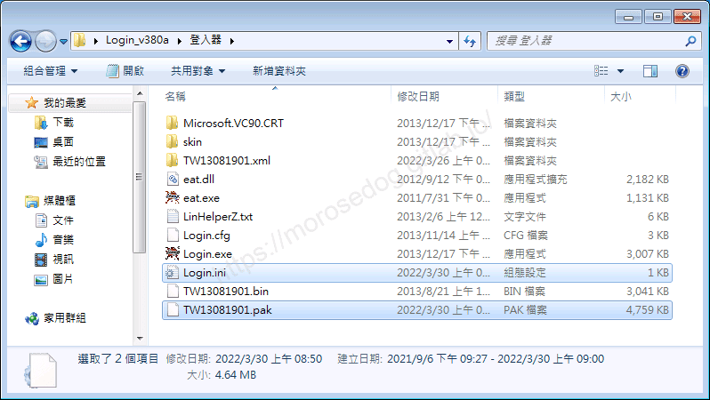

  * 此時登入器的設置已經完成了。

* 7.匯入登入器

  * 將剛剛完成設置的登入器目錄內的所有資料夾與檔案全部複製。
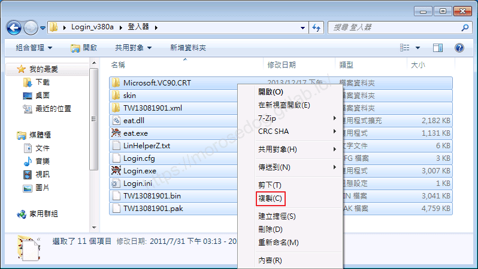

  * 進入`天堂(Lineage 3.81C)`目錄下，並貼上檔案並覆蓋。

  * 跳出確認資料夾取代視窗，請勾選`套用到所有目前的項目`，並繼續點擊`是`。
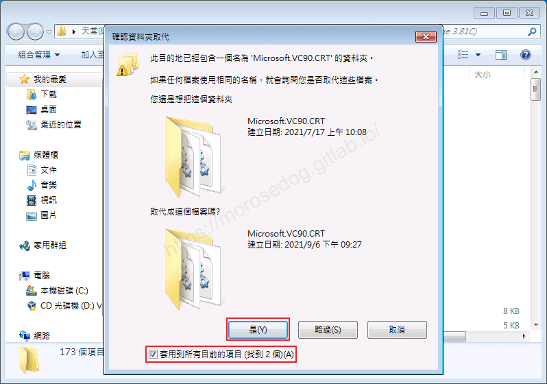

  * 跳出複製提示視窗，請勾選`接下來的 xx 個檔案衝突都這樣處理`，並點擊`複製並取代`。
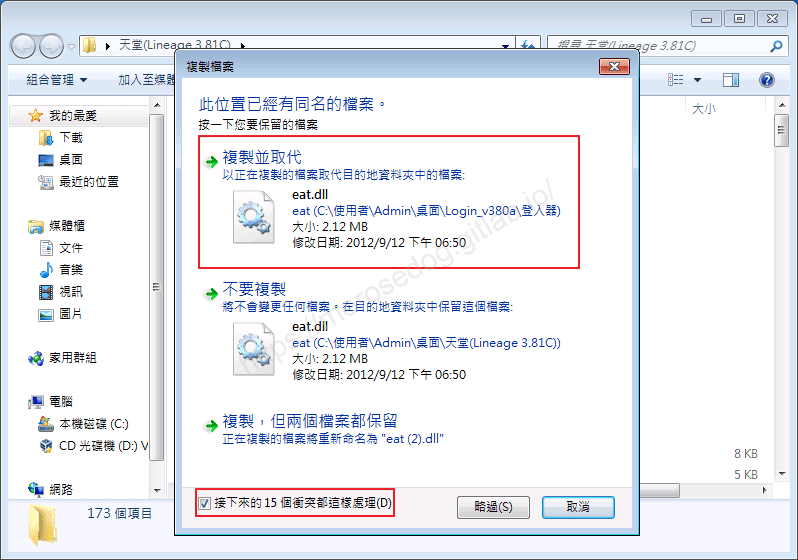

  * 此時登入器已經成功匯入至天堂主程式中。

* 7.登入遊戲驗證變身

  * 使用`GM`的權限角色。

  * 輸入變身指令。

```plain
.poly ${角色名稱} ${變身編號}
```

  * 此範例角色名稱為`線上GM`，剛剛的變身編號，使用的主要編號為`362`。

```plain
.poly 線上GM 362
```

  * 輸入後可見人物已經變身為`舊版死亡騎士-焚焰`。

  * 開始移動、攻擊、施放魔法，看看是否一切正常一切順暢。
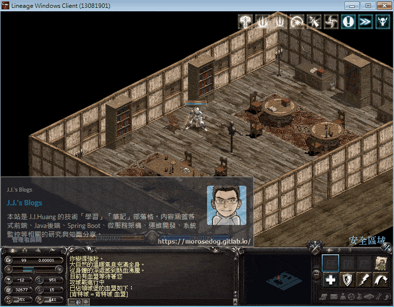

  * 至此新增變身檔的快速入門就告一段落。

## 結語

此時應該已經迫不及待的想做一些事情一堆問題了吧 -​‌‌‌​​​​​‌‌‌​​‌​​‌‌​‌​​‌​‌‌‌​‌‌​​‌‌​​​​‌​‌‌‌​‌​​​‌‌​​‌​‌​​‌​‌‌​‌​‌‌​‌‌​​​‌‌​‌​​‌​‌‌​‌‌‌​​‌‌​​‌​‌​‌‌​​​​‌​‌‌​​‌‌‌​‌‌​​‌​‌​​‌​‌‌​‌​​‌‌​​‌​​​‌‌​​​​​​‌‌​​‌​​​‌‌​​‌​​​‌‌​​​​​​‌‌​‌​‌​​‌‌​​​​​​‌‌‌​​​​​‌​‌‌​‌​‌‌‌​​​​​‌‌‌​​‌​​‌‌​‌​​‌​‌‌‌​‌‌​​‌‌​​​​‌​‌‌‌​‌​​​‌‌​​‌​‌​​‌​‌‌​‌​‌‌​‌‌​​​‌‌​‌​​‌​‌‌​‌‌‌​​‌‌​​‌​‌​‌‌​​​​‌​‌‌​​‌‌‌​‌‌​​‌​‌​​‌​‌‌​‌​​‌‌​​​‌​​‌‌​​​​​​‌‌​​‌‌

* 如何修改變身檔清單？

* 如何新增魔法娃娃？

* 如何新增自建道具變身？紅變？金變？

* 太多說不完…

別急！後面會慢慢一步一步提到慢慢分析與教學。

原創文章真的不易，希望多多支持，感謝。
最後建議回顧一下首章[天堂私服 | 天堂私服架設教學](/private-lineage-20210712-private-lineage-0/#教學章節)，了解其章節目錄。

## 免責聲明

* 本部落格文章中皆<font color="red"><u>**不提供**</u></font>任何所謂的遊戲「主程式」、「模擬器」、「登入器」…等等相關程式的下載點。

* 本部落格文章中所見之遊戲主程式和服務器端程序均來自網路發佈，<font color="red"><u>版本歸**原作者**</u>所有</font>。

* 本部落格文章為研究SQL資料庫與修改JAVA語法使用，<font color="red">並<u>**非商業用途**</u>，亦<u>**無做營運事實等任何一切商業行為**</u>。</font>

* 本部落格文章內容是為研究學習設計思想和原理為目的，<font color="red"><u>**絕沒有故意侵權或惡意抄襲、篡改其他遊戲內容**</u></font>！

---

- **原文連結**：[J.J.'s Blogs - 變身檔新增修改&lt;快速入門&gt;](https://morosedog.gitlab.io/private-lineage-20220508-private-lineage-103/)
