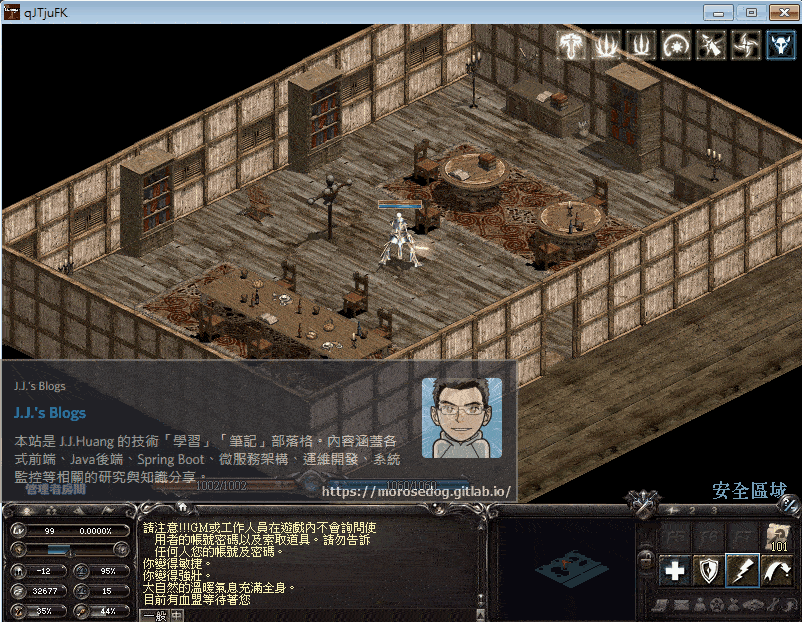
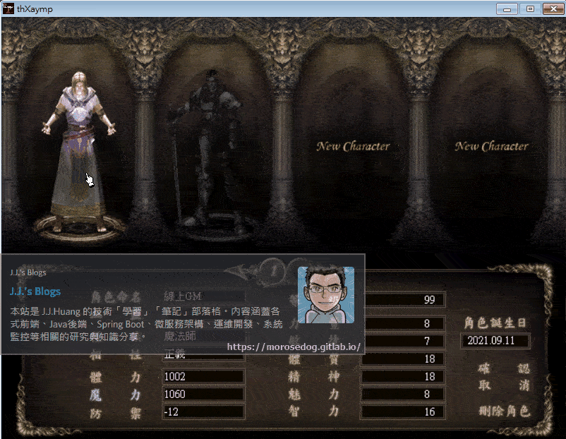

# GM指令使用 (人物變身)

# 天堂私服 | GM指令使用 (人物變身)

    
    
      📑 目錄
      

1. [章節用意](#章節用意)
2. [版本資訊](#版本資訊)
3. [前言](#前言)
4. [說明](#說明)
5. [分析](#分析)
6. [結語](#結語)
7. [免責聲明](#免責聲明)

    
    
    

## 章節用意

在做變身檔的新增與修改時，會希望透過將自身變身成該變身，然後進行移動攻擊施放魔法等等…測試，可以使用`GM`指令(人物變身)實現。

## 版本資訊

* **客戶端版本**

  * 天堂(Lineage 3.81C)

* **核心版本**

  * L1J-3.80c

* **登入器版本**  

  * L1J-3.80c

## 前言

在開始前，請務必先將以下文章閱讀與實際操作過。

* [變身檔新增修改<快速入門>](./103_變身檔新增修改&lt;快速入門&gt;.md)

## 說明

開始說明前，要先理解一些簡單的定義：​‌‌‌​​​​​‌‌‌​​‌​​‌‌​‌​​‌​‌‌‌​‌‌​​‌‌​​​​‌​‌‌‌​‌​​​‌‌​​‌​‌​​‌​‌‌​‌​‌‌​‌‌​​​‌‌​‌​​‌​‌‌​‌‌‌​​‌‌​​‌​‌​‌‌​​​​‌​‌‌​​‌‌‌​‌‌​​‌​‌​​‌​‌‌​‌​​‌‌​​‌​​​‌‌​​​​​​‌‌​​‌​​​‌‌​​‌​​​‌‌​​​​​​‌‌​‌​‌​​‌‌​​​‌​​‌‌​​​​​​‌​‌‌​‌​‌‌‌​​​​​‌‌‌​​‌​​‌‌​‌​​‌​‌‌‌​‌‌​​‌‌​​​​‌​‌‌‌​‌​​​‌‌​​‌​‌​​‌​‌‌​‌​‌‌​‌‌​​​‌‌​‌​​‌​‌‌​‌‌‌​​‌‌​​‌​‌​‌‌​​​​‌​‌‌​​‌‌‌​‌‌​​‌​‌​​‌​‌‌​‌​​‌‌​​​‌​​‌‌​​​​​​‌‌​‌​‌

* <font color="red">**圖檔編號**</font>：表示圖片的檔名。

  * 例：`362-0.spr`，圖檔編號為`362`。

* <font color="brow">**變身編號**</font>：表示於`list.spz`內的編號。

  * 例如：

    * `#240  64     Death Knight`，`#240`表示變身編號為`240`，此時沒定義圖檔編號，則是直接使用圖檔編號與自身相同`240`共`64`張圖。

    * `#5641 64=240 Death Knight`，`#5641`表示變身編號為`5641`，而`64=240`則表示使用的是圖檔編號為`240`共`64`張圖。

> 註：詳細的`list`編輯教學在後面進階教學章節會再慢慢介紹。

## 分析

以下分析繼續沿用[變身檔新增修改<快速入門>](./103_變身檔新增修改&lt;快速入門&gt;.md)所使用的變身檔進行分析。

* 在尚未新增變身檔編碼前，僅將圖檔吃檔入客戶端。

  * 使用`GM`的權限角色。

  * 使用指令人物變身。

```plain
.poly ${角色名稱} ${變身編號}
```

  * 此範例變身編號，使用的主要編號為`362`。

```plain
.poly 線上GM 362
```

  * 可以看到人物變身僅會顯示`362-0.spr`的第一張圖，也就是`362-0-0.spr.bmp`。

  * 人物<font color="red">無法移動</font>、<font color="red">無法改變面向</font>、<font color="red">無法攻擊</font>、<font color="red">可以施放魔法但人物沒施放動畫</font>…等等的變身效果。


* 將變身檔編碼新增進去後，客戶端就可以正常顯示整個動畫了。

  * 編碼加入後，重新登入。


## 結語

此篇文章只是為了介紹該`GM`指令(人物變身)的使用，另外稍微提到變身在沒有變身檔編碼的情況下所呈現的狀態。​‌‌‌​​​​​‌‌‌​​‌​​‌‌​‌​​‌​‌‌‌​‌‌​​‌‌​​​​‌​‌‌‌​‌​​​‌‌​​‌​‌​​‌​‌‌​‌​‌‌​‌‌​​​‌‌​‌​​‌​‌‌​‌‌‌​​‌‌​​‌​‌​‌‌​​​​‌​‌‌​​‌‌‌​‌‌​​‌​‌​​‌​‌‌​‌​​‌‌​​‌​​​‌‌​​​​​​‌‌​​‌​​​‌‌​​‌​​​‌‌​​​​​​‌‌​‌​‌​​‌‌​​​‌​​‌‌​​​​​​‌​‌‌​‌​‌‌‌​​​​​‌‌‌​​‌​​‌‌​‌​​‌​‌‌‌​‌‌​​‌‌​​​​‌​‌‌‌​‌​​​‌‌​​‌​‌​​‌​‌‌​‌​‌‌​‌‌​​​‌‌​‌​​‌​‌‌​‌‌‌​​‌‌​​‌​‌​‌‌​​​​‌​‌‌​​‌‌‌​‌‌​​‌​‌​​‌​‌‌​‌​​‌‌​​​‌​​‌‌​​​​​​‌‌​‌​‌

原創文章真的不易，希望多多支持，感謝。
最後建議回顧一下首章[天堂私服 | 天堂私服架設教學](/private-lineage-20210712-private-lineage-0/#教學章節)，了解其章節目錄。

## 免責聲明

* 本部落格文章中皆<font color="red"><u>**不提供**</u></font>任何所謂的遊戲「主程式」、「模擬器」、「登入器」…等等相關程式的下載點。

* 本部落格文章中所見之遊戲主程式和服務器端程序均來自網路發佈，<font color="red"><u>版本歸**原作者**</u>所有</font>。

* 本部落格文章為研究SQL資料庫與修改JAVA語法使用，<font color="red">並<u>**非商業用途**</u>，亦<u>**無做營運事實等任何一切商業行為**</u>。</font>

* 本部落格文章內容是為研究學習設計思想和原理為目的，<font color="red"><u>**絕沒有故意侵權或惡意抄襲、篡改其他遊戲內容**</u></font>！

---

- **原文連結**：[J.J.'s Blogs - GM指令使用 (人物變身)](https://morosedog.gitlab.io/private-lineage-20220510-private-lineage-105/)
