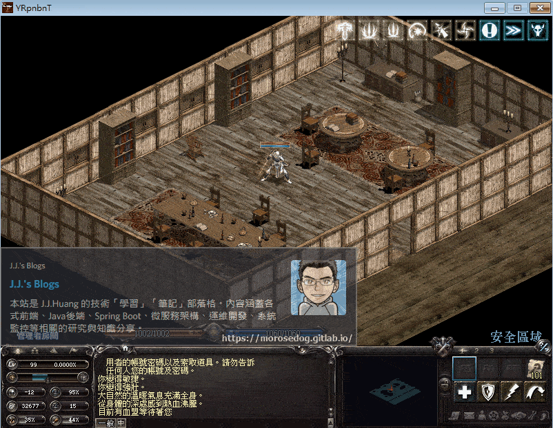
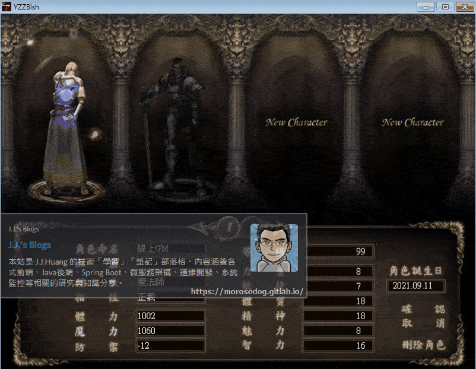
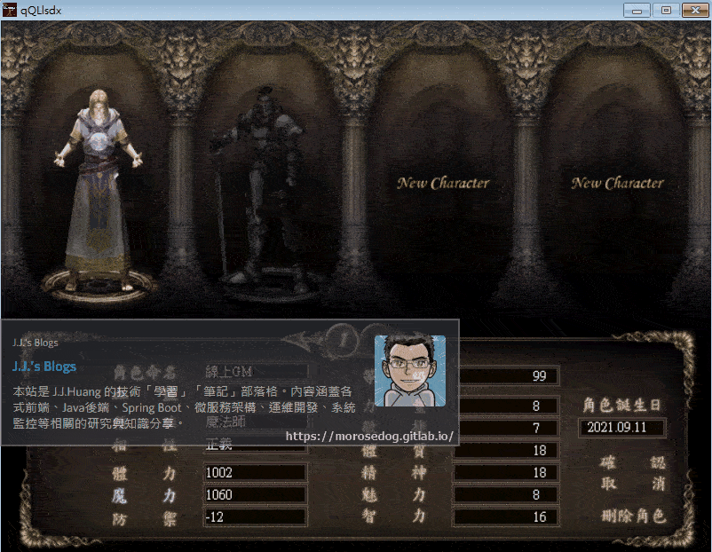

# 客戶端和登入器與變身檔關係分析

# 天堂私服 | 客戶端和登入器與變身檔關係分析

    
    
      📑 目錄
      

1. [章節用意](#章節用意)
2. [版本資訊](#版本資訊)
3. [前言](#前言)
4. [說明](#說明)
5. [問題](#問題)
6. [分析](#分析)
7. [注意](#注意)
8. [結論](#結論)
9. [結語](#結語)
10. [免責聲明](#免責聲明)

    
    
    

## 章節用意

針對客戶端與登入器對`list.spr`與`list.spz`的關係做分析。

## 版本資訊

* **客戶端版本**

  * 天堂(Lineage 3.81C)

* **核心版本**

  * L1J-3.80c

* **登入器版本**  

  * L1J-3.80c

## 前言

在開始分析前，請務必先將[變身檔新增修改<快速入門>](./103_變身檔新增修改&lt;快速入門&gt;.md)文章閱讀與實際操作過；還有對[SPZ、XML加解密 工具](../07_Developer_Tools/082_SPZ_XML加解密_工具.md)的工具的了解與使用。
另外以下說明可能並不是非常正確的，因為我也在自行分析學習中，所以只是做一個自己理解的簡單說明。
<font color="red"><如有錯誤或是可以提供更詳細的說明，歡迎糾正與分享。></font>

## 說明

開始說明前，要先理解一些簡單的定義：​‌‌‌​​​​​‌‌‌​​‌​​‌‌​‌​​‌​‌‌‌​‌‌​​‌‌​​​​‌​‌‌‌​‌​​​‌‌​​‌​‌​​‌​‌‌​‌​‌‌​‌‌​​​‌‌​‌​​‌​‌‌​‌‌‌​​‌‌​​‌​‌​‌‌​​​​‌​‌‌​​‌‌‌​‌‌​​‌​‌​​‌​‌‌​‌​​‌‌​​‌​​​‌‌​​​​​​‌‌​​‌​​​‌‌​​‌​​​‌‌​​​​​​‌‌​‌​‌​​‌‌​​​‌​​‌‌​​​‌​​‌​‌‌​‌​‌‌‌​​​​​‌‌‌​​‌​​‌‌​‌​​‌​‌‌‌​‌‌​​‌‌​​​​‌​‌‌‌​‌​​​‌‌​​‌​‌​​‌​‌‌​‌​‌‌​‌‌​​​‌‌​‌​​‌​‌‌​‌‌‌​​‌‌​​‌​‌​‌‌​​​​‌​‌‌​​‌‌‌​‌‌​​‌​‌​​‌​‌‌​‌​​‌‌​​​‌​​‌‌​​​​​​‌‌​‌‌​

* **客戶端**：表示天堂的主程式。

  * 例：`Lineage 3.81C`、`Lineage 7.2C`、`Lineage 8.8C`。

* **登入器**：表示私服的登入程式

  * 例：`L1Login-Login_363`、`L1Login-Login_380`。

> 註：部分版本可能找不到對應的登入器版本，往往都是使用`lin.bin`檔直接做登入使用。

* **變身檔**：基本上就是`list.spr`、`list.spz`檔，該部分有分為兩種 - 

  * **客戶端使用**：

    * 所謂的客戶端使用，就是在沒有使用登入器的方式去做登入時/或是登入器沒有設定讀取自定義變身檔的時候，客戶端所讀取的變身檔的一系列操作、動作編碼等等；此時候客戶端就是讀取`text.pak`內的`list.spr`、`list.spz`設定。

  * **登入器使用**：

    * 登入器的使用，通常是針對登入器內提供的變身檔並打包成`pak`檔，並設定給登入器使用，此時就會讀取設定的`pak`變身檔設定。

## 問題

看完定義後，產生幾個疑問：

* <font color="red">不使用登入器</font>的變身檔：

  * 1. 客戶端到底是讀取`list.spr`、還是`list.spz`為主呢？

  * 1. 單修改`list.spr`或`list.spz`是否有效果？

  * 1. 單修改`list.spr`或`list.spz`其一是否會造成遊戲崩潰呢？

* <font color="blue">使用登入器</font>的變身檔：

  * 1. 自定義變身檔未設定的部分，是否會讀取客戶端內的`list.spr`、`list.spz`的設定？

  * 1. 自定義變身檔未設定的部分，是否會與客戶端內的`list.spr`、`list.spz`的設定衝突？

## 分析

以下將針對上述產生的五個問題做嘗試並分析：​‌‌‌​​​​​‌‌‌​​‌​​‌‌​‌​​‌​‌‌‌​‌‌​​‌‌​​​​‌​‌‌‌​‌​​​‌‌​​‌​‌​​‌​‌‌​‌​‌‌​‌‌​​​‌‌​‌​​‌​‌‌​‌‌‌​​‌‌​​‌​‌​‌‌​​​​‌​‌‌​​‌‌‌​‌‌​​‌​‌​​‌​‌‌​‌​​‌‌​​‌​​​‌‌​​​​​​‌‌​​‌​​​‌‌​​‌​​​‌‌​​​​​​‌‌​‌​‌​​‌‌​​​‌​​‌‌​​​‌​​‌​‌‌​‌​‌‌‌​​​​​‌‌‌​​‌​​‌‌​‌​​‌​‌‌‌​‌‌​​‌‌​​​​‌​‌‌‌​‌​​​‌‌​​‌​‌​​‌​‌‌​‌​‌‌​‌‌​​​‌‌​‌​​‌​‌‌​‌‌‌​​‌‌​​‌​‌​‌‌​​​​‌​‌‌​​‌‌‌​‌‌​​‌​‌​​‌​‌‌​‌​​‌‌​​​‌​​‌‌​​​​​​‌‌​‌‌​

* 前置作業：

  * 將登入器的`Login.ini`設定改為不讀取自定義的變身檔，並將客戶端內放的`TW13081901.pak`一併先刪除。

  * 已先將相關的`spr`圖檔吃檔完成。

  * `list.spr`抽檔完成。

  * `list.spz`抽檔完成，並解密完成。

> 註：`list.spr`與`list.spz`會備份最原始檔已利後面的分析。

* 指令使用：

  * 使用`GM`的權限角色。

  * 輸入影像動畫指令。

```plain
.gfxid ${圖檔編號} ${數量} ${名稱}
```

  * 此範例變身編號，使用的主要編號為`362`。

```plain
.gfxid 362 1 1
```

  * 可見下圖，放置出來的圖檔並不會正常呼吸或是人物晃動，就是死板板的一張圖片。


> 註：該放置會在畫面上產生一個類似`NPC`的角色，當伺服器重開後，該`NPC`就會移除。

---

* 驗證一：

  * 修改`list.spr`，新增`#362`(舊版死亡騎士-焚焰)的變身檔。

  * 將`list.spr`丟至`text`目錄，並吃檔。

  * 重新登入觀看結果。

  * 依舊是死板板，表示沒有效果。


* 驗證二：

  * 將原始的`list.spr`丟至`text`目錄，並吃檔，做還原的動作。

  * 修改`list.spz`，新增`#362`(舊版死亡騎士-焚焰)的變身檔。

  * 將`list.spz`丟至`text`目錄，並吃檔。<font color="red"><注意吃檔回去需加密></font>

  * 重新登入觀看結果。

  * 可見舊版死亡騎士-焚焰正常在呼吸，表示顯示正常。


根據上面的操作，可以對`1`、`2`、`3`的問題做出解釋：​‌‌‌​​​​​‌‌‌​​‌​​‌‌​‌​​‌​‌‌‌​‌‌​​‌‌​​​​‌​‌‌‌​‌​​​‌‌​​‌​‌​​‌​‌‌​‌​‌‌​‌‌​​​‌‌​‌​​‌​‌‌​‌‌‌​​‌‌​​‌​‌​‌‌​​​​‌​‌‌​​‌‌‌​‌‌​​‌​‌​​‌​‌‌​‌​​‌‌​​‌​​​‌‌​​​​​​‌‌​​‌​​​‌‌​​‌​​​‌‌​​​​​​‌‌​‌​‌​​‌‌​​​‌​​‌‌​​​‌​​‌​‌‌​‌​‌‌‌​​​​​‌‌‌​​‌​​‌‌​‌​​‌​‌‌‌​‌‌​​‌‌​​​​‌​‌‌‌​‌​​​‌‌​​‌​‌​​‌​‌‌​‌​‌‌​‌‌​​​‌‌​‌​​‌​‌‌​‌‌‌​​‌‌​​‌​‌​‌‌​​​​‌​‌‌​​‌‌‌​‌‌​​‌​‌​​‌​‌‌​‌​​‌‌​​​‌​​‌‌​​​​​​‌‌​‌‌​

* 客戶端是依`list.spz`為主。

* 單修改`list.spr`是沒有效果，`list.spz`是有效果的。

* 單修改是不會造成崩潰。

---

* 驗證三：

  * 在<font color="red">不還原</font>`list.spz`的情況下，使用登入器設定讀取自定義變身檔的情況下。

  * 更新登入器`Login.ini`設定改為讀取自定義的變身檔，並將`TW13081901.pak`放置客戶端。

  * 重新登入觀看結果。

  * 結果是死板板，表示沒有效果。


* 驗證四：

  * 修改登入器變身檔`TW13081901.txt`，新增`#362`(舊版死亡騎士-焚焰)的變身檔。

  * 重新打包`TW13081901.pak`，並將`TW13081901.pak`再次放置客戶端覆蓋。

  * 重新登入觀看結果。

  * 可見舊版死亡騎士-焚焰正常在呼吸，表示顯示正常。


根據上面的操作，可以對`4`、`5`的問題做出解釋：

* 自定義變身檔未設定的部分是完全不讀取客戶端。

* 自定義變身檔未設定的部分不會與客戶端衝突。

## 注意

* <font color="blue">使用登入器</font>的變身檔：

  * 每次編輯完`TW13081901.txt`後，重新產生`TW13081901.pak`。

  * 務必<font color="red">再次</font>更新登入器設定，讀取自定義的變身檔，重新產生`Login.ini`。

  * 然後將`Login.ini`與`TW13081901.pak`，放置/覆蓋客戶端。

* 原因解釋：

  * 如果只單純更新`TW13081901.pak`，客戶端重新登入”可能”不會抓取到最正確的變身檔編碼。

> 註：因為在研究和測試過程中有發生過此狀況，固建議就是都一起更新。

## 結論

* <font color="red">不使用登入器</font>的變身檔：

  * 2. 客戶端到底是讀取`list.spr`、還是`list.spz`為主呢？

      * 客戶端是依`list.spz`為主。

  * 2. 單修改`list.spr`或`list.spz`是否有效果？

      * 單修改<font color="red">`list.spr`是沒有效果</font>，<font color="blue">`list.spz`是有效果的</font>。

  * 2. 單修改`list.spr`或`list.spz`其一是否會造成遊戲崩潰呢？

      * 單修改是不會造成崩潰。

* <font color="blue">使用登入器</font>的變身檔：

  * 2. 自定義變身檔未設定的部分，是否會讀取客戶端內的`list.spr`、`list.spz`的設定？

      * 自定義變身檔未設定的部分是<font color="red">**完全不讀取客戶端**</font>。

  * 2. 自定義變身檔未設定的部分，是否會與客戶端內的`list.spr`、`list.spz`的設定衝突？

      * 自定義變身檔未設定的部分<font color="red">**不會與客戶端衝突**</font>。

## 結語

這個部份在網路上也沒有人對其做分析與教學，希望透過這樣的分析教學可以讓大家對這部分有更進一步的了解。​‌‌‌​​​​​‌‌‌​​‌​​‌‌​‌​​‌​‌‌‌​‌‌​​‌‌​​​​‌​‌‌‌​‌​​​‌‌​​‌​‌​​‌​‌‌​‌​‌‌​‌‌​​​‌‌​‌​​‌​‌‌​‌‌‌​​‌‌​​‌​‌​‌‌​​​​‌​‌‌​​‌‌‌​‌‌​​‌​‌​​‌​‌‌​‌​​‌‌​​‌​​​‌‌​​​​​​‌‌​​‌​​​‌‌​​‌​​​‌‌​​​​​​‌‌​‌​‌​​‌‌​​​‌​​‌‌​​​‌​​‌​‌‌​‌​‌‌‌​​​​​‌‌‌​​‌​​‌‌​‌​​‌​‌‌‌​‌‌​​‌‌​​​​‌​‌‌‌​‌​​​‌‌​​‌​‌​​‌​‌‌​‌​‌‌​‌‌​​​‌‌​‌​​‌​‌‌​‌‌‌​​‌‌​​‌​‌​‌‌​​​​‌​‌‌​​‌‌‌​‌‌​​‌​‌​​‌​‌‌​‌​​‌‌​​​‌​​‌‌​​​​​​‌‌​‌‌​

原創文章真的不易，希望多多支持，感謝。
最後建議回顧一下首章[天堂私服 | 天堂私服架設教學](/private-lineage-20210712-private-lineage-0/#教學章節)，了解其章節目錄。

## 免責聲明

* 本部落格文章中皆<font color="red"><u>**不提供**</u></font>任何所謂的遊戲「主程式」、「模擬器」、「登入器」…等等相關程式的下載點。

* 本部落格文章中所見之遊戲主程式和服務器端程序均來自網路發佈，<font color="red"><u>版本歸**原作者**</u>所有</font>。

* 本部落格文章為研究SQL資料庫與修改JAVA語法使用，<font color="red">並<u>**非商業用途**</u>，亦<u>**無做營運事實等任何一切商業行為**</u>。</font>

* 本部落格文章內容是為研究學習設計思想和原理為目的，<font color="red"><u>**絕沒有故意侵權或惡意抄襲、篡改其他遊戲內容**</u></font>！

---

- **原文連結**：[J.J.'s Blogs - 客戶端和登入器與變身檔關係分析](https://morosedog.gitlab.io/private-lineage-20220511-private-lineage-106/)
