# 變身檔與 gfxid、polyid 分析

# 天堂私服 | 變身檔與 gfxid、polyid 分析

    
    
      📑 目錄
      

1. [章節用意](#章節用意)
2. [版本資訊](#版本資訊)
3. [前言](#前言)
4. [說明](#說明)
5. [問題](#問題)
6. [分析](#分析)
7. [結論](#結論)
8. [結語](#結語)
9. [免責聲明](#免責聲明)

    
    
    

## 章節用意

在分析核心、資料庫、對話檔的過程中，對於變身相關的部分，主要就兩個關鍵字欄位分別為`gfxid`、`polyid`，時常混淆不清楚其定義，此處針對兩個欄位做分析與解釋。

## 版本資訊

* **客戶端版本**

  * 天堂(Lineage 3.81C)

* **核心版本**

  * L1J-3.80c

* **登入器版本**  

  * L1J-3.80c

## 前言

在開始前，請務必先將以下文章閱讀與實際操作過。

* [變身檔新增修改<快速入門>](./103_變身檔新增修改&lt;快速入門&gt;.md)

* [客戶端、登入器與變身檔關係分析](./106_客戶端和登入器與變身檔關係分析.md)

<font color="red"><如有錯誤或是可以提供更詳細的說明，歡迎糾正與分享。></font>​‌‌‌​​​​​‌‌‌​​‌​​‌‌​‌​​‌​‌‌‌​‌‌​​‌‌​​​​‌​‌‌‌​‌​​​‌‌​​‌​‌​​‌​‌‌​‌​‌‌​‌‌​​​‌‌​‌​​‌​‌‌​‌‌‌​​‌‌​​‌​‌​‌‌​​​​‌​‌‌​​‌‌‌​‌‌​​‌​‌​​‌​‌‌​‌​​‌‌​​‌​​​‌‌​​​​​​‌‌​​‌​​​‌‌​​‌​​​‌‌​​​​​​‌‌​‌​‌​​‌‌​​​‌​​‌‌​​‌​​​‌​‌‌​‌​‌‌‌​​​​​‌‌‌​​‌​​‌‌​‌​​‌​‌‌‌​‌‌​​‌‌​​​​‌​‌‌‌​‌​​​‌‌​​‌​‌​​‌​‌‌​‌​‌‌​‌‌​​​‌‌​‌​​‌​‌‌​‌‌‌​​‌‌​​‌​‌​‌‌​​​​‌​‌‌​​‌‌‌​‌‌​​‌​‌​​‌​‌‌​‌​​‌‌​​​‌​​‌‌​​​​​​‌‌​‌‌‌

## 說明

* 開始說明前，要先理解一些簡單的定義：

  * <font color="red">**圖檔編號**</font>：表示圖片的檔名。

    * 例：`362-0.spr`，圖檔編號為`362`。

  * <font color="brow">**變身編號**</font>：表示於`list.spz`內的編號。

    * 例如：

      * `#240  64     Death Knight`，`#240`表示變身編號為`240`，此時沒定義圖檔編號，則是直接使用圖檔編號與自身相同`240`共`64`張圖。

      * `#5641 64=240 Death Knight`，`#5641`表示變身編號為`5641`，而`64=240`則表示使用的是圖檔編號為`240`共`64`張圖。

> 註：詳細的`list`編輯教學在後面進階教學章節會再慢慢介紹。

* 另外要認識欄位、變數名稱的命名：​‌‌‌​​​​​‌‌‌​​‌​​‌‌​‌​​‌​‌‌‌​‌‌​​‌‌​​​​‌​‌‌‌​‌​​​‌‌​​‌​‌​​‌​‌‌​‌​‌‌​‌‌​​​‌‌​‌​​‌​‌‌​‌‌‌​​‌‌​​‌​‌​‌‌​​​​‌​‌‌​​‌‌‌​‌‌​​‌​‌​​‌​‌‌​‌​​‌‌​​‌​​​‌‌​​​​​​‌‌​​‌​​​‌‌​​‌​​​‌‌​​​​​​‌‌​‌​‌​​‌‌​​​‌​​‌‌​​‌​​​‌​‌‌​‌​‌‌‌​​​​​‌‌‌​​‌​​‌‌​‌​​‌​‌‌‌​‌‌​​‌‌​​​​‌​‌‌‌​‌​​​‌‌​​‌​‌​​‌​‌‌​‌​‌‌​‌‌​​​‌‌​‌​​‌​‌‌​‌‌‌​​‌‌​​‌​‌​‌‌​​​​‌​‌‌​​‌‌‌​‌‌​​‌​‌​​‌​‌‌​‌​​‌‌​​​‌​​‌‌​​​​​​‌‌​‌‌‌

  * `gfxid`：

    * 英文縮寫`GFX`的英文全稱，查詢結果是`Graphic Effect(s)`，中文意思是`圖形效果`。

  * `polyid`：  

    * 完整英文應該是`Polymorph`，中文意思是`同質異形性`，太專業的術語，其實還有另一個意思就是`變形`。

簡單來說就是`gfxid`對應的就是<u>**圖形**的索引</u>，而`polyid`就是對應<u>**變身**的索引</u>。

> 註：以上名稱的命名，應該是這樣表示；當初開這個`Schema`的作者到底是不是用這英文意思…就需要原作者說明。

## 問題

看完定義後，產生幾個疑問：​‌‌‌​​​​​‌‌‌​​‌​​‌‌​‌​​‌​‌‌‌​‌‌​​‌‌​​​​‌​‌‌‌​‌​​​‌‌​​‌​‌​​‌​‌‌​‌​‌‌​‌‌​​​‌‌​‌​​‌​‌‌​‌‌‌​​‌‌​​‌​‌​‌‌​​​​‌​‌‌​​‌‌‌​‌‌​​‌​‌​​‌​‌‌​‌​​‌‌​​‌​​​‌‌​​​​​​‌‌​​‌​​​‌‌​​‌​​​‌‌​​​​​​‌‌​‌​‌​​‌‌​​​‌​​‌‌​​‌​​​‌​‌‌​‌​‌‌‌​​​​​‌‌‌​​‌​​‌‌​‌​​‌​‌‌‌​‌‌​​‌‌​​​​‌​‌‌‌​‌​​​‌‌​​‌​‌​​‌​‌‌​‌​‌‌​‌‌​​​‌‌​‌​​‌​‌‌​‌‌‌​​‌‌​​‌​‌​‌‌​​​​‌​‌‌​​‌‌‌​‌‌​​‌​‌​​‌​‌‌​‌​​‌‌​​​‌​​‌‌​​​​​​‌‌​‌‌‌

* `gfxid`對應的是圖檔的編號？

* `polyid`對應的是變身編號？

* `gfxid`與`polyid`的差異在哪裡？

* `gfxid`與`polyid`分別應用在哪裡？

## 分析

* 0.分析前準備：

  * 登入器的`TW13081901.txt`變身檔。

  * [L1Viewer 工具](../07_Developer_Tools/077_L1Viewer_工具.md)。

  * 資料庫的`npc`與`polymorphs`的表。

* 1.針對**`gfxid`**進行分析

  * 進入資料庫使用以下`SQL`語法進行搜尋。

  * 可以搜尋出每個`gfxid`對應的怪物名稱，方便後面進行分析。

```sql
SELECT name, gfxid FROM `npc` GROUP BY name, gfxid ORDER BY gfxid DESC
```

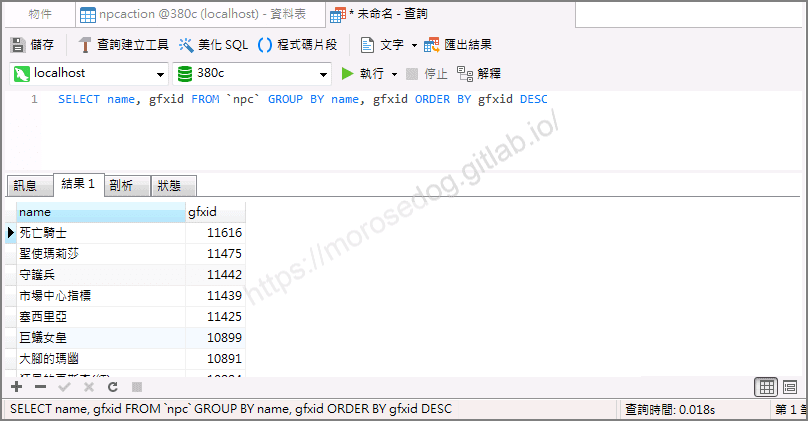

---

  * 首先針對`死亡騎士`、`11616`進行分析。

  * 接著到`TW13081901.txt`裡面搜尋`#11616`的內容。

  * 可以找到`#11616 64 Lightning DeathKnight`，`#11616`表示變身編號為`11616`，此時沒定義圖檔編號，則是直接使用圖檔編號與自身相同`11616`共`64`張圖。
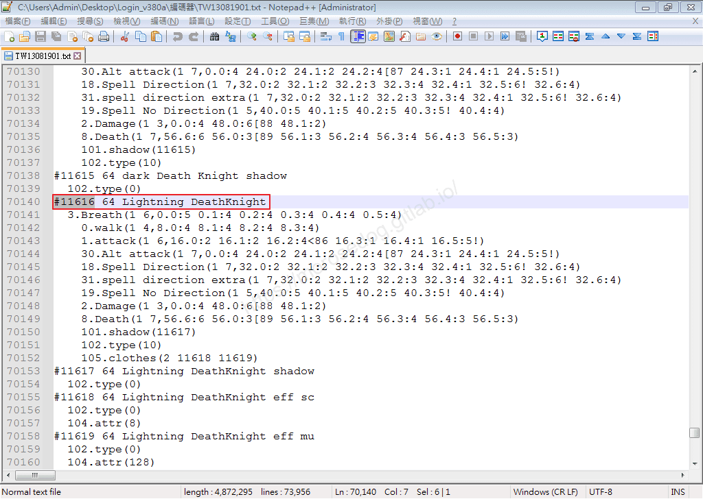

  * 用圖檔編號`11616`，透過搜尋[L1Viewer 工具](../07_Developer_Tools/077_L1Viewer_工具.md)去搜尋。

  * 可以看到該圖檔的預覽畫面如下。
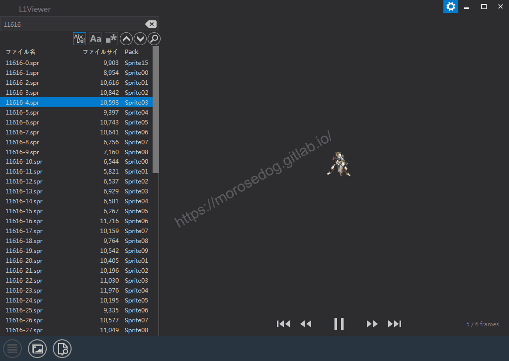

  * 使用[GM指令使用 (影像動畫)](./103_變身檔新增修改&lt;快速入門&gt;.md)，來放置預覽該圖檔動畫。

```plain
.gfxid 11616 1 1
```

  * 呈現效果如下圖。
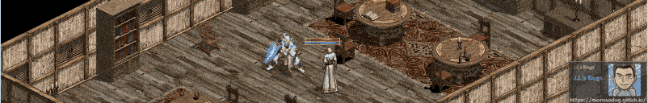

  * 使用[GM指令使用 (人物變身)](./104_GM指令使用_(影像動畫).md)來變身。

```plain
.poly 線上GM 11616
```

  * 變身效果如下圖。
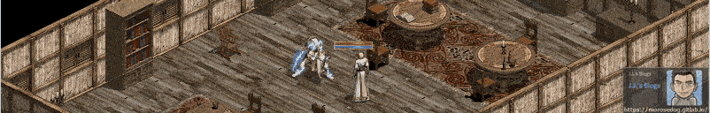

> 註：為什麼用`L1Viewer`預覽圖片沒有閃電殘影，這邊卻有？這部分是因為變身編碼有使用`105.clothes`加上去的效果，<u>關於這個在`list`編輯教學在後面進階教學章節會再慢慢介紹</u>。

---

  * 接著我們在分析`守護兵`、`11442`進行分析。

  * 接著到`TW13081901.txt`裡面搜尋`#11442`的內容。

  * 可以找到`#11442    48=5246 spear of saint cross daker`，`#11442`表示變身編號為`11442`，而`48=5246`則表示使用的是圖檔編號為`5246`共`48`張圖。
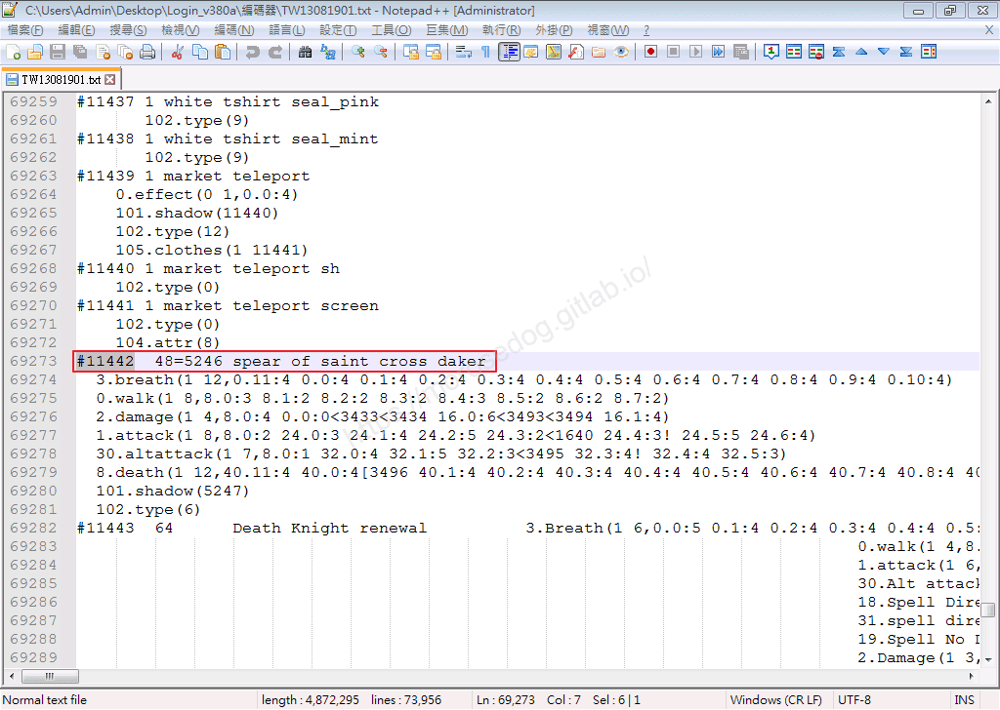

    * 額外嘗試：

      * 1.可以嘗試使用`L1Viewer`看可不可以找到`11442`的圖檔，答案是沒有這張圖的，因為他指向的是`5246`。
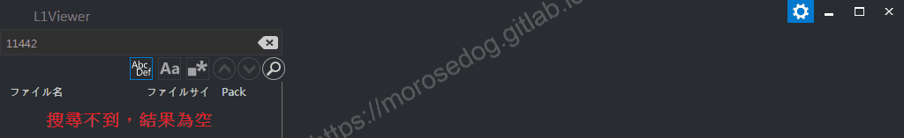

      * 2.搜尋`TW13081901.txt`裡面搜尋`#5246`的內容，會發現他是有直接定義變身編號為`#5246 48 spear of saint cross`的。
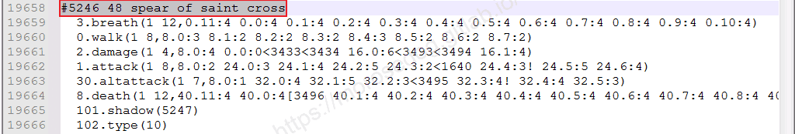

> 註：到這邊應該可以知道變身編號和圖檔編號的一個關係了。<font color="red">疑問？所以`11442`與`5246`不就是一樣的嗎？</font>，<u>關於這個在`list`編輯教學在後面進階教學章節會再慢慢介紹</u>。

  * 用圖檔編號`5246`，透過搜尋[L1Viewer 工具](../07_Developer_Tools/077_L1Viewer_工具.md)去搜尋。

  * 可以看到該圖檔的預覽畫面如下。
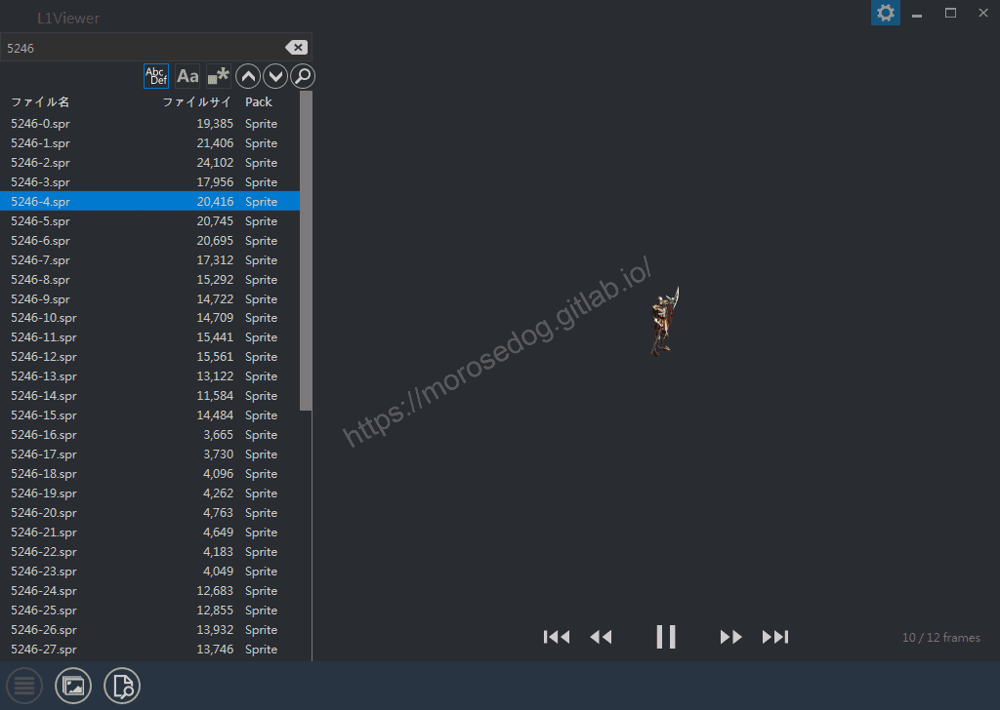

  * 使用[GM指令使用 (影像動畫)](./105_GM指令使用_(人物變身).md)，來放置預覽該圖檔動畫。

```plain
.gfxid 11442 1 1
```

  * 呈現效果如下圖。
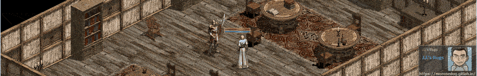

  * 使用[GM指令使用 (人物變身)](./106_客戶端和登入器與變身檔關係分析.md)來變身。

```plain
.poly 線上GM 11442
```

  * 變身效果如下圖。
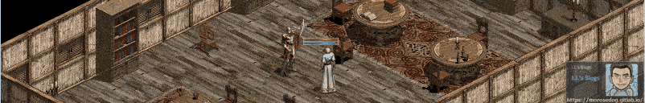

---

* 2.針對**`polyid`**進行分析

  * 進入資料庫使用以下`SQL`語法進行搜尋。

  * 可以搜尋出每個`polyid`對應的變身名稱，方便後面進行分析。

```sql
SELECT name, polyid FROM `polymorphs` GROUP BY name, polyid ORDER BY polyid DESC
```

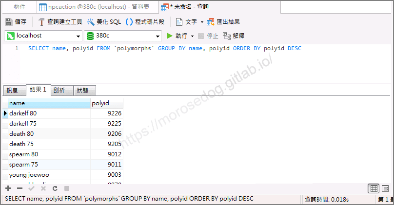

---

  * 首先針對`death 80`、`9206`進行分析。

  * 接著到`TW13081901.txt`裡面搜尋`#9206`的內容。

  * 可以找到`#9206 64=240 ancient platinum Death Knight morph`，`#9206`表示變身編號為`9206`，而`64=240`則表示使用的是圖檔編號為`240`共`64`張圖。

  * 後面的操作基本上都與上方的分析是一致的結果，就不再示範。

## 結論

* `gfxid`對應的是圖檔的編號？

  * 其實實質上是對應變身編號的。

* `polyid`對應的是變身編號？

  * 其實實質上是對應變身編號的。

* `gfxid`與`polyid`的差異在哪裡？

  * 其實可以說是沒有差異，只是在運用上定義成兩個不一樣的名稱，方便分類。

* `gfxid`與`polyid`分別應用在哪裡？

  * `gfxid`通常運用在：

    * 怪物的樣子。

    * 怪物施放的魔法動畫。

    * 地形的場景(門、陷阱..等等)。

    * 武器施放的魔法動畫。

  * `polyid`通常運用在：

    * 對應變身清單(polymorphs)。

    * 套裝變身(惡魔全套、死騎全套..等等)。

    * 怪物施放的魔法動畫。

    * 人物狀態(變身→對應的變身)。

所以！​‌‌‌​​​​​‌‌‌​​‌​​‌‌​‌​​‌​‌‌‌​‌‌​​‌‌​​​​‌​‌‌‌​‌​​​‌‌​​‌​‌​​‌​‌‌​‌​‌‌​‌‌​​​‌‌​‌​​‌​‌‌​‌‌‌​​‌‌​​‌​‌​‌‌​​​​‌​‌‌​​‌‌‌​‌‌​​‌​‌​​‌​‌‌​‌​​‌‌​​‌​​​‌‌​​​​​​‌‌​​‌​​​‌‌​​‌​​​‌‌​​​​​​‌‌​‌​‌​​‌‌​​​‌​​‌‌​​‌​​​‌​‌‌​‌​‌‌‌​​​​​‌‌‌​​‌​​‌‌​‌​​‌​‌‌‌​‌‌​​‌‌​​​​‌​‌‌‌​‌​​​‌‌​​‌​‌​​‌​‌‌​‌​‌‌​‌‌​​​‌‌​‌​​‌​‌‌​‌‌‌​​‌‌​​‌​‌​‌‌​​​​‌​‌‌​​‌‌‌​‌‌​​‌​‌​​‌​‌‌​‌​​‌‌​​​‌​​‌‌​​​​​​‌‌​‌‌‌

* `gfxid`與`polyid`都是對應`list`編碼裡面的變身編號(#362)

* `gfxid`與`polyid`是否就是對應圖檔編號(362-0.spr)，<font color="red">**這是不一定的**</font>，取決於編碼內對應的編號。

---

還是不懂？再來個例子：

* <font color="blue">完全</font>可以對應：

```plain
gfxid = 362
#362 64
362-0.spr
```

* <font color="red">不完全</font>對應：​‌‌‌​​​​​‌‌‌​​‌​​‌‌​‌​​‌​‌‌‌​‌‌​​‌‌​​​​‌​‌‌‌​‌​​​‌‌​​‌​‌​​‌​‌‌​‌​‌‌​‌‌​​​‌‌​‌​​‌​‌‌​‌‌‌​​‌‌​​‌​‌​‌‌​​​​‌​‌‌​​‌‌‌​‌‌​​‌​‌​​‌​‌‌​‌​​‌‌​​‌​​​‌‌​​​​​​‌‌​​‌​​​‌‌​​‌​​​‌‌​​​​​​‌‌​‌​‌​​‌‌​​​‌​​‌‌​​‌​​​‌​‌‌​‌​‌‌‌​​​​​‌‌‌​​‌​​‌‌​‌​​‌​‌‌‌​‌‌​​‌‌​​​​‌​‌‌‌​‌​​​‌‌​​‌​‌​​‌​‌‌​‌​‌‌​‌‌​​​‌‌​‌​​‌​‌‌​‌‌‌​​‌‌​​‌​‌​‌‌​​​​‌​‌‌​​‌‌‌​‌‌​​‌​‌​​‌​‌‌​‌​​‌‌​​​‌​​‌‌​​​​​​‌‌​‌‌‌

```plain
gfxid = 11442
#11442	48=5246
5246-0.spr
```

## 結語

原創文章真的不易，希望多多支持，感謝。
最後建議回顧一下首章[天堂私服 | 天堂私服架設教學](/private-lineage-20210712-private-lineage-0/#教學章節)，了解其章節目錄。

## 免責聲明

* 本部落格文章中皆<font color="red"><u>**不提供**</u></font>任何所謂的遊戲「主程式」、「模擬器」、「登入器」…等等相關程式的下載點。

* 本部落格文章中所見之遊戲主程式和服務器端程序均來自網路發佈，<font color="red"><u>版本歸**原作者**</u>所有</font>。

* 本部落格文章為研究SQL資料庫與修改JAVA語法使用，<font color="red">並<u>**非商業用途**</u>，亦<u>**無做營運事實等任何一切商業行為**</u>。</font>

* 本部落格文章內容是為研究學習設計思想和原理為目的，<font color="red"><u>**絕沒有故意侵權或惡意抄襲、篡改其他遊戲內容**</u></font>！

---

- **原文連結**：[J.J.'s Blogs - 變身檔與 gfxid、polyid 分析](https://morosedog.gitlab.io/private-lineage-20220512-private-lineage-107/)
