# 資料庫中 gfxid、polyid 分析

# 天堂私服 | 資料庫中 gfxid、polyid 分析

    
    
      📑 目錄
      

1. [章節用意](#章節用意)
2. [版本資訊](#版本資訊)
3. [前言](#前言)
4. [搜尋](#搜尋)
5. [分析](#分析)
6. [結語](#結語)
7. [免責聲明](#免責聲明)

    
    
    

## 章節用意

在前一篇[變身檔與 gfxid、polyid 關係](./107_變身檔與_gfxid_polyid_分析.md)中提到的兩個關鍵字欄位為`gfxid`、`polyid`；將解釋兩個欄位運用在哪些表中？其用途是？。

## 版本資訊

* **客戶端版本**

  * 天堂(Lineage 3.81C)

* **核心版本**

  * L1J-3.80c

* **登入器版本**  

  * L1J-3.80c

## 前言

在開始前，請務必先將以下文章閱讀與實際操作過。

* [變身檔新增修改<快速入門>](./103_變身檔新增修改&lt;快速入門&gt;.md)

* [客戶端、登入器與變身檔關係分析](./106_客戶端和登入器與變身檔關係分析.md)

* [變身檔與 gfxid、polyid 關係](./107_變身檔與_gfxid_polyid_分析.md)

<font color="red"><如有錯誤或是可以提供更詳細的說明，歡迎糾正與分享。></font>​‌‌‌​​​​​‌‌‌​​‌​​‌‌​‌​​‌​‌‌‌​‌‌​​‌‌​​​​‌​‌‌‌​‌​​​‌‌​​‌​‌​​‌​‌‌​‌​‌‌​‌‌​​​‌‌​‌​​‌​‌‌​‌‌‌​​‌‌​​‌​‌​‌‌​​​​‌​‌‌​​‌‌‌​‌‌​​‌​‌​​‌​‌‌​‌​​‌‌​​‌​​​‌‌​​​​​​‌‌​​‌​​​‌‌​​‌​​​‌‌​​​​​​‌‌​‌​‌​​‌‌​​​‌​​‌‌​​‌‌​​‌​‌‌​‌​‌‌‌​​​​​‌‌‌​​‌​​‌‌​‌​​‌​‌‌‌​‌‌​​‌‌​​​​‌​‌‌‌​‌​​​‌‌​​‌​‌​​‌​‌‌​‌​‌‌​‌‌​​​‌‌​‌​​‌​‌‌​‌‌‌​​‌‌​​‌​‌​‌‌​​​​‌​‌‌​​‌‌‌​‌‌​​‌​‌​​‌​‌‌​‌​​‌‌​​​‌​​‌‌​​​​​​‌‌‌​​​

## 搜尋

要先搜尋這兩個欄位在資料庫的哪些表中有做使用，可以透過以下`SQL`語法做查詢：

* 針對`gfxid`的相似的字做搜尋。

```sql
SELECT TABLE_NAME, COLUMN_NAME FROM INFORMATION_SCHEMA.`COLUMNS` 
WHERE TABLE_SCHEMA = '380c' AND COLUMN_NAME like '%gfx%id%'
```

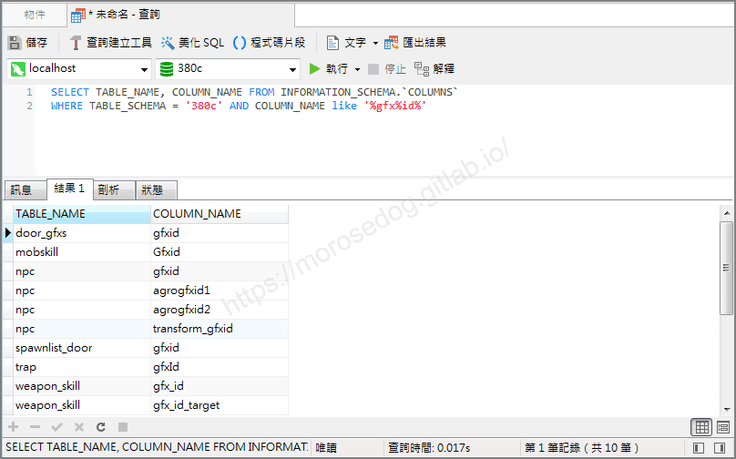​‌‌‌​​​​​‌‌‌​​‌​​‌‌​‌​​‌​‌‌‌​‌‌​​‌‌​​​​‌​‌‌‌​‌​​​‌‌​​‌​‌​​‌​‌‌​‌​‌‌​‌‌​​​‌‌​‌​​‌​‌‌​‌‌‌​​‌‌​​‌​‌​‌‌​​​​‌​‌‌​​‌‌‌​‌‌​​‌​‌​​‌​‌‌​‌​​‌‌​​‌​​​‌‌​​​​​​‌‌​​‌​​​‌‌​​‌​​​‌‌​​​​​​‌‌​‌​‌​​‌‌​​​‌​​‌‌​​‌‌​​‌​‌‌​‌​‌‌‌​​​​​‌‌‌​​‌​​‌‌​‌​​‌​‌‌‌​‌‌​​‌‌​​​​‌​‌‌‌​‌​​​‌‌​​‌​‌​​‌​‌‌​‌​‌‌​‌‌​​​‌‌​‌​​‌​‌‌​‌‌‌​​‌‌​​‌​‌​‌‌​​​​‌​‌‌​​‌‌‌​‌‌​​‌​‌​​‌​‌‌​‌​​‌‌​​​‌​​‌‌​​​​​​‌‌‌​​​

* 針對`polyid`的相似的字做搜尋。

```sql
SELECT TABLE_NAME, COLUMN_NAME FROM INFORMATION_SCHEMA.`COLUMNS` 
WHERE TABLE_SCHEMA = '380c' AND COLUMN_NAME like '%poly%id%'
```

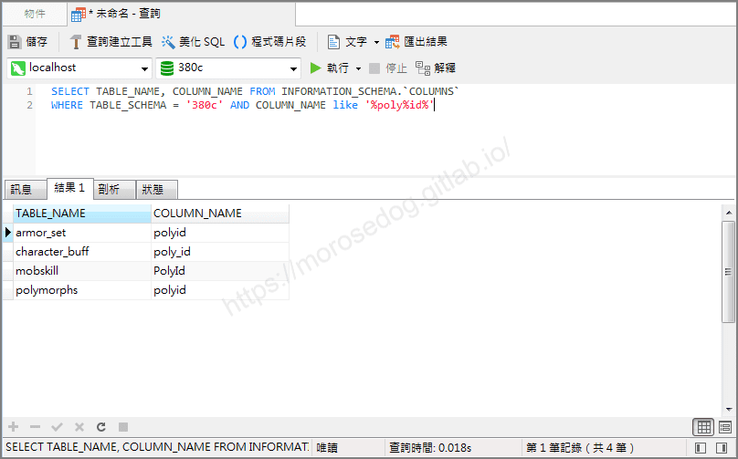

* 根據以上搜尋結果整理出來如下：​‌‌‌​​​​​‌‌‌​​‌​​‌‌​‌​​‌​‌‌‌​‌‌​​‌‌​​​​‌​‌‌‌​‌​​​‌‌​​‌​‌​​‌​‌‌​‌​‌‌​‌‌​​​‌‌​‌​​‌​‌‌​‌‌‌​​‌‌​​‌​‌​‌‌​​​​‌​‌‌​​‌‌‌​‌‌​​‌​‌​​‌​‌‌​‌​​‌‌​​‌​​​‌‌​​​​​​‌‌​​‌​​​‌‌​​‌​​​‌‌​​​​​​‌‌​‌​‌​​‌‌​​​‌​​‌‌​​‌‌​​‌​‌‌​‌​‌‌‌​​​​​‌‌‌​​‌​​‌‌​‌​​‌​‌‌‌​‌‌​​‌‌​​​​‌​‌‌‌​‌​​​‌‌​​‌​‌​​‌​‌‌​‌​‌‌​‌‌​​​‌‌​‌​​‌​‌‌​‌‌‌​​‌‌​​‌​‌​‌‌​​​​‌​‌‌​​‌‌‌​‌‌​​‌​‌​​‌​‌‌​‌​​‌‌​​​‌​​‌‌​​​​​​‌‌‌​​​

```plain
door_gfxs.gfxid
spawnlist_door.gfxid
mobskill.Gfxid
npc.gfxid
npc.agrogfxid1
npc.agrogfxid2
npc.transform_gfxid
trap.gfxId
weapon_skill.gfx_id
weapon_skill.gfx_id_target
```

```plain
armor_set.polyid
character_buff.poly_id
mobskill.PolyId
polymorphs.polyid
```

## 分析

* <font color="red">**`door_gfxs.gfxid`**</font>

  * 表說明：用於定義「門」的方向與偏移量。

  * 欄說明：用於對應`spawnlist_door`的索引與`變身編號`的對應。

* <font color="red">**`spawnlist_door.gfxid`**</font>

  * 表說明：用於定義放置「門」的地圖、做標、取用的`gfxid`定義索引。

  * 欄說明：用於對應`door_gfxs`的索引。

* 舉例：

  * `奇岩-雜貨商`的門。

  * 搜尋

```sql
SELECT * FROM spawnlist_door WHERE location = '奇岩-雜貨商'
-- gfxid = 1331
-- gfxid = 1330
-- gfxid = 1329
SELECT * FROM door_gfxs WHERE gfxid IN (1331, 1330, 1329)
```

  * 對應的`1331.spr`
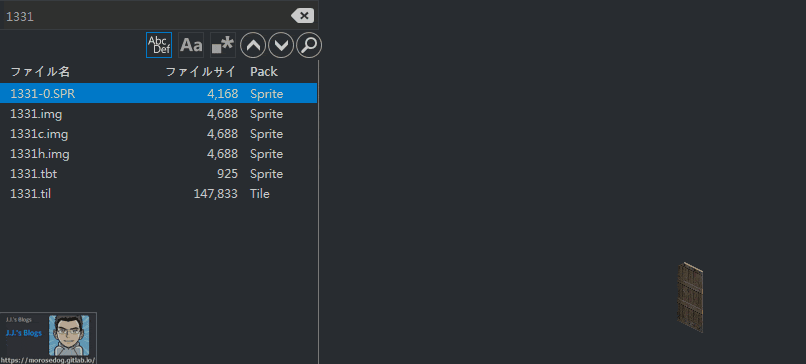

  * 對應的`1330.spr`


  * 對應的`1329.spr`
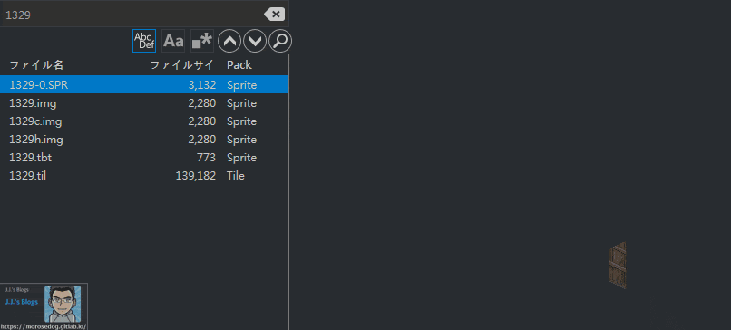

---

* <font color="red">**`mobskill.Gfxid`**</font>

  * 表說明：怪物施放技能的對應表。

  * 欄說明：用於對應怪物技能顯示的`變身編號`的對應。

* 舉例：

  * `安普長老-落石術`

  * 搜尋

```sql
SELECT * FROM mobskill WHERE mobname = '安普長老-落石術'
-- gfxid = 1161
```

  * 對應的`1161.spr`
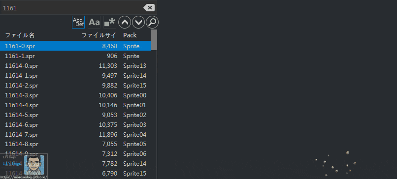

---

* <font color="red">**`npc.gfxid`**</font>

  * 表說明：怪物表。

  * 欄說明：用於對應怪物圖像`變身編號`的對應。

* <font color="red">**`npc.agrogfxid1`、`npc.agrogfxid2`**</font>

  * 欄說明：這兩個欄位沒有特別分析，目前僅知道`克特`與`黑騎士`系列的設定與其他一般怪物設定不同。

* <font color="red">**`npc.transform_gfxid`**</font>

  * 欄說明：怪物死亡後的特效。

* 舉例：

  * `冰之女王侍女`

  * 搜尋

```sql
SELECT * FROM npc WHERE name = '冰之女王侍女' AND transform_gfxid > 0 
-- gfxid = 2118
-- transform_gfxid = 6696
```

  * 對應的`2118.spr`
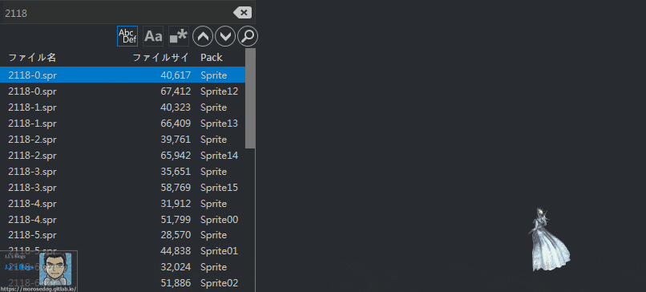

  * 對應的`6696.spr`
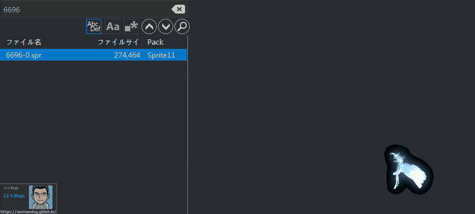

---

* <font color="red">**`trap.gfxId`**</font>

  * 表說明：陷阱表。

  * 欄說明：用於對應陷阱圖像`變身編號`的對應。

* 舉例：

  * `針(横)`

  * 搜尋

```sql
SELECT * FROM trap WHERE note = '針(横)'
-- gfxid = 1070
```

  * 對應的`1070.spr`
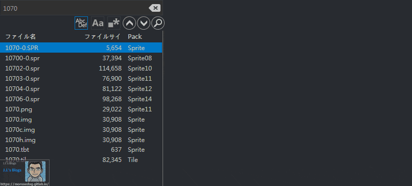

---

* <font color="red">**`weapon_skill.gfx_id`**</font>

  * 表說明：魔法武器表。

  * 欄說明：用於對應陷阱圖像`變身編號`的對應。

* <font color="red">**`weapon_skill.gfx_id_target`**</font>

  * 欄說明：施放的魔法目標。

* 舉例：

  * 由於此核心版本沒有設定資料可以參考，也沒有深入研究，所以在此就無法舉例。

---

* <font color="red">**`armor_set.polyid`**</font>

  * 表說明：裝備套裝效果設定表。

  * 欄說明：套裝效果對應的`變身編號`。

* 舉例：

  * `惡魔套裝`

  * 搜尋

```sql
SELECT * FROM armor_set WHERE note = '惡魔套裝'
-- polyid = 3889
```

  * 接著到`TW13081901.txt`裡面搜尋`#3889`的內容。

  * 可以找到`#3889    56=1180          demon morph`，`#3889`表示變身編號為`3889`，而`56=1180`則表示使用的是圖檔編號為`1180`共`56`張圖。

  * 對應的`1180.spr`
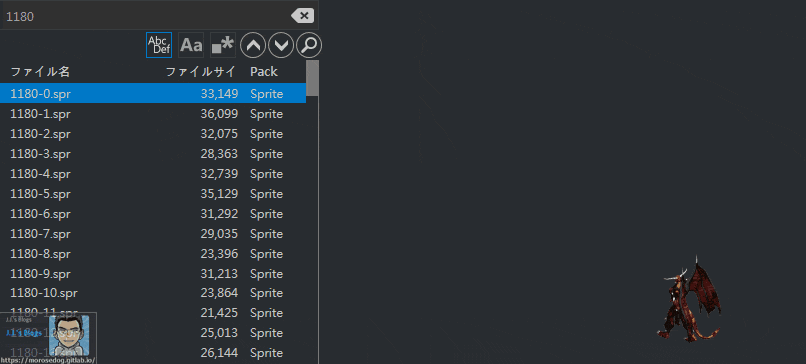

* <font color="red">**`character_buff.poly_id`**</font>

  * 表說明：玩家狀態資料。

  * 欄說明：針對變身狀態，所對應的`變身編號`。

* 舉例：

  * 人物使用變身卷軸，變身為`52`級的`死亡騎士`。

  * 搜尋

```sql
SELECT * FROM characters WHERE char_name = '線上GM'
-- objid = '268471733'
SELECT * FROM character_buff WHERE skill_id = 67 AND char_obj_id = 268471733
-- poly_id = 6137
```

  * 接著到`TW13081901.txt`裡面搜尋`#6137`的內容。

  * 可以找到`#6137 64=240 neo Death Knight morph`，`#6137`表示變身編號為`6137`，而`64=240`則表示使用的是圖檔編號為`240`共`64`張圖。

  * 對應的`240.spr`
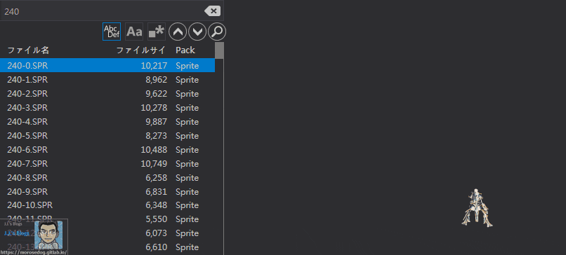

* <font color="red">**`mobskill.PolyId`**</font>

  * 表說明：怪物施放技能的對應表。

  * 欄說明：用於對應怪物施放`集體變形術`對角色時所要變的`變身編號`對應。

* 舉例：

  * `蕾雅-集體變形術(歐姆民兵)`

  * 搜尋

```sql
SELECT * FROM mobskill WHERE mobname = '蕾雅-集體變形術(歐姆民兵)'
-- poly_id = 3950
```

  * 接著到`TW13081901.txt`裡面搜尋`#3950`的內容。

  * 可以找到`#3950 48=3644            middle oum morph`，`#3950`表示變身編號為`3950`，而`48=3644`則表示使用的是圖檔編號為`3644`共`48`張圖。

  * 對應的`3644.spr`
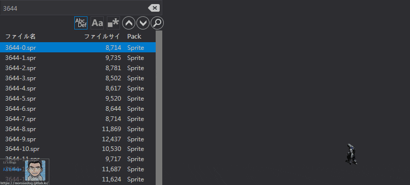

* <font color="red">**`polymorphs.polyid`**</font>

  * 表說明：玩家變身對應變身清單的設定。

  * 欄說明：

* 舉例：

  * `death 52`

  * 搜尋

```sql
SELECT * FROM polymorphs WHERE name = 'death 52'
-- poly_id = 6137
```

  * 接著到`TW13081901.txt`裡面搜尋`#6137`的內容。

  * 可以找到`#6137 64=240 neo Death Knight morph`，`#6137`表示變身編號為`6137`，而`64=240`則表示使用的是圖檔編號為`240`共`64`張圖。

  * 對應的`240.spr`


## 結語

此篇文章只是透過關鍵字去搜尋欄位，並嘗試分析之間的用途與關係。

原創文章真的不易，希望多多支持，感謝。
最後建議回顧一下首章[天堂私服 | 天堂私服架設教學](/private-lineage-20210712-private-lineage-0/#教學章節)，了解其章節目錄。

## 免責聲明

* 本部落格文章中皆<font color="red"><u>**不提供**</u></font>任何所謂的遊戲「主程式」、「模擬器」、「登入器」…等等相關程式的下載點。

* 本部落格文章中所見之遊戲主程式和服務器端程序均來自網路發佈，<font color="red"><u>版本歸**原作者**</u>所有</font>。

* 本部落格文章為研究SQL資料庫與修改JAVA語法使用，<font color="red">並<u>**非商業用途**</u>，亦<u>**無做營運事實等任何一切商業行為**</u>。</font>

* 本部落格文章內容是為研究學習設計思想和原理為目的，<font color="red"><u>**絕沒有故意侵權或惡意抄襲、篡改其他遊戲內容**</u></font>！

---

- **原文連結**：[J.J.'s Blogs - 資料庫中 gfxid、polyid 分析](https://morosedog.gitlab.io/private-lineage-20220513-private-lineage-108/)
