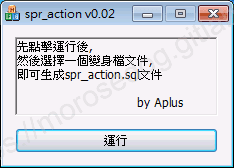
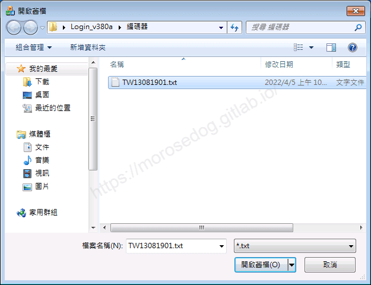
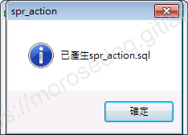
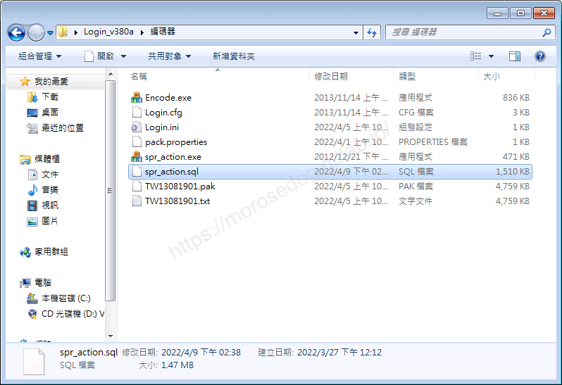
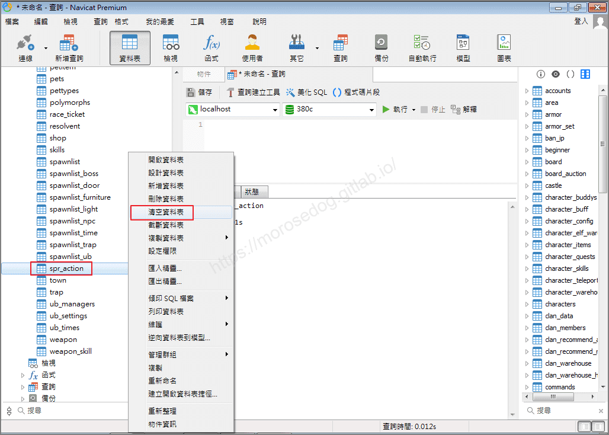
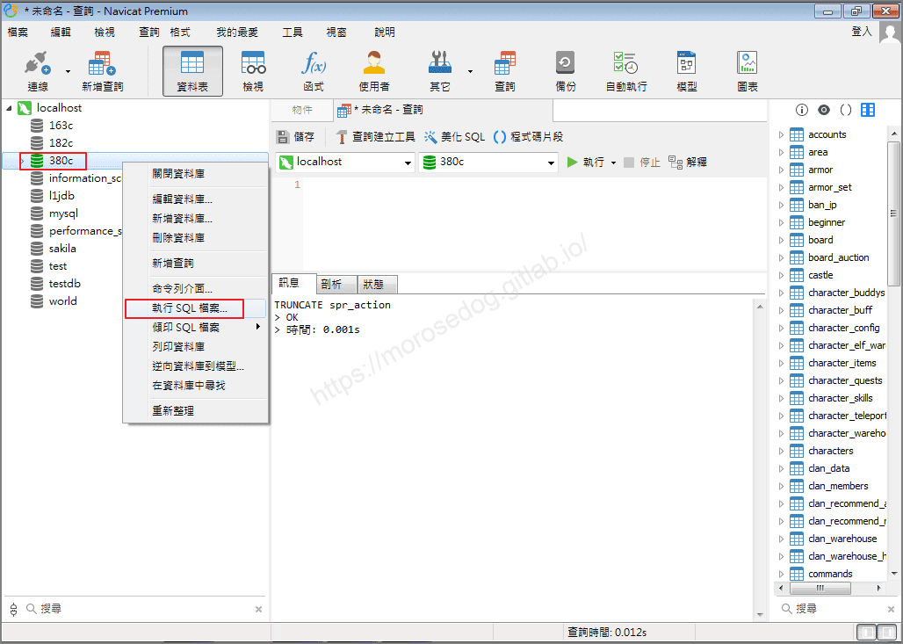
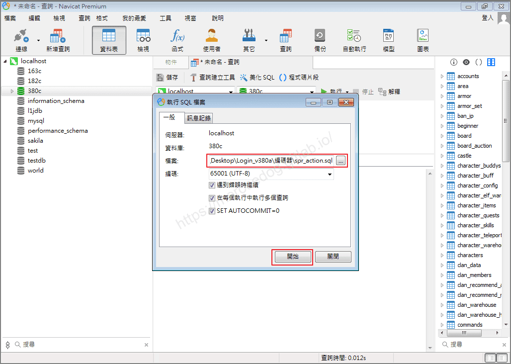
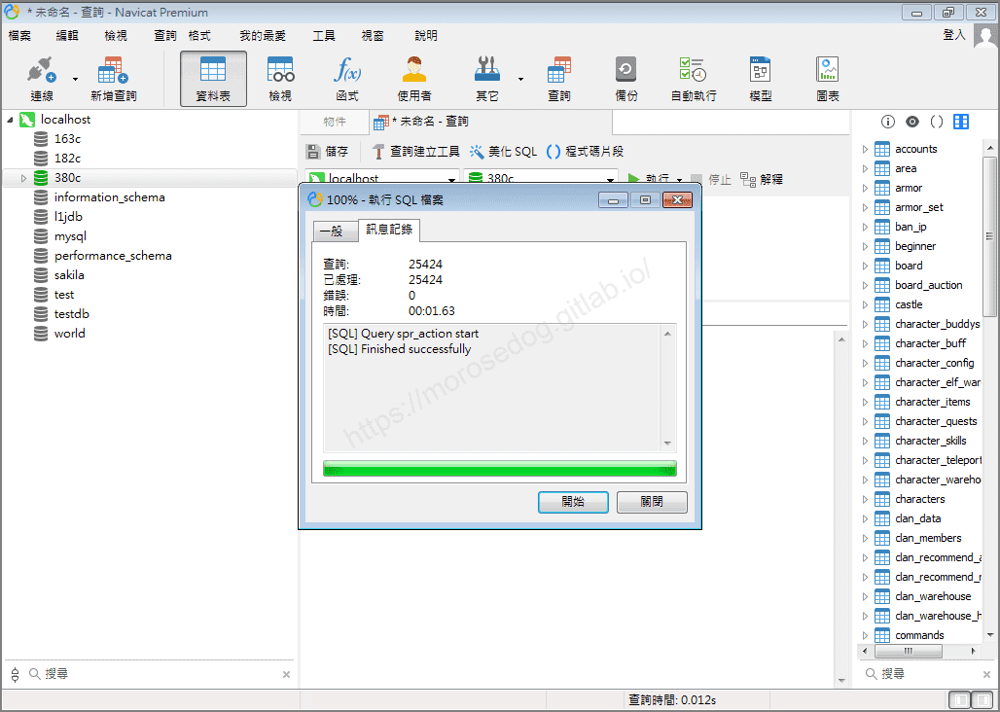

# 登入器的 spr_action 產生

# 天堂私服 | 登入器的 spr_action 產生

    
    
      📑 目錄
      

1. [章節用意](#章節用意)
2. [版本資訊](#版本資訊)
3. [前言](#前言)
4. [分析](#分析)
5. [注意](#注意)
6. [結語](#結語)
7. [免責聲明](#免責聲明)

    
    
    

## 章節用意

一般的模擬器依靠`spr_action`表資料，來做為判斷客戶端移動、攻擊速度、是否異常的檢查依據；而`spr_action`是透過變身檔內容做產生。
此章節將教學透過登入器中提供的`spr_action.exe`來產生`spr_action.sql`。

## 版本資訊

* **客戶端版本**

  * 天堂(Lineage 3.81C)

* **核心版本**

  * L1J-3.80c

* **登入器版本**  

  * L1J-3.80c

## 前言

在開始前，請務必先將以下文章閱讀與實際操作過。

* [變身檔新增修改<快速入門>](./103_變身檔新增修改&lt;快速入門&gt;.md)

* [客戶端、登入器與變身檔關係分析](./106_客戶端和登入器與變身檔關係分析.md)

<font color="red"><如有錯誤或是可以提供更詳細的說明，歡迎糾正與分享。></font>​‌‌‌​​​​​‌‌‌​​‌​​‌‌​‌​​‌​‌‌‌​‌‌​​‌‌​​​​‌​‌‌‌​‌​​​‌‌​​‌​‌​​‌​‌‌​‌​‌‌​‌‌​​​‌‌​‌​​‌​‌‌​‌‌‌​​‌‌​​‌​‌​‌‌​​​​‌​‌‌​​‌‌‌​‌‌​​‌​‌​​‌​‌‌​‌​​‌‌​​‌​​​‌‌​​​​​​‌‌​​‌​​​‌‌​​‌​​​‌‌​​​​​​‌‌​‌​‌​​‌‌​​​‌​​‌‌​‌​​​​‌​‌‌​‌​‌‌‌​​​​​‌‌‌​​‌​​‌‌​‌​​‌​‌‌‌​‌‌​​‌‌​​​​‌​‌‌‌​‌​​​‌‌​​‌​‌​​‌​‌‌​‌​‌‌​‌‌​​​‌‌​‌​​‌​‌‌​‌‌‌​​‌‌​​‌​‌​‌‌​​​​‌​‌‌​​‌‌‌​‌‌​​‌​‌​​‌​‌‌​‌​​‌‌​​​‌​​‌‌​​​​​​‌‌‌​​‌

## 分析

* 1.準備完成變身檔

  * 登入器提供的`TW13081901.txt`變身檔，不管是新增、修改、刪除…等等的操作，都要先完成並確認正常可以使用。

* 2.執行`spr_action.exe`產生`spr_action.sql`

  * 執行`編碼器`→`spr_action.exe`。


  * 點擊`運行`。

  * 瀏覽選擇編修完成的`TW13081901.txt`檔。


  * 產生完畢會跳出訊息室窗顯示`已產生spr_action.sql`。


  * 此時相同目錄下會看到已經產生`spr_action.sql`檔。


* 3.匯入`spr_action.sql`

  * 首先要清除`spr_action`表內的資料。

  * 可以透過`SQL`指令清除，亦可透過工具去做<以下提供指令與工具操作圖>。

```sql
TRUNCATE spr_action;
```



  * 在資料清除後，要匯入最新的變身檔對應的`spr_actrion`資料。

  * 右鍵點擊<380c>，選擇`執行 SQL 檔案...`。


  * 檔案選擇剛剛產生的`spr_actrion.sql`檔，請點擊開始。


  * 執行進度條…請等待執行完畢。

  * 執行完畢，應該無錯誤，請點擊`關閉`。


  * 至此`spr_actrion`已經更新完畢。

## 注意

1.每次只要有修改變身檔後，一定要確認變身檔可以正常使用、遊戲不會崩潰、動畫有正常顯示。
2.只要有修改變身檔後，建議都重新產生一次`spr_action`並做匯入
3.匯入`spr_action`時，建議一定要清除後再重新匯入。

## 結語

原創文章真的不易，希望多多支持，感謝。
最後建議回顧一下首章[天堂私服 | 天堂私服架設教學](/private-lineage-20210712-private-lineage-0/#教學章節)，了解其章節目錄。

## 免責聲明

* 本部落格文章中皆<font color="red"><u>**不提供**</u></font>任何所謂的遊戲「主程式」、「模擬器」、「登入器」…等等相關程式的下載點。

* 本部落格文章中所見之遊戲主程式和服務器端程序均來自網路發佈，<font color="red"><u>版本歸**原作者**</u>所有</font>。

* 本部落格文章為研究SQL資料庫與修改JAVA語法使用，<font color="red">並<u>**非商業用途**</u>，亦<u>**無做營運事實等任何一切商業行為**</u>。</font>

* 本部落格文章內容是為研究學習設計思想和原理為目的，<font color="red"><u>**絕沒有故意侵權或惡意抄襲、篡改其他遊戲內容**</u></font>！

---

- **原文連結**：[J.J.'s Blogs - 登入器的 spr_action 產生](https://morosedog.gitlab.io/private-lineage-20220514-private-lineage-109/)
