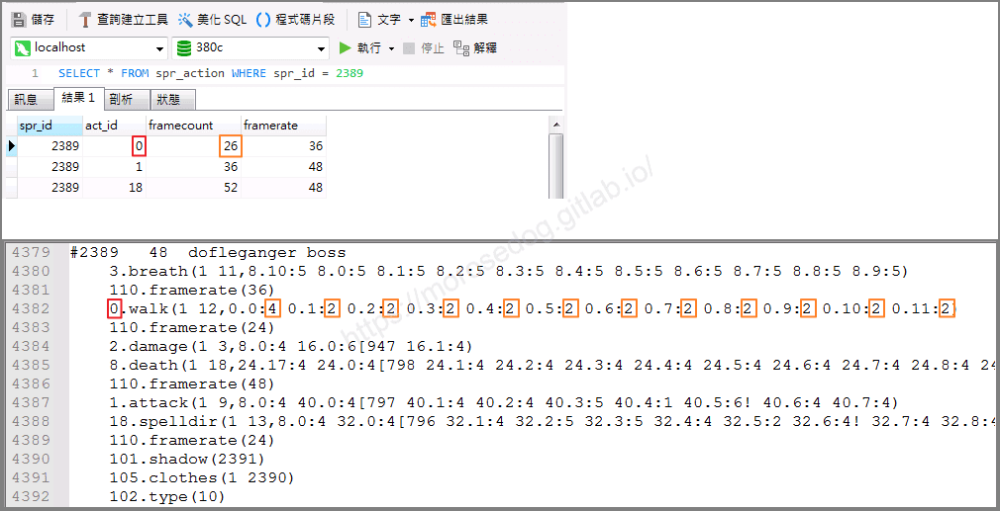
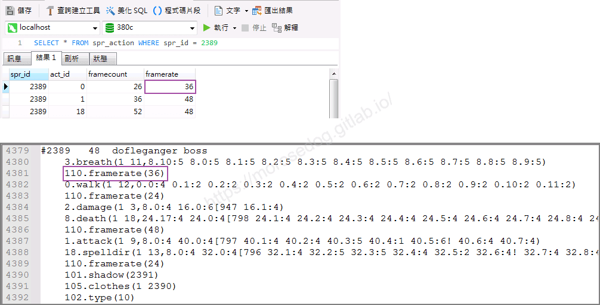

# 資料庫中 spr_action 分析

# 天堂私服 | 資料庫中 spr_action 分析

    
    
      📑 目錄
      

1. [章節用意](#章節用意)
2. [版本資訊](#版本資訊)
3. [前言](#前言)
4. [欄位](#欄位)
5. [分析](#分析)
6. [結論](#結論)
7. [結語](#結語)
8. [免責聲明](#免責聲明)

    
    
    

## 章節用意

在前一篇[登入器的 spr_action 產生](./109_登入器的_spr_action_產生.md)提到透過登入器中提供的`spr_action.exe`來產生`spr_action.sql`。
此章節將會簡單說明`spr_action`表中的欄位用途與產生規則。

## 版本資訊

* **客戶端版本**

  * 天堂(Lineage 3.81C)

* **核心版本**

  * L1J-3.80c

* **登入器版本**  

  * L1J-3.80c

## 前言

在開始前，請務必先將以下文章閱讀與實際操作過。

* [變身檔新增修改<快速入門>](./103_變身檔新增修改&lt;快速入門&gt;.md)

* [客戶端、登入器與變身檔關係分析](./106_客戶端和登入器與變身檔關係分析.md)

* [登入器的 spr_action 產生](./109_登入器的_spr_action_產生.md)

> 注意：深度的核心判斷方式並不會在此分析說明。​‌‌‌​​​​​‌‌‌​​‌​​‌‌​‌​​‌​‌‌‌​‌‌​​‌‌​​​​‌​‌‌‌​‌​​​‌‌​​‌​‌​​‌​‌‌​‌​‌‌​‌‌​​​‌‌​‌​​‌​‌‌​‌‌‌​​‌‌​​‌​‌​‌‌​​​​‌​‌‌​​‌‌‌​‌‌​​‌​‌​​‌​‌‌​‌​​‌‌​​‌​​​‌‌​​​​​​‌‌​​‌​​​‌‌​​‌​​​‌‌​​​​​​‌‌​‌​‌​​‌‌​​​‌​​‌‌​‌​‌​​‌​‌‌​‌​‌‌‌​​​​​‌‌‌​​‌​​‌‌​‌​​‌​‌‌‌​‌‌​​‌‌​​​​‌​‌‌‌​‌​​​‌‌​​‌​‌​​‌​‌‌​‌​‌‌​‌‌​​​‌‌​‌​​‌​‌‌​‌‌‌​​‌‌​​‌​‌​‌‌​​​​‌​‌‌​​‌‌‌​‌‌​​‌​‌​​‌​‌‌​‌​​‌‌​​​‌​​‌‌​​​‌​​‌‌​​​​

<font color="red"><如有錯誤或是可以提供更詳細的說明，歡迎糾正與分享。></font>

## 欄位

列出`spr_action`表中的所有欄位：

* `spr_action.spr_id`

  * 定義：變檔編號。

  * 說明：就是直接對應變身檔裡面的變身編號，像是`#362`，就是`362`。

* `spr_action.act_id`

  * 定義：變身擋內的編碼動作。

  * 說明：像是`0.walk → 空手走路動作`、`1.attack → 空手攻擊動作`。

* `spr_action.framecount`

  * 定義：幀數<圖片張數>。

  * 說明：這個`spr`內的圖，總花費單位時間。(1單位時間 = 1 / 24 秒)

* `spr_action.framerate`

  * 定義：幀率<圖片播放速度>。

  * 說明：Frame Rate（影格速率）則是顯示出這些圖像要用甚麼樣的速度播放，通常表示的單位為「每秒幀數」或「FPS」。每一張圖像都代表一幀，所以，如果以30 fps的速度播放影像，則代表每一秒鐘會顯示30張不同的靜止圖像。

> 註：以上有些東西看不懂沒關係，這邊先稍微看過，<u>關於這個教學在後面進階教學章節會再慢慢介紹</u>。​‌‌‌​​​​​‌‌‌​​‌​​‌‌​‌​​‌​‌‌‌​‌‌​​‌‌​​​​‌​‌‌‌​‌​​​‌‌​​‌​‌​​‌​‌‌​‌​‌‌​‌‌​​​‌‌​‌​​‌​‌‌​‌‌‌​​‌‌​​‌​‌​‌‌​​​​‌​‌‌​​‌‌‌​‌‌​​‌​‌​​‌​‌‌​‌​​‌‌​​‌​​​‌‌​​​​​​‌‌​​‌​​​‌‌​​‌​​​‌‌​​​​​​‌‌​‌​‌​​‌‌​​​‌​​‌‌​‌​‌​​‌​‌‌​‌​‌‌‌​​​​​‌‌‌​​‌​​‌‌​‌​​‌​‌‌‌​‌‌​​‌‌​​​​‌​‌‌‌​‌​​​‌‌​​‌​‌​​‌​‌‌​‌​‌‌​‌‌​​​‌‌​‌​​‌​‌‌​‌‌‌​​‌‌​​‌​‌​‌‌​​​​‌​‌‌​​‌‌‌​‌‌​​‌​‌​​‌​‌‌​‌​​‌‌​​​‌​​‌‌​​​‌​​‌‌​​​​

## 分析

* 哪些`act_id`(編碼動作)被加入？

  * 說明：核心內多數是只判斷`攻擊速度`、`施法速度`、`移動速度`是否異常，所以並不會把所有編碼列入，這邊來列出有被加入的編碼。

  * 分析：

    * 使用`SQL`語法列出有被加入的編碼。

```sql
SELECT act_id FROM spr_action GROUP BY act_id
```

    * 有下列這些編碼被加入。

```plain
0.walk                   ← 空手走路
1.attack                 ← 空手攻擊
4.walk sword             ← 單手劍走路
5.attack sword           ← 單手劍攻擊
11.walk axe              ← 斧頭走路
12.attack axe            ← 斧攻擊
17.wand                  ← 用變仗電仗
18.spell dir             ← 攻擊魔法
19.spell nodir           ← 輔助魔法
20.walk bow              ← 弓走路
21.attack bow            ← 弓攻擊
24.walk spear            ← 矛走路
25.attack spear          ← 矛攻擊
28.on                    ← 啟動（物件用指令）
29.off                   ← 關掉（物件用指令）
30.alt attack            ← 攻擊必殺技
31.spell direction extra ← 魔法必殺技
40.walk staff            ← 杖走路
41.attack staff          ← 杖攻擊
46.walk dagger           ← 匕首走路
47.attack dagger         ← 匕首攻擊
50.walk largesword       ← 雙手劍走路
51.attack largesword     ← 雙手劍攻擊
54.walk double sword     ← 雙刀走路
55.attack double sword   ← 雙刀攻擊
58.walk claw             ← 雙爪走路
59.attack claw           ← 雙爪攻擊
62.walk shuriken         ← 飛鏢走路
63.attack shuriken       ← 飛鏢攻擊
66.shop loop             ← 商店循環動作
67.act dual              ← 重複動作
```

    * 基本上就是針對不同武器的`走路`與`攻擊`還有`施放魔法`的動作和部分的編碼有加入表中。

* `framecount`(幀數<圖片張數>)是怎麼算的？

  * 說明：每個動作所使用的幀數<圖片張數>，是被設定在編碼內的，所以是可以通過計算出數量的。

  * 分析：

    * 此使用`變形怪首領`(#2389)的編碼來做說明。

    * 使用`SQL`語法，找尋出對應的資料。

```sql
SELECT * FROM spr_action WHERE spr_id = 2389
-- 2389	0	26	36
-- 2389	1	36	48
-- 2389	18	52	48
```

    * 根據上面搜尋的資料語編碼對應。

    * `act_id` = <font color="red">紅色框框</font>動作編碼。

    * `framecount` = <font color="orange">橘色框框</font>也就是`:`冒號後方的數字加總。<`4+2+2+2+2+2+2+2+2+2+2+2 = 26`>


* `framerate`幀率<圖片播放速度>是帶什麼值？

  * 說明：就是圖片的播放速度。

  * 分析：

    * `framerate` = <font color="Purple">紫色框框</font>此動作編碼是否有被配置加速編碼，如果沒有預設為`24`，而此上面有定義為`110.framerate(36)` = `36`。


* 最後動作編碼`1`和`18`，可以自己嘗試是看看是不是規則也是如此。

## 結論

* 基本上`spr_action`裡面的資料都是透過變身編碼去計算出來的。

* 核心判斷攻擊、移動、施法速度是否又異常就是透過這些資料判斷。

## 結語

原創文章真的不易，希望多多支持，感謝。
最後建議回顧一下首章[天堂私服 | 天堂私服架設教學](/private-lineage-20210712-private-lineage-0/#教學章節)，了解其章節目錄。

## 免責聲明

* 本部落格文章中皆<font color="red"><u>**不提供**</u></font>任何所謂的遊戲「主程式」、「模擬器」、「登入器」…等等相關程式的下載點。

* 本部落格文章中所見之遊戲主程式和服務器端程序均來自網路發佈，<font color="red"><u>版本歸**原作者**</u>所有</font>。

* 本部落格文章為研究SQL資料庫與修改JAVA語法使用，<font color="red">並<u>**非商業用途**</u>，亦<u>**無做營運事實等任何一切商業行為**</u>。</font>

* 本部落格文章內容是為研究學習設計思想和原理為目的，<font color="red"><u>**絕沒有故意侵權或惡意抄襲、篡改其他遊戲內容**</u></font>！

> 註：以上參考了
> [My Entry for Andymation’s Flipbook Fest 2022!](https://www.youtube.com/watch?v=EJaychqNvhc)
> [【老師有問題】甚麼是Frame Rate（影格速率）？（9/52）](https://www.yottau.com.tw/article/836)

---

- **原文連結**：[J.J.'s Blogs - 資料庫中 spr_action 分析](https://morosedog.gitlab.io/private-lineage-20220515-private-lineage-110/)
