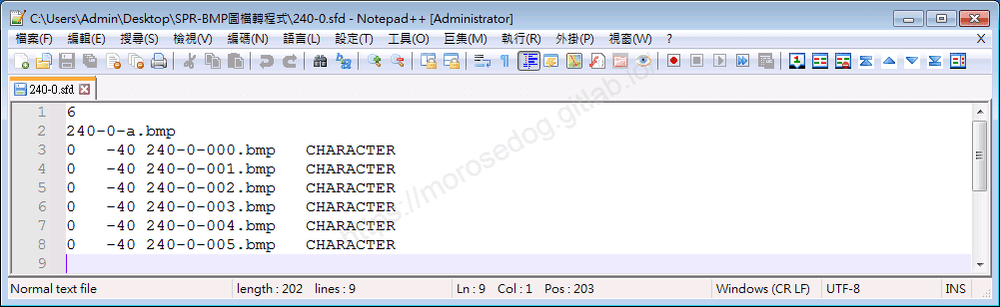
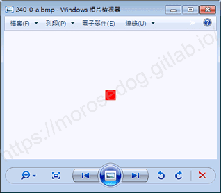
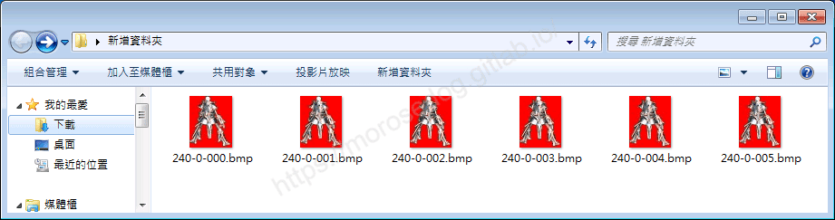
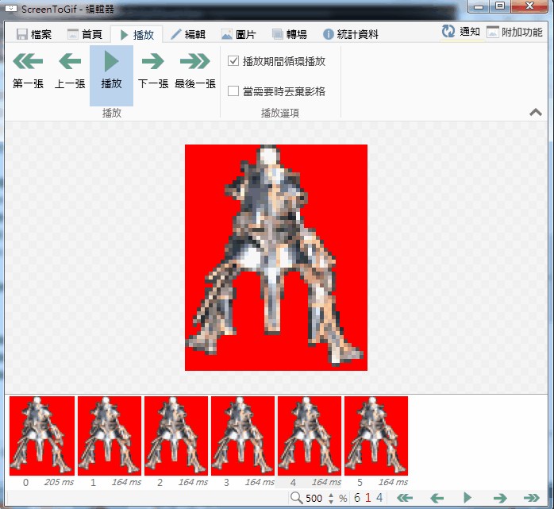

# 動畫圖檔 spr 基礎了解說明

# 天堂私服 | 動畫圖檔 spr 基礎了解說明

    
    
      📑 目錄
      

1. [章節用意](#章節用意)
2. [SPR 是什麼？](#SPR-是什麼？)
3. [解析](#解析)
4. [結論](#結論)
5. [結語](#結語)
6. [免責聲明](#免責聲明)

    
    
    

## 章節用意

針對`spr`副檔名的檔案做一個簡單的認識與了解，在後面對變身檔的學習與修改上會有一定的幫助。

## SPR 是什麼？

* SPR文件摘要：

  * 我們有三個與`SPR`文件相關的已知軟體程式(通常是由`Valve`開發的稱為`Half-Life`的軟體)，它們可以歸類為二種主文件類型。

  * 通常，這些文件被視為`Half-Life Sprite File`格式。

  * 這些文件分為`Raster Image Files`或`Executable Files`。

  * 在大多數情況下，這些文件屬於`Raster Image Files`。

  * `Windows`與`Linux`支持文件擴展名`SPR`。

  * 這些類型的文件主要可以在桌面設備上與某些移動設備上找到。

  * `SPR`文件普及性為“低”。這意味著它們在大多數設備上都不常見。

> 以上擷取於[什麼是 SPR 文件？](https://www.solvusoft.com/zh-tw/file-extensions/file-extension-spr/)文章中內容：

## 解析

此處無法對`spr`檔有太多的定義，畢竟自身非專業，僅能用自己的理解方式去做解釋：​‌‌‌​​​​​‌‌‌​​‌​​‌‌​‌​​‌​‌‌‌​‌‌​​‌‌​​​​‌​‌‌‌​‌​​​‌‌​​‌​‌​​‌​‌‌​‌​‌‌​‌‌​​​‌‌​‌​​‌​‌‌​‌‌‌​​‌‌​​‌​‌​‌‌​​​​‌​‌‌​​‌‌‌​‌‌​​‌​‌​​‌​‌‌​‌​​‌‌​​‌​​​‌‌​​​​​​‌‌​​‌​​​‌‌​​‌​​​‌‌​​​​​​‌‌​‌​‌​​‌‌​​​‌​​‌‌​‌‌​​​‌​‌‌​‌​‌‌‌​​​​​‌‌‌​​‌​​‌‌​‌​​‌​‌‌‌​‌‌​​‌‌​​​​‌​‌‌‌​‌​​​‌‌​​‌​‌​​‌​‌‌​‌​‌‌​‌‌​​​‌‌​‌​​‌​‌‌​‌‌‌​​‌‌​​‌​‌​‌‌​​​​‌​‌‌​​‌‌‌​‌‌​​‌​‌​​‌​‌‌​‌​​‌‌​​​‌​​‌‌​​​‌​​‌‌​​​‌

* 1.使用抽檔程式抽檔：  

  * 使用抽檔工具去看`240-0.spr`，此為死騎的其中一個面向的呼吸動畫圖。

* 2.使用SPR轉BMP工具轉檔：

  * 使用[SPR-BMP互轉 工具(SPR↔BMP)](../07_Developer_Tools/087_SPR-BMP互轉_工具(SPR↔BMP).md)，將`240-0.spr`轉檔。

  * 可以發現轉出了下列這些檔：

```plain
240-0.sfd
240-0-000.bmp
240-0-001.bmp
240-0-002.bmp
240-0-003.bmp
240-0-004.bmp
240-0-005.bmp
240-0-a.bmp
```

  * 根據這些檔案去做分析。

---

  * `sfd`內容如下：

    * 可見第一行是說明總共六張圖。

    * 第二行是要表示透明的底色。<舉例：背景色為紅色，那在客戶端內紅色的部分表示透明>

    * 第三至八行是六張圖片的定義`X,Y`軸偏移位置。


---

  * 首先觀察`240-0-a.bmp`，這邊是紅色的一個點。<下方圖片已經放大，不然看不到那個點>


  * 在觀察`240-0-000.bmp ~ 240-0-005.bmp`，圖片只有些微的差異。<因為是靜止不動的呼吸動畫圖>


  * 這一個`spr`檔其實是由多六張圖檔(`240-0-000.bmp ~ 240-0-005.bmp`)去組合而成的，`240-0-a.bmp`這張圖請的顏色是要定義要透明的顏色。

  * 可以把`spr`當成一個圖檔的集合，但是他並沒有像是`gif`圖會自動輪播。

  * 他是透過變身檔的編碼定義去設定的播放的單位時間。

  * 這邊大概解說一下這段`#240`的`3.Breath`編碼。

---

```xml
#240  64      Death Knight        3.Breath(1 6,0.0:5 0.1:4 0.2:4 0.3:4 0.4:4 0.5:4)
```

  * `1 6`

    * `1`：表示有方向性，反之`0`無方向性。

    * `6`：使用`圖片`總數。

> 註：這個`6`就是剛剛解出來的`6`張`bmp`圖的意思。

  * `0.0:5`

    * `0.0`：表示為`240-0.spr`中的`240-0-000.bmp`圖片。

    * `:5`：表示`240-0-000.bmp`圖片，需要花費`5`單位時間(`1`單位時間 = `1 / 24` 秒)

  * `0.1:4`

    * `0.1`：表示為`240-0.spr`中的`240-0-001.bmp`圖片。

    * `:4`：表示`240-0-001.bmp`圖片，需要花費`4`單位時間(`1`單位時間 = `1 / 24` 秒)

  * `0.2:4`

    * `0.2`：表示為`240-0.spr`中的`240-0-002.bmp`圖片。

    * `:4`：表示`240-0-002.bmp`圖片，需要花費`4`單位時間(`1`單位時間 = `1 / 24` 秒)

  * `0.3:4`

    * `0.3`：表示為`240-0.spr`中的`240-0-003.bmp`圖片。

    * `:4`：表示`240-0-003.bmp`圖片，需要花費`4`單位時間(`1`單位時間 = `1 / 24` 秒)

  * `0.4:4`

    * `0.4`：表示為`240-0.spr`中的`240-0-004.bmp`圖片。

    * `:4`：表示`240-0-004.bmp`圖片，需要花費`4`單位時間(`1`單位時間 = `1 / 24` 秒)

  * `0.5:4`

    * `0.5`：表示為`240-0.spr`中的`240-0-005.bmp`圖片。

    * `:4`：表示`240-0-005.bmp`圖片，需要花費`4`單位時間(`1`單位時間 = `1 / 24` 秒)

---

  * 如果依照上面的設定去輪播，就是完整的一個`死亡騎士`呼吸的動作循環。

  * 以下用`gif`圖片的製作軟體去做一格呈現，死亡騎士在遊戲畫面內就會如此的呼吸。


## 結論

以下大概可以這樣定義：

* `spr`檔，就是多張圖檔的一個集合，並且有定義總圖片數量、圖片的偏移量。

* `spr`的每張的播放時間，是透過變身檔編碼去定義單位時間。

## 結語

原創文章真的不易，希望多多支持，感謝。
最後建議回顧一下首章[天堂私服 | 天堂私服架設教學](/private-lineage-20210712-private-lineage-0/#教學章節)，了解其章節目錄。​‌‌‌​​​​​‌‌‌​​‌​​‌‌​‌​​‌​‌‌‌​‌‌​​‌‌​​​​‌​‌‌‌​‌​​​‌‌​​‌​‌​​‌​‌‌​‌​‌‌​‌‌​​​‌‌​‌​​‌​‌‌​‌‌‌​​‌‌​​‌​‌​‌‌​​​​‌​‌‌​​‌‌‌​‌‌​​‌​‌​​‌​‌‌​‌​​‌‌​​‌​​​‌‌​​​​​​‌‌​​‌​​​‌‌​​‌​​​‌‌​​​​​​‌‌​‌​‌​​‌‌​​​‌​​‌‌​‌‌​​​‌​‌‌​‌​‌‌‌​​​​​‌‌‌​​‌​​‌‌​‌​​‌​‌‌‌​‌‌​​‌‌​​​​‌​‌‌‌​‌​​​‌‌​​‌​‌​​‌​‌‌​‌​‌‌​‌‌​​​‌‌​‌​​‌​‌‌​‌‌‌​​‌‌​​‌​‌​‌‌​​​​‌​‌‌​​‌‌‌​‌‌​​‌​‌​​‌​‌‌​‌​​‌‌​​​‌​​‌‌​​​‌​​‌‌​​​‌

## 免責聲明

* 本部落格文章中皆<font color="red"><u>**不提供**</u></font>任何所謂的遊戲「主程式」、「模擬器」、「登入器」…等等相關程式的下載點。

* 本部落格文章中所見之遊戲主程式和服務器端程序均來自網路發佈，<font color="red"><u>版本歸**原作者**</u>所有</font>。

* 本部落格文章為研究SQL資料庫與修改JAVA語法使用，<font color="red">並<u>**非商業用途**</u>，亦<u>**無做營運事實等任何一切商業行為**</u>。</font>

* 本部落格文章內容是為研究學習設計思想和原理為目的，<font color="red"><u>**絕沒有故意侵權或惡意抄襲、篡改其他遊戲內容**</u></font>！

---

- **原文連結**：[J.J.'s Blogs - 動畫圖檔 spr 基礎了解說明](https://morosedog.gitlab.io/private-lineage-20220516-private-lineage-111/)
