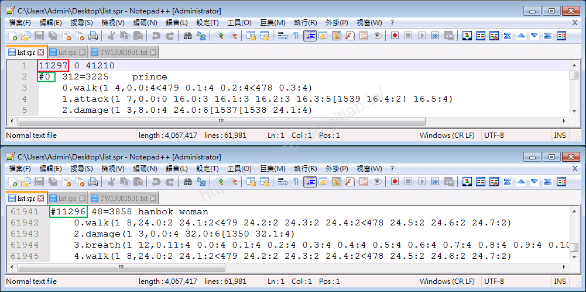
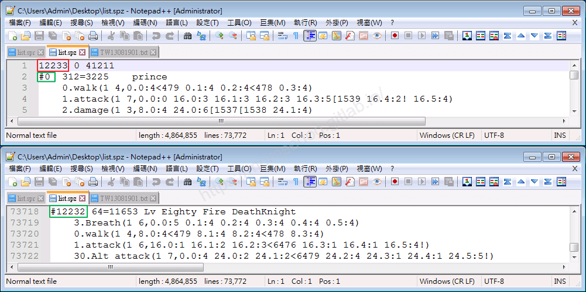
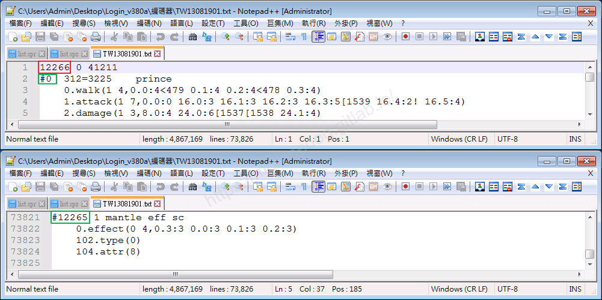
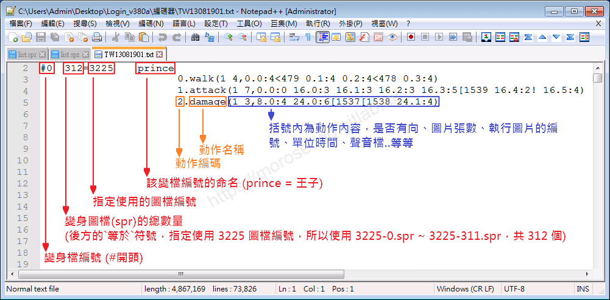
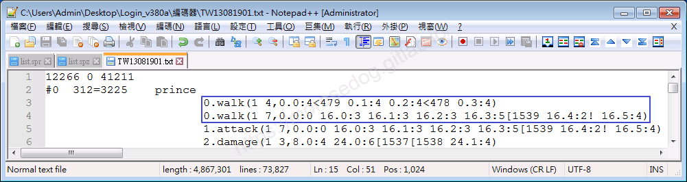
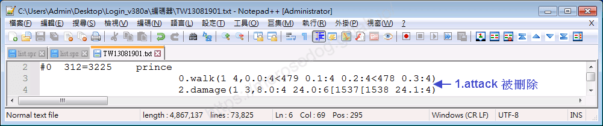
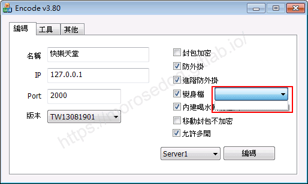
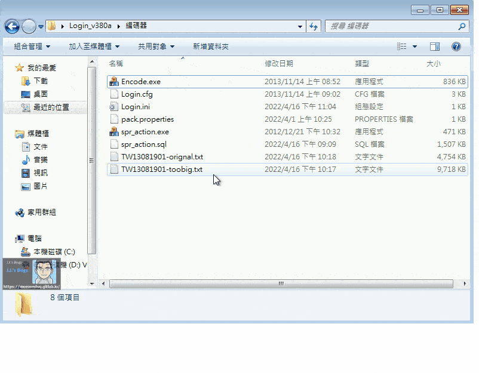

# 變身檔-初步說明與規則

# 天堂私服 | 變身檔-初步說明與規則

    
    
      📑 目錄
      

1. [章節用意](#章節用意)
2. [版本資訊](#版本資訊)
3. [前言](#前言)
4. [基礎與規則](#基礎與規則)
5. [變身檔編碼數量、檔案過大問題](#變身檔編碼數量、檔案過大問題)
6. [結語](#結語)
7. [免責聲明](#免責聲明)

    
    
    

## 章節用意

初期就先針對變身檔基礎規格、編碼規格、打包的規則舉例與說明，在往後的路上可以少採點坑；另外有提供變身檔編碼數量、檔案過大問題的一個解決方案教學。

## 版本資訊

* **客戶端版本**

  * 天堂(Lineage 3.81C)

* **核心版本**

  * L1J-3.80c

* **登入器版本**  

  * L1J-3.80c

## 前言

在開始前，請務必先將以下文章閱讀與實際操作過。

* [變身檔新增修改<快速入門>](./103_變身檔新增修改&lt;快速入門&gt;.md)

* [客戶端、登入器與變身檔關係分析](./106_客戶端和登入器與變身檔關係分析.md)

## 基礎與規則

在[客戶端、登入器與變身檔關係分析](./106_客戶端和登入器與變身檔關係分析.md)這篇文章中可以了解到總共會有三個變身檔編碼檔：​‌‌‌​​​​​‌‌‌​​‌​​‌‌​‌​​‌​‌‌‌​‌‌​​‌‌​​​​‌​‌‌‌​‌​​​‌‌​​‌​‌​​‌​‌‌​‌​‌‌​‌‌​​​‌‌​‌​​‌​‌‌​‌‌‌​​‌‌​​‌​‌​‌‌​​​​‌​‌‌​​‌‌‌​‌‌​​‌​‌​​‌​‌‌​‌​​‌‌​​‌​​​‌‌​​​​​​‌‌​​‌​​​‌‌​​‌​​​‌‌​​​​​​‌‌​‌​‌​​‌‌​​​‌​​‌‌​‌‌‌​​‌​‌‌​‌​‌‌‌​​​​​‌‌‌​​‌​​‌‌​‌​​‌​‌‌‌​‌‌​​‌‌​​​​‌​‌‌‌​‌​​​‌‌​​‌​‌​​‌​‌‌​‌​‌‌​‌‌​​​‌‌​‌​​‌​‌‌​‌‌‌​​‌‌​​‌​‌​‌‌​​​​‌​‌‌​​‌‌‌​‌‌​​‌​‌​​‌​‌‌​‌​​‌‌​​​‌​​‌‌​​​‌​​‌‌​​‌​

```plain
list.spr
list.spz
TW13081901.txt      <ps:因版本不同檔名可能不一樣>
```

* **變身檔編碼的數量**

  * <font color="green">**<說明>**</font>：

    * 觀察到變身檔的第一行第一個數字，其數字就表示變身檔編碼的總數量。(後面兩個數字暫時不知用途)

    * `list.spr`如下，可以看到<font color="red">**紅框**</font>數字為`11297`，則表示變身檔編碼是<font color="green">**綠框**</font>`#0`~`#11296`，共`11297`個。


    * `list.spz`如下，可以看到<font color="red">**紅框**</font>數字為`12233`，則表示變身檔編碼是<font color="green">**綠框**</font>`#0`~`#12232`，共`12233`個。


    * `TW13081901.txt`如下，可以看到<font color="red">**紅框**</font>數字為`12266`，則表示變身檔編碼是<font color="green">**綠框**</font>`#0`~`#12265`，共`12266`個。


  * <font color="blue">**<規則>**</font>：

    1. 新增大於總數量的編碼，必須要調整第一個的第一個總數量。

    * 舉例：新增`#20000`的變身編號，那第一行的總數量就要改成`20001`。

    1. 總數量變更大後，<font color="red">**中間缺少的編碼都必須補齊，不能遺漏**</font>。

    * 舉例：將總數量從`11297`變更為`20001`，但是目前最後的編碼只有編到`#11296`，需補`#11297`~`#20000`的編碼

```plain
#11297 2        dummy               102.type(0)
#11298 2        dummy               102.type(0)
#11299 2        dummy               102.type(0)
#11300 2        dummy               102.type(0)
...............中間省略，務必補齊...............
#20000 2        dummy               102.type(0)
```

* **變身檔編碼的格式**

  * <font color="green">**<說明>**</font>：

    * 請直接參考以下圖片說明。


  * <font color="blue">**<規則>**</font>：

    1. `動作編碼 + 動作名稱`是不能重複出現在同一個變身編號的編碼內。

    * 舉例：兩個`0.walk`，後面括號內的`動作內容`是<font color="red">**不一樣**</font>的，登入遊戲後就會`Lineage 已經停止運作`。


> 註：如果內容完全一樣是不會有錯誤。

    1. 所有的`動作編號`只要原始的檔案裡有的全都可以加以修改，但是<font color="red">**不可以刪除**</font>。

    * 舉例：將`1.attack`移除，可以正常登入遊戲，但是人物無法`空手攻擊`。


* **變身檔編碼的打包**

  * <font color="green">**<說明>**</font>：

    * `list.spz`，此檔是不需要打包的，只是要記得加密再吃檔回去。

    * `TW13081901.txt`，此檔是透過`登入器`裡面的`編碼器`去做變身檔打包(`.pak`)檔。

  * <font color="blue">**<規則>**</font>：

    1. `list.spz`沒有變身編號數量和檔案大小限制。

    * 舉例：`list.spz`編碼總數量到`30000`，檔案大小到`57.1 MB`，正常吃檔正常變身`#29999`的變身。

    1. 登入器變身檔編碼打包，理論上也是沒有變身編號數量和檔案大小限制。
<font color="red">但！打包的`.pak`檔太大，在做`Login.ini`編碼的時候，會無法選擇`.pak`檔</font>。

    * 舉例：`TW13081901.txt`編碼總數量到`21000`，檔案大小到`9.48 MB`，打包成`.pak`後，造成變身檔無法選擇`.pak`檔。


> 註：解決辦法在下面會介紹並教學使用。

## 變身檔編碼數量、檔案過大問題

情境：
將`TW13081901.txt`編碼總數量到`21000`，檔案大小到`9.48 MB`，最後一個`#20999`編號 = 2468圖檔(賽尼斯)。​‌‌‌​​​​​‌‌‌​​‌​​‌‌​‌​​‌​‌‌‌​‌‌​​‌‌​​​​‌​‌‌‌​‌​​​‌‌​​‌​‌​​‌​‌‌​‌​‌‌​‌‌​​​‌‌​‌​​‌​‌‌​‌‌‌​​‌‌​​‌​‌​‌‌​​​​‌​‌‌​​‌‌‌​‌‌​​‌​‌​​‌​‌‌​‌​​‌‌​​‌​​​‌‌​​​​​​‌‌​​‌​​​‌‌​​‌​​​‌‌​​​​​​‌‌​‌​‌​​‌‌​​​‌​​‌‌​‌‌‌​​‌​‌‌​‌​‌‌‌​​​​​‌‌‌​​‌​​‌‌​‌​​‌​‌‌‌​‌‌​​‌‌​​​​‌​‌‌‌​‌​​​‌‌​​‌​‌​​‌​‌‌​‌​‌‌​‌‌​​​‌‌​‌​​‌​‌‌​‌‌‌​​‌‌​​‌​‌​‌‌​​​​‌​‌‌​​‌‌‌​‌‌​​‌​‌​​‌​‌‌​‌​​‌‌​​​‌​​‌‌​​​‌​​‌‌​​‌​

準備：

* 原始的`TW13081901-original.txt`

* 編輯後`TW13081901-toobig.txt`  (就是無法選擇的過大編碼)

<font color="red">注意：以下操作過程中`Encode v3.80`視窗絕對不能關閉。</font>

1. 如果已經有`TW13081901.pak`請先刪除。

2. 將原始的`TW13081901-original.txt`，改名為`TW13081901.txt`。

3. 點擊`Encode.exe` → `工具`頁籤 → `變檔編碼`按鈕，打包成`TW13081901.pak`。

4. 繼續點選切換至`編碼`頁籤畫面 → 變身檔打勾並選`TW13081901.pak`。<其他的設定請自行勾選與設定>

5. 此時再將`TW13081901.txt`，改名回`TW13081901-original.txt`。

6. 再編輯後`TW13081901-toobig.txt`，改名為`TW13081901.txt`。

7. 回到`Encode v3.80`視窗 → `工具`頁籤 → `變檔編碼`按鈕，再次打包`TW13081901.pak`。

8. 繼續點選切換至`編碼`頁籤畫面 - `編碼`按鈕。

9. 複製`Login.ini`與`TW13081901.pak`檔案，覆蓋至客戶端下。

10. 務必重新登入遊戲，使用`.poly 線上GM 20999`變身。


以上解法由<font color="red">`Linhelper論壇`</font>的會員”<font color="blue"><u>天堂同好</u></font>“成員提供的資訊，**非常感謝**。​‌‌‌​​​​​‌‌‌​​‌​​‌‌​‌​​‌​‌‌‌​‌‌​​‌‌​​​​‌​‌‌‌​‌​​​‌‌​​‌​‌​​‌​‌‌​‌​‌‌​‌‌​​​‌‌​‌​​‌​‌‌​‌‌‌​​‌‌​​‌​‌​‌‌​​​​‌​‌‌​​‌‌‌​‌‌​​‌​‌​​‌​‌‌​‌​​‌‌​​‌​​​‌‌​​​​​​‌‌​​‌​​​‌‌​​‌​​​‌‌​​​​​​‌‌​‌​‌​​‌‌​​​‌​​‌‌​‌‌‌​​‌​‌‌​‌​‌‌‌​​​​​‌‌‌​​‌​​‌‌​‌​​‌​‌‌‌​‌‌​​‌‌​​​​‌​‌‌‌​‌​​​‌‌​​‌​‌​​‌​‌‌​‌​‌‌​‌‌​​​‌‌​‌​​‌​‌‌​‌‌‌​​‌‌​​‌​‌​‌‌​​​​‌​‌‌​​‌‌‌​‌‌​​‌​‌​​‌​‌‌​‌​​‌‌​​​‌​​‌‌​​​‌​​‌‌​​‌​

## 結語

原創文章真的不易，希望多多支持，感謝。
最後建議回顧一下首章[天堂私服 | 天堂私服架設教學](/private-lineage-20210712-private-lineage-0/#教學章節)，了解其章節目錄。

## 免責聲明

* 本部落格文章中皆<font color="red"><u>**不提供**</u></font>任何所謂的遊戲「主程式」、「模擬器」、「登入器」…等等相關程式的下載點。

* 本部落格文章中所見之遊戲主程式和服務器端程序均來自網路發佈，<font color="red"><u>版本歸**原作者**</u>所有</font>。

* 本部落格文章為研究SQL資料庫與修改JAVA語法使用，<font color="red">並<u>**非商業用途**</u>，亦<u>**無做營運事實等任何一切商業行為**</u>。</font>

* 本部落格文章內容是為研究學習設計思想和原理為目的，<font color="red"><u>**絕沒有故意侵權或惡意抄襲、篡改其他遊戲內容**</u></font>！

---

- **原文連結**：[J.J.'s Blogs - 變身檔-初步說明與規則](https://morosedog.gitlab.io/private-lineage-20220517-private-lineage-112/)
