# 變身檔-格式與編碼基礎

# 天堂私服 | 變身檔-格式與編碼基礎

    
    
      📑 目錄
      

1. [章節用意](#章節用意)
2. [版本資訊](#版本資訊)
3. [前言](#前言)
4. [教學](#教學)
5. [結語](#結語)
6. [免責聲明](#免責聲明)

    
    
    

## 章節用意

此章將會提供動作編碼清單(目前網路上整理)，並且針對動作編碼的內容做詳細的講解教學。

## 版本資訊

* **客戶端版本**

  * 天堂(Lineage 3.81C)

* **核心版本**

  * L1J-3.80c

* **登入器版本**  

  * L1J-3.80c

## 前言

在開始前，請務必先將以下文章閱讀與實際操作過。

* [變身檔新增修改<快速入門>](./103_變身檔新增修改&lt;快速入門&gt;.md)

* [客戶端、登入器與變身檔關係分析](./106_客戶端和登入器與變身檔關係分析.md)

* [變身檔-初步說明與規則](./112_變身檔-初步說明與規則.md)

## 教學

* 在[變身檔-初步說明與規則](./112_變身檔-初步說明與規則.md)基本上已經提到：

  * `變身檔編碼的數量`

  * `變身檔編碼的格式`

* 以下將會針對`變身檔編碼的格式`的`動作內容`做更詳細的教學。
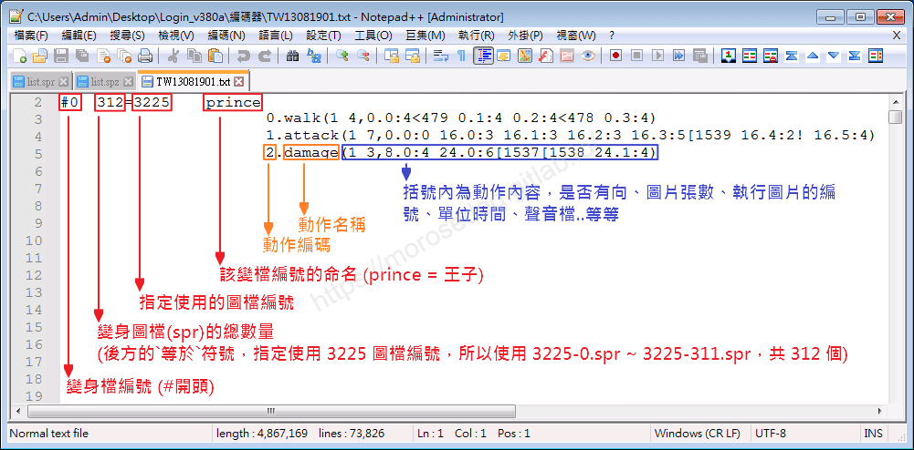

* 首先提供`動作編碼/動作名稱說明-清單`，並非代表全部。

> 註：避免版面占幅太大，使用下面的方式提供，<font color="green">**在<u>未展開</u>的狀態下，依舊可以使用<`Ctrl + F`搜尋>功能找關鍵字**</font>。​‌‌‌​​​​​‌‌‌​​‌​​‌‌​‌​​‌​‌‌‌​‌‌​​‌‌​​​​‌​‌‌‌​‌​​​‌‌​​‌​‌​​‌​‌‌​‌​‌‌​‌‌​​​‌‌​‌​​‌​‌‌​‌‌‌​​‌‌​​‌​‌​‌‌​​​​‌​‌‌​​‌‌‌​‌‌​​‌​‌​​‌​‌‌​‌​​‌‌​​‌​​​‌‌​​​​​​‌‌​​‌​​​‌‌​​‌​​​‌‌​​​​​​‌‌​‌​‌​​‌‌​​​‌​​‌‌‌​​​​​‌​‌‌​‌​‌‌‌​​​​​‌‌‌​​‌​​‌‌​‌​​‌​‌‌‌​‌‌​​‌‌​​​​‌​‌‌‌​‌​​​‌‌​​‌​‌​​‌​‌‌​‌​‌‌​‌‌​​​‌‌​‌​​‌​‌‌​‌‌‌​​‌‌​​‌​‌​‌‌​​​​‌​‌‌​​‌‌‌​‌‌​​‌​‌​​‌​‌‌​‌​​‌‌​​​‌​​‌‌​​​‌​​‌‌​​‌‌

* 【動作編碼/動作名稱說明-清單】<font color="red">**<點擊開合>**</font>
  

```plain
編號.動作說明(英文)         ← 動作說明(中文)
------------------------------------------
0.sign                     → 符號(物件用指令)
0.attack                   → 攻擊
0.particle                 → 粒子
0.fire                     → 特效(魔法等特效的動作，可呼叫)
0.move                     → 移動
0.walk                     → 空手走路動作
1.attack                   → 空手攻擊動作
2.damage                   → 空手被打動作
3.Breath                   → 呼吸動作
3.idle                     → 工作
3.animation                → 動畫
3.breath one               → 呼吸
4.walk sword               → 拿劍走路動作
4.walksky                  → 空中移動
5.attack sword             → 拿劍攻擊動作
6.damage sword             → 拿劍被打動作
7.Breath Sword             → 拿劍呼吸
7.breathsky                → 空中呼吸
8.death                    → 死亡動作
9.breath two               → 呼吸
11.hide                    → 隱藏
11.walk axe                → 拿斧頭走路動作
11.damagereactionreturn    → 損傷反應返回
12.attack axe              → 拿斧頭攻擊動作
13.damage axe              → 拿斧頭被打動作
13.hide damage             → 隱藏被打
14.Breath Axe              → 拿斧呼吸
14.hide breath             → 隱藏呼吸
15.get                     → 撿古
16.throw                   → 投擲
17.wand                    → 用變仗電仗
18.spell dir               → 攻擊魔法
19.spell nodir             → 輔助魔法
20.walk bow                → 拿弓走路動作
21.attack bow              → 拿弓攻擊動作
22.damage bow              → 拿弓被打動作
23.Breath Bow              → 拿弓呼吸
24.walk spear              → 拿茅走路動作
25.attack spear            → 拿茅攻擊動作
26.damage spear            → 拿茅被打動作
27.Breath Spear            → 拿矛呼吸
28.on                      → 啟動(物件用指令)
29.off                     → 關掉(物件用指令)
28.open                    → 打開(物件用指令)
29.close                   → 關閉(物件用指令)
28.south                   → 南(物件用指令)
29.west                    → 西(物件用指令)
30.alt attack              → 攻擊必殺技
31.spell direction extra   → 魔法必殺技
32.stateone                → 塔(物件用指令)
33.statetwo                → 破壞塔(物件用指令)
34.statethree              → 破壞塔(物件用指令)
35.statefour               → 破壞塔(物件用指令)
32.dooraction              → 城門(物件用指令)
33.dooraction              → 破壞城門(物件用指令)
34.dooraction              → 破壞城門(物件用指令)
35.dooraction              → 破壞城門(物件用指令)
36.dooraction              → 破壞城門(物件用指令)
37.dooraction              → 破壞城門(物件用指令)
40.walk staff              → 拿仗走路動作
41.attack staff            → 拿仗攻擊動作
42.damage staff            → 拿仗被打動作
43.Breath staff            → 拿杖呼吸
44.moveup                  → 飛向天空
45.movedown                → 降落
46.walk dagger             → 拿匕首走路動作
47.attack dagger           → 拿匕首攻擊動作
48.damage dagger           → 拿匕首被打動作
49.breath dagger           → 拿匕首站立動作
50.walk largesword         → 拿雙手劍走路動作
51.attack largesword       → 拿雙手劍攻擊動作
52.damage largesword       → 拿雙手劍被打動作
53.breath largesword       → 拿雙手劍站立動作
54.walk double sword       → 雙刀走路動作
55.attack double sword     → 雙刀攻擊動作
56.damage double sword     → 雙刀被打動作
57.breath double sword     → 雙刀站立動作
58.walk claw               → 拿爪走路動作(目前在新職業中發現)
59.attack claw             → 拿爪攻擊動作
60.damage claw             → 破損爪
61.breath claw             → 拿爪站立動作
62.walk shuriken           → 持飛鏢走路動作
63.attack shuriken         → 持飛鏢攻擊動作
64.damage shuriken         → 持飛鏢被打動作
65.breath shuriken         → 持飛鏢站立動作
66.attack                  → 攻擊
66.motionone               → 動感1
66.act happy               → 動作 快樂
67.motiontwo               → 動感2
67.attack                  → 攻擊
67.act angry               → 動作 生氣
68.Alt attack              → Alt 攻擊
68.act sad                 → 動作 傷心
69.Alt attack              → Alt 攻擊
69.act joy                 → 動作 喜悅
70.act shop                → 動作商店
71.fishing                 → 釣魚
72.alt attack              → Alt 攻擊
73.alt attack onehandsword → Alt 進攻單刀
74.alt attack axe          → Alt 進攻斧頭
75.alt attack bow          → Alt 進攻弓
76.alt attack spear        → Alt 進攻矛
77.alt attack staff        → Alt 進攻人員
78.alt attack dagger       → Alt 進攻匕首
79.alt attack largesword   → Alt 進攻雙手劍
80.alt attack double sword → Alt 進攻雙刀
81.alt attack claw         → Alt 進攻雙爪
82.alt attack shuriken     → Alt 進攻手裡劍
83.walk chainsword         → 走路鎖鏈劍
84.attack chainsword       → 攻擊鎖鏈劍
85.damage chainsword       → 被打鎖鏈劍
86.breath chainsword       → 呼吸鎖鏈劍
100.switch                 → 開關控制
101.shadow(XXX)            → 影子圖(代號)
102.type(X)                → 物件分辨
104.attr(X)                → 濾鏡效果
105.clothes(X X)           → 附加物件
106.weapon(@ # $ % &)      → 武器
107.size(X X)              → 體型
108.flying type(X)         → 飛行模式
109.effect(X X)            → 魔法造成效果
110.framerate(X)           → 加速指令
111.stride(1)              → 跳畫格移動
```

* 開始詳細解說括號的動作內容<此處使用<font color="blue">**騎士#61**</font>部分編碼>做為範例。
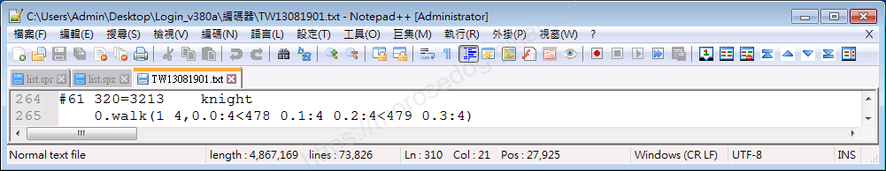

* <font color="blue">**段落起始說明**：</font>

  * `#61`：變身檔編號(`#`開頭)。

  * `320`：變身圖檔(`spr`)總數量(後方的`=`指定使用`3213`圖檔編號，所以使用`3213-0.spr ~ 3213-319.spr`，共`320`個)。

  * `3213`：指定使用的圖檔編號。

  * `Knight`：`#61`的編號的命名(敘述)。

---

* <font color="blue">**動作內容說明**：</font><u><以下在[動畫圖檔 spr 基礎了解說明](./111_動畫圖檔_spr_基礎了解說明.md)中已有講解過一次></u>

  * `0.walk`：空手走路動作(對應上方提供的[【動作編碼/動作名稱說明-清單】](#spr-action-list)查看)。

  * `( )`內容：空手走路動作包含的所有詳細內容。

  * `1`：有方向性 (`0`無方向性)。

  * `4`：使用`圖片`總數。<對應下方的四張圖片>

  * `,`：分隔符號。

* <font color="blue">**第一張圖片**：</font>

  * `0.0`：`3213-0.spr`變身圖檔中的`3213-0-000.bmp`圖片。

  * `:4`：`3213-0-000.bmp`圖片，需要花費`4`單位時間(`1`單位時間 = `1 / 24` 秒)。

  * `<478`：套用聲音檔`478.wav`。


* <font color="blue">**第二張圖片**：</font>

  * `0.1`：`3213-0.spr`變身圖檔中的`3213-0-001.bmp`圖片。

  * `:4`：`3213-0-001.bmp`圖片，需要花費`4`單位時間(`1`單位時間 = `1 / 24` 秒)。
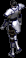

* <font color="blue">**第三張圖片**：</font>

  * `0.2`：`3213-0.spr`變身圖檔中的`3213-0-002.bmp`圖片。

  * `:4`：`3213-0-002.bmp`圖片，需要花費`4`單位時間(`1`單位時間 = `1 / 24` 秒)。

  * `<479`：套用聲音檔 479.wav
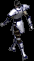

* <font color="blue">**第四張圖片**：</font>

  * `0.3`：`3213-0.spr`變身圖檔中的`3213-0-003.bmp`圖片。

  * `:4`：`3213-0-003.bmp`圖片，需要花費`4`單位時間(`1`單位時間 = `1 / 24` 秒)。


> 以上總花費`4 + 4 + 4 + 4 = 16`單位時間。

---

* <font color="blue">**方向性的補充**：</font>

  * **<u>有方向性(1)</u>**：`( )`內容編輯的資料，都是用角色「面向左上方」的`變身圖檔(`spr`)`基準，再衍伸其他方向的動作。

    * 所以在<font color="red">**`有方向性`**</font>的部分，<font color="red">**只需要一行`基準`的`動作內容`編碼即可**</font>。

    * 以下為`基準`與`延伸`的**參考**。

```plain
#61  320=3213  knight
0.walk(1 4,0.0:4<478 0.1:4 0.2:4<479 0.3:4) → 角色「面向左上方」(基準)

0.walk(1 4,1.0:4<478 1.1:4 1.2:4<479 1.3:4) → 角色「面向 　上方」(衍伸)
0.walk(1 4,2.0:4<478 1.1:4 2.2:4<479 2.3:4) → 角色「面向 右上方」(衍伸)
0.walk(1 4,3.0:4<478 1.1:4 3.2:4<479 3.3:4) → 角色「面向 　右方」(衍伸)
0.walk(1 4,4.0:4<478 1.1:4 4.2:4<479 4.3:4) → 角色「面向 右下方」(衍伸)
0.walk(1 4,5.0:4<478 1.1:4 5.2:4<479 5.3:4) → 角色「面向 　下方」(衍伸)
0.walk(1 4,6.0:4<478 1.1:4 6.2:4<479 6.3:4) → 角色「面向 左下方」(衍伸)
0.walk(1 4,7.0:4<478 1.1:4 7.2:4<479 7.3:4) → 角色「面向 　左方」(衍伸)
```

    * 變身圖檔(`spr`)的編號，也是由「面向左上方」開始編號。

```plain
3213-0.spr → 角色「面向 左上方」空手走路動作圖檔
3213-1.spr → 角色「面向 　上方」空手走路動作圖檔
3213-2.spr → 角色「面向 右上方」空手走路動作圖檔
3213-3.spr → 角色「面向 　右方」空手走路動作圖檔
3213-4.spr → 角色「面向 右下方」空手走路動作圖檔
3213-5.spr → 角色「面向 　下方」空手走路動作圖檔
3213-6.spr → 角色「面向 左下方」空手走路動作圖檔
3213-7.spr → 角色「面向 　左方」空手走路動作圖檔
```

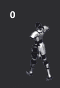 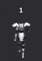 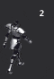
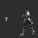  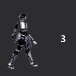
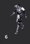 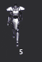 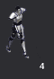

  * **<u>無方向性(0)</u>**：根據上述，反之僅使用`( )`內容編輯的資料，並不會有衍伸的狀況。

---

* <font color="blue">**`( )`內容，特殊符號補充**：</font>

  * <font color="red">**`!`**</font>：當執行到該`圖片`時，目標會出現被打動作以及被打聲音，加的越多對方會有越多個被打動作及聲音出現。如果把`!`刪除了則目標不會出現被打動作及被打聲音，包括射出的箭以及魔法。

    * 當<font color="blue">**騎士#61**</font>的`1.attack<空手攻擊動作>`<font color="green">**有**</font>`!`符號，目標`食人妖精`有`被打動作`與`被打聲音`。
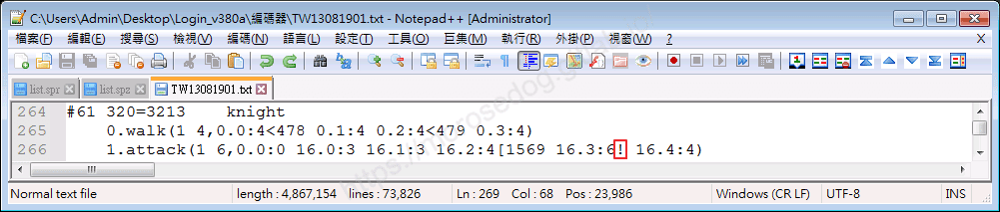
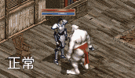

    * 當<font color="blue">**騎士#61**</font>的`1.attack<空手攻擊動作>`<font color="red">**無**</font>`!`符號，目標`食人妖精`沒有`被打動作`與`被打聲音`。
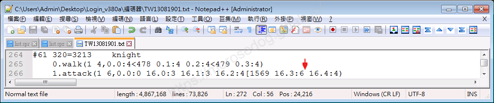
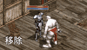

---

  * <font color="red">**`[`**</font>：是執行到該`圖片`時，執行`[`後方的編號聲音檔。<聲音檔路徑：`客戶端\Sound\`>

    * 舉例<font color="blue">**騎士#61**</font>的`1.attack<空手攻擊動作>`的`[`符號後方`1569`，表示空手攻擊的時候執行`3213-16-002.bmp`圖片的時候播放此聲音檔。
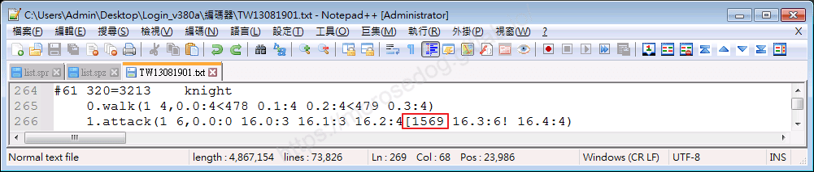

---

  * <font color="red">**`]`**</font>：是執行到該`圖片`時，執行`]`後方的編號`變身檔編碼#214`，要套圖檔時要注意第一張圖不能套圖檔。

    * 舉例<font color="blue">**火燄之魔法師#173**</font>的`1.attack<空手攻擊動作>`的`]`符號後方`214`，表示空手攻擊的時候執行`173-24-002.bmp`圖片的時候，包含執行這個`動作編碼`的效果。
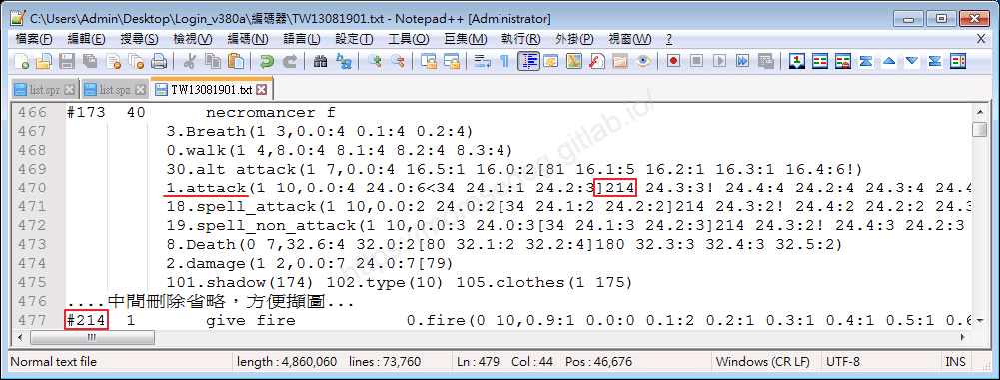
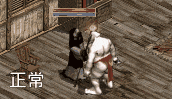 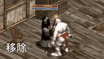

---

  * <font color="red">**`<`**</font>：是執行到該`圖片`時，執行`<`後方的編號聲音檔。

  * <font color="red">**`{`**</font>：未知。

  * <font color="red">**`}`**</font>：未知。

  * <font color="red">**`>`**</font>：未知。

> 註：未知的符號部分，目前沒有去分析和嘗試。

## 結語

恭喜您，如果您有認真學習動手實作，至此您已經是一位變身檔高手了。
只能說變身檔真的不難，內容其實也不多，最重要的是去實踐，只要動手去嘗試很快就會掌握到裡面的精隨。​‌‌‌​​​​​‌‌‌​​‌​​‌‌​‌​​‌​‌‌‌​‌‌​​‌‌​​​​‌​‌‌‌​‌​​​‌‌​​‌​‌​​‌​‌‌​‌​‌‌​‌‌​​​‌‌​‌​​‌​‌‌​‌‌‌​​‌‌​​‌​‌​‌‌​​​​‌​‌‌​​‌‌‌​‌‌​​‌​‌​​‌​‌‌​‌​​‌‌​​‌​​​‌‌​​​​​​‌‌​​‌​​​‌‌​​‌​​​‌‌​​​​​​‌‌​‌​‌​​‌‌​​​‌​​‌‌‌​​​​​‌​‌‌​‌​‌‌‌​​​​​‌‌‌​​‌​​‌‌​‌​​‌​‌‌‌​‌‌​​‌‌​​​​‌​‌‌‌​‌​​​‌‌​​‌​‌​​‌​‌‌​‌​‌‌​‌‌​​​‌‌​‌​​‌​‌‌​‌‌‌​​‌‌​​‌​‌​‌‌​​​​‌​‌‌​​‌‌‌​‌‌​​‌​‌​​‌​‌‌​‌​​‌‌​​​‌​​‌‌​​​‌​​‌‌​​‌‌

原創文章真的不易，希望多多支持，感謝。
最後建議回顧一下首章[天堂私服 | 天堂私服架設教學](/private-lineage-20210712-private-lineage-0/#教學章節)，了解其章節目錄。

## 免責聲明

* 本部落格文章中皆<font color="red"><u>**不提供**</u></font>任何所謂的遊戲「主程式」、「模擬器」、「登入器」…等等相關程式的下載點。

* 本部落格文章中所見之遊戲主程式和服務器端程序均來自網路發佈，<font color="red"><u>版本歸**原作者**</u>所有</font>。

* 本部落格文章為研究SQL資料庫與修改JAVA語法使用，<font color="red">並<u>**非商業用途**</u>，亦<u>**無做營運事實等任何一切商業行為**</u>。</font>

* 本部落格文章內容是為研究學習設計思想和原理為目的，<font color="red"><u>**絕沒有故意侵權或惡意抄襲、篡改其他遊戲內容**</u></font>！

> 註：以上參考了
> [Linhelper論壇 - [教學] [彙整]List.spr變身檔網路教學彙整](https://bbs.linhelper.com/forum.php?mod=viewthread&tid=1301)

---

- **原文連結**：[J.J.'s Blogs - 變身檔-格式與編碼基礎](https://morosedog.gitlab.io/private-lineage-20220518-private-lineage-113/)
