# 變身檔-物件分辨的教學

# 天堂私服 | 變身檔-物件分辨的教學

    
    
      📑 目錄
      

1. [章節用意](#章節用意)
2. [版本資訊](#版本資訊)
3. [前言](#前言)
4. [教學](#教學)
5. [結語](#結語)
6. [免責聲明](#免責聲明)

    
    
    

## 章節用意

此章將會針對`102.type(X)`做說明，並且針對每個數字所代表的物件說明與舉例。

## 版本資訊

* **客戶端版本**

  * 天堂(Lineage 3.81C)

* **核心版本**

  * L1J-3.80c

* **登入器版本**  

  * L1J-3.80c

## 前言

在開始前，請務必先將以下文章閱讀與實際操作過。

* [變身檔新增修改<快速入門>](./103_變身檔新增修改&lt;快速入門&gt;.md)

* [客戶端、登入器與變身檔關係分析](./106_客戶端和登入器與變身檔關係分析.md)

* [變身檔-初步說明與規則](./112_變身檔-初步說明與規則.md)

* [變身檔-格式與編碼基礎](./113_變身檔-格式與編碼基礎.md)

## 教學

* 在[變身檔-格式與編碼基礎](./113_變身檔-格式與編碼基礎.md#spr-action-list)的【動作編碼/動作名稱說明-清單】，中有提到`102.type(X)`，關於這個`X`可以帶入的數字與對應的物件。

* 以下是網路上加上變身檔裡面整理出來的，部分`？`的為不是很肯定的物件。

```plain
102.type(0)   → 影子類，如人物或怪物的影子，法術等等
102.type(1)   → 裝飾品，如聖誕樹，雪人，潘朵拉背後的帳篷，船，蟻洞
102.type(4)   → ？
102.type(5)   → 玩家人物，或不能對話的NPC，變怪免CTRL就是把變怪和玩家的5改成10
102.type(6)   → 可以對話NPC
102.type(7)   → 寶箱，開關
102.tyoe(8)   → 可以打開的門
102.type(9)   → 可撿取的物品，一般物品，武器等等
102.tyoe(10)  → MOB，就是怪物，會出現攻擊符號的?變怪免CTRL就是把變怪和玩家的5改成10
102.type(11)  → 城牆，城門
102.type(12)  → 新的NPC可以對話
102.type(14)  → 盟屋前的告示牌
102.type(15)  → 拍賣公佈欄
102.type(16)  → ？
102.type(18)  → ？
102.type(19)  → ？
```

* 以下盡量提供各個`type`的範例：

  * <font color="red">**`102.type(0)`**</font>：<影子類，如人物或怪物的影子，法術等等>

    * 舉例<font color="blue">**狼#96**</font>的`101.shadow<影子圖(代號)>`的`97`，表示使用`#97`的變身編號當做影子。

    * 而<font color="blue">**狼_影子#97**</font>的`102.type(X)`的`X`設定為`0`，表示為影子。
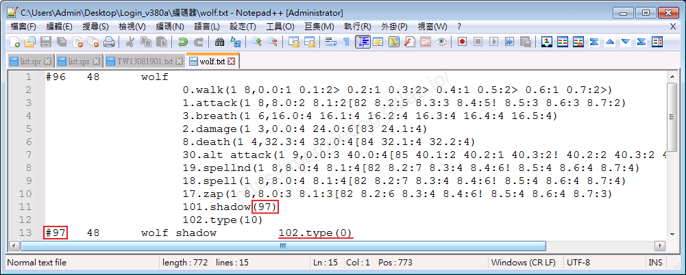
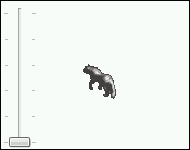 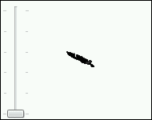

    * 注意：如果將變身編號內容要設定為**空**的**假**的(`dummy`)，要記得要設定`102.type(0)`。
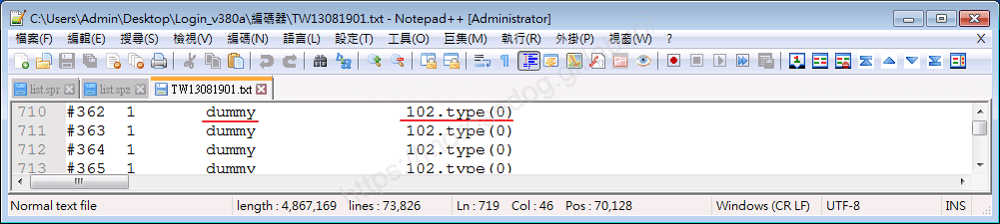

---

  * <font color="red">**`102.type(1)`**</font>：<裝飾品，如聖誕樹，雪人，潘朵拉背後的帳篷，船，蟻洞>

    * 舉例<font color="blue">**聖誕樹#1995**</font>的`102.type(X)`的`X`設定為`1`，表示為裝飾品。
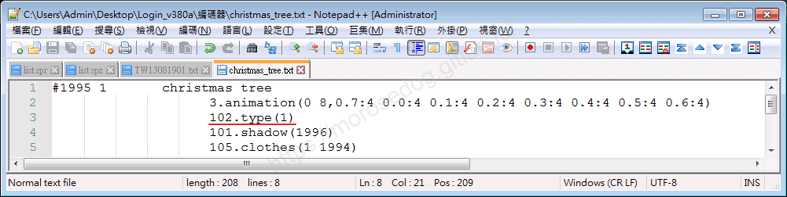


---

  * <font color="red">**`102.type(4)`**</font>：<？>

    * 暫時沒分析。

---

  * <font color="red">**`102.type(5)`**</font>：<玩家人物，或不能對話的NPC>

    * 舉例<font color="blue">**男法師#734**</font>的`102.type(X)`的`X`設定為`5`，表示為玩家人物。
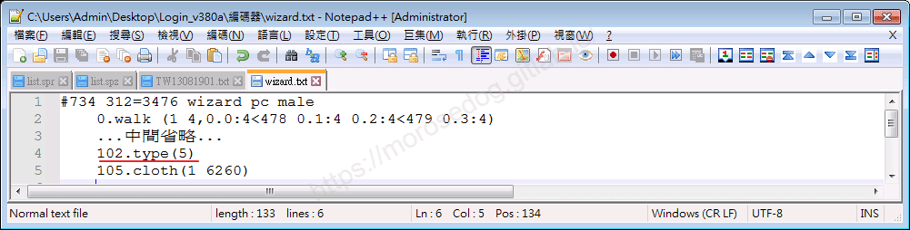

    * <font color="blue">無法直接點擊</font>，攻擊變形怪變的**男法師**，需搭配`Ctrl`強制攻擊。
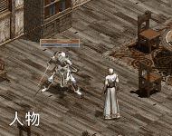

    * 將`102.type(X)`的`X`由為`5`改成`10`後。

    * <font color="orange">可直接點擊</font>，攻擊變形怪變的**男法師**。
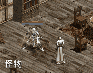

    * <font color="blue">依舊無法直接點擊</font>，攻擊**男法師**的玩家，依舊需搭配`Ctrl`強制攻擊。
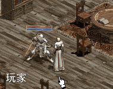

---

  * <font color="red">**`102.type(6)`**</font>：<可以對話`NPC`>

    * 舉例<font color="blue">**甘特#100**</font>的`102.type(X)`的`X`設定為`6`，表示為可以對話`NPC`。
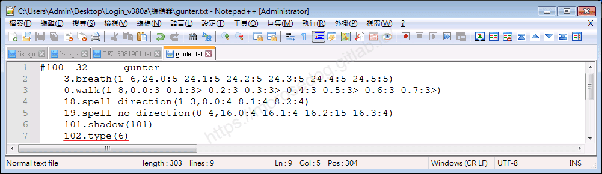

    * 滑鼠游標<font color="orange">顯示為對話狀態</font>的甘特`NPC`。
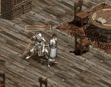

---

  * <font color="red">**`102.type(7)`**</font>：<寶箱，開關>

    * 舉例<font color="blue">**箱子#122**</font>的`102.type(X)`的`X`設定為`7`，表示為寶箱。
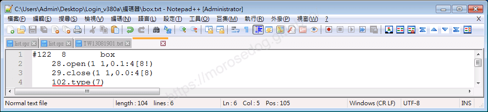

    * 滑鼠游標<font color="orange">顯示為開關的手</font>的寶箱。
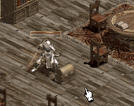

---

  * <font color="red">**`102.type(8)`**</font>：<可以打開的門>

    * 變身檔內找不到使用的編碼，固無法展示。

---

  * <font color="red">**`102.type(9)`**</font>：<可撿取的物品，一般物品，武器等等>

    * 舉例<font color="blue">**斧頭#2**</font>的`102.type(X)`的`X`設定為`9`，表示為可撿取的物品。
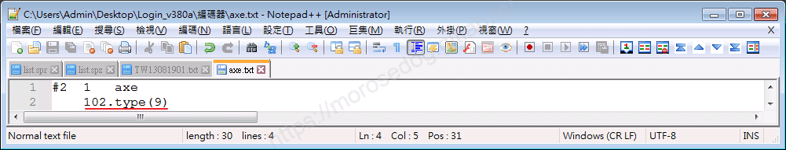

    * 滑鼠游標<font color="orange">顯示為檢取的手</font>的寶箱。
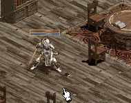

---

  * <font color="red">**`102.type(10)`**</font>：<怪物>

    * 此就不特別展示，標記為`10`的就為怪物，可以直接點擊攻擊。

---

  * <font color="red">**`102.type(11)`**</font>：<城牆，城門>

    * 舉例<font color="blue">**肯特內城門#339**</font>的`102.type(X)`的`X`設定為`11`，表示為城門。
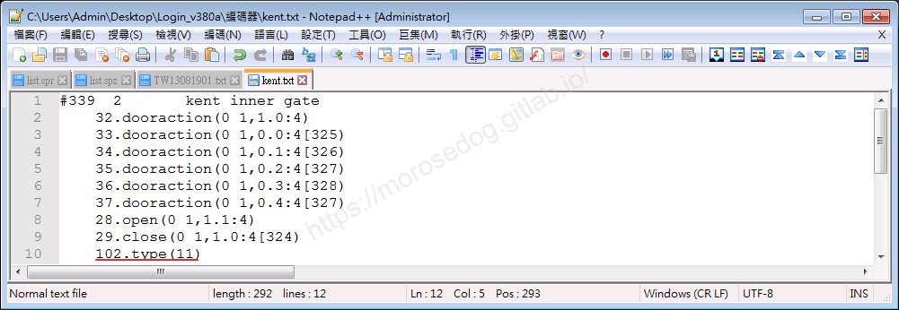

    * 滑鼠游標點擊無效果，強制攻擊可以攻擊。
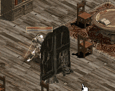

---

  * <font color="red">**`102.type(12)`**</font>：<新的NPC可以對話>

    * 效果與`102.type(6)`是一樣的，表示為可以對話`NPC`。

---

  * <font color="red">**`102.type(14)`**</font>：<盟屋前的告示牌>

    * 舉例<font color="blue">**血盟告示牌#1534**</font>的`102.type(X)`的`X`設定為`14`，表示為盟屋前的告示牌。
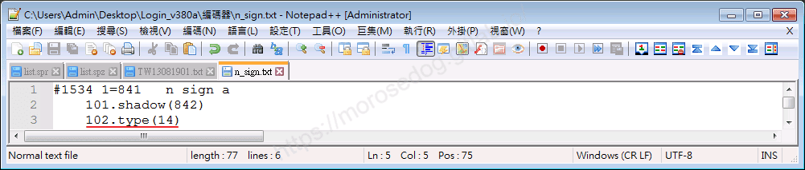

    * 滑鼠游標<font color="orange">顯示為放大鏡</font>的告示牌。
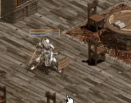

---

  * <font color="red">**`102.type(15)`**</font>：<拍賣公佈欄>

    * 舉例<font color="blue">**拍賣公布欄#1552**</font>的`102.type(X)`的`X`設定為`15`，表示為拍賣公佈欄。
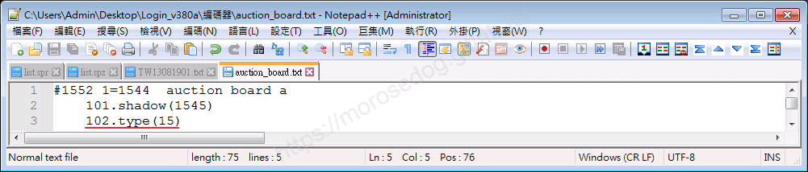

    * 滑鼠游標<font color="orange">顯示為放大鏡</font>的拍賣公佈欄。
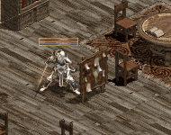

---

  * <font color="red">**`102.type(16)`**</font>：<？>

    * 暫時沒分析。

---

  * <font color="red">**`102.type(18)`**</font>：<？>

    * 暫時沒分析。

---

  * <font color="red">**`102.type(19)`**</font>：<？>

    * 暫時沒分析。

## 結語

網路上的教學僅僅只有文字說明，此處盡量找出圖片互動，讓其更容易學習了解。​‌‌‌​​​​​‌‌‌​​‌​​‌‌​‌​​‌​‌‌‌​‌‌​​‌‌​​​​‌​‌‌‌​‌​​​‌‌​​‌​‌​​‌​‌‌​‌​‌‌​‌‌​​​‌‌​‌​​‌​‌‌​‌‌‌​​‌‌​​‌​‌​‌‌​​​​‌​‌‌​​‌‌‌​‌‌​​‌​‌​​‌​‌‌​‌​​‌‌​​‌​​​‌‌​​​​​​‌‌​​‌​​​‌‌​​‌​​​‌‌​​​​​​‌‌​‌​‌​​‌‌​​​‌​​‌‌‌​​‌​​‌​‌‌​‌​‌‌‌​​​​​‌‌‌​​‌​​‌‌​‌​​‌​‌‌‌​‌‌​​‌‌​​​​‌​‌‌‌​‌​​​‌‌​​‌​‌​​‌​‌‌​‌​‌‌​‌‌​​​‌‌​‌​​‌​‌‌​‌‌‌​​‌‌​​‌​‌​‌‌​​​​‌​‌‌​​‌‌‌​‌‌​​‌​‌​​‌​‌‌​‌​​‌‌​​​‌​​‌‌​​​‌​​‌‌​‌​​

原創文章真的不易，希望多多支持，感謝。
最後建議回顧一下首章[天堂私服 | 天堂私服架設教學](/private-lineage-20210712-private-lineage-0/#教學章節)，了解其章節目錄。

## 免責聲明

* 本部落格文章中皆<font color="red"><u>**不提供**</u></font>任何所謂的遊戲「主程式」、「模擬器」、「登入器」…等等相關程式的下載點。

* 本部落格文章中所見之遊戲主程式和服務器端程序均來自網路發佈，<font color="red"><u>版本歸**原作者**</u>所有</font>。

* 本部落格文章為研究SQL資料庫與修改JAVA語法使用，<font color="red">並<u>**非商業用途**</u>，亦<u>**無做營運事實等任何一切商業行為**</u>。</font>

* 本部落格文章內容是為研究學習設計思想和原理為目的，<font color="red"><u>**絕沒有故意侵權或惡意抄襲、篡改其他遊戲內容**</u></font>！

> 註：以上參考了
> [Linhelper論壇 - [教學] [彙整]List.spr變身檔網路教學彙整](https://bbs.linhelper.com/forum.php?mod=viewthread&tid=1301)

---

- **原文連結**：[J.J.'s Blogs - 變身檔-物件分辨的教學](https://morosedog.gitlab.io/private-lineage-20220519-private-lineage-114/)
