# 變身檔-濾鏡效果的教學

# 天堂私服 | 變身檔-濾鏡效果的教學

    
    
      📑 目錄
      

1. [章節用意](#章節用意)
2. [版本資訊](#版本資訊)
3. [前言](#前言)
4. [教學](#教學)
5. [結語](#結語)
6. [免責聲明](#免責聲明)

    
    
    

## 章節用意

此章將會針對`104.attr(X)`做說明，並且針對每個數字所代表的濾鏡效果說明與舉例。

## 版本資訊

* **客戶端版本**

  * 天堂(Lineage 3.81C)

* **核心版本**

  * L1J-3.80c

* **登入器版本**  

  * L1J-3.80c

## 前言

在開始前，請務必先將以下文章閱讀與實際操作過。

* [變身檔新增修改<快速入門>](./103_變身檔新增修改&lt;快速入門&gt;.md)

* [客戶端、登入器與變身檔關係分析](./106_客戶端和登入器與變身檔關係分析.md)

* [變身檔-初步說明與規則](./112_變身檔-初步說明與規則.md)

* [變身檔-格式與編碼基礎](./113_變身檔-格式與編碼基礎.md)

## 教學

* 在[變身檔-格式與編碼基礎](./113_變身檔-格式與編碼基礎.md#spr-action-list)的【動作編碼/動作名稱說明-清單】，中有提到`104.attr(X)`，關於這個`X`可以帶入的數字與對應的濾鏡效果。

```plain
104.attr(1)    → 半透明
104.attr(2)    → 隱形，可看見名字
104.attr(4)    → 正常
104.attr(8)    → 發光的
104.attr(9)    → 半透明+發光
104.attr(32)   → 中毒，綠色
104.attr(128)  → 黑邊半透明
104.attr(512)  → 石化，灰灰的
104.attr(4096) → 南瓜怪隱形(有影子)
104.attr(4104) → 南瓜怪隱形(沒影子)
104.attr(8192) → 巨人守護者隱形(有影子)
104.attr(8193) → 巨人守護者隱形(沒影子)
```

* 以下盡量提供各個`attr`的範例：

  * <font color="red">**`104.attr(1)`**</font>：<半透明>

    * 舉例<font color="blue">**蜘蛛網的影子#223**</font>的`104.attr(X)`的`X`設定為`1`，表示為半透明。
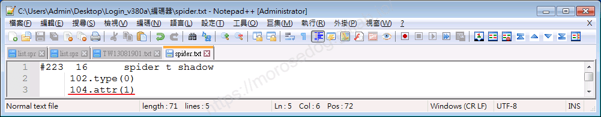

    * 拔掉`104.attr(1)`的前後差異。
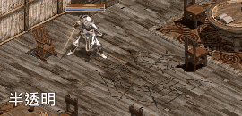

---

  * <font color="red">**`104.attr(2)`**</font>：<隱形，可看見名字>

    * 變身檔內找不到使用的編碼，就不去嘗試也不做展示。

---

  * <font color="red">**`104.attr(4)`**</font>：<正常>

    * 變身檔內找不到使用的編碼，就不去嘗試也不做展示。

---

  * <font color="red">**`104.attr(8)`**</font>：<發光的>

    * 舉例<font color="blue">**火牆#168**</font>的`104.attr(X)`的`X`設定為`8`，表示為發光的。
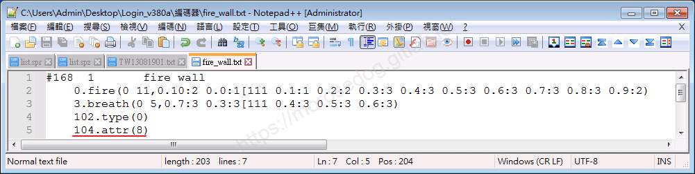

    * 拔掉`104.attr(8)`的前後差異。
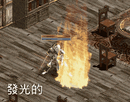

---

  * <font color="red">**`104.attr(9)`**</font>：<半透明+發光>

    * 變身檔內找不到使用的編碼，就不去嘗試也不做展示。

---

  * <font color="red">**`104.attr(32)`**</font>：<中毒，綠色>

    * 變身檔內找不到使用的編碼，就不去嘗試也不做展示。

---

  * <font color="red">**`104.attr(128)`**</font>：<黑邊半透明>

    * 舉例<font color="blue">**變形怪BOSS#2390**</font>的`104.attr(X)`的`X`設定為`128`，表示為黑邊半透明。
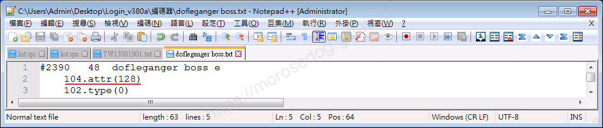

    * 拔掉`104.attr(128)`的前後差異。
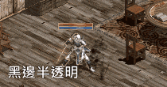

---

  * <font color="red">**`104.attr(512)`**</font>：<石化，灰灰的>

    * 變身檔內找不到使用的編碼，就不去嘗試也不做展示。

---

  * <font color="red">**`104.attr(4096)`**</font>：<南瓜怪隱形(有影子)>

    * 舉例<font color="blue">**南瓜怪#2412**</font>的`104.attr(X)`的`X`設定為`4096`，表示為南瓜怪隱形(有影子)。
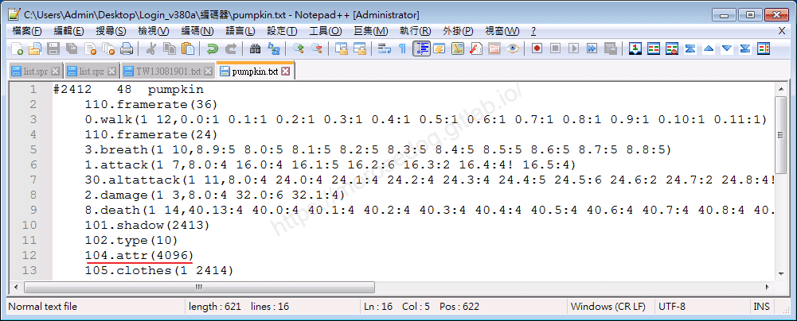

    * 拔掉`104.attr(4096)`的前後差異。
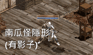

---

  * <font color="red">**`104.attr(4104)`**</font>：<南瓜怪隱形(沒影子)>

    * 舉例<font color="blue">**南瓜怪#2414**</font>的`104.attr(X)`的`X`設定為`4104`，表示為南瓜怪隱形(沒影子)。
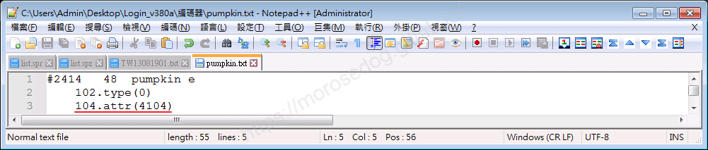

    * 拔掉`104.attr(4104)`的前後差異。
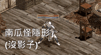

---

  * <font color="red">**`104.attr(8192)`**</font>：<巨人守護者隱形(有影子)>

    * 舉例<font color="blue">**巨人守護者#2714**</font>的`104.attr(X)`的`X`設定為`8192`，表示為巨人守護者隱形(有影子)。
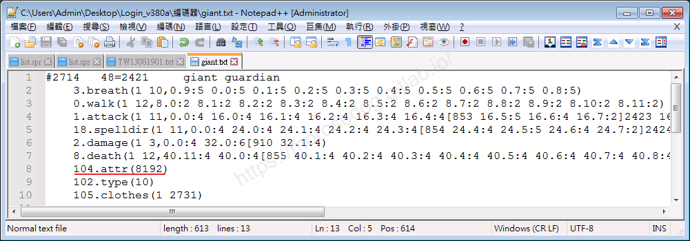

    * 拔掉`104.attr(8192)`的前後差異。
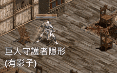

---

  * <font color="red">**`104.attr(8193)`**</font>：<巨人守護者隱形(沒影子)>

    * 舉例<font color="blue">**巨人守護者#2731**</font>的`104.attr(X)`的`X`設定為`8193`，表示為巨人守護者隱形(沒影子)。
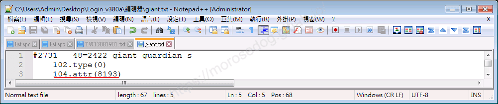

    * 拔掉`104.attr(8193)`的前後差異。
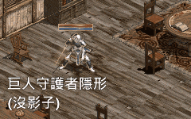

## 結語

以上沒有展示的數字，可以自己去修改嘗試看看效果，或許可以有更多收穫唷。​‌‌‌​​​​​‌‌‌​​‌​​‌‌​‌​​‌​‌‌‌​‌‌​​‌‌​​​​‌​‌‌‌​‌​​​‌‌​​‌​‌​​‌​‌‌​‌​‌‌​‌‌​​​‌‌​‌​​‌​‌‌​‌‌‌​​‌‌​​‌​‌​‌‌​​​​‌​‌‌​​‌‌‌​‌‌​​‌​‌​​‌​‌‌​‌​​‌‌​​‌​​​‌‌​​​​​​‌‌​​‌​​​‌‌​​‌​​​‌‌​​​​​​‌‌​‌​‌​​‌‌​​‌​​​‌‌​​​​​​‌​‌‌​‌​‌‌‌​​​​​‌‌‌​​‌​​‌‌​‌​​‌​‌‌‌​‌‌​​‌‌​​​​‌​‌‌‌​‌​​​‌‌​​‌​‌​​‌​‌‌​‌​‌‌​‌‌​​​‌‌​‌​​‌​‌‌​‌‌‌​​‌‌​​‌​‌​‌‌​​​​‌​‌‌​​‌‌‌​‌‌​​‌​‌​​‌​‌‌​‌​​‌‌​​​‌​​‌‌​​​‌​​‌‌​‌​‌

原創文章真的不易，希望多多支持，感謝。
最後建議回顧一下首章[天堂私服 | 天堂私服架設教學](/private-lineage-20210712-private-lineage-0/#教學章節)，了解其章節目錄。

## 免責聲明

* 本部落格文章中皆<font color="red"><u>**不提供**</u></font>任何所謂的遊戲「主程式」、「模擬器」、「登入器」…等等相關程式的下載點。

* 本部落格文章中所見之遊戲主程式和服務器端程序均來自網路發佈，<font color="red"><u>版本歸**原作者**</u>所有</font>。

* 本部落格文章為研究SQL資料庫與修改JAVA語法使用，<font color="red">並<u>**非商業用途**</u>，亦<u>**無做營運事實等任何一切商業行為**</u>。</font>

* 本部落格文章內容是為研究學習設計思想和原理為目的，<font color="red"><u>**絕沒有故意侵權或惡意抄襲、篡改其他遊戲內容**</u></font>！

> 註：以上參考了
> [Linhelper論壇 - [教學] [彙整]List.spr變身檔網路教學彙整](https://bbs.linhelper.com/forum.php?mod=viewthread&tid=1301)

---

- **原文連結**：[J.J.'s Blogs - 變身檔-濾鏡效果的教學](https://morosedog.gitlab.io/private-lineage-20220520-private-lineage-115/)
