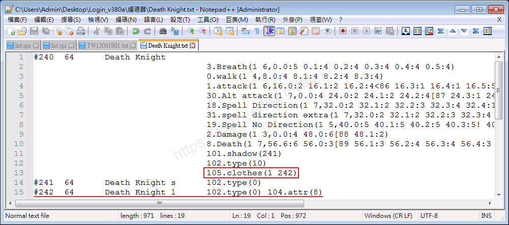
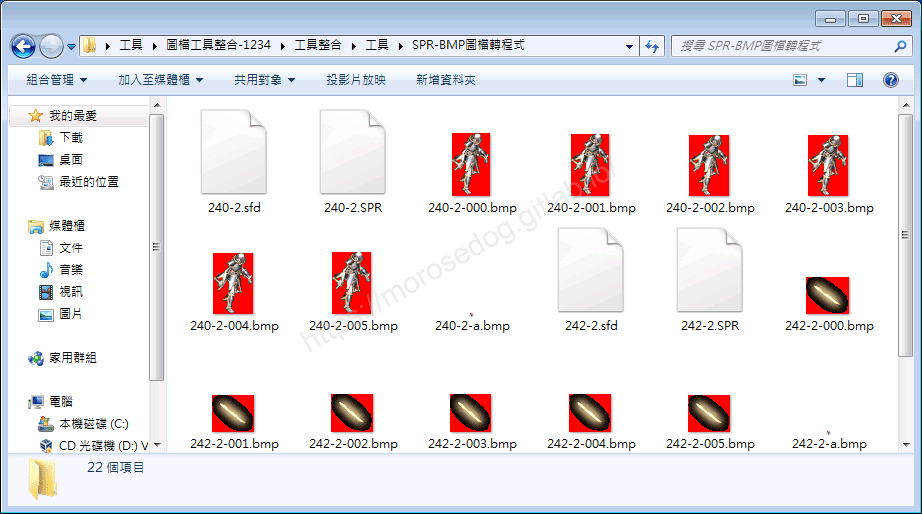
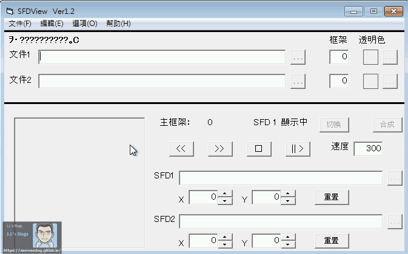
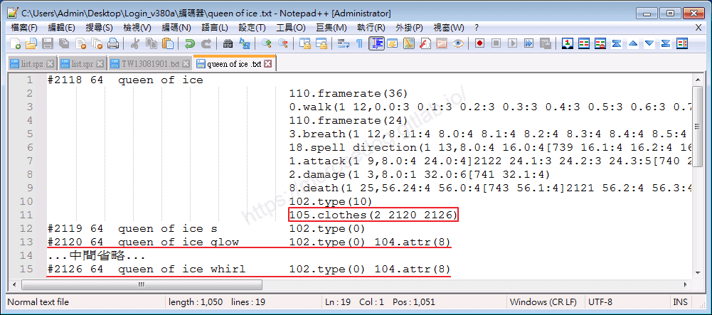
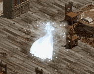

# 變身檔-附加物件的教學

# 天堂私服 | 變身檔-附加物件的教學

    
    
      📑 目錄
      

1. [章節用意](#章節用意)
2. [版本資訊](#版本資訊)
3. [前言](#前言)
4. [教學](#教學)
5. [結論](#結論)
6. [結語](#結語)
7. [免責聲明](#免責聲明)

    
    
    

## 章節用意

此章將會針對`105.clothes(X X)`做說明，並且針對後面的數字所代表的做說明與舉例。

## 版本資訊

* **客戶端版本**

  * 天堂(Lineage 3.81C)

* **核心版本**

  * L1J-3.80c

* **登入器版本**  

  * L1J-3.80c

## 前言

在開始前，請務必先將以下文章閱讀與實際操作過。

* [變身檔新增修改<快速入門>](./103_變身檔新增修改&lt;快速入門&gt;.md)

* [客戶端、登入器與變身檔關係分析](./106_客戶端和登入器與變身檔關係分析.md)

* [變身檔-初步說明與規則](./112_變身檔-初步說明與規則.md)

* [變身檔-格式與編碼基礎](./113_變身檔-格式與編碼基礎.md)

## 教學

* 在[變身檔-格式與編碼基礎](./113_變身檔-格式與編碼基礎.md#spr-action-list)的【動作編碼/動作名稱說明-清單】，中有提到`105.clothes(X X)`，關於這個`X`可以帶入的數字與對應的附加物件。​‌‌‌​​​​​‌‌‌​​‌​​‌‌​‌​​‌​‌‌‌​‌‌​​‌‌​​​​‌​‌‌‌​‌​​​‌‌​​‌​‌​​‌​‌‌​‌​‌‌​‌‌​​​‌‌​‌​​‌​‌‌​‌‌‌​​‌‌​​‌​‌​‌‌​​​​‌​‌‌​​‌‌‌​‌‌​​‌​‌​​‌​‌‌​‌​​‌‌​​‌​​​‌‌​​​​​​‌‌​​‌​​​‌‌​​‌​​​‌‌​​​​​​‌‌​‌​‌​​‌‌​​‌​​​‌‌​​​‌​​‌​‌‌​‌​‌‌‌​​​​​‌‌‌​​‌​​‌‌​‌​​‌​‌‌‌​‌‌​​‌‌​​​​‌​‌‌‌​‌​​​‌‌​​‌​‌​​‌​‌‌​‌​‌‌​‌‌​​​‌‌​‌​​‌​‌‌​‌‌‌​​‌‌​​‌​‌​‌‌​​​​‌​‌‌​​‌‌‌​‌‌​​‌​‌​​‌​‌‌​‌​​‌‌​​​‌​​‌‌​​​‌​​‌‌​‌‌​

```plain
105.clothes(X X)  →(物件數量 物件圖號)
```

* 以下盡量提供多個`clothes`的範例：

  * <font color="red">**`105.clothes(1 242)`**</font>：<死騎光刀>

    * 舉例<font color="blue">**死亡騎士#240**</font>的`105.clothes(X X)`。


      * 第一個`X`設定為`1`，表示附加幾個物件。

      * 第二個`X`設定為`242`，表示使用`死騎光刀#242`的變身編號。

    * 首先抽出`240-2.spr`與`242-2.spr`，這邊抽過`-2`的是因為面向右上方。

> 註：不要忘記`方向性`的觀念。忘記了？[參考](./113_變身檔-格式與編碼基礎.md#direction)

    * 並將`240-2.spr`與`242-2.spr`轉檔為`.bmp`檔。


    * 這邊可以觀察到`240-2.spr`使用六張`圖檔`，那`242-2.spr`其實也可以發現對應的就是六張`圖檔`。

    * 因為每一張圖都要手拿刀，所以就是一張對一張。

    * 如果這時候想要看`死亡騎士`與`光刀`合併後的樣子。

    * 可以使用[SFDviewer 工具(圖檔座標定位)](../07_Developer_Tools/088_SFDviewer_工具(圖檔座標定位).md)來呈現。

    * 解出來的檔案都會有`.sfd`檔。

    * 開啟兩個`240-2.sfd`、`242-2.sfd`呈現的效果如下。


---

  * <font color="red">**`105.clothes(2 2120 2126)`**</font>：<冰之女王特效>

    * 舉例<font color="blue">**冰之女王#2118**</font>的`105.clothes(X X X)`。


      * 第一個`X`設定為`2`，表示附加幾個物件。

      * 第二個`X`設定為`2120`，表示使用`冰之女王發光特效#2120`的變身編號。

      * 第二個`X`設定為`2126`，表示使用`冰之女王風雪特效#2126`的變身編號。

    * 冰之女王的特別之處在於是「**本體** + **發亮身體** + **風雪效果**」。

    * 首先來看這三個變身編號的獨立效果。
  

    * 這邊忽略本體，只抽出`2120-2.spr`與`2126-2.spr`，這邊抽過`-2`的是因為面向右上方。

> 註：不要忘記`方向性`的觀念。忘記了？[參考](./113_變身檔-格式與編碼基礎.md#direction)​‌‌‌​​​​​‌‌‌​​‌​​‌‌​‌​​‌​‌‌‌​‌‌​​‌‌​​​​‌​‌‌‌​‌​​​‌‌​​‌​‌​​‌​‌‌​‌​‌‌​‌‌​​​‌‌​‌​​‌​‌‌​‌‌‌​​‌‌​​‌​‌​‌‌​​​​‌​‌‌​​‌‌‌​‌‌​​‌​‌​​‌​‌‌​‌​​‌‌​​‌​​​‌‌​​​​​​‌‌​​‌​​​‌‌​​‌​​​‌‌​​​​​​‌‌​‌​‌​​‌‌​​‌​​​‌‌​​​‌​​‌​‌‌​‌​‌‌‌​​​​​‌‌‌​​‌​​‌‌​‌​​‌​‌‌‌​‌‌​​‌‌​​​​‌​‌‌‌​‌​​​‌‌​​‌​‌​​‌​‌‌​‌​‌‌​‌‌​​​‌‌​‌​​‌​‌‌​‌‌‌​​‌‌​​‌​‌​‌‌​​​​‌​‌‌​​‌‌‌​‌‌​​‌​‌​​‌​‌‌​‌​​‌‌​​​‌​​‌‌​​​‌​​‌‌​‌‌​

    * 這邊就直接在遊戲內，展示完整合體後的樣子。


## 結論

* 1.附加物件是有方向性的，所以在抽檔的時候不要對應錯了。

> 註：作者就發生拿不同面向的武器來看..結果發生武器長短不正確。

* 2.附加物件的數量是可以多個的，透過第一個`X`參數決定後面要加上幾個物件。

## 結語

還有其他的比如`四色`的武器…等等，這邊就不一個一個展示，可以自己去研究摸摸看。

原創文章真的不易，希望多多支持，感謝。
最後建議回顧一下首章[天堂私服 | 天堂私服架設教學](/private-lineage-20210712-private-lineage-0/#教學章節)，了解其章節目錄。​‌‌‌​​​​​‌‌‌​​‌​​‌‌​‌​​‌​‌‌‌​‌‌​​‌‌​​​​‌​‌‌‌​‌​​​‌‌​​‌​‌​​‌​‌‌​‌​‌‌​‌‌​​​‌‌​‌​​‌​‌‌​‌‌‌​​‌‌​​‌​‌​‌‌​​​​‌​‌‌​​‌‌‌​‌‌​​‌​‌​​‌​‌‌​‌​​‌‌​​‌​​​‌‌​​​​​​‌‌​​‌​​​‌‌​​‌​​​‌‌​​​​​​‌‌​‌​‌​​‌‌​​‌​​​‌‌​​​‌​​‌​‌‌​‌​‌‌‌​​​​​‌‌‌​​‌​​‌‌​‌​​‌​‌‌‌​‌‌​​‌‌​​​​‌​‌‌‌​‌​​​‌‌​​‌​‌​​‌​‌‌​‌​‌‌​‌‌​​​‌‌​‌​​‌​‌‌​‌‌‌​​‌‌​​‌​‌​‌‌​​​​‌​‌‌​​‌‌‌​‌‌​​‌​‌​​‌​‌‌​‌​​‌‌​​​‌​​‌‌​​​‌​​‌‌​‌‌​

## 免責聲明

* 本部落格文章中皆<font color="red"><u>**不提供**</u></font>任何所謂的遊戲「主程式」、「模擬器」、「登入器」…等等相關程式的下載點。

* 本部落格文章中所見之遊戲主程式和服務器端程序均來自網路發佈，<font color="red"><u>版本歸**原作者**</u>所有</font>。

* 本部落格文章為研究SQL資料庫與修改JAVA語法使用，<font color="red">並<u>**非商業用途**</u>，亦<u>**無做營運事實等任何一切商業行為**</u>。</font>

* 本部落格文章內容是為研究學習設計思想和原理為目的，<font color="red"><u>**絕沒有故意侵權或惡意抄襲、篡改其他遊戲內容**</u></font>！

> 註：以上參考了
> [Linhelper論壇 - [教學] [彙整]List.spr變身檔網路教學彙整](https://bbs.linhelper.com/forum.php?mod=viewthread&tid=1301)

---

- **原文連結**：[J.J.'s Blogs - 變身檔-附加物件的教學](https://morosedog.gitlab.io/private-lineage-20220521-private-lineage-116/)
