# 變身檔-武器指令的教學

# 天堂私服 | 變身檔-武器指令的教學

    
    
      📑 目錄
      

1. [章節用意](#章節用意)
2. [版本資訊](#版本資訊)
3. [前言](#前言)
4. [教學](#教學)
5. 
6. 
7. 
8. 
9. [結論](#結論)
10. [結語](#結語)
11. [免責聲明](#免責聲明)

    
    
    

## 章節用意

此章將會針對`106.weapon(@ # $ % &)`做說明，並且針對後面的符號的**位置**所代表的做說明與舉例。

## 版本資訊

* **客戶端版本**

  * 天堂(Lineage 1.93C)

  * 天堂(Lineage 3.81C)

* **核心版本**

  * L1J-3.80c

* **登入器版本**  

  * L1J-3.80c

## 前言

在開始前，請務必先將以下文章閱讀與實際操作過。

* [變身檔新增修改<快速入門>](./103_變身檔新增修改&lt;快速入門&gt;.md)

* [客戶端、登入器與變身檔關係分析](./106_客戶端和登入器與變身檔關係分析.md)

* [變身檔-初步說明與規則](./112_變身檔-初步說明與規則.md)

* [變身檔-格式與編碼基礎](./113_變身檔-格式與編碼基礎.md)

## 教學

* 在[變身檔-格式與編碼基礎](./113_變身檔-格式與編碼基礎.md#spr-action-list)的【動作編碼/動作名稱說明-清單】，中有提到`106.weapon(@ # $ % &)`，關於這個後面符號帶入的數字與對應的武器。​‌‌‌​​​​​‌‌‌​​‌​​‌‌​‌​​‌​‌‌‌​‌‌​​‌‌​​​​‌​‌‌‌​‌​​​‌‌​​‌​‌​​‌​‌‌​‌​‌‌​‌‌​​​‌‌​‌​​‌​‌‌​‌‌‌​​‌‌​​‌​‌​‌‌​​​​‌​‌‌​​‌‌‌​‌‌​​‌​‌​​‌​‌‌​‌​​‌‌​​‌​​​‌‌​​​​​​‌‌​​‌​​​‌‌​​‌​​​‌‌​​​​​​‌‌​‌​‌​​‌‌​​‌​​​‌‌​​‌​​​‌​‌‌​‌​‌‌‌​​​​​‌‌‌​​‌​​‌‌​‌​​‌​‌‌‌​‌‌​​‌‌​​​​‌​‌‌‌​‌​​​‌‌​​‌​‌​​‌​‌‌​‌​‌‌​‌‌​​​‌‌​‌​​‌​‌‌​‌‌‌​​‌‌​​‌​‌​‌‌​​​​‌​‌‌​​‌‌‌​‌‌​​‌​‌​​‌​‌‌​‌​​‌‌​​​‌​​‌‌​​​‌​​‌‌​‌‌‌

```plain
106.weapon(@ # $ % &)      → 武器
```

* 在開始前先分析一下版本之間的`list`差異。

  * 舉例<font color="blue">**男法師#734**</font>的`106.weapon(@ # $ % &)`。

  * 左邊為`381`版本，右邊為`193`版本。

  * 可以發現左邊的`381`版本，並<font color="red">沒有使用</font>`106.weapon`，右邊的`193`版本，有使用`106.weapon`。
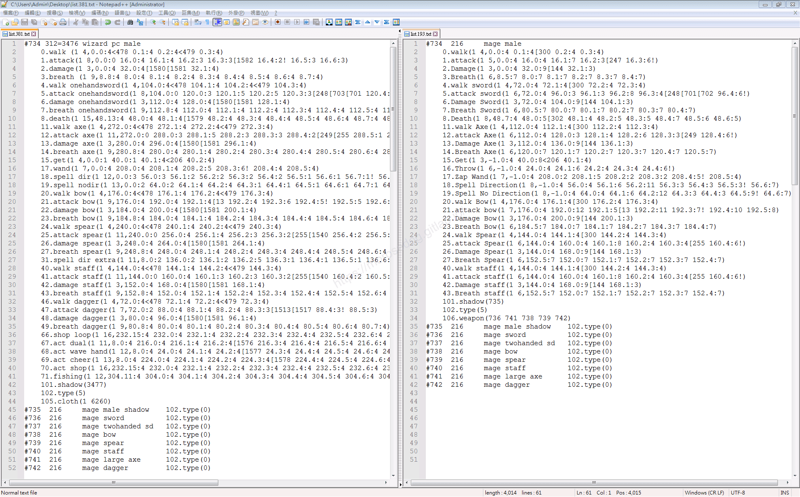

  * <font color="red">**`4.walk sword`**</font>，`381`(`3476-104.spr`)版本圖檔是有拿**劍**的，反之`193`(`734-72.spr`)是空手的。

```java
// 381
4.walk onehandsword(1 4,104.0:4<478 104.1:4 104.2:4<479 104.3:4)
// 193
4.walk sword(1 4,72.0:4 72.1:4[300 72.2:4 72.3:4)
```

## 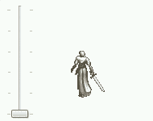 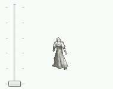

  * <font color="red">**`11.walk Axe`**</font>，`381`(`3476-272.spr`)版本圖檔是有拿**斧**的，反之`193`(`734-112.spr`)是空手的。

```java
// 381
11.walk axe(1 4,272.0:4<478 272.1:4 272.2:4<479 272.3:4)
// 193
11.walk Axe(1 4,112.0:4 112.1:4[300 112.2:4 112.3:4)
```

## 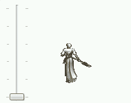 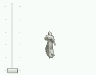

  * <font color="red">**`20.walk bow`**</font>，`381`(`3476-176.spr`)版本圖檔是有拿**弓**的，反之`193`(`734-176.spr`)是空手的。

```java
// 381
20.walk bow(1 4,176.0:4<478 176.1:4 176.2:4<479 176.3:4)
// 193
20.walk Bow(1 4,176.0:4 176.1:4[300 176.2:4 176.3:4)
```

## 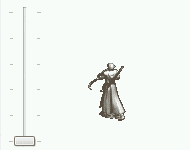 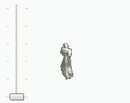

  * <font color="red">**`24.walk spear`**</font>，`381`(`3476-240.spr`)版本圖檔是有拿**矛**的，反之`193`(`734-144.spr`)是空手的。

```java
// 381
24.walk spear(1 4,240.0:4<478 240.1:4 240.2:4<479 240.3:4)
// 193
24.walk Spear(1 4,144.0:4 144.1:4[300 144.2:4 144.3:4)
```

## 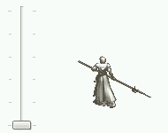 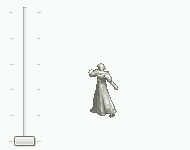

  * <font color="red">**`40.walk staff`**</font>，`381`(`3476-144.spr`)版本圖檔是有拿**杖**的，反之`193`(`734-144.spr`)是空手的。

```java
// 381
40.walk staff(1 4,144.0:4<478 144.1:4 144.2:4<479 144.3:4)
// 193
40.walk staff(1 4,144.0:4 144.1:4[300 144.2:4 144.3:4)
```

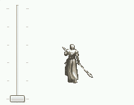 

* 以下分析`193`版本中的`weapon`：

  * 舉例<font color="blue">**男法師#734**</font>的`106.weapon(@ # $ % &)`。

```plain
106.weapon(736 741 738 739 742)
```

    * 第一個`@`設定為`736`，表示使用`劍#736`的變身編號。

    * 第二個`#`設定為`741`，表示使用`斧#741`的變身編號。

    * 第二個`$`設定為`738`，表示使用`弓#738`的變身編號。

    * 第二個`%`設定為`739`，表示使用`矛#739`的變身編號。

    * 第二個`&`設定為`742`，表示使用`杖#742`的變身編號。

```plain
#735  216     mage male shadow    102.type(0)
#736  216     mage sword          102.type(0)
#737  216     mage twohanded sd   102.type(0)
#738  216     mage bow            102.type(0)
#739  216     mage spear          102.type(0)
#740  216     mage staff          102.type(0)
#741  216     mage large axe      102.type(0)
#742  216     mage dagger         102.type(0)
```

  * 以下將各個變身編號預覽。
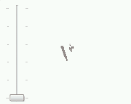 
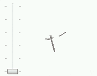 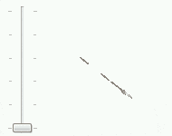 

  * 所以在低版本的變身編號中，人物武器是需要透過武器指令配合才會拿上武器。

---

* 在`381`版本套用`weapon`指令：​‌‌‌​​​​​‌‌‌​​‌​​‌‌​‌​​‌​‌‌‌​‌‌​​‌‌​​​​‌​‌‌‌​‌​​​‌‌​​‌​‌​​‌​‌‌​‌​‌‌​‌‌​​​‌‌​‌​​‌​‌‌​‌‌‌​​‌‌​​‌​‌​‌‌​​​​‌​‌‌​​‌‌‌​‌‌​​‌​‌​​‌​‌‌​‌​​‌‌​​‌​​​‌‌​​​​​​‌‌​​‌​​​‌‌​​‌​​​‌‌​​​​​​‌‌​‌​‌​​‌‌​​‌​​​‌‌​​‌​​​‌​‌‌​‌​‌‌‌​​​​​‌‌‌​​‌​​‌‌​‌​​‌​‌‌‌​‌‌​​‌‌​​​​‌​‌‌‌​‌​​​‌‌​​‌​‌​​‌​‌‌​‌​‌‌​‌‌​​​‌‌​‌​​‌​‌‌​‌‌‌​​‌‌​​‌​‌​‌‌​​​​‌​‌‌​​‌‌‌​‌‌​​‌​‌​​‌​‌‌​‌​​‌‌​​​‌​​‌‌​​​‌​​‌‌​‌‌‌

  * 將`weapon`指令加入到`381`版本的變身編號內。
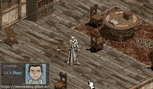

## 結論

* 1.武器指令只有在低版本的時候有使用，高版本的圖檔基本上都有帶武器了。

* 2.武器指令的五個編號分別代表(劍 斧 弓 矛 杖)。

* 3.武器指令硬是套在高版本的編碼內會造成武器重疊、殘影。

## 結語

原創文章真的不易，希望多多支持，感謝。
最後建議回顧一下首章[天堂私服 | 天堂私服架設教學](/private-lineage-20210712-private-lineage-0/#教學章節)，了解其章節目錄。

## 免責聲明

* 本部落格文章中皆<font color="red"><u>**不提供**</u></font>任何所謂的遊戲「主程式」、「模擬器」、「登入器」…等等相關程式的下載點。

* 本部落格文章中所見之遊戲主程式和服務器端程序均來自網路發佈，<font color="red"><u>版本歸**原作者**</u>所有</font>。

* 本部落格文章為研究SQL資料庫與修改JAVA語法使用，<font color="red">並<u>**非商業用途**</u>，亦<u>**無做營運事實等任何一切商業行為**</u>。</font>

* 本部落格文章內容是為研究學習設計思想和原理為目的，<font color="red"><u>**絕沒有故意侵權或惡意抄襲、篡改其他遊戲內容**</u></font>！

> 註：以上參考了
> [Linhelper論壇 - [教學] [彙整]List.spr變身檔網路教學彙整](https://bbs.linhelper.com/forum.php?mod=viewthread&tid=1301)

---

- **原文連結**：[J.J.'s Blogs - 變身檔-武器指令的教學](https://morosedog.gitlab.io/private-lineage-20220522-private-lineage-117/)
