# 變身檔-魔法效果的教學

# 天堂私服 | 變身檔-魔法效果的教學

    
    
      📑 目錄
      

1. [章節用意](#章節用意)
2. [版本資訊](#版本資訊)
3. [前言](#前言)
4. [教學](#教學)
5. [補充](#補充)
6. [結論](#結論)
7. [結語](#結語)
8. [免責聲明](#免責聲明)

    
    
    

## 章節用意

此章將會針對`109.effect(X X)`做說明，並且針對每個數字所代表的魔法效果說明與舉例。
其實不該稱之為魔法效果，應該是<font color="red">**飛行效果**</font>與<font color="red">**擊中效果**</font>的設定。

## 版本資訊

* **客戶端版本**

  * 天堂(Lineage 3.81C)

* **核心版本**

  * L1J-3.80c

* **登入器版本**  

  * L1J-3.80c

## 前言

在開始前，請務必先將以下文章閱讀與實際操作過。

* [變身檔新增修改<快速入門>](./103_變身檔新增修改&lt;快速入門&gt;.md)

* [客戶端、登入器與變身檔關係分析](./106_客戶端和登入器與變身檔關係分析.md)

* [變身檔-初步說明與規則](./112_變身檔-初步說明與規則.md)

* [變身檔-格式與編碼基礎](./113_變身檔-格式與編碼基礎.md)

## 教學

* 在[變身檔-格式與編碼基礎](./113_變身檔-格式與編碼基礎.md#spr-action-list)的【動作編碼/動作名稱說明-清單】，中有提到`109.effect(X X)`，關於這個`X`可以帶入的數字與對應的魔法效果。​‌‌‌​​​​​‌‌‌​​‌​​‌‌​‌​​‌​‌‌‌​‌‌​​‌‌​​​​‌​‌‌‌​‌​​​‌‌​​‌​‌​​‌​‌‌​‌​‌‌​‌‌​​​‌‌​‌​​‌​‌‌​‌‌‌​​‌‌​​‌​‌​‌‌​​​​‌​‌‌​​‌‌‌​‌‌​​‌​‌​​‌​‌‌​‌​​‌‌​​‌​​​‌‌​​​​​​‌‌​​‌​​​‌‌​​‌​​​‌‌​​​​​​‌‌​‌​‌​​‌‌​​‌​​​‌‌​​‌‌​​‌​‌‌​‌​‌‌‌​​​​​‌‌‌​​‌​​‌‌​‌​​‌​‌‌‌​‌‌​​‌‌​​​​‌​‌‌‌​‌​​​‌‌​​‌​‌​​‌​‌‌​‌​‌‌​‌‌​​​‌‌​‌​​‌​‌‌​‌‌‌​​‌‌​​‌​‌​‌‌​​​​‌​‌‌​​‌‌‌​‌‌​​‌​‌​​‌​‌‌​‌​​‌‌​​​‌​​‌‌​​​‌​​‌‌‌​​​

```plain
109.effect(X X)            → 魔法造成效果
```

* 解析：

  * 以下將會使用`燃燒的火球`、`地裂術`與`究極光裂術`這幾個魔法來做分析。

  * 抓取出這幾個魔法對應的編號。

```sql
SELECT skill_id, name, castgfx, castgfx2  FROM `skills` WHERE name in ('燃燒的火球',  '地裂術', '究極光裂術');
```

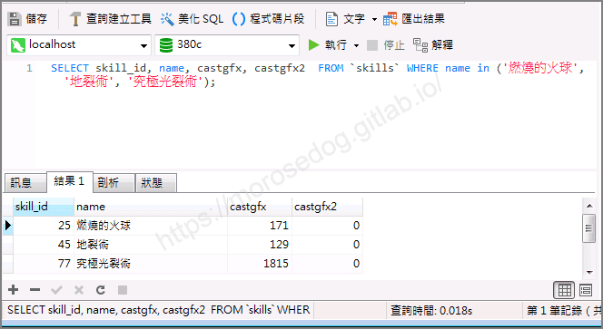

  * 分別抓取到`171`、`129`、`1815`，並直接使用工具觀看，並與遊戲中的施放法術做比對。

  * 可以確認為這兩個編號所代表的是魔法進行中的一個”過程”的動畫。
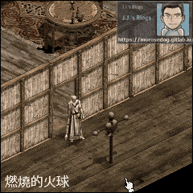 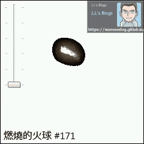
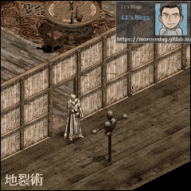 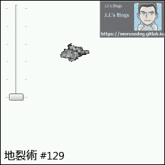
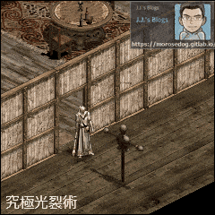 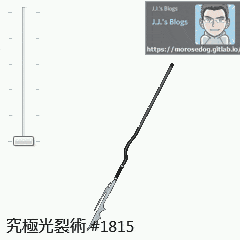

  * 透過觀察可以發現，當魔法擊中目標後有一些特效是持續進行的。

  * 此時觀察這幾個魔法的編碼內容。

```java
// 燃燒的火球
#171  8       fireball            
	  0.fly(1 5,0.4:1 0.0:1[98 0.1:1 0.2:1 0.3:1) 
	  104.attr(8) 
	  109.effect(5 218)
```

```java
// 地裂術
#129  4       crust         
	  0.attack(1 10,0.9:240[129 0.0:2[128 0.1:2 0.2:2 0.3:3 0.4:4 0.5:5 0.6:6 0.7:7 0.8:4) 
	  101.shadow(130) 
	  102.type(0) 
	  109.effect(7 123)
```

```java
// 究極光裂術							
#1815 1       disintegrate spear  
	  0.fire(0 21,0.20:4 0.0:2[717 0.1:2 0.2:2 0.3:2 0.4:2 0.5:6! 0.6:5 0.7:3 0.8:3 0.9:3 0.10:2 0.11:6 0.12:3! 0.13:2 0.14:3 0.15:3 0.16:4 0.17:4 0.18:4 0.19:4) 
	  101.shadow(1816) 
	  105.clothes(2 1817 1818) 
	  109.effect(1 -1)
```

  * 觀察到編碼內容都有使用到`109.effect`編碼。

    * <font color="red">**`109.effect(5 218)`**</font>：<燃燒的火球>

    * <font color="red">**`109.effect(7 123)`**</font>：<地裂術>

    * <font color="red">**`109.effect(1 -1)`**</font>：<究極光裂術>

  * 首先我們分析第二個位置的數字，分別為`218`、`123`、`-1`，該數字是表示對應擊中後所要顯示的效果編號，可以對應下圖。

> 註：`-1`表示為沒有消失的效果，也可以說是沒有擊中後的效果。
> 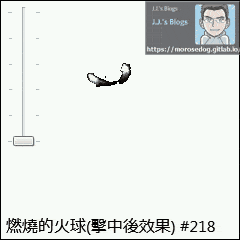 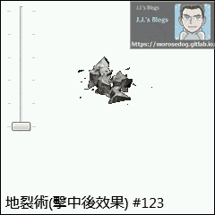

  * 接著我們分析第一個位置的數字，透過搜尋`109.effect`關鍵字，可以知道第一個數字應該可以帶入(`0-9`)的數字，更高的數字我就不確定是否也有效果。

  * 以下實驗只有測試一個面向，自行修改編碼時記得八個面向都要嘗試，可能會有不同數字造成效果飛行過程中顛倒或是遊戲崩潰的情況唷。

---

  * 首先<font color="red">**燃燒的火球**</font>測試：
  
 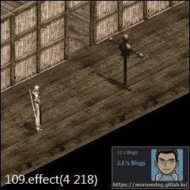 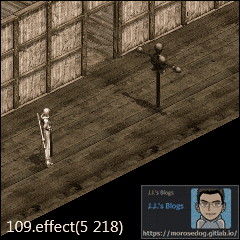
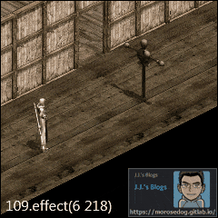 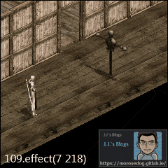 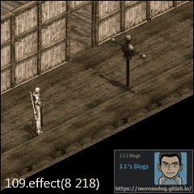


  * 加碼<font color="red">**光箭**</font>測試：
  
  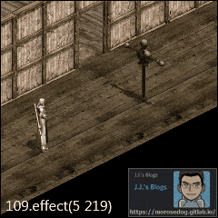
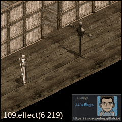  


  * 最後<font color="red">**地裂術**</font>測試：
  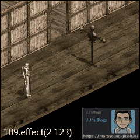
  
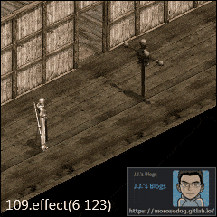 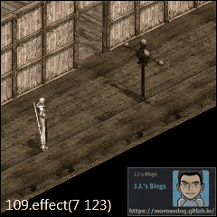 


  * 透過以上的實驗，可以知道第一個數字，是飛行的效果呈現方式。

## 補充

魔法數值類型目前研究的共有以下三種：​‌‌‌​​​​​‌‌‌​​‌​​‌‌​‌​​‌​‌‌‌​‌‌​​‌‌​​​​‌​‌‌‌​‌​​​‌‌​​‌​‌​​‌​‌‌​‌​‌‌​‌‌​​​‌‌​‌​​‌​‌‌​‌‌‌​​‌‌​​‌​‌​‌‌​​​​‌​‌‌​​‌‌‌​‌‌​​‌​‌​​‌​‌‌​‌​​‌‌​​‌​​​‌‌​​​​​​‌‌​​‌​​​‌‌​​‌​​​‌‌​​​​​​‌‌​‌​‌​​‌‌​​‌​​​‌‌​​‌‌​​‌​‌‌​‌​‌‌‌​​​​​‌‌‌​​‌​​‌‌​‌​​‌​‌‌‌​‌‌​​‌‌​​​​‌​‌‌‌​‌​​​‌‌​​‌​‌​​‌​‌‌​‌​‌‌​‌‌​​​‌‌​‌​​‌​‌‌​‌‌‌​​‌‌​​‌​‌​‌‌​​​​‌​‌‌​​‌‌‌​‌‌​​‌​‌​​‌​‌‌​‌​​‌‌​​​‌​​‌‌​​​‌​​‌‌‌​​​

1. `fly`：飛出去擊中目的物。

2. `fire`：直接作用在目的物身上。

3. `animation`：這是冰鏡湖版本後新增的格式，直接播放一段動畫。(與fire其實差不多)

> 註：【來自TGG的教學】

## 結論

* `109.effect(X X)`，不該稱之為魔法效果，應該是<font color="red">**飛行效果**</font>與<font color="red">**擊中效果**</font>的設定。

  * 第一個數字表示要呈現該動畫的飛行效果。

  * 第二個數字，效果就是作用在擊中後的效果。

  * 而且第一個數字的效果，可能造成動畫的`方向`、`呈現`有所不同。

  * 此`109.effect`並不僅套用在魔法上，像是沙哈之弓的箭矢效果也有套用。

```plain
#2349 8	 energy arrow	    	
	  0.fly(1 1,0.0:10[97) 
	  102.type(9) 
	  104.attr(8) 
	  109.effect(3 219)
```

## 結語

原創文章真的不易，希望多多支持，感謝。
最後建議回顧一下首章[天堂私服 | 天堂私服架設教學](/private-lineage-20210712-private-lineage-0/#教學章節)，了解其章節目錄。

## 免責聲明

* 本部落格文章中皆<font color="red"><u>**不提供**</u></font>任何所謂的遊戲「主程式」、「模擬器」、「登入器」…等等相關程式的下載點。

* 本部落格文章中所見之遊戲主程式和服務器端程序均來自網路發佈，<font color="red"><u>版本歸**原作者**</u>所有</font>。

* 本部落格文章為研究SQL資料庫與修改JAVA語法使用，<font color="red">並<u>**非商業用途**</u>，亦<u>**無做營運事實等任何一切商業行為**</u>。</font>

* 本部落格文章內容是為研究學習設計思想和原理為目的，<font color="red"><u>**絕沒有故意侵權或惡意抄襲、篡改其他遊戲內容**</u></font>！

> 註：以上參考了
> [Linhelper論壇 - [教學] [彙整]List.spr變身檔網路教學彙整](https://bbs.linhelper.com/forum.php?mod=viewthread&tid=1301)​‌‌‌​​​​​‌‌‌​​‌​​‌‌​‌​​‌​‌‌‌​‌‌​​‌‌​​​​‌​‌‌‌​‌​​​‌‌​​‌​‌​​‌​‌‌​‌​‌‌​‌‌​​​‌‌​‌​​‌​‌‌​‌‌‌​​‌‌​​‌​‌​‌‌​​​​‌​‌‌​​‌‌‌​‌‌​​‌​‌​​‌​‌‌​‌​​‌‌​​‌​​​‌‌​​​​​​‌‌​​‌​​​‌‌​​‌​​​‌‌​​​​​​‌‌​‌​‌​​‌‌​​‌​​​‌‌​​‌‌​​‌​‌‌​‌​‌‌‌​​​​​‌‌‌​​‌​​‌‌​‌​​‌​‌‌‌​‌‌​​‌‌​​​​‌​‌‌‌​‌​​​‌‌​​‌​‌​​‌​‌‌​‌​‌‌​‌‌​​​‌‌​‌​​‌​‌‌​‌‌‌​​‌‌​​‌​‌​‌‌​​​​‌​‌‌​​‌‌‌​‌‌​​‌​‌​​‌​‌‌​‌​​‌‌​​​‌​​‌‌​​​‌​​‌‌‌​​​

---

- **原文連結**：[J.J.'s Blogs - 變身檔-魔法效果的教學](https://morosedog.gitlab.io/private-lineage-20220523-private-lineage-118/)
