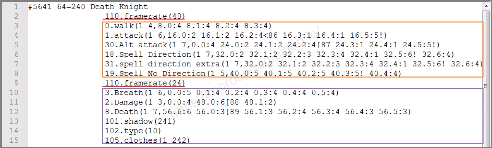
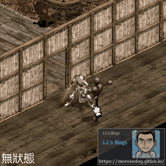
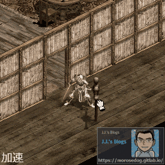
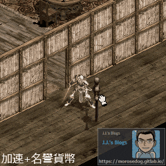
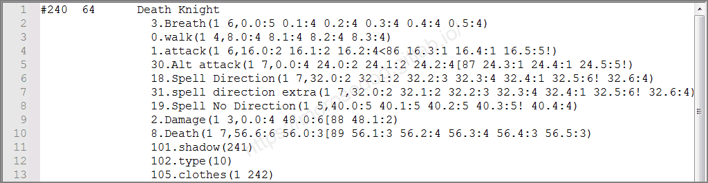
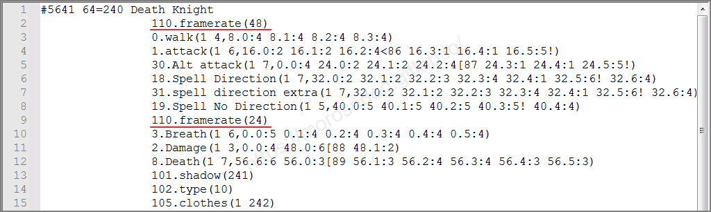
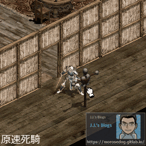
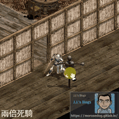

# 變身檔-加速指令的教學

# 天堂私服 | 變身檔-加速指令的教學

    
    
      📑 目錄
      

1. [章節用意](#章節用意)
2. [版本資訊](#版本資訊)
3. [前言](#前言)
4. [教學](#教學)
5. [framerate幀率<圖片播放速度>的一些說明：](#framerate幀率-lt-圖片播放速度-gt-的一些說明：)
6. [結論](#結論)
7. [結語](#結語)
8. [免責聲明](#免責聲明)

    
    
    

## 章節用意

此章將會針對`110.framerate(X)`做說明，並且針對每個數字所代表的加速說明與舉例。

## 版本資訊

* **客戶端版本**

  * 天堂(Lineage 3.81C)

* **核心版本**

  * L1J-3.80c

* **登入器版本**  

  * L1J-3.80c

## 前言

在開始前，請務必先將以下文章閱讀與實際操作過。

* [變身檔新增修改<快速入門>](./103_變身檔新增修改&lt;快速入門&gt;.md)

* [客戶端、登入器與變身檔關係分析](./106_客戶端和登入器與變身檔關係分析.md)

* [變身檔-初步說明與規則](./112_變身檔-初步說明與規則.md)

* [變身檔-格式與編碼基礎](./113_變身檔-格式與編碼基礎.md)

## 教學

* 在[變身檔-格式與編碼基礎](./113_變身檔-格式與編碼基礎.md#spr-action-list)的【動作編碼/動作名稱說明-清單】，中有提到`110.framerate(X)`，關於這個`X`可以帶入的數字與對應的加速效果。​‌‌‌​​​​​‌‌‌​​‌​​‌‌​‌​​‌​‌‌‌​‌‌​​‌‌​​​​‌​‌‌‌​‌​​​‌‌​​‌​‌​​‌​‌‌​‌​‌‌​‌‌​​​‌‌​‌​​‌​‌‌​‌‌‌​​‌‌​​‌​‌​‌‌​​​​‌​‌‌​​‌‌‌​‌‌​​‌​‌​​‌​‌‌​‌​​‌‌​​‌​​​‌‌​​​​​​‌‌​​‌​​​‌‌​​‌​​​‌‌​​​​​​‌‌​‌​‌​​‌‌​​‌​​​‌‌​‌​​​​‌​‌‌​‌​‌‌‌​​​​​‌‌‌​​‌​​‌‌​‌​​‌​‌‌‌​‌‌​​‌‌​​​​‌​‌‌‌​‌​​​‌‌​​‌​‌​​‌​‌‌​‌​‌‌​‌‌​​​‌‌​‌​​‌​‌‌​‌‌‌​​‌‌​​‌​‌​‌‌​​​​‌​‌‌​​‌‌‌​‌‌​​‌​‌​​‌​‌‌​‌​​‌‌​​​‌​​‌‌​​​‌​​‌‌‌​​‌

```plain
110.framerate(X)           → 加速指令
```

* ## `framerate`幀率<圖片播放速度>的一些說明：

  * 數字就是圖片的播放速度，以下提供公式與常見的數字與速度的比對。

    * 公式：

```plain
110.(X) X = 一秒鐘的畫格數 X/24 = 加速倍率
```

      * 數字與速度比對：

```plain
110.framerate(24)  = 24/24  = 1      倍
110.framerate(36)  = 36/24  = 1.5    倍
110.framerate(40)  = 40/24  = 1.66   倍
110.framerate(48)  = 48/24  = 2      倍
110.framerate(255) = 255/24 = 10.625 倍
```

> 註1：數字不可填入`0`，會造成遊戲崩潰；數字可以填寫超過`255`依然有效果，但過高其實沒太大意義，作者嘗試過`512`、`1024`依舊有效果與差異。
> 註2：網路上有人說`36` = 綠水速度，`40` = 勇水速度，其實自己實測後會發現速度並不一樣，建議還是自己調整嘗試比對會比較實際。

---

  * 設定後的指令下方的動作編碼皆受到影響。


    * `110.framerate(48)`下方會影響的<font color="orange">**<u>橘色框</u>**</font>內的動作編碼，播放速度都加速為<font color="red">**兩倍**</font>。

```plain
0.walk                     → 空手走路動作
1.attack                   → 空手攻擊動作
30.Alt attack              → 攻擊必殺技
18.Spell Direction         → 攻擊魔法
31.spell direction extra   → 魔法必殺技
19.Spell No Direction      → 輔助魔法
```

    * `110.framerate(24)`下方會影響的<font color="purple">**<u>紫色框</u>**</font>內的動作編碼，播放速度都恢復成<font color="blue">**原速**</font>。

```plain
3.Breath                   → 呼吸動作
2.Damage                   → 空手被打動作
8.Death                    → 死亡動作
101.shadow                 → 影子圖
102.type                   → 物件分辨
105.clothes                → 附加物件
```

---

  * 設定`framerate`與遊戲內喝綠水、勇水、名譽貨幣…等等，是不互相牴觸是可疊加的。

    * 舉例<font color="blue">**死亡騎士#5641**</font>攻擊的加速指令為`110.framerate(48)`。

    * 下圖依序為：無加速的攻擊速度、加速後的攻擊速度、加速與名譽貨幣的攻擊速度。(專注在木頭人轉動速度即可看出差異)
  

* 比較死亡騎士的`framerate`的範例：

  * <font color="blue">**死亡騎士#240**</font><font color="red">**`110.framerate(24)`**</font>：<原速死騎>


  * <font color="blue">**死亡騎士#5641**</font><font color="red">**`110.framerate(48)`**</font>：<兩倍死騎>


  * 兩個死亡騎士的攻擊速度比對。
 

## 結論

* `110.framerate(X)`：​‌‌‌​​​​​‌‌‌​​‌​​‌‌​‌​​‌​‌‌‌​‌‌​​‌‌​​​​‌​‌‌‌​‌​​​‌‌​​‌​‌​​‌​‌‌​‌​‌‌​‌‌​​​‌‌​‌​​‌​‌‌​‌‌‌​​‌‌​​‌​‌​‌‌​​​​‌​‌‌​​‌‌‌​‌‌​​‌​‌​​‌​‌‌​‌​​‌‌​​‌​​​‌‌​​​​​​‌‌​​‌​​​‌‌​​‌​​​‌‌​​​​​​‌‌​‌​‌​​‌‌​​‌​​​‌‌​‌​​​​‌​‌‌​‌​‌‌‌​​​​​‌‌‌​​‌​​‌‌​‌​​‌​‌‌‌​‌‌​​‌‌​​​​‌​‌‌‌​‌​​​‌‌​​‌​‌​​‌​‌‌​‌​‌‌​‌‌​​​‌‌​‌​​‌​‌‌​‌‌‌​​‌‌​​‌​‌​‌‌​​​​‌​‌‌​​‌‌‌​‌‌​​‌​‌​​‌​‌‌​‌​​‌‌​​​‌​​‌‌​​​‌​​‌‌‌​​‌

  * 1. 設定`110.framerate(24)` = 沒有設定 = 原速。

  * 1. 設定`110.framerate(X)`，影響後方的其他動作編碼速度，如不想被加速的動作編碼，需要在前方加入原速設定。

* 額外補充：

  * 官方的`55`、`60`、`65`、`70`的變身後的攻擊、移動、施放速度、硬直..等等，並<font color="red">不是</font>透過`110.framerate(X)`指令加速的。

## 結語

原創文章真的不易，希望多多支持，感謝。
最後建議回顧一下首章[天堂私服 | 天堂私服架設教學](/private-lineage-20210712-private-lineage-0/#教學章節)，了解其章節目錄。

## 免責聲明

* 本部落格文章中皆<font color="red"><u>**不提供**</u></font>任何所謂的遊戲「主程式」、「模擬器」、「登入器」…等等相關程式的下載點。

* 本部落格文章中所見之遊戲主程式和服務器端程序均來自網路發佈，<font color="red"><u>版本歸**原作者**</u>所有</font>。

* 本部落格文章為研究SQL資料庫與修改JAVA語法使用，<font color="red">並<u>**非商業用途**</u>，亦<u>**無做營運事實等任何一切商業行為**</u>。</font>

* 本部落格文章內容是為研究學習設計思想和原理為目的，<font color="red"><u>**絕沒有故意侵權或惡意抄襲、篡改其他遊戲內容**</u></font>！

> 註：以上參考了
> [Linhelper論壇 - [教學] [彙整]List.spr變身檔網路教學彙整](https://bbs.linhelper.com/forum.php?mod=viewthread&tid=1301)​‌‌‌​​​​​‌‌‌​​‌​​‌‌​‌​​‌​‌‌‌​‌‌​​‌‌​​​​‌​‌‌‌​‌​​​‌‌​​‌​‌​​‌​‌‌​‌​‌‌​‌‌​​​‌‌​‌​​‌​‌‌​‌‌‌​​‌‌​​‌​‌​‌‌​​​​‌​‌‌​​‌‌‌​‌‌​​‌​‌​​‌​‌‌​‌​​‌‌​​‌​​​‌‌​​​​​​‌‌​​‌​​​‌‌​​‌​​​‌‌​​​​​​‌‌​‌​‌​​‌‌​​‌​​​‌‌​‌​​​​‌​‌‌​‌​‌‌‌​​​​​‌‌‌​​‌​​‌‌​‌​​‌​‌‌‌​‌‌​​‌‌​​​​‌​‌‌‌​‌​​​‌‌​​‌​‌​​‌​‌‌​‌​‌‌​‌‌​​​‌‌​‌​​‌​‌‌​‌‌‌​​‌‌​​‌​‌​‌‌​​​​‌​‌‌​​‌‌‌​‌‌​​‌​‌​​‌​‌‌​‌​​‌‌​​​‌​​‌‌​​​‌​​‌‌‌​​‌

---

- **原文連結**：[J.J.'s Blogs - 變身檔-加速指令的教學](https://morosedog.gitlab.io/private-lineage-20220524-private-lineage-119/)
