# 變身檔-走路分析與修改

# 天堂私服 | 變身檔-走路分析與修改

    
    
      📑 目錄
      

1. [章節用意](#章節用意)
2. [版本資訊](#版本資訊)
3. [前言](#前言)
4. [注意事項](#注意事項)
5. [分析](#分析)
6. [實驗修改](#實驗修改)
7. [結論](#結論)
8. [結語](#結語)
9. [免責聲明](#免責聲明)

    
    
    

## 章節用意

此章將會針對變身檔中的`0.walk`空手走路動作，進行分析與修改，進而瞭解其特性與限制。

## 版本資訊

* **客戶端版本**

  * 天堂(Lineage 3.81C)

* **核心版本**

  * L1J-3.80c

* **登入器版本**  

  * L1J-3.80c

## 前言

在開始前，請務必先將以下文章閱讀與實際操作過。

* [變身檔新增修改<快速入門>](./103_變身檔新增修改&lt;快速入門&gt;.md)

* [客戶端、登入器與變身檔關係分析](./106_客戶端和登入器與變身檔關係分析.md)

* [變身檔-初步說明與規則](./112_變身檔-初步說明與規則.md)

* [變身檔-格式與編碼基礎](./113_變身檔-格式與編碼基礎.md)

## 注意事項

* 請將伺服器端開啟加速器檢測功能。

  * 原因：用於測試修改變身檔總單位時間的偵測極限。

```yaml
# 加速器偵測功能,開啟後將檢驗封包發送間隔時間
# Move: 移動間隔  Attack: 攻撃間隔  Spell: 技能使用間隔
CheckMoveInterval = true
CheckAttackInterval = true
CheckSpellInterval = true
```

* 人物使用<font color="red">非</font>`GM`角色進行測試。

  * 原因：此測試的伺服器核心會將加速器偵測排除掉`GM`角色。

* 請<font color="red">不要</font>因更動變身檔後，重新產生和更新資料庫的`spr_action`。

  * 原因：保持修改前的資料，測試伺服器的偵測極限。

## 分析

* 圖片張數數量分析<根據`TW13081901.txt`>：

  * 有向性：

```java
// 動作編碼   = 共有幾個編號使用 → 說明

0.walk(1 0)  = 0               → 無，理論上不可能沒有圖片。
0.walk(1 1)  = 765             → 表示不會移動，例：木頭人。
0.walk(1 2)  = 3               → 理論不會移動，例：黑暗精靈稻草人。
0.walk(1 3)  = 6               → ?
0.walk(1 4)  = 789             → 使用了4張圖，例：王子、骷髏、石頭高崙、巴風特..等等。
0.walk(1 5)  = 3               → 使用了5張圖，例：魔法師。
0.walk(1 6)  = 67              → 使用了6張圖，例：人形殭屍、哥布林、亞力安..等等。
0.walk(1 7)  = 1               → ? 例：皮革工藝NPC。
0.walk(1 8)  = 1447            → 使用了8張圖，例：狼、狼人、萊肯、怪手、格倫NPC..等等。
0.walk(1 9)  = 13              → 使用了9張圖，例：青蛙、卡司特、卡司特王..等等。
0.walk(1 10) = 4               → ?
0.walk(1 11) = 0               → 無。
0.walk(1 12) = 753             → 使用了12張圖，例：妖魔殭屍、紙人、活鎧甲..等等。
...省略...   = 0               → 無。
0.walk(1 15) = 1               → ?
```

> 註：可以看到使用占比較高的為`4`與`8`張圖，基本上可以說多數的人物、怪物都是使用`4`與`8`張圖。​‌‌‌​​​​​‌‌‌​​‌​​‌‌​‌​​‌​‌‌‌​‌‌​​‌‌​​​​‌​‌‌‌​‌​​​‌‌​​‌​‌​​‌​‌‌​‌​‌‌​‌‌​​​‌‌​‌​​‌​‌‌​‌‌‌​​‌‌​​‌​‌​‌‌​​​​‌​‌‌​​‌‌‌​‌‌​​‌​‌​​‌​‌‌​‌​​‌‌​​‌​​​‌‌​​​​​​‌‌​​‌​​​‌‌​​‌​​​‌‌​​​​​​‌‌​‌​‌​​‌‌​​‌​​​‌‌​‌​‌​​‌​‌‌​‌​‌‌‌​​​​​‌‌‌​​‌​​‌‌​‌​​‌​‌‌‌​‌‌​​‌‌​​​​‌​‌‌‌​‌​​​‌‌​​‌​‌​​‌​‌‌​‌​‌‌​‌‌​​​‌‌​‌​​‌​‌‌​‌‌‌​​‌‌​​‌​‌​‌‌​​​​‌​‌‌​​‌‌‌​‌‌​​‌​‌​​‌​‌‌​‌​​‌‌​​​‌​​‌‌​​‌​​​‌‌​​​​

  * 無向性：

```java
// 動作編碼   = 共有幾個編號使用 → 說明

0.walk(0 0)  = 0               → 無，理論上不可能沒有圖片。
0.walk(0 1)  = 30              → 船、叉叉圖。
0.walk(0 8)  = 3               → 矮史密斯NPC。
0.walk(0 11) = 1               → 沙漠進蟻洞的流沙動畫。
0.walk(0 16) = 3               → 菁英林德拜爾制空動畫。
```

> 註：以上僅自己透過分析變身檔整理出來的資訊，並不表示就是最正確與完整。
> 註：走路的部分不僅僅只有空手走路，還有拿不同武器的走路，這邊就不特別列出。

---

* 以下盡量提供各個`0.walk`的範例：

  * <font color="blue">**王子#0**</font>：
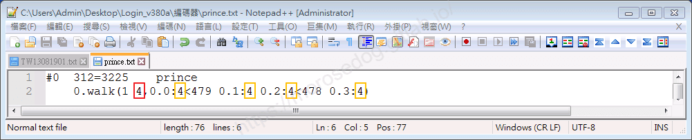

    * 圖片張數 = `4`

    * 時間總合 = `4 + 4 + 4 + 4 = 16`

  * <font color="blue">**人形殭屍#52**</font>：
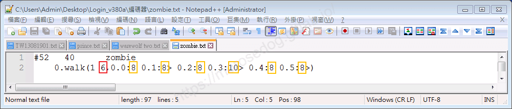

    * 圖片張數 = `6`

    * 時間總合 = `8 + 8 + 8 + 10 + 8 + 8 = 50`

  * <font color="blue">**狼人#1110**</font>：
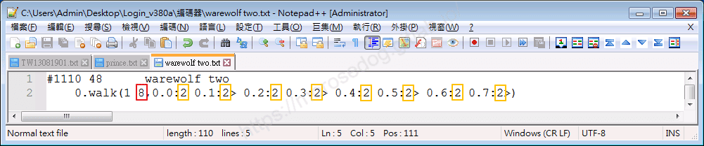

    * 圖片張數 = `8`

    * 時間總合 = `2 + 2 + 2 + 2 + 2 + 2 + 2 + 2 = 16`

  * <font color="blue">**活鎧甲#1578**</font>：
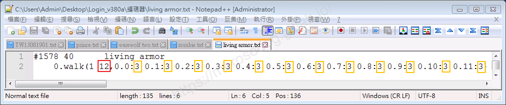

    * 圖片張數 = `12`

    * 時間總合 = `3 + 3 + 3 + 3 + 3 + 3 + 3 + 3 + 3 + 3 + 3 + 3 = 36`

## 實驗修改

* 以下使用<font color="blue">**王子#0**</font>，實驗修改。

```plain
0.walk(1 4,0.0:4<479 0.1:4 0.2:4<478 0.3:4)
```

* 改變圖片張數：​‌‌‌​​​​​‌‌‌​​‌​​‌‌​‌​​‌​‌‌‌​‌‌​​‌‌​​​​‌​‌‌‌​‌​​​‌‌​​‌​‌​​‌​‌‌​‌​‌‌​‌‌​​​‌‌​‌​​‌​‌‌​‌‌‌​​‌‌​​‌​‌​‌‌​​​​‌​‌‌​​‌‌‌​‌‌​​‌​‌​​‌​‌‌​‌​​‌‌​​‌​​​‌‌​​​​​​‌‌​​‌​​​‌‌​​‌​​​‌‌​​​​​​‌‌​‌​‌​​‌‌​​‌​​​‌‌​‌​‌​​‌​‌‌​‌​‌‌‌​​​​​‌‌‌​​‌​​‌‌​‌​​‌​‌‌‌​‌‌​​‌‌​​​​‌​‌‌‌​‌​​​‌‌​​‌​‌​​‌​‌‌​‌​‌‌​‌‌​​​‌‌​‌​​‌​‌‌​‌‌‌​​‌‌​​‌​‌​‌‌​​​​‌​‌‌​​‌‌‌​‌‌​​‌​‌​​‌​‌‌​‌​​‌‌​​​‌​​‌‌​​‌​​​‌‌​​​​

  * 分別為`0`、`1`、`2`、`3`、時間總合都維持原來的`16`。

    * `0` = 叉叉，`1` = 無法移動，`2` = 無法移動，`3` = 可以移動。 

```plain
0.walk(1 0)
0.walk(1 1,0.0:16<479)
0.walk(1 2,0.0:8<479 0.3:8)
0.walk(1 3,0.0:4<479 0.2:6<478 0.3:6)
```

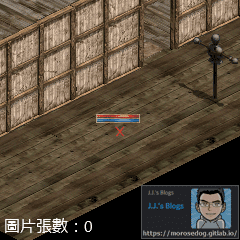 
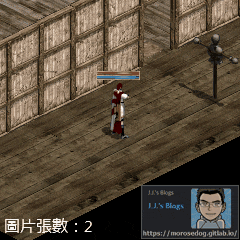 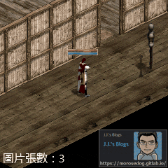

* 改變時間總合：

  * 分別為`15`、`14`、`13`、`12`，圖片張數維持原來的`4`。

    * 數字越小，可以觀察到有些微的移動速度加速。

```plain
0.walk(1 4,0.0:4<479 0.1:4 0.2:4<478 0.3:3)
0.walk(1 4,0.0:4<479 0.1:4 0.2:3<478 0.3:3)
0.walk(1 4,0.0:4<479 0.1:3 0.2:3<478 0.3:3)
0.walk(1 4,0.0:3<479 0.1:3 0.2:3<478 0.3:3)
```

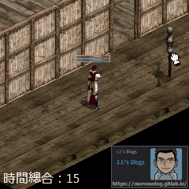 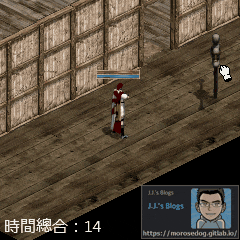
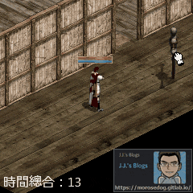 

  * 修改為`4`，圖片張數維持原來的`4`。

    * 可見移動速度明顯加快，但是移動過快，被伺服器的偵測到而傳送特定地圖了。

```plain
0.walk(1 4,0.0:1<479 0.1:1 0.2:1<478 0.3:1)
```

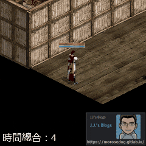

> 註：每個伺服器偵測的基準與演算法請自行研究分析。

---

* 以下使用<font color="blue">**狼人#1110**</font>，實驗修改。

```plain
0.walk(1 8,0.0:2 0.1:2> 0.2:2 0.3:2> 0.4:2 0.5:2> 0.6:2 0.7:2>)
```

* 改變圖片張數：

  * 修改為`4`，時間總合都維持原來的`16`。

    * 於原始`8`張圖的比較，會有錯覺感覺走比較快，但是其實是一樣的速度。

```plain
0.walk(1 8,0.0:4 0.2:4 0.4:4 0.6:4)
```

 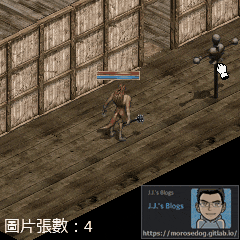

## 結論

* 針對`0.walk`走路動作 - ​‌‌‌​​​​​‌‌‌​​‌​​‌‌​‌​​‌​‌‌‌​‌‌​​‌‌​​​​‌​‌‌‌​‌​​​‌‌​​‌​‌​​‌​‌‌​‌​‌‌​‌‌​​​‌‌​‌​​‌​‌‌​‌‌‌​​‌‌​​‌​‌​‌‌​​​​‌​‌‌​​‌‌‌​‌‌​​‌​‌​​‌​‌‌​‌​​‌‌​​‌​​​‌‌​​​​​​‌‌​​‌​​​‌‌​​‌​​​‌‌​​​​​​‌‌​‌​‌​​‌‌​​‌​​​‌‌​‌​‌​​‌​‌‌​‌​‌‌‌​​​​​‌‌‌​​‌​​‌‌​‌​​‌​‌‌‌​‌‌​​‌‌​​​​‌​‌‌‌​‌​​​‌‌​​‌​‌​​‌​‌‌​‌​‌‌​‌‌​​​‌‌​‌​​‌​‌‌​‌‌‌​​‌‌​​‌​‌​‌‌​​​​‌​‌‌​​‌‌‌​‌‌​​‌​‌​​‌​‌‌​‌​​‌‌​​​‌​​‌‌​​‌​​​‌‌​​​​

  * 最少需要`3`幾張圖，才可移動。

  * 時間總合基於伺服器的偵測，而判斷可減少多少，不然很容易回碩、偵測、退回。

  * 如需要動作更加細膩，可使用多張圖片張數達成，例：狼人。

  * 多數動作緩慢的怪物、`NPC`…等等，基本上都是使用多張圖片，但也有例外，例：狼人。

> 注意：走路的部分不僅僅只有空手走路，還有拿不同武器的走路。

## 結語

原創文章真的不易，希望多多支持，感謝。
最後建議回顧一下首章[天堂私服 | 天堂私服架設教學](/private-lineage-20210712-private-lineage-0/#教學章節)，了解其章節目錄。

## 免責聲明

* 本部落格文章中皆<font color="red"><u>**不提供**</u></font>任何所謂的遊戲「主程式」、「模擬器」、「登入器」…等等相關程式的下載點。

* 本部落格文章中所見之遊戲主程式和服務器端程序均來自網路發佈，<font color="red"><u>版本歸**原作者**</u>所有</font>。

* 本部落格文章為研究SQL資料庫與修改JAVA語法使用，<font color="red">並<u>**非商業用途**</u>，亦<u>**無做營運事實等任何一切商業行為**</u>。</font>

* 本部落格文章內容是為研究學習設計思想和原理為目的，<font color="red"><u>**絕沒有故意侵權或惡意抄襲、篡改其他遊戲內容**</u></font>！

> 註：以上參考了
> [Linhelper論壇 - [教學] [彙整]List.spr變身檔網路教學彙整](https://bbs.linhelper.com/forum.php?mod=viewthread&tid=1301)​‌‌‌​​​​​‌‌‌​​‌​​‌‌​‌​​‌​‌‌‌​‌‌​​‌‌​​​​‌​‌‌‌​‌​​​‌‌​​‌​‌​​‌​‌‌​‌​‌‌​‌‌​​​‌‌​‌​​‌​‌‌​‌‌‌​​‌‌​​‌​‌​‌‌​​​​‌​‌‌​​‌‌‌​‌‌​​‌​‌​​‌​‌‌​‌​​‌‌​​‌​​​‌‌​​​​​​‌‌​​‌​​​‌‌​​‌​​​‌‌​​​​​​‌‌​‌​‌​​‌‌​​‌​​​‌‌​‌​‌​​‌​‌‌​‌​‌‌‌​​​​​‌‌‌​​‌​​‌‌​‌​​‌​‌‌‌​‌‌​​‌‌​​​​‌​‌‌‌​‌​​​‌‌​​‌​‌​​‌​‌‌​‌​‌‌​‌‌​​​‌‌​‌​​‌​‌‌​‌‌‌​​‌‌​​‌​‌​‌‌​​​​‌​‌‌​​‌‌‌​‌‌​​‌​‌​​‌​‌‌​‌​​‌‌​​​‌​​‌‌​​‌​​​‌‌​​​​

---

- **原文連結**：[J.J.'s Blogs - 變身檔-走路分析與修改](https://morosedog.gitlab.io/private-lineage-20220525-private-lineage-120/)
