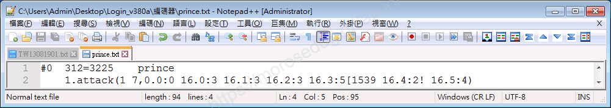
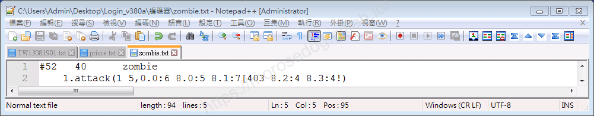
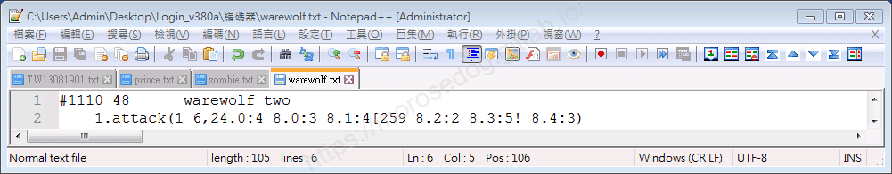
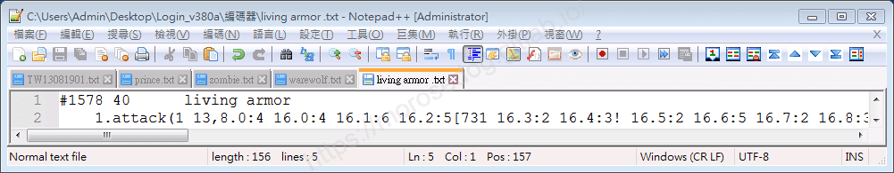
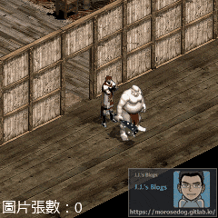
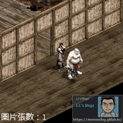
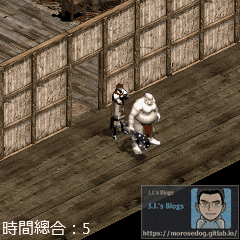
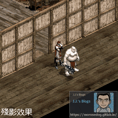
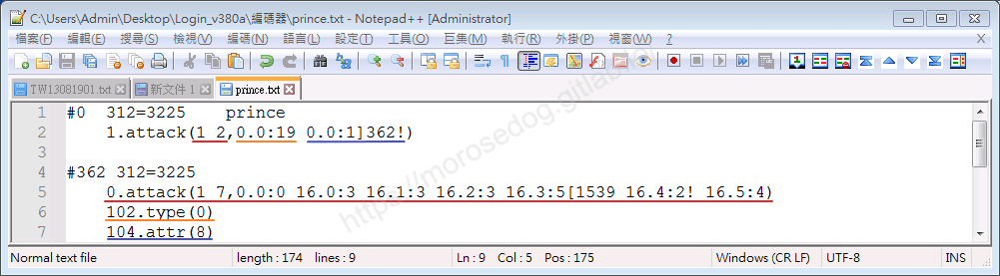

# 變身檔-攻擊分析與修改

# 天堂私服 | 變身檔-攻擊分析與修改

    
    
      📑 目錄
      

1. [章節用意](#章節用意)
2. [版本資訊](#版本資訊)
3. [前言](#前言)
4. [注意事項](#注意事項)
5. [分析](#分析)
6. [實驗修改](#實驗修改)
7. [殘影修改](#殘影修改)
8. [結論](#結論)
9. [結語](#結語)
10. [免責聲明](#免責聲明)

    
    
    

## 章節用意

此章將會針對變身檔中的`1.attack`空手攻擊動作，進行分析與修改，進而瞭解其特性與限制。

## 版本資訊

* **客戶端版本**

  * 天堂(Lineage 3.81C)

* **核心版本**

  * L1J-3.80c

* **登入器版本**  

  * L1J-3.80c

## 前言

在開始前，請務必先將以下文章閱讀與實際操作過。

* [變身檔新增修改<快速入門>](./103_變身檔新增修改&lt;快速入門&gt;.md)

* [客戶端、登入器與變身檔關係分析](./106_客戶端和登入器與變身檔關係分析.md)

* [變身檔-初步說明與規則](./112_變身檔-初步說明與規則.md)

* [變身檔-格式與編碼基礎](./113_變身檔-格式與編碼基礎.md)

## 注意事項

* 請將伺服器端開啟加速器檢測功能。

  * 原因：用於測試修改變身檔總單位時間的偵測極限。

```yaml
# 加速器偵測功能,開啟後將檢驗封包發送間隔時間
# Move: 移動間隔  Attack: 攻撃間隔  Spell: 技能使用間隔
CheckMoveInterval = true
CheckAttackInterval = true
CheckSpellInterval = true
```

* 人物使用<font color="red">非</font>`GM`角色進行測試。

  * 原因：此測試的伺服器核心會將加速器偵測排除掉`GM`角色。

* 請<font color="red">不要</font>因更動變身檔後，重新產生和更新資料庫的`spr_action`。

  * 原因：保持修改前的資料，測試伺服器的偵測極限。

## 分析

* 圖片張數數量分析<根據`TW13081901.txt`>：

  * 有向性：

```java
// 動作編碼   = 共有幾個編號使用 → 說明

1.attack(1 0)  = 0             → 無，理論上不可能沒有圖片。
1.attack(1 1)  = 0             → 無。
1.attack(1 2)  = 0             → 無。
1.attack(1 3)  = 2             → 使用了3張圖，例：莫妮亞。
1.attack(1 4)  = 24            → 使用了4張圖，例：史萊姆、夏洛伯..等等。
1.attack(1 5)  = 208           → 使用了5張圖，例：骷髏、人形殭屍、侏儒..等等。
1.attack(1 6)  = 341           → 使用了6張圖，例：男騎士、男妖精、妖魔、狼人..等等。
1.attack(1 7)  = 540           → 使用了7張圖，例：王子、甘地妖魔..等等。
1.attack(1 8)  = 500           → 使用了8張圖，例：公主、女騎士、狼..等等。
1.attack(1 9)  = 415           → 使用了9張圖，例：女妖精、石頭高崙..等等。
1.attack(1 10) = 174           → 使用了10張圖，例：長老、卡士柏..等等。
1.attack(1 11) = 119           → 使用了11張圖，例：漂浮之眼、老虎..等等。
1.attack(1 12) = 46            → 使用了12張圖，例：巨人、火焰弓箭手..等等。
1.attack(1 13) = 54            → 使用了13張圖，例：死神、活鎧甲..等等。
...剩餘自行搜尋...
```

  * 無向性：

```java
// 動作編碼   = 共有幾個編號使用 → 說明

1.attack(0 8)  = 1             → 地裂術。
```

> 註：以上僅自己透過分析變身檔整理出來的資訊，並不表示就是最正確與完整。
> 註：攻擊的部分不僅僅只有空手攻擊，還有拿不同武器的攻擊，這邊就不特別列出。​‌‌‌​​​​​‌‌‌​​‌​​‌‌​‌​​‌​‌‌‌​‌‌​​‌‌​​​​‌​‌‌‌​‌​​​‌‌​​‌​‌​​‌​‌‌​‌​‌‌​‌‌​​​‌‌​‌​​‌​‌‌​‌‌‌​​‌‌​​‌​‌​‌‌​​​​‌​‌‌​​‌‌‌​‌‌​​‌​‌​​‌​‌‌​‌​​‌‌​​‌​​​‌‌​​​​​​‌‌​​‌​​​‌‌​​‌​​​‌‌​​​​​​‌‌​‌​‌​​‌‌​​‌​​​‌‌​‌‌​​​‌​‌‌​‌​‌‌‌​​​​​‌‌‌​​‌​​‌‌​‌​​‌​‌‌‌​‌‌​​‌‌​​​​‌​‌‌‌​‌​​​‌‌​​‌​‌​​‌​‌‌​‌​‌‌​‌‌​​​‌‌​‌​​‌​‌‌​‌‌‌​​‌‌​​‌​‌​‌‌​​​​‌​‌‌​​‌‌‌​‌‌​​‌​‌​​‌​‌‌​‌​​‌‌​​​‌​​‌‌​​‌​​​‌‌​​​‌

---

* 以下盡量提供各個`1.attack`的範例：

  * <font color="blue">**王子#0**</font>：


    * 圖片張數 = `7`

    * 時間總合 = `0 + 3 + 3 + 3 + 5 + 2 + 4 = 20`

  * <font color="blue">**人形殭屍#52**</font>：


    * 圖片張數 = `5`

    * 時間總合 = `6 + 5 + 7 + 4 + 4 = 26`

  * <font color="blue">**狼人#1110**</font>：


    * 圖片張數 = `6`

    * 時間總合 = `4 + 3 + 4 + 2 + 5 + 3 = 21`

  * <font color="blue">**活鎧甲#1578**</font>：


    * 圖片張數 = `13`

    * 時間總合 = `4 + 4 + 6 + 5 + 2 + 3 + 2 + 5 + 2 + 3 + 4 + 4 + 4 = 48`

## 實驗修改

* 以下使用<font color="blue">**王子#0**</font>，實驗修改。

```plain
1.attack(1 7,0.0:0 16.0:3 16.1:3 16.2:3 16.3:5[1539 16.4:2! 16.5:4)
```

* 改變圖片張數：

  * 分別為`0`、`1`、`2`、`3`、時間總合都維持原來的`20`。

    * `0` = 可攻擊，人物消失，怪物<font color="red">無</font>被打動作以及被打聲音。

    * `1` = 可攻擊，人物正常，怪物有被打動作以及被打聲音，**但被攻擊到前怪物就已經被打動作和聲音**。

    * `2` = 可攻擊，人物正常，怪物有被打動作以及被打聲音。

    * `3` = 可攻擊，人物正常，怪物有被打動作以及被打聲音。 

```plain
1.attack(1 0)
1.attack(1 1,0.0:20!)
1.attack(1 2,0.0:10 16.5:10!)
1.attack(1 3,0.0:6 16.4:7! 16.5:7)
```

 
 

* 改變時間總合：​‌‌‌​​​​​‌‌‌​​‌​​‌‌​‌​​‌​‌‌‌​‌‌​​‌‌​​​​‌​‌‌‌​‌​​​‌‌​​‌​‌​​‌​‌‌​‌​‌‌​‌‌​​​‌‌​‌​​‌​‌‌​‌‌‌​​‌‌​​‌​‌​‌‌​​​​‌​‌‌​​‌‌‌​‌‌​​‌​‌​​‌​‌‌​‌​​‌‌​​‌​​​‌‌​​​​​​‌‌​​‌​​​‌‌​​‌​​​‌‌​​​​​​‌‌​‌​‌​​‌‌​​‌​​​‌‌​‌‌​​​‌​‌‌​‌​‌‌‌​​​​​‌‌‌​​‌​​‌‌​‌​​‌​‌‌‌​‌‌​​‌‌​​​​‌​‌‌‌​‌​​​‌‌​​‌​‌​​‌​‌‌​‌​‌‌​‌‌​​​‌‌​‌​​‌​‌‌​‌‌‌​​‌‌​​‌​‌​‌‌​​​​‌​‌‌​​‌‌‌​‌‌​​‌​‌​​‌​‌‌​‌​​‌‌​​​‌​​‌‌​​‌​​​‌‌​​​‌

  * 分別為`15`、`10`、`7`，圖片張數維持原來的`7`。

    * 數字越小，可以觀察到攻擊速度的加速。

```plain
1.attack(1 7,0.0:0 16.0:2 16.1:2 16.2:2 16.3:4[1539 16.4:2! 16.5:3)
1.attack(1 7,0.0:0 16.0:1 16.1:2 16.2:2 16.3:2[1539 16.4:1! 16.5:2)
1.attack(1 7,0.0:1 16.0:1 16.1:1 16.2:1 16.3:1[1539 16.4:1! 16.5:1)
```

 


  * 時間總合修改為`5`，圖片張數維持原來的`7`。

    * 可見攻擊速度超快，但是攻擊過快，被伺服器的偵測到而傳送特定地圖了。

```plain
1.attack(1 7,0.0:0 16.0:0 16.1:1 16.2:1 16.3:1[1539 16.4:1! 16.5:1)
```



> 註：每個伺服器偵測的基準與演算法請自行研究分析。

## 殘影修改

* 以下使用<font color="blue">**王子#0**</font>，<font color="red">**殘影**</font>修改。

  * 為何需要殘影修改？因為可以達到，<font color="red">怪死收刀</font>、<font color="red">無動作</font>、<font color="red">不空揮</font>的這些效果。


* 修改編碼內容：
  

  * 針對<font color="blue">**#0**</font>的部分：

    * `1`：有方向性 (`0`無方向性)。

    * `2`：使用`圖片`總數。

---

    * `0.0`：`3225-0.spr`變身圖檔中的`3225-0-000.bmp`圖片。

    * `:19`：需要花費`19`單位時間。

---

    * `0.0`：`3225-0.spr`變身圖檔中的`3225-0-000.bmp`圖片。

    * `:1`：需要花費`1`單位時間。

    * `]362`：是執行到該`圖片`時，執行`]`後方的編號變身檔編碼`#362`。

    * `!`：當執行到該`圖片`時，目標會出現被打動作以及被打聲音。

  * 針對<font color="blue">**#362**</font>的部分：

    * `0.attack`：使用`0`的`attack`，其他數字無效，後方動作編碼為原始的王子空手攻擊編碼內容。

---

    * `102.type(0)`：影子類，如人物或怪物的影子，法術等等。

---

    * `104.attr(8)`：濾鏡效果，`8` = 發光的。

* 殘影編碼問題：

  * 殘影是如何實現的？

    * 透過`]`實現；要套圖檔時要注意第一張圖不能套圖檔。

  * 為何使用圖片張數為`2`？

    * 只有一張圖會在未攻擊到前，怪物就有被打動作與聲音，會很奇怪，所以需要兩張。

    * 而且只有一張圖也無法實現殘影效果，因為”要套圖檔時要注意第一張圖不能套圖檔”。

  * 為何第一張圖總時間單位 = `19` 第二張圖卻為 `1`？

    * 首先攻擊時間加總必須跟原本的一樣。這邊總合為`20`。

    * 第一張圖占了`19`是為你的主要攻擊動作圖，第二張圖為僅占`1`是為了方便<font color="red">**收刀**</font>、顯示<font color="red">**殘影**</font>與<font color="red">**怪物被打動作和聲音**</font>。

> 註：第二張圖，也可以將時間單位設定為`0`，那第一張要設定跟原本的一樣`20`。

  * 為何使用`#362 dummy`來新增編碼？

    * `dummy`表示為空的編碼，所以可以用此編號進行新增。

    * 此編碼內容就是殘影的效果，是透過`]`來做觸發。

  * 為何`#362`內使用的是`0.attack`？

    * 我也不知道原因，其他數字沒效果。

  * 為何濾鏡效果選用`8`？

    * 本身顏色比較淡的，使用`8`效果很好。顏色暗的就看不清楚了，或許可以用`1`，可以自己多嘗試看看。

## 結論

* 同場加映<font color="blue">**狼人#1110**</font>，<font color="red">**殘影**</font>效果。
​‌‌‌​​​​​‌‌‌​​‌​​‌‌​‌​​‌​‌‌‌​‌‌​​‌‌​​​​‌​‌‌‌​‌​​​‌‌​​‌​‌​​‌​‌‌​‌​‌‌​‌‌​​​‌‌​‌​​‌​‌‌​‌‌‌​​‌‌​​‌​‌​‌‌​​​​‌​‌‌​​‌‌‌​‌‌​​‌​‌​​‌​‌‌​‌​​‌‌​​‌​​​‌‌​​​​​​‌‌​​‌​​​‌‌​​‌​​​‌‌​​​​​​‌‌​‌​‌​​‌‌​​‌​​​‌‌​‌‌​​​‌​‌‌​‌​‌‌‌​​​​​‌‌‌​​‌​​‌‌​‌​​‌​‌‌‌​‌‌​​‌‌​​​​‌​‌‌‌​‌​​​‌‌​​‌​‌​​‌​‌‌​‌​‌‌​‌‌​​​‌‌​‌​​‌​‌‌​‌‌‌​​‌‌​​‌​‌​‌‌​​​​‌​‌‌​​‌‌‌​‌‌​​‌​‌​​‌​‌‌​‌​​‌‌​​​‌​​‌‌​​‌​​​‌‌​​​‌

* 針對`1.attack`攻擊動作 -

  * 沒有最少圖片張數的限制。

  * 圖片張數建議兩張，由第二張觸發怪物被打動作與聲音。

  * 時間總合基於伺服器的偵測，而判斷可減少多少，不然很容易回碩、偵測、退回。

> 注意：攻擊的部分不僅僅只有空手攻擊，還有拿不同武器的攻擊。

## 結語

原創文章真的不易，希望多多支持，感謝。
最後建議回顧一下首章[天堂私服 | 天堂私服架設教學](/private-lineage-20210712-private-lineage-0/#教學章節)，了解其章節目錄。​‌‌‌​​​​​‌‌‌​​‌​​‌‌​‌​​‌​‌‌‌​‌‌​​‌‌​​​​‌​‌‌‌​‌​​​‌‌​​‌​‌​​‌​‌‌​‌​‌‌​‌‌​​​‌‌​‌​​‌​‌‌​‌‌‌​​‌‌​​‌​‌​‌‌​​​​‌​‌‌​​‌‌‌​‌‌​​‌​‌​​‌​‌‌​‌​​‌‌​​‌​​​‌‌​​​​​​‌‌​​‌​​​‌‌​​‌​​​‌‌​​​​​​‌‌​‌​‌​​‌‌​​‌​​​‌‌​‌‌​​​‌​‌‌​‌​‌‌‌​​​​​‌‌‌​​‌​​‌‌​‌​​‌​‌‌‌​‌‌​​‌‌​​​​‌​‌‌‌​‌​​​‌‌​​‌​‌​​‌​‌‌​‌​‌‌​‌‌​​​‌‌​‌​​‌​‌‌​‌‌‌​​‌‌​​‌​‌​‌‌​​​​‌​‌‌​​‌‌‌​‌‌​​‌​‌​​‌​‌‌​‌​​‌‌​​​‌​​‌‌​​‌​​​‌‌​​​‌

## 免責聲明

* 本部落格文章中皆<font color="red"><u>**不提供**</u></font>任何所謂的遊戲「主程式」、「模擬器」、「登入器」…等等相關程式的下載點。

* 本部落格文章中所見之遊戲主程式和服務器端程序均來自網路發佈，<font color="red"><u>版本歸**原作者**</u>所有</font>。

* 本部落格文章為研究SQL資料庫與修改JAVA語法使用，<font color="red">並<u>**非商業用途**</u>，亦<u>**無做營運事實等任何一切商業行為**</u>。</font>

* 本部落格文章內容是為研究學習設計思想和原理為目的，<font color="red"><u>**絕沒有故意侵權或惡意抄襲、篡改其他遊戲內容**</u></font>！

> 註：以上參考了
> [Linhelper論壇 - [教學] [彙整]List.spr變身檔網路教學彙整](https://bbs.linhelper.com/forum.php?mod=viewthread&tid=1301)

---

- **原文連結**：[J.J.'s Blogs - 變身檔-攻擊分析與修改](https://morosedog.gitlab.io/private-lineage-20220526-private-lineage-121/)
