# 變身檔-施法分析與修改

# 天堂私服 | 變身檔-施法分析與修改

    
    
      📑 目錄
      

1. [章節用意](#章節用意)
2. [版本資訊](#版本資訊)
3. [前言](#前言)
4. [注意事項](#注意事項)
5. [分析](#分析)
6. [實驗修改](#實驗修改)
7. [施法無動作修改](#施法無動作修改)
8. [施法無動作 + 殘影修改](#施法無動作-殘影修改)
9. [結論](#結論)
10. [結語](#結語)
11. [免責聲明](#免責聲明)

    
    
    

## 章節用意

此章將會針對變身檔中的`18.spell dir`攻擊魔法與`19.spell nodir`輔助魔法，進行分析與修改，進而瞭解其特性與限制。

## 版本資訊

* **客戶端版本**

  * 天堂(Lineage 3.81C)

* **核心版本**

  * L1J-3.80c

* **登入器版本**  

  * L1J-3.80c

## 前言

在開始前，請務必先將以下文章閱讀與實際操作過。

* [變身檔新增修改<快速入門>](./103_變身檔新增修改&lt;快速入門&gt;.md)

* [客戶端、登入器與變身檔關係分析](./106_客戶端和登入器與變身檔關係分析.md)

* [變身檔-初步說明與規則](./112_變身檔-初步說明與規則.md)

* [變身檔-格式與編碼基礎](./113_變身檔-格式與編碼基礎.md)

## 注意事項

* 請將伺服器端開啟加速器檢測功能。

  * 原因：用於測試修改變身檔總單位時間的偵測極限。

```yaml
# 加速器偵測功能,開啟後將檢驗封包發送間隔時間
# Move: 移動間隔  Attack: 攻撃間隔  Spell: 技能使用間隔
CheckMoveInterval = true
CheckAttackInterval = true
CheckSpellInterval = true
```

* 人物使用<font color="red">非</font>`GM`角色進行測試。

  * 原因：此測試的伺服器核心會將加速器偵測排除掉`GM`角色。

* 請<font color="red">不要</font>因更動變身檔後，重新產生和更新資料庫的`spr_action`。

  * 原因：保持修改前的資料，測試伺服器的偵測極限。

## 分析

* 圖片張數數量分析<根據`TW13081901.txt`>：

  * 有向性：

```java
// 動作編碼   = 共有幾個編號使用 → 說明

18.spell dir(1 0)  = 0         → 無，理論上不可能沒有圖片。
18.spell dir(1 5)  = 1         → 使用了5張圖，例：lv雪人。
18.spell dir(1 6)  = 9         → 使用了6張圖，例：西瑪、伽瑪橙、lv巨蟻..等等。
18.spell dir(1 7)  = 13        → 使用了7張圖，例：千里眼(Clairvoyance)、長矛大師(lance master)..等等。
18.spell dir(1 8)  = 28        → 使用了8張圖，例：男幻術士、lv歐姆民兵..等等。
18.spell dir(1 9)  = 29        → 使用了9張圖，例：男妖精、高等猴子..等等。
18.spell dir(1 10) = 78        → 使用了10張圖，例：王子、公主..等等。
18.spell dir(1 11) = 53        → 使用了11張圖，例：男騎士、蕾雅..等等。
18.spell dir(1 12) = 48        → 使用了12張圖，例：女妖精、男法師..等等。
...剩餘自行搜尋...
```

  * 無向性：

```java
// 動作編碼   = 共有幾個編號使用 → 說明

18.spell dir(0 X)  = 0             → 無，沒有無向的攻擊魔法。
```

---

  * 有向性：

```java
// 動作編碼   = 共有幾個編號使用 → 說明

19.spell nodir(1 0)  = 0         → 無，理論上不可能沒有圖片。
19.spell nodir(1 5)  = 2         → 使用了5張圖，例：lv紙人。
19.spell nodir(1 6)  = 2         → 使用了6張圖，例：lv巨蟻。
19.spell nodir(1 7)  = 12        → 使用了7張圖，例：伽瑪橙、長矛大師(lance master)..等等。
19.spell nodir(1 8)  = 4         → 使用了8張圖，例：lv歐姆民兵。
19.spell nodir(1 9)  = 9         → 使用了9張圖，例：哈汀之影、西瑪..等等。
19.spell nodir(1 10) = 64        → 使用了10張圖，例：王子、公主..等等。
19.spell nodir(1 11) = 35        → 使用了11張圖，例：女妖精、巴蘭卡..等等。
19.spell nodir(1 12) = 48        → 使用了12張圖，例：女龍騎士、男幻術士..等等。
...剩餘自行搜尋...
```

  * 無向性：

```java
// 動作編碼   = 共有幾個編號使用 → 說明

19.spell nodir(0 15)  = 1        → 使用了15張圖，例：大王烏賊？
```

> 註：以上僅自己透過分析變身檔整理出來的資訊，並不表示就是最正確與完整。​‌‌‌​​​​​‌‌‌​​‌​​‌‌​‌​​‌​‌‌‌​‌‌​​‌‌​​​​‌​‌‌‌​‌​​​‌‌​​‌​‌​​‌​‌‌​‌​‌‌​‌‌​​​‌‌​‌​​‌​‌‌​‌‌‌​​‌‌​​‌​‌​‌‌​​​​‌​‌‌​​‌‌‌​‌‌​​‌​‌​​‌​‌‌​‌​​‌‌​​‌​​​‌‌​​​​​​‌‌​​‌​​​‌‌​​‌​​​‌‌​​​​​​‌‌​‌​‌​​‌‌​​‌​​​‌‌​‌‌‌​​‌​‌‌​‌​‌‌‌​​​​​‌‌‌​​‌​​‌‌​‌​​‌​‌‌‌​‌‌​​‌‌​​​​‌​‌‌‌​‌​​​‌‌​​‌​‌​​‌​‌‌​‌​‌‌​‌‌​​​‌‌​‌​​‌​‌‌​‌‌‌​​‌‌​​‌​‌​‌‌​​​​‌​‌‌​​‌‌‌​‌‌​​‌​‌​​‌​‌‌​‌​​‌‌​​​‌​​‌‌​​‌​​​‌‌​​‌​

---

* 以下盡量提供各個`18.spell dir`與`19.spell nodir`的範例：

  * <font color="blue">**王子#0**</font>：
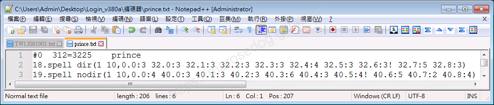

    * 圖片張數 = `10`

    * `18.spell dir`時間總合 = `3 + 3 + 3 + 3 + 3 + 4 + 3 + 3 + 5 + 3 = 33`

    * `19.spell nodir`時間總合 = `4 + 3 + 3 + 3 + 6 + 3 + 4 + 5 + 2 + 4 = 37`

  * <font color="blue">**人形殭屍#52**</font>：
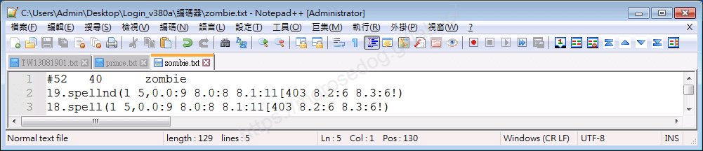

    * 圖片張數 = `5`

    * `18.spell dir`時間總合 = `9 + 8 + 11 + 6 + 6 = 40`

    * `19.spell nodir`時間總合 = `9 + 8 + 11 + 6 + 6 = 40`

  * <font color="blue">**狼人#1110**</font>：
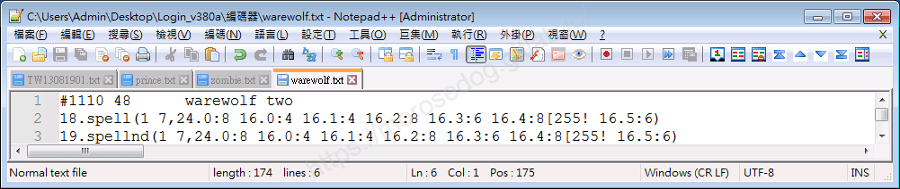

    * 圖片張數 = `7`

    * `18.spell dir`時間總合 = `8 + 4 + 4 + 8 + 6 + 8 + 6 = 44`

    * `19.spell nodir`時間總合 = `8 + 4 + 4 + 8 + 6 + 8 + 6 = 44`

  * <font color="blue">**活鎧甲#1578**</font>：
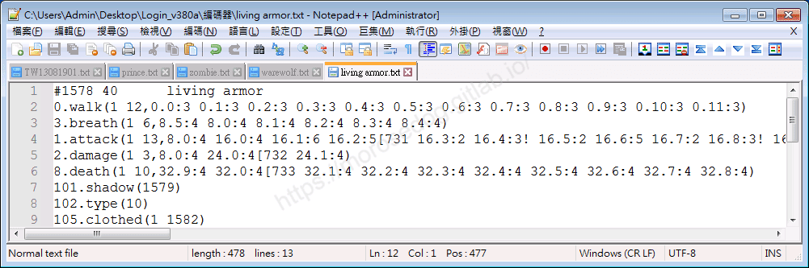

    * 沒有`18.spell dir`、`19.spell nodir`。

    * 時間總合 = 技能的施放會受到技能的冷卻時間限制。

    * 施法動作 = 空手走路動作的第`0.0`張圖。(叉開雙腿)

## 實驗修改

* 以下使用<font color="blue">**王子#0**</font>，實驗修改。

```plain
18.spell dir(1 10,0.0:3 32.0:3 32.1:3 32.2:3 32.3:3 32.4:4 32.5:3 32.6:3! 32.7:5 32.8:3)
19.spell nodir(1 10,0.0:4 40.0:3 40.1:3 40.2:3 40.3:6 40.4:3 40.5:4! 40.6:5 40.7:2 40.8:4)
```

* 移除`18.spell dir`與`19.spell nodir`：

  * 移除後，技能的施放會受到技能的冷卻時間限制，而動作會為空手走路的第`0.0`張圖。(叉開雙腿)

    * `攻擊魔法` = 正常施放，`0.0`圖(叉開雙腿)，冷卻受限。

    * `輔助魔法` = 正常施放，`0.0`圖(叉開雙腿)，冷卻受限。
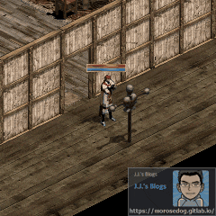 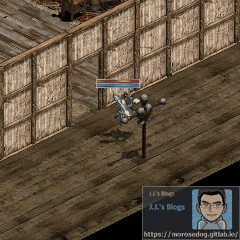
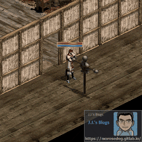 

> 註：這邊使用活鎧甲，比照移除這兩個編碼動作內容後的施法動作和冷卻時間是一樣的。 ​‌‌‌​​​​​‌‌‌​​‌​​‌‌​‌​​‌​‌‌‌​‌‌​​‌‌​​​​‌​‌‌‌​‌​​​‌‌​​‌​‌​​‌​‌‌​‌​‌‌​‌‌​​​‌‌​‌​​‌​‌‌​‌‌‌​​‌‌​​‌​‌​‌‌​​​​‌​‌‌​​‌‌‌​‌‌​​‌​‌​​‌​‌‌​‌​​‌‌​​‌​​​‌‌​​​​​​‌‌​​‌​​​‌‌​​‌​​​‌‌​​​​​​‌‌​‌​‌​​‌‌​​‌​​​‌‌​‌‌‌​​‌​‌‌​‌​‌‌‌​​​​​‌‌‌​​‌​​‌‌​‌​​‌​‌‌‌​‌‌​​‌‌​​​​‌​‌‌‌​‌​​​‌‌​​‌​‌​​‌​‌‌​‌​‌‌​‌‌​​​‌‌​‌​​‌​‌‌​‌‌‌​​‌‌​​‌​‌​‌‌​​​​‌​‌‌​​‌‌‌​‌‌​​‌​‌​​‌​‌‌​‌​​‌‌​​​‌​​‌‌​​‌​​​‌‌​​‌​

* 改變圖片張數：

  * 分別為`0`、`1`、`2`、`3`、時間總合都維持原來的`33`與`37`。

    * `0` `攻擊魔法` = 遊戲崩潰。

    * `0` `輔助魔法` = 遊戲崩潰。

    * `1` `攻擊魔法` = 正常施放，`0.0`圖(叉開雙腿)，冷卻受限。

    * `1` `輔助魔法` = 正常施放，`0.0`圖(叉開雙腿)，冷卻受限。

    * `2` `攻擊魔法` = 正常施放，設定的圖號動作，冷卻受限。

    * `2` `輔助魔法` = 正常施放，設定的圖號動作，冷卻受限。

    * `3` `攻擊魔法` = 正常施放，設定的圖號動作，冷卻受限。

    * `3` `輔助魔法` = 正常施放，設定的圖號動作，冷卻受限。

```plain
18.spell dir(1 0)
19.spell nodir(1 0)
	
18.spell dir(1 1,0.0:33!)
19.spell nodir(1 1,0.0:37!)

18.spell dir(1 2,0.0:16 32.8:17!)
19.spell nodir(1 2,0.0:33 40.8:34!)

18.spell dir(1 3,0.0:11 32.3:11 32.8:11!)
19.spell nodir(1 3,0.0:12 40.3:12 40.8:13!)
```

 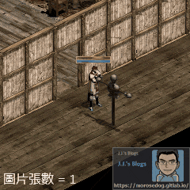
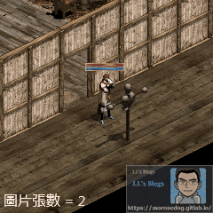 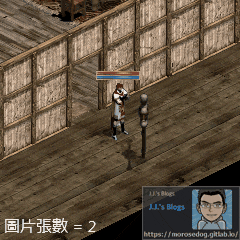
 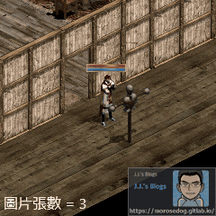

* 改變時間總合：

  * 分別為`20`、`15`、`10`，圖片張數維持原來的`10`。

    * 數字越小，可以觀察到施法速度的加速。

```plain
18.spell dir(1 10,0.0:2 32.0:2 32.1:2 32.2:2 32.3:2 32.4:2 32.5:2 32.6:2! 32.7:2 32.8:2)
19.spell nodir(1 10,0.0:2 40.0:2 40.1:2 40.2:2 40.3:2 40.4:2 40.5:2! 40.6:2 40.7:2 40.8:2)

18.spell dir(1 10,0.0:2 32.0:1 32.1:2 32.2:1 32.3:2 32.4:1 32.5:2 32.6:1! 32.7:2 32.8:1)
19.spell nodir(1 10,0.0:2 40.0:1 40.1:2 40.2:1 40.3:2 40.4:1 40.5:2! 40.6:1 40.7:2 40.8:1)

18.spell dir(1 10,0.0:1 32.0:1 32.1:1 32.2:1 32.3:1 32.4:1 32.5:1 32.6:1! 32.7:1 32.8:1)
19.spell nodir(1 10,0.0:1 40.0:1 40.1:1 40.2:1 40.3:1 40.4:1 40.5:1! 40.6:1 40.7:1 40.8:1)
```

 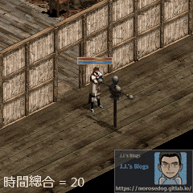
 
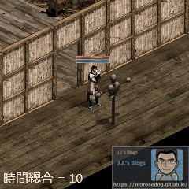 

  * 時間總合修改為`0`，圖片張數 = `1`。

    * 可見施法超快，但是過快，被伺服器的偵測到而傳送特定地圖了。

```plain
18.spell dir(1 1,0.0:0!)
19.spell nodir(1 1,0.0:0!)
```

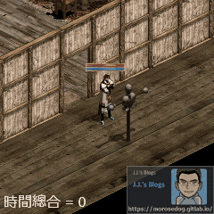 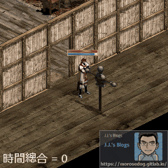

> 註：每個伺服器偵測的基準與演算法請自行研究分析。​‌‌‌​​​​​‌‌‌​​‌​​‌‌​‌​​‌​‌‌‌​‌‌​​‌‌​​​​‌​‌‌‌​‌​​​‌‌​​‌​‌​​‌​‌‌​‌​‌‌​‌‌​​​‌‌​‌​​‌​‌‌​‌‌‌​​‌‌​​‌​‌​‌‌​​​​‌​‌‌​​‌‌‌​‌‌​​‌​‌​​‌​‌‌​‌​​‌‌​​‌​​​‌‌​​​​​​‌‌​​‌​​​‌‌​​‌​​​‌‌​​​​​​‌‌​‌​‌​​‌‌​​‌​​​‌‌​‌‌‌​​‌​‌‌​‌​‌‌‌​​​​​‌‌‌​​‌​​‌‌​‌​​‌​‌‌‌​‌‌​​‌‌​​​​‌​‌‌‌​‌​​​‌‌​​‌​‌​​‌​‌‌​‌​‌‌​‌‌​​​‌‌​‌​​‌​‌‌​‌‌‌​​‌‌​​‌​‌​‌‌​​​​‌​‌‌​​‌‌‌​‌‌​​‌​‌​​‌​‌‌​‌​​‌‌​​​‌​​‌‌​​‌​​​‌‌​​‌​

## 施法無動作修改

* 以下使用<font color="blue">**王子#0**</font>，<font color="red">**施法無動作**</font>修改。

  * 為何需要施法無動作修改？因為可以達到，<font color="red">幾乎無動作</font>的效果，在走位連續施放魔法時較快。

* 修改編碼內容：

  * 第一種方式，移除`18.spell dir`與`19.spell nodir`。

  * 第二種方式，`18.spell dir`與`19.spell nodir`的圖片張數改為`1`，時間總和保持不變。

> 註：建議使用第二種方式。

* 施法無動作問題：

  * 為何使用圖片張數為`1`時間總合保持不變？

    * 因為可以保持本身角色的一個施放需要的冷卻時間。如果使用移除的方式，會發現他的冷卻時間變快了。

  * 為何移除`18.spell dir`與`19.spell nodir`後，是執行空手走路的第`0.0`張圖？

    * 只要沒有的編碼動作，全部預設跳 `0.0:1`，這是`BIN`綁住的機制。

> 此問題的解答說明由<font color="red">`Lineage:Rise (討論交流學習)`</font>的成員”<font color="blue"><u>Achilles</u></font>“成員提供的資訊，**非常感謝**。

  * 是否可以做到<font color="red">完全無動作</font>，連**叉開雙腿**的動作都不要了？

    * 其實可以將`0.0`改變成`8.0`，這張圖為站著不動的呼吸圖。
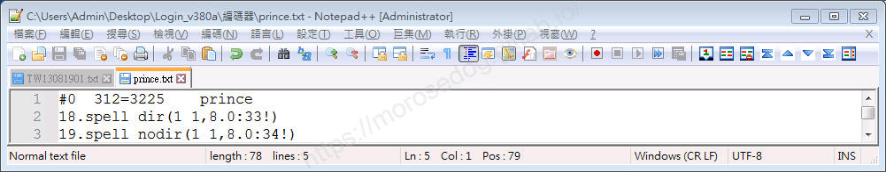
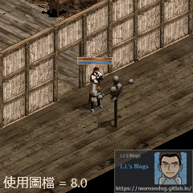 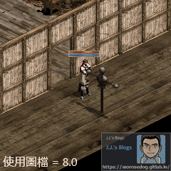

## 施法無動作 + 殘影修改

* 以下使用<font color="blue">**王子#0**</font>，<font color="red">**施法無動作**</font> + <font color="red">**殘影**</font>修改。
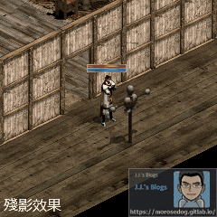 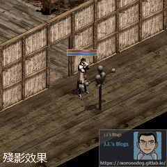

* 相關的修改教學與說明，可以參考[變身檔-攻擊分析與修改](./121_變身檔-攻擊分析與修改.md)裡面的[殘影修改](./121_變身檔-攻擊分析與修改.md#殘影修改-v3)。

* 修改編碼內容：
  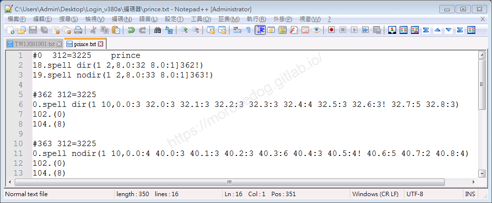

## 結論

* 針對`18.spell dir`攻擊魔法與`19.spell nodir`輔助魔法 - 

  * 最少需要`1`幾張圖。

  * 建議保持原本的時間總合，避免冷卻時間被加速了。

  * 時間總合基於伺服器的偵測，而判斷可減少多少，不然很容易回碩、偵測、退回。

## 結語

原創文章真的不易，希望多多支持，感謝。
最後建議回顧一下首章[天堂私服 | 天堂私服架設教學](/private-lineage-20210712-private-lineage-0/#教學章節)，了解其章節目錄。​‌‌‌​​​​​‌‌‌​​‌​​‌‌​‌​​‌​‌‌‌​‌‌​​‌‌​​​​‌​‌‌‌​‌​​​‌‌​​‌​‌​​‌​‌‌​‌​‌‌​‌‌​​​‌‌​‌​​‌​‌‌​‌‌‌​​‌‌​​‌​‌​‌‌​​​​‌​‌‌​​‌‌‌​‌‌​​‌​‌​​‌​‌‌​‌​​‌‌​​‌​​​‌‌​​​​​​‌‌​​‌​​​‌‌​​‌​​​‌‌​​​​​​‌‌​‌​‌​​‌‌​​‌​​​‌‌​‌‌‌​​‌​‌‌​‌​‌‌‌​​​​​‌‌‌​​‌​​‌‌​‌​​‌​‌‌‌​‌‌​​‌‌​​​​‌​‌‌‌​‌​​​‌‌​​‌​‌​​‌​‌‌​‌​‌‌​‌‌​​​‌‌​‌​​‌​‌‌​‌‌‌​​‌‌​​‌​‌​‌‌​​​​‌​‌‌​​‌‌‌​‌‌​​‌​‌​​‌​‌‌​‌​​‌‌​​​‌​​‌‌​​‌​​​‌‌​​‌​

## 免責聲明

* 本部落格文章中皆<font color="red"><u>**不提供**</u></font>任何所謂的遊戲「主程式」、「模擬器」、「登入器」…等等相關程式的下載點。

* 本部落格文章中所見之遊戲主程式和服務器端程序均來自網路發佈，<font color="red"><u>版本歸**原作者**</u>所有</font>。

* 本部落格文章為研究SQL資料庫與修改JAVA語法使用，<font color="red">並<u>**非商業用途**</u>，亦<u>**無做營運事實等任何一切商業行為**</u>。</font>

* 本部落格文章內容是為研究學習設計思想和原理為目的，<font color="red"><u>**絕沒有故意侵權或惡意抄襲、篡改其他遊戲內容**</u></font>！

> 註：以上參考了
> [Linhelper論壇 - [教學] [彙整]List.spr變身檔網路教學彙整](https://bbs.linhelper.com/forum.php?mod=viewthread&tid=1301)

---

- **原文連結**：[J.J.'s Blogs - 變身檔-施法分析與修改](https://morosedog.gitlab.io/private-lineage-20220527-private-lineage-122/)
