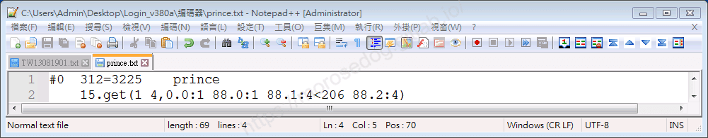
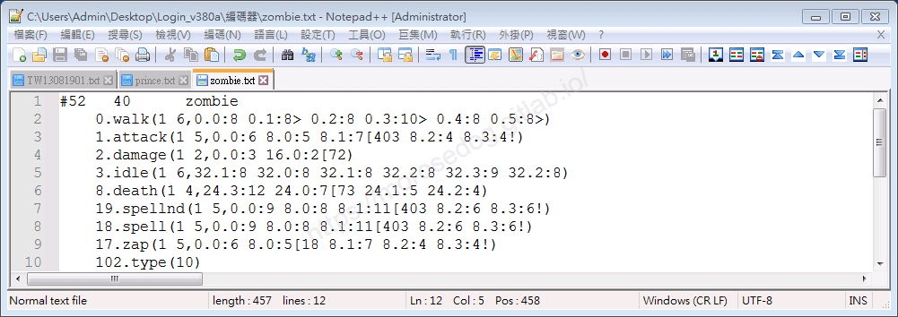
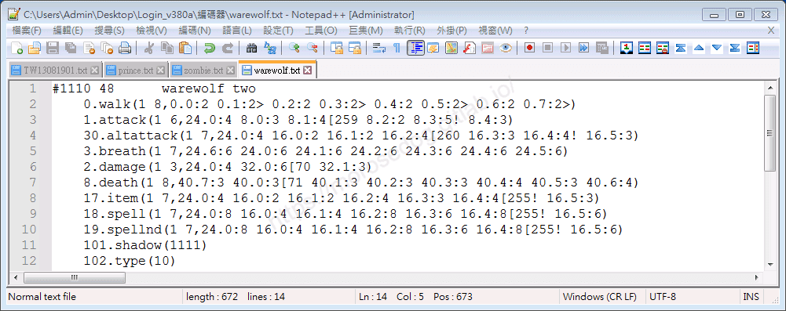
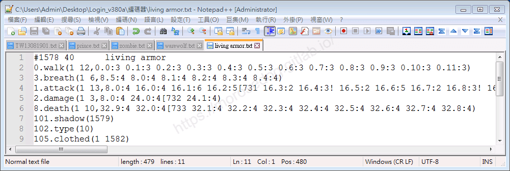
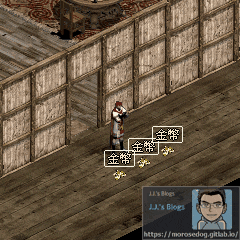
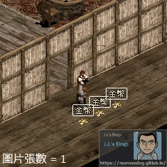
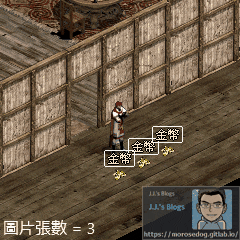
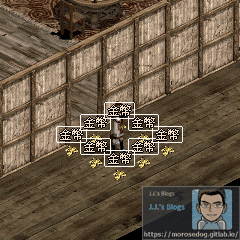
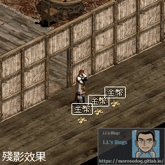
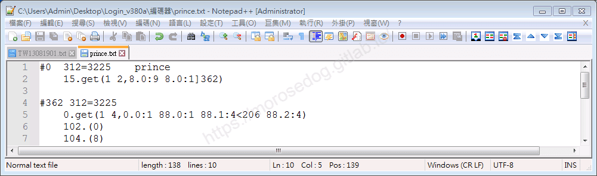

# 變身檔-撿取分析與修改

# 天堂私服 | 變身檔-撿取分析與修改

    
    
      📑 目錄
      

1. [章節用意](#章節用意)
2. [版本資訊](#版本資訊)
3. [前言](#前言)
4. [分析](#分析)
5. [實驗修改](#實驗修改)
6. [撿取無動作](#撿取無動作)
7. [撿取無動作 + 殘影修改](#撿取無動作-殘影修改)
8. [結論](#結論)
9. [結語](#結語)
10. [免責聲明](#免責聲明)

    
    
    

## 章節用意

此章將會針對變身檔中的`15.get`撿取動作，進行分析與修改，進而瞭解其特性與限制。

## 版本資訊

* **客戶端版本**

  * 天堂(Lineage 3.81C)

* **核心版本**

  * L1J-3.80c

* **登入器版本**  

  * L1J-3.80c

## 前言

在開始前，請務必先將以下文章閱讀與實際操作過。

* [變身檔新增修改<快速入門>](./103_變身檔新增修改&lt;快速入門&gt;.md)

* [客戶端、登入器與變身檔關係分析](./106_客戶端和登入器與變身檔關係分析.md)

* [變身檔-初步說明與規則](./112_變身檔-初步說明與規則.md)

* [變身檔-格式與編碼基礎](./113_變身檔-格式與編碼基礎.md)

## 分析

* 圖片張數數量分析<根據`TW13081901.txt`>：

  * 有向性：

```java
// 動作編碼   = 共有幾個編號使用 → 說明

15.get(1 0)  = 0             → 無，理論上不可能沒有圖片。
15.get(1 3)  = 6             → 使用了3張圖，例：葛林、英國勳爵NPC..等等。
15.get(1 4)  = 261           → 使用了4張圖，例：王子、公主、女妖精、女騎士..等等。
15.get(1 6)  = 7             → 使用了6張圖，例：女黑暗妖精、..等等。
...剩餘自行搜尋...
```

  * 無向性：

```java
// 動作編碼   = 共有幾個編號使用 → 說明

沒有無向性撿取動作...
```

> 註：以上僅自己透過分析變身檔整理出來的資訊，並不表示就是最正確與完整。​‌‌‌​​​​​‌‌‌​​‌​​‌‌​‌​​‌​‌‌‌​‌‌​​‌‌​​​​‌​‌‌‌​‌​​​‌‌​​‌​‌​​‌​‌‌​‌​‌‌​‌‌​​​‌‌​‌​​‌​‌‌​‌‌‌​​‌‌​​‌​‌​‌‌​​​​‌​‌‌​​‌‌‌​‌‌​​‌​‌​​‌​‌‌​‌​​‌‌​​‌​​​‌‌​​​​​​‌‌​​‌​​​‌‌​​‌​​​‌‌​​​​​​‌‌​‌​‌​​‌‌​​‌​​​‌‌‌​​‌​​‌​‌‌​‌​‌‌‌​​​​​‌‌‌​​‌​​‌‌​‌​​‌​‌‌‌​‌‌​​‌‌​​​​‌​‌‌‌​‌​​​‌‌​​‌​‌​​‌​‌‌​‌​‌‌​‌‌​​​‌‌​‌​​‌​‌‌​‌‌‌​​‌‌​​‌​‌​‌‌​​​​‌​‌‌​​‌‌‌​‌‌​​‌​‌​​‌​‌‌​‌​​‌‌​​​‌​​‌‌​​‌​​​‌‌​‌​​

---

* 以下盡量提供各個`15.get`的範例：

  * <font color="blue">**王子#0**</font>：


    * 圖片張數 = `4`

    * 時間總合 = `1 + 1 + 4 + 4 = 10`

  * <font color="blue">**人形殭屍#52**</font>：


    * 沒有`15.get`。

    * 時間總合 = 基本上為`1`。

    * 撿取動作 = 空手走路動作的第`0.0`張圖。(叉開雙腿)

  * <font color="blue">**狼人#1110**</font>：


    * 沒有`15.get`。

    * 時間總合 = 基本上為`1`。

    * 撿取動作 = 空手走路動作的第`0.0`張圖。(叉開雙腿)

  * <font color="blue">**活鎧甲#1578**</font>：


    * 沒有`15.get`。

    * 時間總合 = 基本上為`1`。

    * 撿取動作 = 空手走路動作的第`0.0`張圖。(叉開雙腿)

## 實驗修改

* 以下使用<font color="blue">**王子#0**</font>，實驗修改。

```plain
15.get(1 4,0.0:1 88.0:1 88.1:4<206 88.2:4)
```

* 移除`15.get：

  * 移除後，撿取動作會為空手走路的第`0.0`張圖。(叉開雙腿)


* 改變圖片張數：​‌‌‌​​​​​‌‌‌​​‌​​‌‌​‌​​‌​‌‌‌​‌‌​​‌‌​​​​‌​‌‌‌​‌​​​‌‌​​‌​‌​​‌​‌‌​‌​‌‌​‌‌​​​‌‌​‌​​‌​‌‌​‌‌‌​​‌‌​​‌​‌​‌‌​​​​‌​‌‌​​‌‌‌​‌‌​​‌​‌​​‌​‌‌​‌​​‌‌​​‌​​​‌‌​​​​​​‌‌​​‌​​​‌‌​​‌​​​‌‌​​​​​​‌‌​‌​‌​​‌‌​​‌​​​‌‌‌​​‌​​‌​‌‌​‌​‌‌‌​​​​​‌‌‌​​‌​​‌‌​‌​​‌​‌‌‌​‌‌​​‌‌​​​​‌​‌‌‌​‌​​​‌‌​​‌​‌​​‌​‌‌​‌​‌‌​‌‌​​​‌‌​‌​​‌​‌‌​‌‌‌​​‌‌​​‌​‌​‌‌​​​​‌​‌‌​​‌‌‌​‌‌​​‌​‌​​‌​‌‌​‌​​‌‌​​​‌​​‌‌​​‌​​​‌‌​‌​​

  * 分別為`0`、`1`、`2`、`3`、時間總合都維持原來的`10`。

    * `0` = 撿取就遊戲崩潰。

    * `1` = 人物有撿取打動作。

    * `2` = 人物有撿取打動作以及撿取聲音。

    * `3` = 人物有撿取打動作以及撿取聲音。

```plain
15.get(1 0)
15.get(1 1,0.0:10)
15.get(1 2,0.0:5 88.1:5<206)
15.get(1 3,0.0:3 88.0:3 88.1:4<206)
```

 


* 改變時間總合：

  * 分別為`8`、`4`，圖片張數維持原來的`4`。

    * 數字越小，可以觀察到撿取的速度感覺上是越來越快。

```plain
15.get(1 4,0.0:1 88.0:1 88.1:3<206 88.2:3)
15.get(1 4,0.0:1 88.0:1 88.1:1<206 88.2:1)
```

 

  * 時間總合修改為`0`，圖片張數`1`。

    * 撿取的速度貌似沒有顯著的提升。

```plain
15.get(1 1,0.0:0<206)
```

## 撿取無動作

* 以下使用<font color="blue">**王子#0**</font>，<font color="red">**撿取無動作**</font>修改。

  * 為何需要撿取無動作修改？因為可以達到，<font color="red">幾乎無動作</font>的效果，在撿取物品 + 走位時比較不會受到影響。

* 修改編碼內容：

  * 第一種方式，移除`15.get`。

  * 第二種方式，`15.get`的圖片張數改為`1`，時間總和保持不變。


> 註：使用第一種方式即可。

## 撿取無動作 + 殘影修改

* 以下使用<font color="blue">**王子#0**</font>，<font color="red">**撿取無動作**</font> + <font color="red">**殘影**</font>修改。


* 相關的修改教學與說明，可以參考[變身檔-攻擊分析與修改](./121_變身檔-攻擊分析與修改.md)裡面的[殘影修改](./121_變身檔-攻擊分析與修改.md#殘影修改-v3)。

* 修改編碼內容：
  

## 結論

* 針對`15.get`檢取動作 - 

  * 最少需要`1`幾張圖，或是完整移除動作編碼。

  * 圖片張數建議兩張，由第二張觸發人物撿取動作與聲音。

## 結語

原創文章真的不易，希望多多支持，感謝。
最後建議回顧一下首章[天堂私服 | 天堂私服架設教學](/private-lineage-20210712-private-lineage-0/#教學章節)，了解其章節目錄。​‌‌‌​​​​​‌‌‌​​‌​​‌‌​‌​​‌​‌‌‌​‌‌​​‌‌​​​​‌​‌‌‌​‌​​​‌‌​​‌​‌​​‌​‌‌​‌​‌‌​‌‌​​​‌‌​‌​​‌​‌‌​‌‌‌​​‌‌​​‌​‌​‌‌​​​​‌​‌‌​​‌‌‌​‌‌​​‌​‌​​‌​‌‌​‌​​‌‌​​‌​​​‌‌​​​​​​‌‌​​‌​​​‌‌​​‌​​​‌‌​​​​​​‌‌​‌​‌​​‌‌​​‌​​​‌‌‌​​‌​​‌​‌‌​‌​‌‌‌​​​​​‌‌‌​​‌​​‌‌​‌​​‌​‌‌‌​‌‌​​‌‌​​​​‌​‌‌‌​‌​​​‌‌​​‌​‌​​‌​‌‌​‌​‌‌​‌‌​​​‌‌​‌​​‌​‌‌​‌‌‌​​‌‌​​‌​‌​‌‌​​​​‌​‌‌​​‌‌‌​‌‌​​‌​‌​​‌​‌‌​‌​​‌‌​​​‌​​‌‌​​‌​​​‌‌​‌​​

## 免責聲明

* 本部落格文章中皆<font color="red"><u>**不提供**</u></font>任何所謂的遊戲「主程式」、「模擬器」、「登入器」…等等相關程式的下載點。

* 本部落格文章中所見之遊戲主程式和服務器端程序均來自網路發佈，<font color="red"><u>版本歸**原作者**</u>所有</font>。

* 本部落格文章為研究SQL資料庫與修改JAVA語法使用，<font color="red">並<u>**非商業用途**</u>，亦<u>**無做營運事實等任何一切商業行為**</u>。</font>

* 本部落格文章內容是為研究學習設計思想和原理為目的，<font color="red"><u>**絕沒有故意侵權或惡意抄襲、篡改其他遊戲內容**</u></font>！

> 註：以上參考了
> [Linhelper論壇 - [教學] [彙整]List.spr變身檔網路教學彙整](https://bbs.linhelper.com/forum.php?mod=viewthread&tid=1301)

---

- **原文連結**：[J.J.'s Blogs - 變身檔-撿取分析與修改](https://morosedog.gitlab.io/private-lineage-20220529-private-lineage-124/)
