# 變身檔-指向指令分析與修改

# 天堂私服 | 變身檔-指向指令分析與修改

    
    
      📑 目錄
      

1. [章節用意](#章節用意)
2. [版本資訊](#版本資訊)
3. [前言](#前言)
4. [分析](#分析)
5. [實驗修改](#實驗修改)
6. [怪死消失](#怪死消失)
7. [結論](#結論)
8. [結語](#結語)
9. [免責聲明](#免責聲明)

    
    
    

## 章節用意

此章將會針對變身檔中的**指向指令**，進行分析與修改，進而瞭解其特性與限制。

## 版本資訊

* **客戶端版本**

  * 天堂(Lineage 3.81C)

* **核心版本**

  * L1J-3.80c

* **登入器版本**  

  * L1J-3.80c

## 前言

在開始前，請務必先將以下文章閱讀與實際操作過。

* [變身檔新增修改<快速入門>](./103_變身檔新增修改&lt;快速入門&gt;.md)

* [客戶端、登入器與變身檔關係分析](./106_客戶端和登入器與變身檔關係分析.md)

* [變身檔-初步說明與規則](./112_變身檔-初步說明與規則.md)

* [變身檔-格式與編碼基礎](./113_變身檔-格式與編碼基礎.md)

## 分析

* 分析<根據`TW13081901.txt`>：

  * 注意到在`#786`變檔編號裡面的”動作編碼”，有使用到`8=784`的方式(下圖第`18`行)，這就是指向指令的用法。
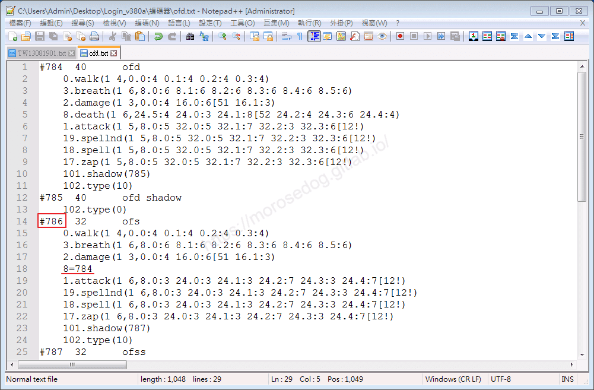

  * 編碼內容說明：

    * 透過資料庫查詢<font color="blue">**#784**</font>是`甘地妖魔、羅孚妖魔`使用的編號、<font color="blue">**#786**</font>為`阿吐巴妖魔`使用的編號。
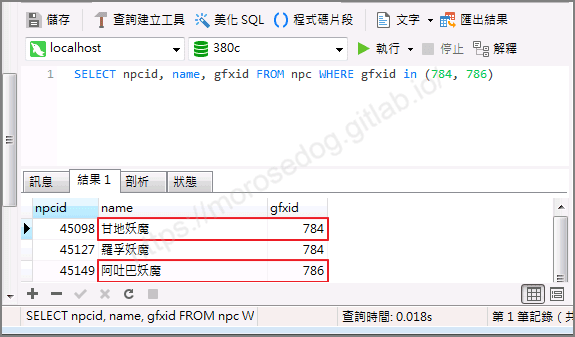

    * 編碼解析：
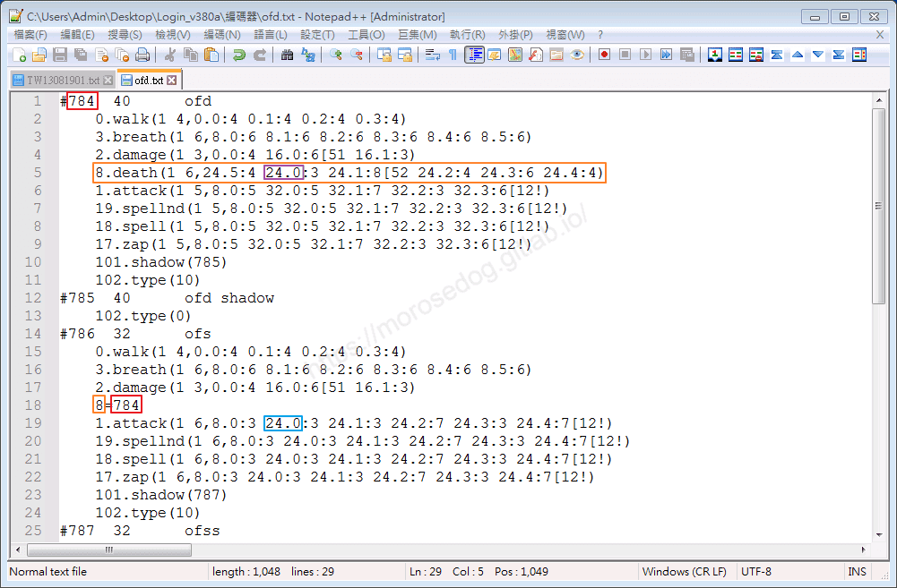

      * `#784`的`8.death`(死亡動作)，有定義使用的<u>**圖片張數**</u>、<u>**圖片編號**</u>和<u>**時間總合**</u>的完整動作編碼(橘色框)。

      * `#786`的第`18`行，使用`8=784`，下方做解釋。

        * `8` = `8.death`

        * `784` = 變身編號`#784`。(注意不是定義圖檔編號)

      * 紫色框是表示`#784`的**死亡動作**，呼叫的其中一張圖是`784-24-000.bmp`圖片。
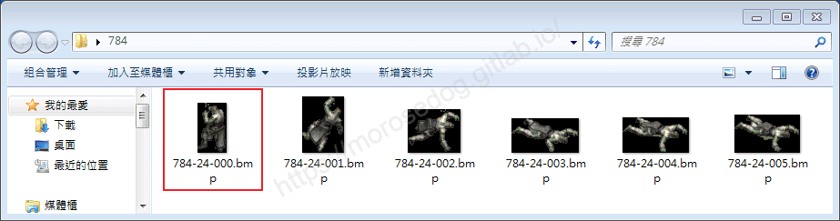

      * 藍色框是表示`#786`的**攻擊動作**，呼叫的其中一張圖是`786-24-000.bmp`圖片。
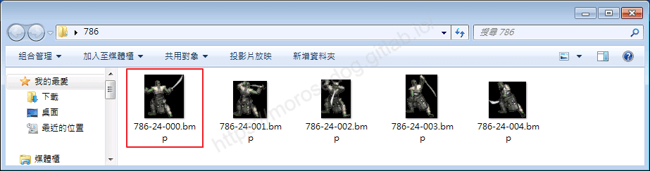

> 註：為何要特別說明這兩個圖？因為他都是第24的圖檔，但是一個是給攻擊的一個是給死亡的，所以阿吐巴妖魔使用指向指令後，呼叫的圖檔就不會是原本的`786-24-000.bmp`圖，而是會去參考呼叫`784-24-000.bmp`。​‌‌‌​​​​​‌‌‌​​‌​​‌‌​‌​​‌​‌‌‌​‌‌​​‌‌​​​​‌​‌‌‌​‌​​​‌‌​​‌​‌​​‌​‌‌​‌​‌‌​‌‌​​​‌‌​‌​​‌​‌‌​‌‌‌​​‌‌​​‌​‌​‌‌​​​​‌​‌‌​​‌‌‌​‌‌​​‌​‌​​‌​‌‌​‌​​‌‌​​‌​​​‌‌​​​​​​‌‌​​‌​​​‌‌​​‌​​​‌‌​​​​​​‌‌​‌​‌​​‌‌​​‌‌​​‌‌​​​​​​‌​‌‌​‌​‌‌‌​​​​​‌‌‌​​‌​​‌‌​‌​​‌​‌‌‌​‌‌​​‌‌​​​​‌​‌‌‌​‌​​​‌‌​​‌​‌​​‌​‌‌​‌​‌‌​‌‌​​​‌‌​‌​​‌​‌‌​‌‌‌​​‌‌​​‌​‌​‌‌​​​​‌​‌‌​​‌‌‌​‌‌​​‌​‌​​‌​‌‌​‌​​‌‌​​​‌​​‌‌​​‌​​​‌‌​‌​‌

    * 指向指令說明：

      * 透過上方的解析可以知道，動作編碼，可以透過指向方式去執行別的變身編號內的變身編碼內容。

      * 白話說法：<font color="blue">**#786**</font>阿吐巴妖魔的死亡動作，直接使用<font color="blue">**#784**</font>甘地妖魔的死亡動作編碼內容+圖檔。

## 實驗修改

* 使用<font color="blue">**王子#0**</font>，實驗修改。

```plain
8.death(1 12,96.11:4 96.0:4 96.1:4[1536 96.2:4 96.3:4 96.4:4 96.5:4 96.6:4 96.7:4 96.8:4 96.9:4 96.10:4)
```

  * 使用指向指令，指定到<font color="red">**後面**</font>的<font color="blue">**公主#1**</font>變身編碼。

  * 希望王子死亡的動畫，變成公主的死亡動畫。

```plain
#0 312=3225	prince
      8=1
```

  * 測試王子死亡後，遊戲直接崩潰。
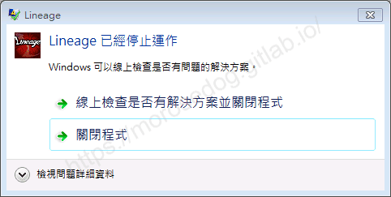

* 接著反過來使用<font color="blue">**公主#1**</font>，實驗修改。

```plain
8.death(1 12,96.11:4 96.0:4 96.1:4[1545 96.2:4 96.3:4 96.4:4 96.5:4 96.6:4 96.7:4 96.8:4 96.9:4 96.10:4)
```

  * 使用指向指令，指定到<font color="orange">**前面**</font>的<font color="blue">**王子#0**</font>變身編碼。

  * 希望公主死亡的動畫，變成的王子死亡動畫。

```plain
#1 312=3227	princess
      8=0
```

  * 測試死亡後，正常顯示為王子的死亡動畫。
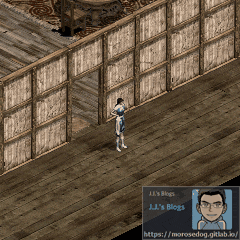

> 註：所以指向指令所指定的變身編號，必須要小於自己的變身編號。​‌‌‌​​​​​‌‌‌​​‌​​‌‌​‌​​‌​‌‌‌​‌‌​​‌‌​​​​‌​‌‌‌​‌​​​‌‌​​‌​‌​​‌​‌‌​‌​‌‌​‌‌​​​‌‌​‌​​‌​‌‌​‌‌‌​​‌‌​​‌​‌​‌‌​​​​‌​‌‌​​‌‌‌​‌‌​​‌​‌​​‌​‌‌​‌​​‌‌​​‌​​​‌‌​​​​​​‌‌​​‌​​​‌‌​​‌​​​‌‌​​​​​​‌‌​‌​‌​​‌‌​​‌‌​​‌‌​​​​​​‌​‌‌​‌​‌‌‌​​​​​‌‌‌​​‌​​‌‌​‌​​‌​‌‌‌​‌‌​​‌‌​​​​‌​‌‌‌​‌​​​‌‌​​‌​‌​​‌​‌‌​‌​‌‌​‌‌​​​‌‌​‌​​‌​‌‌​‌‌‌​​‌‌​​‌​‌​‌‌​​​​‌​‌‌​​‌‌‌​‌‌​​‌​‌​​‌​‌‌​‌​​‌‌​​​‌​​‌‌​​‌​​​‌‌​‌​‌

* 是否可以透用其他的動作編碼？例如攻擊、走路？

* 主要使用<font color="blue">**公主#1**</font>，實驗修改。

  * `王子#0`的空手攻擊動作編碼

```plain
1.attack(1 7,0.0:0 16.0:3 16.1:3 16.2:3 16.3:5[1539 16.4:2! 16.5:4)
```

    * 圖片張數 = `7`

    * 時間總合 = `0 + 3 + 3 + 3 + 5 + 2 + 4 = 20`

  * `公主#1`的空手攻擊動作編碼

```plain
1.attack(1 8,0.0:0 16.0:2 16.1:3 16.2:5 16.3:3 16.4:2[246 16.5:2! 16.6:3)
```

    * 圖片張數 = `8`

    * 時間總合 = `0 + 2 + 3 + 5 + 3 + 2 + 2 + 3 = 20`

  * 修改公主的空手攻擊，指向到王子的空手攻擊。

```plain
#1 312=3227	princess
      1=0
```

  * 測試空手攻擊，正常顯示為王子的攻擊動畫。
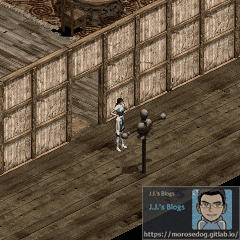

* 加碼使用<font color="blue">**活鎧甲#1578**</font>，實驗修改。​‌‌‌​​​​​‌‌‌​​‌​​‌‌​‌​​‌​‌‌‌​‌‌​​‌‌​​​​‌​‌‌‌​‌​​​‌‌​​‌​‌​​‌​‌‌​‌​‌‌​‌‌​​​‌‌​‌​​‌​‌‌​‌‌‌​​‌‌​​‌​‌​‌‌​​​​‌​‌‌​​‌‌‌​‌‌​​‌​‌​​‌​‌‌​‌​​‌‌​​‌​​​‌‌​​​​​​‌‌​​‌​​​‌‌​​‌​​​‌‌​​​​​​‌‌​‌​‌​​‌‌​​‌‌​​‌‌​​​​​​‌​‌‌​‌​‌‌‌​​​​​‌‌‌​​‌​​‌‌​‌​​‌​‌‌‌​‌‌​​‌‌​​​​‌​‌‌‌​‌​​​‌‌​​‌​‌​​‌​‌‌​‌​‌‌​‌‌​​​‌‌​‌​​‌​‌‌​‌‌‌​​‌‌​​‌​‌​‌‌​​​​‌​‌‌​​‌‌‌​‌‌​​‌​‌​​‌​‌‌​‌​​‌‌​​​‌​​‌‌​​‌​​​‌‌​‌​‌

```plain
1.attack(1 13,8.0:4 16.0:4 16.1:6 16.2:5[731 16.3:2 16.4:3! 16.5:2 16.6:5 16.7:2 16.8:3! 16.9:4 16.10:4 16.11:4)
```

  * 圖片張數 = `13`

  * 時間總合 = `4 + 4 + 6 + 5 + 2 + 3 + 2 + 5 + 2 + 3 + 4 + 4 + 4 = 48`

    * 修改活鎧甲的空手攻擊，指向到王子的空手攻擊。

```plain
#1578 40 living armor
      1=0
```

    * 測試空手攻擊，正常顯示為王子的攻擊動畫。
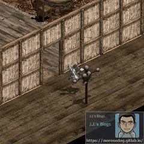 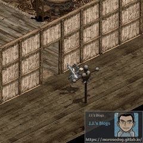

    * 但！可以看到原本活鎧甲攻擊速度是比較慢的，但是指向王子的攻擊後，攻擊速度提升了，那是因為時間總合變短了。

    * 這樣可能會被伺服器的偵測到而傳送特定地圖了。

> 註：每個伺服器偵測的基準與演算法請自行研究分析。

## 怪死消失

* 依照指向指令的特性，可以利用這個將死亡的動作變成使用火炎蛋的圖檔。

* 此使用`362`這個空變身編號，來新增怪死消失的死亡效果。

```plain
#362  40=1820 fire egg death
	8.death(1 1,32.10:0) 
	102.type(10) 
	104.attr(8)
```

* 設定<font color="blue">**狼人#1110**</font>的死亡指向到`362`。

```plain
#1110 48      warewolf two
      8=362
```

  * 測試狼人怪物死亡後的效果。
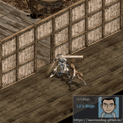

> 註：不只應用在怪死消失，還有火窟除除霧除火…等等。

## 結論

* 針對指向指令 - 

  * 指向的指令變身號碼，必須小於自身的變身編號。

> 註：其實可以透過其他變身編號去解決這問題；請自行思考嘗試看看。​‌‌‌​​​​​‌‌‌​​‌​​‌‌​‌​​‌​‌‌‌​‌‌​​‌‌​​​​‌​‌‌‌​‌​​​‌‌​​‌​‌​​‌​‌‌​‌​‌‌​‌‌​​​‌‌​‌​​‌​‌‌​‌‌‌​​‌‌​​‌​‌​‌‌​​​​‌​‌‌​​‌‌‌​‌‌​​‌​‌​​‌​‌‌​‌​​‌‌​​‌​​​‌‌​​​​​​‌‌​​‌​​​‌‌​​‌​​​‌‌​​​​​​‌‌​‌​‌​​‌‌​​‌‌​​‌‌​​​​​​‌​‌‌​‌​‌‌‌​​​​​‌‌‌​​‌​​‌‌​‌​​‌​‌‌‌​‌‌​​‌‌​​​​‌​‌‌‌​‌​​​‌‌​​‌​‌​​‌​‌‌​‌​‌‌​‌‌​​​‌‌​‌​​‌​‌‌​‌‌‌​​‌‌​​‌​‌​‌‌​​​​‌​‌‌​​‌‌‌​‌‌​​‌​‌​​‌​‌‌​‌​​‌‌​​​‌​​‌‌​​‌​​​‌‌​‌​‌

  * 指向指令後，所讀取的圖檔為指向的變身編號的號碼為主要號碼。

  * 指向指令可以指向其他的變身編號，不限於死亡、攻擊…其他的自己試驗看看。

## 結語

原創文章真的不易，希望多多支持，感謝。
最後建議回顧一下首章[天堂私服 | 天堂私服架設教學](/private-lineage-20210712-private-lineage-0/#教學章節)，了解其章節目錄。

## 免責聲明

* 本部落格文章中皆<font color="red"><u>**不提供**</u></font>任何所謂的遊戲「主程式」、「模擬器」、「登入器」…等等相關程式的下載點。

* 本部落格文章中所見之遊戲主程式和服務器端程序均來自網路發佈，<font color="red"><u>版本歸**原作者**</u>所有</font>。

* 本部落格文章為研究SQL資料庫與修改JAVA語法使用，<font color="red">並<u>**非商業用途**</u>，亦<u>**無做營運事實等任何一切商業行為**</u>。</font>

* 本部落格文章內容是為研究學習設計思想和原理為目的，<font color="red"><u>**絕沒有故意侵權或惡意抄襲、篡改其他遊戲內容**</u></font>！

> 註：以上參考了
> [Linhelper論壇 - [教學] [彙整]List.spr變身檔網路教學彙整](https://bbs.linhelper.com/forum.php?mod=viewthread&tid=1301)

---

- **原文連結**：[J.J.'s Blogs - 變身檔-指向指令分析與修改](https://morosedog.gitlab.io/private-lineage-20220530-private-lineage-125/)
